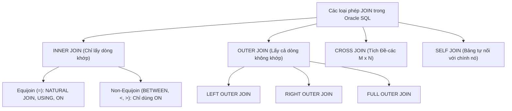

# Chương 7: Truy Vấn Dữ Liệu Từ Nhiều Bảng (Joining Multiple Tables)

> **Mục tiêu chương học (Exam Objectives — OCA 1Z0-071 & OCP Developer):**
> - Làm chủ các loại phép kết nối chuẩn ANSI SQL: `INNER JOIN` (Equijoin & Non-Equijoin), `LEFT OUTER JOIN`, `RIGHT OUTER JOIN`, `FULL OUTER JOIN`, `CROSS JOIN` và `SELF JOIN`.
> - Phân biệt cơ chế kết nối của `NATURAL JOIN`, `JOIN ... USING` và `JOIN ... ON`.
> - Nắm vững bẫy thi kinh điển về cấm dùng Table Qualifier (`table.column` hoặc `alias.column`) đối với cột nằm trong `USING` và `NATURAL JOIN`.
> - Đọc hiểu và chuyển đổi thành thạo cú pháp Oracle Legacy Outer Join `(+)` cùng các giới hạn nghiêm ngặt của toán tử `(+)`.
> - Hiểu sâu sự khác biệt sống còn giữa việc đặt điều kiện lọc ở mệnh đề `ON` so với mệnh đề `WHERE` trong `OUTER JOIN`.
> - Áp dụng kỹ thuật phòng chống nhân bản dữ liệu (Fan Trap / Chasm Trap) khi JOIN nhiều bảng 1-N.

---

## Mục Lục

1. [Tổng quan về Phép Kết Nối (JOIN) trong Cơ sở dữ liệu Quan hệ](#1-tổng-quan-về-phép-kết-nối-join-trong-cơ-sở-dữ-liệu-quan-hệ)
2. [INNER JOIN: Equijoin và Non-Equijoin](#2-inner-join-equijoin-và-non-equijoin)
3. [Các mệnh đề điều kiện kết nối: `NATURAL JOIN`, `USING`, và `ON`](#3-các-mệnh-đề-điều-kiện-kết-nối-natural-join-using-và-on)
4. [OUTER JOIN: `LEFT`, `RIGHT`, `FULL OUTER JOIN` & Bẫy điều kiện `ON` vs `WHERE`](#4-outer-join-left-right-full-outer-join--bẫy-điều-kiện-on-vs-where)
5. [CROSS JOIN (Tích Đề-các) và SELF JOIN (Tự kết nối)](#5-cross-join-tích-đề-các-và-self-join-tự-kết-nối)
6. [Cú pháp Oracle Legacy Join và Toán tử Outer Join `(+)`](#6-cú-pháp-oracle-legacy-join-và-toán-tử-outer-join-)
7. [Kỹ thuật tránh nhân bản dữ liệu (Row Duplication / Fan Trap) khi JOIN nhiều bảng](#7-kỹ-thuật-tránh-nhân-bản-dữ-liệu-row-duplication--fan-trap-khi-join-nhiều-bảng)
8. [Bài tập thực hành tự luyện (Kèm lời giải chi tiết)](#8-bài-tập-thực-hành-tự-luyện-kèm-lời-giải-chi-tiết)
9. [Tổng hợp Bẫy thi OCA/OCP (Exam Essentials)](#9-tổng-hợp-bẫy-thi-ocaocp-exam-essentials)

---

## 1. Tổng quan về Phép Kết Nối (JOIN) trong Cơ sở dữ liệu Quan hệ

Trong cơ sở dữ liệu được chuẩn hóa (Normalized Database), dữ liệu được tách thành nhiều bảng (ví dụ: `EMPLOYEES`, `DEPARTMENTS`, `LOCATIONS`, `JOB_GRADES`) nhằm triệt tiêu sự dư thừa. **JOIN** là phép toán ghép các cột từ hai hay nhiều bảng lại với nhau dựa trên mối quan hệ logic giữa chúng (thường là cặp **Foreign Key — Primary Key**).



### Dữ liệu mẫu dùng xuyên suốt chương học

Để dễ dàng kiểm chứng kết quả của mọi loại JOIN, ta xét 2 bảng nhỏ sau:

**Bảng `EMPS` (4 dòng):**

| EMP_ID | ENAME | DEPT_ID | SALARY |
| :--- | :--- | :--- | :--- |
| `101` | `KING` | `10` | `9000` |
| `102` | `CLARK` | `10` | `5000` |
| `103` | `SCOTT` | `20` | `6000` |
| `104` | `GRANT` | *(NULL)* | `4000` |

**Bảng `DEPTS` (3 dòng):**

| DEPT_ID | DNAME |
| :--- | :--- |
| `10` | `ACCOUNTING` |
| `20` | `RESEARCH` |
| `30` | `SALES` |

*(Nhận xét nhanh: Nhân viên `GRANT` chưa có phòng ban `DEPT_ID IS NULL`; Phòng ban `30 - SALES` chưa có nhân viên nào).*

---

## 2. INNER JOIN: Equijoin và Non-Equijoin

**`INNER JOIN`** (từ khóa `INNER` là tùy chọn, viết `JOIN` không thôi mặc định chính là `INNER JOIN`) chỉ trả về những dòng **thỏa mãn điều kiện kết nối ở cả hai bảng**. Bất kỳ dòng nào có giá trị khóa kết nối bị `NULL` hoặc không tìm thấy dòng đối ứng ở bảng kia đều bị **loại bỏ**.

### 2.1. Equijoin (Kết nối bằng)
Là phép kết nối sử dụng toán tử so sánh bằng (`=`) giữa các cột của hai bảng:
```sql
SELECT e.emp_id, e.ename, d.dept_id, d.dname
FROM emps e
INNER JOIN depts d ON e.dept_id = d.dept_id;
```
**Kết quả (3 dòng — `GRANT` và phòng `30 - SALES` đều bị loại):**

| EMP_ID | ENAME | DEPT_ID | DNAME |
| :--- | :--- | :--- | :--- |
| `101` | `KING` | `10` | `ACCOUNTING` |
| `102` | `CLARK` | `10` | `ACCOUNTING` |
| `103` | `SCOTT` | `20` | `RESEARCH` |

### 2.2. Non-Equijoin (Kết nối không bằng)
Là phép kết nối sử dụng các toán tử khác dấu `=` (như `BETWEEN ... AND ...`, `>=`, `<=`, `<`, `>`). Ví dụ kinh điển trong đề thi OCA là tra cứu bậc lương (`GRADE_LEVEL`) của nhân viên từ bảng `JOB_GRADES(grade_level, lowest_sal, highest_sal)`:

```sql
SELECT e.ename, e.salary, j.grade_level
FROM emps e
JOIN job_grades j
  ON e.salary BETWEEN j.lowest_sal AND j.highest_sal;
```

> [!NOTE]
> Vì `NATURAL JOIN` và `USING` chỉ thực hiện so sánh bằng (`=`) trên các cột cùng tên, nên với **Non-Equijoin**, bạn **bắt buộc phải dùng mệnh đề `ON`** (hoặc `WHERE` trong cú pháp cũ).

---

## 3. Các mệnh đề điều kiện kết nối: `NATURAL JOIN`, `USING`, và `ON`

Chuẩn ANSI SQL:1999 cung cấp 3 cách viết điều kiện kết nối. Đây là phần có **nhiều bẫy cú pháp nhất** trong đề thi OCA 1Z0-071!

### 3.1. `NATURAL JOIN` (Kết nối tự nhiên)
- Tự động tìm **TẤT CẢ các cột có CÙNG TÊN** giữa hai bảng và nối chúng bằng phép so sánh bằng (`=`).
- Nếu hai bảng có 2 cột trùng tên (ví dụ bảng `EMPLOYEES` và `DEPARTMENTS` cùng có cả `DEPARTMENT_ID` **và** `MANAGER_ID`), `NATURAL JOIN` sẽ tự động nối theo **CẢ HAI CỘT**: `e.department_id = d.department_id AND e.manager_id = d.manager_id`!
- **Rủi ro lớn trong thực tế:** Nếu hai cột trùng tên nhưng có **kiểu dữ liệu không tương thích** (ví dụ một bên là `NUMBER`, một bên là `DATE`), `NATURAL JOIN` sẽ báo lỗi! Nếu hai bảng không có bất kỳ cột nào trùng tên, `NATURAL JOIN` sẽ biến thành **`CROSS JOIN` (Tích Đề-các)**!

### 3.2. Mệnh đề `JOIN ... USING (column_list)`
- Khắc phục nhược điểm của `NATURAL JOIN` bằng cách cho phép bạn **chỉ định rõ tên cột (hoặc danh sách cột) dùng chung** để kết nối, bất kể hai bảng còn bao nhiêu cột trùng tên khác.
- Các cột liệt kê trong `USING (col1, col2)` **bắt buộc phải tồn tại với cùng tên ở cả hai bảng** (nhưng kiểu dữ liệu có thể khác nhau miễn là Oracle ép kiểu ngầm định được).

> [!WARNING]
> **BẪY THI SỐ 1 CHƯƠNG 7 (Lỗi `ORA-25154`):**
> Đối với các cột dùng chung để kết nối trong **`NATURAL JOIN`** hoặc được liệt kê bên trong **`USING (col)`**, bạn **TUYỆT ĐỐI KHÔNG ĐƯỢC PHÉP gắn tiền tố tên bảng hoặc bí danh bảng (Table Alias / Qualifier)** ở bất kỳ đâu trong toàn bộ câu truy vấn (`SELECT`, `WHERE`, `GROUP BY`, `ORDER BY`, và chính bên trong `USING`)!
>
> - **SAI (Báo lỗi `ORA-25154: column part of USING clause cannot have qualifier`):**
>   ```sql
>   SELECT e.ename, d.dept_id -- LỖI vì gắn tiền tố d. vào cột dept_id nằm trong USING!
>   FROM emps e JOIN depts d USING (dept_id);
>   ```
> - **ĐÚNG (Phải viết `dept_id` đứng độc lập không có tiền tố):**
>   ```sql
>   SELECT e.ename, dept_id, d.dname
>   FROM emps e JOIN depts d USING (dept_id)
>   WHERE dept_id = 10;
>   ```
> *(Lưu ý: Các cột trùng tên giữa hai bảng nhưng **KHÔNG** nằm trong `USING` thì lại **BẮT BUỘC phải có tiền tố bảng** để tránh lỗi `ORA-00918: column ambiguously defined`!).*

### 3.3. Mệnh đề `JOIN ... ON (condition)`
- Là mệnh đề linh hoạt nhất, chuẩn mực nhất và được khuyến nghị sử dụng 99% trong các dự án thực tế.
- Cho phép nối hai cột **khác tên nhau** (`ON e.dept_id = d.id`), nối nhiều điều kiện phức hợp (`AND`/`OR`), và hỗ trợ Non-Equijoin (`BETWEEN`, `<`, `>`).
- Khác với `USING`, khi nối bằng `ON e.dept_id = d.dept_id`, hai cột `e.dept_id` và `d.dept_id` vẫn là 2 cột riêng biệt, nên ở `SELECT` hay `WHERE` bạn **BẮT BUỘC phải gắn tiền tố `e.dept_id` hoặc `d.dept_id`**!

### Bảng so sánh tổng hợp `NATURAL JOIN`, `USING`, và `ON`

| Tiêu chí | `NATURAL JOIN` | `JOIN ... USING (col)` | `JOIN ... ON (cond)` |
| :--- | :--- | :--- | :--- |
| **Tên cột nối ở 2 bảng** | Phải trùng tên (Tự động lấy **mọi** cột trùng tên). | Phải trùng tên (Chỉ nối các cột được liệt kê trong `USING`). | Có thể cùng tên hoặc **khác tên**. |
| **Dùng tiền tố `alias.col` cho cột nối?** | **CẤM TUYỆT ĐỐI** (`ORA-25154`). | **CẤM TUYỆT ĐỐI** (`ORA-25154`). | **BẮT BUỘC** (nếu cột trùng tên ở 2 bảng, tránh `ORA-00918`). |
| **Khi `SELECT *`** | Cột nối chung chỉ xuất hiện **1 lần** ở đầu tiên. | Cột trong `USING` chỉ xuất hiện **1 lần** ở đầu tiên. | Cột nối xuất hiện **2 lần** (mỗi bảng 1 cột). |

---

## 4. OUTER JOIN: `LEFT`, `RIGHT`, `FULL OUTER JOIN` & Bẫy điều kiện `ON` vs `WHERE`

Trong `INNER JOIN`, các dòng không tìm thấy bản ghi khớp ở bảng kia bị loại bỏ. Khi bạn muốn **giữ lại cả những dòng không khớp (unmatched rows)** từ một hoặc cả hai bảng, bạn sử dụng **`OUTER JOIN`** (từ khóa `OUTER` là tùy chọn: `LEFT JOIN` chính là `LEFT OUTER JOIN`).

### 4.1. Ba loại `OUTER JOIN`

1. **`LEFT [OUTER] JOIN`:** Giữ lại **toàn bộ các dòng của bảng bên TRÁI** (bảng viết trước từ khóa `LEFT JOIN`). Nếu dòng nào ở bảng trái không tìm thấy dòng khớp ở bảng phải, các cột của bảng phải sẽ được điền giá trị **`NULL`**.
2. **`RIGHT [OUTER] JOIN`:** Giữ lại **toàn bộ các dòng của bảng bên PHẢI** (bảng viết sau từ khóa `RIGHT JOIN`). Các cột của bảng trái không khớp sẽ được điền **`NULL`**.
3. **`FULL [OUTER] JOIN`:** Hợp nhất cả `LEFT JOIN` và `RIGHT JOIN` — giữ lại **toàn bộ các dòng không khớp của CẢ HAI BẢNG** (điền `NULL` vào phía bị thiếu).

```sql
-- Ví dụ FULL OUTER JOIN trên bảng EMPS và DEPTS mẫu:
SELECT e.emp_id, e.ename, e.dept_id AS e_dept, d.dept_id AS d_dept, d.dname
FROM emps e
FULL OUTER JOIN depts d ON e.dept_id = d.dept_id;
```

**Kết quả đầu ra (5 dòng — giữ lại cả `GRANT` lẫn phòng `30 - SALES`):**

| EMP_ID | ENAME | E_DEPT | D_DEPT | DNAME |
| :--- | :--- | :--- | :--- | :--- |
| `101` | `KING` | `10` | `10` | `ACCOUNTING` |
| `102` | `CLARK` | `10` | `10` | `ACCOUNTING` |
| `103` | `SCOTT` | `20` | `20` | `RESEARCH` |
| `104` | `GRANT` | *(NULL)* | *(NULL)* | *(NULL)* |
| *(NULL)* | *(NULL)* | *(NULL)* | `30` | `SALES` |

### 4.2. Bẫy thi chí mạng: Đặt điều kiện lọc bổ sung ở `ON` so với `WHERE` trong `LEFT JOIN`

> [!IMPORTANT]
> Trong **`INNER JOIN`**, việc đặt điều kiện lọc phụ (ví dụ `AND d.dname = 'ACCOUNTING'`) ở mệnh đề **`ON`** hay mệnh đề **`WHERE`** đều cho kết quả **GIỐNG HỆT NHAU**.
> Nhưng trong **`OUTER JOIN` (`LEFT` / `RIGHT` / `FULL JOIN`)**, đặt điều kiện ở **`ON`** và ở **`WHERE`** cho ra **HAI KẾT QUẢ KHÁC NHAU HOÀN TOÀN**!

Hãy phân tích hai câu truy vấn `LEFT JOIN` dưới đây trên bảng `EMPS` (4 dòng) và `DEPTS` (3 dòng):

#### Trường hợp 1: Đặt điều kiện phụ của bảng phải (`d.dept_id = 10`) ở mệnh đề `ON`
```sql
SELECT e.emp_id, e.ename, d.dname
FROM emps e
LEFT JOIN depts d
       ON e.dept_id = d.dept_id
      AND d.dept_id = 10;
```
- **Cơ chế:** Điều kiện trong `ON` chỉ quyết định **có ghép thông tin từ bảng `depts` sang hay không**. Vì đây là `LEFT JOIN`, **tất cả 4 nhân viên của bảng trái `emps` vẫn luôn được giữ lại 100%**! Những ai không thuộc phòng `10` (`SCOTT` ở phòng 20 và `GRANT` ở phòng `NULL`) vẫn xuất hiện nhưng cột `d.dname` sẽ là `NULL`.
- **Kết quả:** Trả về đủ **4 dòng** (`KING` và `CLARK` có `dname = 'ACCOUNTING'`; `SCOTT` và `GRANT` có `dname = NULL`).

#### Trường hợp 2: Đặt điều kiện phụ của bảng phải (`d.dept_id = 10`) ở mệnh đề `WHERE`
```sql
SELECT e.emp_id, e.ename, d.dname
FROM emps e
LEFT JOIN depts d
       ON e.dept_id = d.dept_id
WHERE d.dept_id = 10;
```
- **Cơ chế:** Sau khi `LEFT JOIN` tạo ra bảng tạm (trong đó dòng của `GRANT` có `d.dept_id IS NULL`), mệnh đề `WHERE d.dept_id = 10` chạy sau cùng sẽ **lọc bỏ thẳng tay** mọi dòng có `d.dept_id` khác `10` (bao gồm cả các dòng `d.dept_id IS NULL` vừa được cứu bởi `LEFT JOIN`)!
- **Hậu quả:** Điều kiện `WHERE d.dept_id = 10` đã **vô hiệu hóa hoàn toàn `LEFT JOIN` và biến câu lệnh thành `INNER JOIN`**!
- **Kết quả:** Chỉ còn lại **2 dòng** (`KING` và `CLARK`).

> [!TIP]
> **Vậy còn nếu đặt điều kiện trên BẢNG TRÁI (`e.salary > 5000`) vào bên trong `ON` của `LEFT JOIN` thì sao?**
> Nếu bạn viết `FROM emps e LEFT JOIN depts d ON (e.dept_id = d.dept_id AND e.salary > 5000)`, các dòng có `e.salary <= 5000` (`CLARK` và `GRANT`) **VẪN KHÔNG BỊ LOẠI BỎ** khỏi kết quả (vì `LEFT JOIN` bảo toàn mọi dòng của bảng trái `emps`), chúng chỉ bị gán `NULL` ở các cột của bảng `depts`! Muốn lọc bớt dòng của bảng trái trong `LEFT JOIN`, bạn **bắt buộc phải đặt điều kiện đó ở `WHERE`** (`WHERE e.salary > 5000`).

---

## 5. CROSS JOIN (Tích Đề-các) và SELF JOIN (Tự kết nối)

### 5.1. `CROSS JOIN` (Cartesian Product — Tích Đề-các)
- Kết hợp **mỗi dòng của bảng thứ nhất với TẤT CẢ các dòng của bảng thứ hai** mà không có bất kỳ điều kiện nối nào.
- Nếu bảng $A$ có $M$ dòng và bảng $B$ có $N$ dòng, `A CROSS JOIN B` sẽ sinh ra đúng **$M \times N$ dòng**.
- Cú pháp chuẩn ANSI và cú pháp cũ:
  ```sql
  -- Cú pháp ANSI (Chủ đích tạo tích Đề-các):
  SELECT e.ename, d.dname FROM emps e CROSS JOIN depts d;

  -- Cú pháp truyền thống (Hoặc khi quên viết điều kiện WHERE):
  SELECT e.ename, d.dname FROM emps e, depts d;
  ```
- Với bảng `EMPS` (4 dòng) và `DEPTS` (3 dòng), kết quả sẽ có $4 \times 3 = 12$ dòng.

### 5.2. `SELF JOIN` (Tự kết nối)
- Là kỹ thuật nối **một bảng với chính nó** để truy vấn dữ liệu phân cấp nằm trong cùng một bảng (ví dụ: tìm tên người quản lý `MANAGER_ID` của từng nhân viên `EMPLOYEE_ID` trong bảng `EMPLOYEES`).
- **Quy tắc bắt buộc:** Vì cùng một bảng xuất hiện 2 lần trong mệnh đề `FROM`, bạn **BẮT BUỘC phải đặt 2 Bí danh bảng (Table Aliases) khác nhau** (ví dụ `EMPLOYEES worker` và `EMPLOYEES manager`) và gắn tiền tố bí danh vào tất cả các cột được tham chiếu!

```sql
-- Sử dụng LEFT JOIN để giữ lại cả Chủ tịch KING (người có manager_id IS NULL):
SELECT w.last_name AS employee_name,
       NVL(m.last_name, 'No Manager (Top Boss)') AS manager_name
FROM employees w
LEFT JOIN employees m
       ON w.manager_id = m.employee_id;
```

---

## 6. Cú pháp Oracle Legacy Join và Toán tử Outer Join `(+)`

Trước khi chuẩn ANSI SQL:1999 ra đời, Oracle sử dụng dấu phẩy `,` trong mệnh đề `FROM` và đặt điều kiện nối trong `WHERE`, kèm theo ký hiệu đặc biệt **`(+)`** để biểu diễn `OUTER JOIN`. Dù thực tế hiện nay ưu tiên dùng ANSI JOIN, nhưng cả **đề thi OCA 1Z0-071 lẫn đề thi sát hạch VNPT** đều hỏi rất sâu về toán tử `(+)`!

### 6.1. Quy tắc đặt dấu `(+)` — Đặt ở phía nào?

> [!IMPORTANT]
> **Mẹo nhớ bất biến về toán tử `(+)`:**
> Dấu `(+)` luôn luôn được đặt ngay sau tên cột của **bảng BỊ THIẾU dữ liệu (deficient table — bảng có thể sinh ra dòng `NULL` để bù đắp)**, tức là ngược hướng với tên gọi `LEFT`/`RIGHT JOIN`:
> - **`LEFT OUTER JOIN`** (Giữ toàn bộ bảng trái `A`, bảng phải `B` thiếu dữ liệu) $\Longleftrightarrow$ Đặt `(+)` ở **bên phải (`B`)**:
>   `WHERE a.id = b.id(+)`
> - **`RIGHT OUTER JOIN`** (Giữ toàn bộ bảng phải `B`, bảng trái `A` thiếu dữ liệu) $\Longleftrightarrow$ Đặt `(+)` ở **bên trái (`A`)**:
>   `WHERE a.id(+) = b.id`

### 6.2. Các giới hạn nghiêm ngặt và Bẫy thi của toán tử `(+)`

1. **Không thể tạo `FULL OUTER JOIN` trực tiếp bằng `(+)`:**
   - Bạn **KHÔNG ĐƯỢC PHÉP** đặt `(+)` ở cả hai vế của cùng một điều kiện (`WHERE a.id(+) = b.id(+)` sẽ báo lỗi **`ORA-01468: a predicate may reference only one outer-joined table`**).
2. **Không được kết hợp `(+)` với toán tử `OR` hoặc `IN`:**
   - `WHERE a.id = b.id(+) OR a.id = 10` $\rightarrow$ Báo lỗi **`ORA-01719: outer join operator (+) not allowed in operand of OR or IN`**.
   - `WHERE a.id(+) IN (10, 20)` $\rightarrow$ Báo lỗi **`ORA-01719`**.
3. **Bẫy lọc điều kiện phụ trên bảng có dấu `(+)`:**
   - Nếu bạn nối `LEFT JOIN` bằng `WHERE e.dept_id = d.dept_id(+)` và muốn lọc thêm điều kiện trên bảng `d` (ví dụ `d.location_id = 1700`), bạn **BẮT BUỘC phải gắn dấu `(+)` vào cả điều kiện phụ đó**:
     ```sql
     -- ĐÚNG (Tương đương với: LEFT JOIN depts d ON e.dept_id = d.dept_id AND d.location_id = 1700):
     SELECT e.ename, d.dname
     FROM emps e, depts d
     WHERE e.dept_id = d.dept_id(+)
       AND d.location_id(+) = 1700;
     ```
   - Nếu bạn quên dấu `(+)` ở `AND d.location_id = 1700`, Oracle sẽ tự động hạ cấp phép `Outer Join` xuống thành **`Inner Join`** (loại bỏ hết các dòng không khớp)!

---

## 7. Kỹ thuật tránh nhân bản dữ liệu (Row Duplication / Fan Trap) khi JOIN nhiều bảng

Trong công việc phát triển hệ thống thực tế, một lỗi logic cực kỳ nguy hiểm là **nhân bản dữ liệu (Row Multiplication / Fan Trap)** khi JOIN từ 2 bảng quan hệ `1 - N` trở lên rồi tính hàm tổng hợp `SUM()` hoặc `COUNT()`.

### Tình huống thực tế (Fan Trap):
Giả sử một Phòng ban (`DEPARTMENTS`) có:
- **2 Nhân viên** trong bảng `EMPLOYEES` (Lương: `5000` và `6000` $\rightarrow$ Tổng lương thực tế = **`11000`**).
- **3 Dự án** đang triển khai trong bảng `PROJECTS` (`P1`, `P2`, `P3`).

Nếu một lập trình viên ngây thơ viết câu lệnh JOIN cả 3 bảng lại để vừa đếm số dự án vừa tính tổng lương phòng ban:
```sql
-- SAI NGHIÊM TRỌNG (Bị nhân bản dữ liệu chéo giữa EMPLOYEES và PROJECTS!):
SELECT d.department_id,
       SUM(e.salary)      AS wrong_total_salary, -- Bị nhân gấp 3 lần thành 33000!
       COUNT(p.proj_id)   AS wrong_proj_count    -- Bị nhân gấp 2 lần thành 6!
FROM departments d
JOIN employees e ON d.department_id = e.department_id
JOIN projects  p ON d.department_id = p.department_id
GROUP BY d.department_id;
```
**Nguyên nhân:** Vì mỗi phòng ban có 2 nhân viên và 3 dự án độc lập nhau, khi JOIN chung qua `department_id`, mỗi nhân viên sẽ bị ghép với cả 3 dự án tạo thành $2 \times 3 = 6$ dòng! Hệ quả là lương của mỗi nhân viên bị cộng lặp lại **3 lần** (`11000 * 3 = 33000`), và số dự án bị đếm lặp **2 lần** (`3 * 2 = 6`)!

### 2 Giải pháp chuẩn mực để xử lý triệt để:

1. **Với hàm `COUNT`:** Sử dụng **`COUNT(DISTINCT p.proj_id)`** và **`COUNT(DISTINCT e.employee_id)`** để khử các bản ghi bị nhân bản. (Tuy nhiên tuyệt đối không dùng `SUM(DISTINCT e.salary)` vì hai nhân viên khác nhau hoàn toàn có thể có cùng mức lương!).
2. **Với hàm `SUM` / `AVG` (Giải pháp chuẩn kiến trúc):** Thực hiện **gom nhóm trước (Pre-aggregation) trong Inline View / Subquery** cho từng bảng `1 - N` để đưa về quan hệ `1 - 1` theo `department_id` rồi mới JOIN lại với nhau!

```sql
-- ĐÚNG CHUẨN KIẾN TRÚC (Gom nhóm trước khi JOIN):
SELECT d.department_id,
       d.department_name,
       NVL(emp_stat.total_sal, 0)  AS exact_total_salary,
       NVL(prj_stat.proj_cnt, 0)   AS exact_project_count
FROM departments d
LEFT JOIN (
    SELECT department_id, SUM(salary) AS total_sal
    FROM employees
    GROUP BY department_id
) emp_stat ON d.department_id = emp_stat.department_id
LEFT JOIN (
    SELECT department_id, COUNT(*) AS proj_cnt
    FROM projects
    GROUP BY department_id
) prj_stat ON d.department_id = prj_stat.department_id;
```

---

## 8. Bài tập thực hành tự luyện (Kèm lời giải chi tiết)

### Bài tập 1: Truy vấn kết hợp 3 bảng và giữ lại dữ liệu thiếu
Cho 3 bảng:
- `EMPLOYEES(employee_id, last_name, department_id, salary)`
- `DEPARTMENTS(department_id, department_name, location_id)`
- `LOCATIONS(location_id, city)`

Hãy viết câu lệnh SQL hiển thị `last_name`, `department_name`, và `city` của **tất cả các nhân viên** trong công ty (bao gồm cả những nhân viên chưa được phân vào phòng ban nào, hoặc phòng ban của họ chưa được gán `location_id`).

<details>
<summary><b>👉 Xem Lời Giải Chi Tiết Bài Tập 1</b></summary>

```sql
SELECT e.last_name,
       d.department_name,
       l.city
FROM employees e
LEFT JOIN departments d ON e.department_id = d.department_id
LEFT JOIN locations   l ON d.location_id   = l.location_id;
```
- **Lưu ý bẫy cực kỳ quan trọng:** Khi đã dùng `LEFT JOIN` từ `employees` sang `departments`, thì bước nối tiếp từ `departments` sang `locations` **BẮT BUỘC cũng phải là `LEFT JOIN`**! Nếu bước thứ hai bạn viết là `INNER JOIN locations l ON d.location_id = l.location_id`, thì đối với những nhân viên không có phòng ban (`d.location_id` bị `NULL`), phép `INNER JOIN` thứ hai sẽ loại bỏ mất các nhân viên đó!
</details>

### Bài tập 2: Tìm các phòng ban chưa có nhân viên nào (Anti-Join bằng LEFT JOIN)
Sử dụng `LEFT OUTER JOIN` giữa bảng `DEPARTMENTS` và `EMPLOYEES`, hãy viết câu lệnh SQL liệt kê mã phòng ban và tên của những phòng ban **hiện không có bất kỳ nhân viên nào làm việc**.

<details>
<summary><b>👉 Xem Lời Giải Chi Tiết Bài Tập 2</b></summary>

```sql
SELECT d.department_id, d.department_name
FROM departments d
LEFT JOIN employees e ON d.department_id = e.department_id
WHERE e.employee_id IS NULL;
```
- **Giải thích:** Khi thực hiện `departments d LEFT JOIN employees e`, những phòng ban không có nhân viên nào vẫn được giữ lại và toàn bộ các cột bên bảng `employees` (như khóa chính `e.employee_id`) sẽ mang giá trị `NULL`. Lọc `WHERE e.employee_id IS NULL` ở ngoài sẽ trích xuất chính xác các phòng ban trống này.
</details>

---

## 9. Tổng hợp Bẫy thi OCA/OCP (Exam Essentials)

| STT | Chủ đề | Bẫy thi thường gặp trong đề OCA 1Z0-071 / VNPT | Quy tắc chuẩn cần nhớ |
| :--- | :--- | :--- | :--- |
| **1** | Tiền tố cột trong `USING` / `NATURAL JOIN` | Viết `SELECT d.dept_id FROM emp e JOIN dept d USING (dept_id)`. | Báo lỗi **`ORA-25154`**! Cột dùng làm khóa nối trong `USING` hoặc `NATURAL JOIN` **cấm tuyệt đối** gắn tiền tố bảng (`d.`) ở mọi nơi trong câu truy vấn. |
| **2** | Cột trùng tên ngoài `USING` | Hai bảng trùng 2 cột `dept_id` và `mgr_id`, viết `USING (dept_id)` và `SELECT mgr_id`. | Báo lỗi **`ORA-00918: column ambiguously defined`**! Cột `mgr_id` không nằm trong `USING` nên bắt buộc phải có tiền tố `e.mgr_id` hoặc `d.mgr_id`. |
| **3** | `NATURAL JOIN` không có cột trùng tên | Nối `A NATURAL JOIN B` khi `A` và `B` không có cột nào trùng tên. | Không báo lỗi mà tự động thực hiện **`CROSS JOIN` (Tích Đề-các $M \times N$)**. |
| **4** | Điều kiện `ON` vs `WHERE` trong `LEFT JOIN` | Đặt `WHERE d.loc_id = 1700` sau khi `e LEFT JOIN d`. | Điều kiện ở `WHERE` lọc bỏ các dòng `d.loc_id IS NULL`, biến `LEFT JOIN` thành **`INNER JOIN`**. Muốn giữ lại mọi dòng của `e`, phải đặt `AND d.loc_id = 1700` ngay trong mệnh đề **`ON`**. |
| **5** | Bí danh bảng (Table Alias) | Đặt bí danh `FROM emps e` nhưng trên `SELECT` lại viết `emps.ename`. | Báo lỗi **`ORA-00904`**! Một khi đã khai báo Table Alias cho bảng ở `FROM`, bạn **bắt buộc phải dùng Alias đó** thay cho tên bảng gốc trong toàn bộ câu lệnh. |
| **6** | Toán tử `(+)` của Oracle | Viết `WHERE a.id(+) = b.id(+)` hoặc kết hợp `(+)` với `OR` / `IN`. | Đều báo lỗi (`ORA-01468`, `ORA-01719`). Dấu `(+)` chỉ được đặt ở 1 phía (phía bảng thiếu dữ liệu) và cấm đi cùng `OR`, `IN`. |
| **7** | Số lượng điều kiện nối tối thiểu | Hỏi: Để nối $N$ bảng không bị Tích Đề-các thì cần tối thiểu bao nhiêu điều kiện JOIN? | Cần tối thiểu **$N - 1$ điều kiện JOIN**. |
