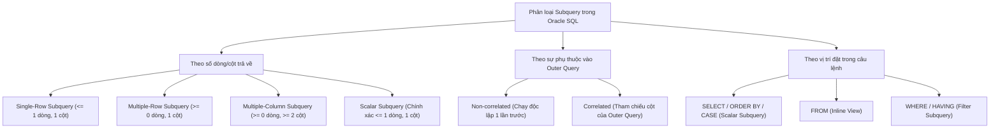

# Chương 8: Truy Vấn Con (Subqueries)

> **Mục tiêu chương học (Exam Objectives — OCA 1Z0-071 & OCP Developer):**
> - Phân loại và nắm vững quy tắc sử dụng **Single-Row Subquery**, **Multiple-Row Subquery**, **Multiple-Column Subquery**, và **Scalar Subquery**.
> - Hiểu sâu cơ chế hoạt động của các toán tử tập hợp trong Subquery: `IN`, `NOT IN`, `ANY` (`SOME`), `ALL`, `EXISTS`, và `NOT EXISTS`.
> - Tránh bẫy kinh điển nhất trong SQL: **`NOT IN` và `ALL` khi tập kết quả của Subquery chứa giá trị `NULL`** (trả về 0 dòng!).
> - Làm chủ **Correlated Subquery** (Truy vấn con tương quan) và phân biệt với Uncorrelated Subquery.
> - Vận dụng Subquery linh hoạt tại mọi vị trí: `SELECT` (Scalar Subquery), `FROM` (Inline View), `WHERE`, và `HAVING`.
> - So sánh ngữ nghĩa và hiệu năng thực tế (Execution Plan: Semi-Join, Anti-Join) giữa `IN` / `EXISTS` / `NOT IN` / `NOT EXISTS` và `JOIN`.

---

## Mục Lục

1. [Tổng quan và Phân loại Subquery trong Oracle SQL](#1-tổng-quan-và-phân-loại-subquery-trong-oracle-sql)
2. [Single-Row Subqueries (Truy vấn con đơn dòng)](#2-single-row-subqueries-truy-vấn-con-đơn-dòng)
3. [Multiple-Row Subqueries: `IN`, `NOT IN`, `ANY`/`SOME`, `ALL` & Bẫy `NULL`](#3-multiple-row-subqueries-in-not-in-anysome-all--bẫy-null)
4. [Multiple-Column Subqueries (Truy vấn con đa cột — Pairwise Comparison)](#4-multiple-column-subqueries-truy-vấn-con-đa-cột--pairwise-comparison)
5. [Correlated Subqueries (Truy vấn con tương quan) và `EXISTS` / `NOT EXISTS`](#5-correlated-subqueries-truy-vấn-con-tương-quan-và-exists--not-exists)
6. [Vị trí đặt Subquery: Scalar Subquery (`SELECT`), Inline View (`FROM`), `WHERE`, `HAVING`](#6-vị-trí-đặt-subquery-scalar-subquery-select-inline-view-from-where-having)
7. [So sánh ngữ nghĩa và hiệu năng: `IN` / `EXISTS` vs `JOIN`](#7-so-sánh-ngữ-nghĩa-và-hiệu-năng-in--exists-vs-join)
8. [Bài tập thực hành tự luyện (Kèm lời giải chi tiết)](#8-bài-tập-thực-hành-tự-luyện-kèm-lời-giải-chi-tiết)
9. [Tổng hợp Bẫy thi OCA/OCP (Exam Essentials)](#9-tổng-hợp-bẫy-thi-ocaocp-exam-essentials)

---

## 1. Tổng quan và Phân loại Subquery trong Oracle SQL

**Subquery (Truy vấn con / Inner Query / Nested Query)** là một câu lệnh `SELECT` được đặt bên trong cặp dấu ngoặc đơn `(...)` và nhúng vào bên trong một câu lệnh SQL khác (gọi là **Outer Query / Main Query** — có thể là `SELECT`, `INSERT`, `UPDATE`, `DELETE`, hoặc `MERGE`).



### Quy tắc cú pháp chung:
1. Subquery **bắt buộc phải luôn nằm trong cặp dấu ngoặc đơn `(SELECT ...)`**.
2. Theo mặc định (Uncorrelated Subquery), Subquery được thực thi **TRƯỚC**, và kết quả của nó được truyền ra cho Outer Query sử dụng.
3. **Về mệnh đề `ORDER BY` trong Subquery:** Không được phép dùng `ORDER BY` trong Subquery đặt ở mệnh đề `WHERE` hoặc `HAVING` (báo lỗi **`ORA-00907: missing right parenthesis`**), nhưng **ĐƯỢC PHÉP** dùng `ORDER BY` bên trong **Inline View** (Subquery trong mệnh đề `FROM`, ví dụ để phục vụ Top-N query với `ROWNUM`).

---

## 2. Single-Row Subqueries (Truy vấn con đơn dòng)

**Single-Row Subquery** là truy vấn con trả về **tối đa 1 dòng và 1 cột** (0 hoặc 1 dòng). Nó được kết hợp với các **toán tử so sánh đơn dòng (Single-Row Operators)**:

| Toán tử | Ý nghĩa |
| :--- | :--- |
| `=` | Bằng |
| `>` / `>=` | Lớn hơn / Lớn hơn hoặc bằng |
| `<` / `<=` | Nhỏ hơn / Nhỏ hơn hoặc bằng |
| `<>` hoặc `!=` | Khác |

```sql
-- Tìm các nhân viên có mức lương cao hơn mức lương của nhân viên 'ABEL':
SELECT employee_id, last_name, salary
FROM employees
WHERE salary > (SELECT salary
                FROM employees
                WHERE last_name = 'Abel');
```

### Hai trường hợp đặc biệt cực kỳ quan trọng trong đề thi:
1. **Nếu Single-Row Subquery trả về `0` dòng (Empty result / No rows):**
   - Toàn bộ Subquery được đánh giá thành giá trị **`NULL`**!
   - Câu lệnh **KHÔNG BÁO LỖI**, nhưng vì điều kiện `WHERE salary > NULL` luôn trả về `UNKNOWN`, nên câu truy vấn ngoài cùng sẽ trả về **0 dòng (`No rows selected`)**.
2. **Nếu Single-Row Subquery trả về từ `2` dòng trở lên (ví dụ công ty có 2 người cùng tên `'Smith'`):**
   - Toán tử đơn dòng (`=`, `>`, `<`...) không thể so sánh 1 giá trị với một danh sách nhiều dòng!
   - Oracle lập tức ném lỗi runtime: **`ORA-01427: single-row subquery returns more than one row`**.

---

## 3. Multiple-Row Subqueries: `IN`, `NOT IN`, `ANY`/`SOME`, `ALL` & Bẫy `NULL`

Khi Subquery có thể trả về **nhiều hơn 1 dòng** (1 cột), bạn **bắt buộc** phải sử dụng các **toán tử đa dòng (Multiple-Row Operators)**: `IN`, `NOT IN`, `ANY` (từ đồng nghĩa là `SOME`), và `ALL`.

### 3.1. Bảng ngữ nghĩa của `IN`, `ANY` (`SOME`), và `ALL`

Giả sử tập kết quả của Subquery trả về 3 giá trị: **`(1000, 2000, 3000)`**.

| Toán tử kết hợp | Ý nghĩa logic chính xác | Quy đổi tương đương dễ nhớ | Với tập `(1000, 2000, 3000)` |
| :--- | :--- | :--- | :--- |
| `x IN (...)` | Bằng **bất kỳ** phần tử nào trong tập hợp. | **`x = ANY (...)`** (`x = 1000 OR x = 2000 OR x = 3000`) | `x` thuộc `{1000, 2000, 3000}` |
| `x NOT IN (...)` | Khác **tất cả** các phần tử trong tập hợp. | **`x <> ALL (...)`** (`x <> 1000 AND x <> 2000 AND x <> 3000`) | `x` không thuộc `{1000, 2000, 3000}` |
| **`x > ANY (...)`** | Lớn hơn **ít nhất 1** phần tử trong tập hợp. | **Lớn hơn giá trị NHỎ NHẤT (`x > MIN`)** | **`x > 1000`** |
| **`x < ANY (...)`** | Nhỏ hơn **ít nhất 1** phần tử trong tập hợp. | **Nhỏ hơn giá trị LỚN NHẤT (`x < MAX`)** | **`x < 3000`** |
| **`x > ALL (...)`** | Lớn hơn **tất cả mọi** phần tử trong tập hợp. | **Lớn hơn giá trị LỚN NHẤT (`x > MAX`)** | **`x > 3000`** |
| **`x < ALL (...)`** | Nhỏ hơn **tất cả mọi** phần tử trong tập hợp. | **Nhỏ hơn giá trị NHỎ NHẤT (`x < MIN`)** | **`x < 1000`** |

> [!TIP]
> **Lưu ý cú pháp:** Từ khóa **`SOME`** và **`ANY`** là hoàn toàn tương đương 100% trong Oracle SQL (`> SOME` chính là `> ANY`). Ngoài ra, tuyệt đối không viết `IN ANY` hay `IN ALL` (lỗi cú pháp); phải có toán tử so sánh (`=`, `>`, `<`, `>=`, `<=`, `<>`) đứng ngay trước `ANY` hoặc `ALL`!

### 3.2. BẪY THI SỐ 1 CỦA SQL: `NOT IN` (và `ALL`) khi Subquery chứa `NULL`!

> [!WARNING]
> **BẪY CHÍ MẠNG TRONG ĐỀ THI OCA 1Z0-071 & VNPT:**
> Nếu tập kết quả trả về của Subquery có chứa dù chỉ **MỘT giá trị `NULL`** (ví dụ: `(101, 102, NULL)`):
> - Toán tử **`IN`** (và **`ANY`**): **VẪN HOẠT ĐỘNG BÌNH THƯỜNG**!
> - Toán tử **`NOT IN`** (và **`ALL`**): Sẽ khiến toàn bộ mệnh đề `WHERE` trở thành `UNKNOWN` và câu truy vấn trả về **ĐÚNG `0` DÒNG (`No rows selected`)**!

**Tại sao lại như vậy? Hãy chứng minh bằng logic 3 giá trị (Three-Valued Logic: `TRUE`, `FALSE`, `UNKNOWN`) của SQL:**
Giả sử ta tìm các nhân viên **không phải là quản lý của ai** từ bảng `EMPS` (trong đó Chủ tịch `KING` có `manager_id IS NULL`), nên `SELECT manager_id FROM emps` trả về tập `(101, 102, NULL)`.
Xét nhân viên có `emp_id = 105`:
1. Với **`IN`** (`emp_id IN (101, 102, NULL)`):
   - Được dịch thành phép **`OR`**: `(105 = 101) OR (105 = 102) OR (105 = NULL)`
   - Với `emp_id = 101`: `TRUE OR FALSE OR UNKNOWN` $\rightarrow$ **`TRUE`**! (Vì trong phép `OR`, chỉ cần 1 vế `TRUE` là cả biểu thức `TRUE`, bất chấp vế `UNKNOWN`).
2. Với **`NOT IN`** (`emp_id NOT IN (101, 102, NULL)`):
   - Được dịch thành phép **`AND`**: `(105 <> 101) AND (105 <> 102) AND (105 <> NULL)`
   - Đánh giá từng vế: `TRUE AND TRUE AND UNKNOWN` $\rightarrow$ **`UNKNOWN`**!
   - Vì trong phép `AND`, phải tất cả các vế đều `TRUE` thì kết quả mới `TRUE`; khi bị dính `AND UNKNOWN` thì kết quả không bao giờ có thể là `TRUE`! Mà mệnh đề `WHERE` chỉ lấy dòng có kết quả `TRUE`, nên **mọi dòng đều bị loại bỏ -> Trả về 0 dòng**!
3. Tương tự hoàn toàn với **`> ALL (1000, 2000, NULL)`**:
   - Dịch thành: `(sal > 1000) AND (sal > 2000) AND (sal > NULL)` $\rightarrow$ Luôn bị dính `AND UNKNOWN` $\rightarrow$ **Trả về 0 dòng**!

```sql
-- SAI (Trả về 0 dòng vì trong bảng EMPLOYEES có dòng của Chủ tịch có manager_id IS NULL!):
SELECT last_name FROM employees
WHERE employee_id NOT IN (SELECT manager_id FROM employees);

-- CÁCH SỬA 1 (Lọc bỏ NULL bên trong Subquery của NOT IN):
SELECT last_name FROM employees
WHERE employee_id NOT IN (SELECT manager_id FROM employees WHERE manager_id IS NOT NULL);

-- CÁCH SỬA 2 (Khuyên dùng trong thực tế: Dùng NOT EXISTS — miễn nhiễm với NULL!):
SELECT e.last_name FROM employees e
WHERE NOT EXISTS (SELECT 1 FROM employees m WHERE m.manager_id = e.employee_id);
```

---

## 4. Multiple-Column Subqueries (Truy vấn con đa cột — Pairwise Comparison)

Oracle SQL cho phép so sánh **một bộ nhiều cột cùng lúc (Pairwise Comparison)** với một Subquery trả về nhiều cột tương ứng.

### So sánh theo cặp (Pairwise) vs. Không theo cặp (Non-Pairwise)

Giả sử ta muốn tìm các nhân viên có **cùng `(manager_id, department_id)`** với nhân viên có mã `103` hoặc `110`:

| EMP_ID | ENAME | MANAGER_ID | DEPARTMENT_ID |
| :--- | :--- | :--- | :--- |
| `103` | `HUNOLD` | `102` | `60` |
| `110` | `CHEN` | `108` | `100` |
| `201` | `FAKE_MATCH` | `102` | `100` |

1. **Pairwise Comparison (So sánh theo cặp — Đúng yêu cầu):**
   ```sql
   SELECT emp_id, ename, manager_id, department_id
   FROM employees
   WHERE (manager_id, department_id) IN (SELECT manager_id, department_id
                                         FROM employees
                                         WHERE emp_id IN (103, 110));
   ```
   - Yêu cầu `manager_id` và `department_id` phải khớp trên **cùng một dòng**: chỉ chấp nhận cặp `(102, 60)` hoặc `(108, 100)`. Nhân viên `201` có cặp `(102, 100)` sẽ **bị loại**.
2. **Non-Pairwise Comparison (So sánh từng cột riêng rẽ):**
   ```sql
   SELECT emp_id, ename, manager_id, department_id
   FROM employees
   WHERE manager_id    IN (SELECT manager_id    FROM employees WHERE emp_id IN (103, 110))
     AND department_id IN (SELECT department_id FROM employees WHERE emp_id IN (103, 110));
   ```
   - Chỉ cần `manager_id IN (102, 108)` **VÀ** `department_id IN (60, 100)` độc lập nhau $\rightarrow$ Nhân viên `201` có `(102, 100)` **vẫn lọt qua**!

---

## 5. Correlated Subqueries (Truy vấn con tương quan) và `EXISTS` / `NOT EXISTS`

### 5.1. Cơ chế của Correlated Subquery
Khác với Subquery thông thường (chạy 1 lần duy nhất rồi trả kết quả cho câu lệnh ngoài), **Correlated Subquery** tham chiếu trực tiếp đến một hoặc nhiều cột của bảng nằm ở **Outer Query**.
- **Luồng thực thi logic (Row-by-row processing):**
  1. Lấy 1 dòng ứng viên (candidate row) từ Outer Query.
  2. Truyền giá trị cột của dòng ứng viên đó vào bên trong Correlated Subquery và thực thi Subquery.
  3. Dùng kết quả của Subquery để đánh giá điều kiện `WHERE` cho dòng ứng viên đang xét.
  4. Lặp lại cho đến hết các dòng của Outer Query.

```sql
-- Tìm các nhân viên có mức lương cao hơn mức lương trung bình của CHÍNH PHÒNG BAN mà họ đang làm việc:
SELECT e_out.employee_id, e_out.last_name, e_out.department_id, e_out.salary
FROM employees e_out
WHERE e_out.salary > (SELECT AVG(e_in.salary)
                      FROM employees e_in
                      WHERE e_in.department_id = e_out.department_id);
```

### 5.2. Toán tử `EXISTS` và `NOT EXISTS`
`EXISTS` và `NOT EXISTS` được thiết kế chuyên biệt để đi kèm với Correlated Subquery nhằm kiểm tra sự tồn tại của bản ghi:
- **`EXISTS (subquery)`:** Trả về **`TRUE`** ngay lập tức khi Subquery tìm thấy **ít nhất 1 dòng** thỏa mãn điều kiện (cơ chế **Short-circuit**: dừng quét ngay khi gặp dòng đầu tiên, không quan tâm Subquery SELECT cột gì hay giá trị cột đó là `NULL`!).
- **`NOT EXISTS (subquery)`:** Trả về **`TRUE`** nếu Subquery trả về **0 dòng**.

> [!IMPORTANT]
> **Tại sao viết `SELECT 1`, `SELECT 'X'`, hay `SELECT NULL` trong `EXISTS` đều cho kết quả giống hệt nhau?**
> Vì `EXISTS` chỉ kiểm tra xem **có dòng nào được trả về hay không**, hoàn toàn không đọc giá trị của danh sách cột trong `SELECT`! Thậm chí nếu bạn viết:
> ```sql
> WHERE EXISTS (SELECT NULL FROM departments d WHERE d.department_id = e.department_id)
> ```
> Kết quả vẫn là **`TRUE`** khi có dòng khớp, đừng bao giờ bị lừa rằng `SELECT NULL` làm cho `EXISTS` trả về `FALSE` hay `UNKNOWN`!

---

## 6. Vị trí đặt Subquery: Scalar Subquery (`SELECT`), Inline View (`FROM`), `WHERE`, `HAVING`

### 6.1. Scalar Subquery (Truy vấn con vô hướng)
**Scalar Subquery** là một Subquery trả về **tối đa 1 dòng và ĐÚNG 1 cột** (nếu trả về 0 dòng thì giá trị của nó tự động là **`NULL`**; nếu trả về `> 1` dòng sẽ báo lỗi **`ORA-01427`**; nếu trả về `> 1` cột sẽ báo lỗi **`ORA-00913: too many values`**).
Scalar Subquery có thể xuất hiện ở bất kỳ đâu mà một biểu thức cột đơn (`column expression`) được phép xuất hiện:
- Danh sách **`SELECT`**
- Biểu thức **`CASE WHEN`**
- Mệnh đề **`ORDER BY`**
- Mệnh đề **`WHERE`**, **`HAVING`**, **`VALUES`** của `INSERT`, **`SET`** của `UPDATE`
- *(Lưu ý: Không dùng được Scalar Subquery trong `GROUP BY` hoặc giá trị `DEFAULT` của cột).*

```sql
-- Ví dụ dùng Scalar Subquery trong SELECT và ORDER BY:
SELECT d.department_id,
       d.department_name,
       (SELECT COUNT(*) FROM employees e WHERE e.department_id = d.department_id) AS emp_cnt
FROM departments d
ORDER BY (SELECT AVG(salary) FROM employees e WHERE e.department_id = d.department_id) DESC NULLS LAST;
```

### 6.2. Inline View (Subquery trong mệnh đề `FROM`)
Khi một Subquery được đặt trong mệnh đề `FROM`, nó đóng vai trò như một bảng dữ liệu ảo (tồn tại trong suốt thời gian chạy câu lệnh) và được gọi là **Inline View**:
- Có thể đặt Table Alias cho Inline View (không dùng từ khóa `AS` cho Table Alias trong Oracle!).
- Là nơi duy nhất mà Subquery được phép sử dụng mệnh đề `ORDER BY` truyền thống (thường kết hợp với `ROWNUM` ở truy vấn cha để lấy Top-N dòng):

```sql
-- Lấy Top 3 nhân viên có lương cao nhất công ty bằng Inline View + ROWNUM:
SELECT ROWNUM AS rank_no, emp_id, last_name, salary
FROM (
    SELECT employee_id AS emp_id, last_name, salary
    FROM employees
    ORDER BY salary DESC
)
WHERE ROWNUM <= 3;
```

### 6.3. Subquery trong mệnh đề `HAVING`
Dùng để lọc các nhóm của `GROUP BY` bằng cách so sánh kết quả tổng hợp của nhóm với kết quả của một truy vấn khác:
```sql
-- Tìm các phòng ban có lương thấp nhất vẫn lớn hơn lương thấp nhất của phòng ban 50:
SELECT department_id, MIN(salary)
FROM employees
GROUP BY department_id
HAVING MIN(salary) > (SELECT MIN(salary) FROM employees WHERE department_id = 50);
```

---

## 7. So sánh ngữ nghĩa và hiệu năng: `IN` / `EXISTS` vs `JOIN`

Đây là câu hỏi phỏng vấn và sát hạch thực chiến cực kỳ phổ biến tại VNPT và các kỳ thi OCP:

| Tiêu chí | `INNER JOIN` | `IN` / `EXISTS` (Semi-Join) | `NOT IN` / `NOT EXISTS` (Anti-Join) |
| :--- | :--- | :--- | :--- |
| **Cột hiển thị trên `SELECT`** | Lấy được cột của **cả hai bảng**. | Chỉ lấy được cột của **bảng ngoài (Outer table)**. | Chỉ lấy được cột của **bảng ngoài**. |
| **Nhân bản dòng (Row Duplication)** | **CÓ!** Nếu 1 dòng bảng `DEPARTMENTS` khớp với 5 dòng bảng `EMPLOYEES`, `INNER JOIN` sẽ nhân bản phòng ban đó thành **5 dòng** (phải dùng `DISTINCT` để khử). | **KHÔNG BAO GIỜ NHÂN BẢN!** Mỗi dòng của bảng ngoài (`DEPARTMENTS`) chỉ được kiểm tra và xuất hiện **tối đa 1 lần** dù bên trong có bao nhiêu nhân viên khớp. | **KHÔNG BAO GIỜ NHÂN BẢN!** |
| **Xử lý `NULL`** | Bỏ qua dòng có khóa nối `NULL`. | Cả `IN` và `EXISTS` đều xử lý `NULL` an toàn như nhau. | **`NOT IN` trả về 0 dòng nếu tập con có `NULL`** (`Null-Aware Anti-Join`). **`NOT EXISTS` luôn an toàn tuyệt đối với `NULL`**! |
| **Hiệu năng trong Oracle CBO hiện đại** | Rất nhanh (`HASH JOIN` / `NESTED LOOPS`). | Trong Oracle hiện đại (11g/12c/19c/21c), Cost-Based Optimizer (CBO) thường tự động chuyển đổi (Query Transformation) cả `IN` và `EXISTS` về cùng một phép toán vật lý là **`HASH JOIN SEMI`** hoặc **`NESTED LOOPS SEMI`**. Tuy nhiên, khi bảng ngoài nhỏ và bảng trong cực lớn có Index, `EXISTS` rất lợi thế nhờ cơ chế dừng sớm; ngược lại khi tập trong rất nhỏ, `IN` rất nhanh. | `NOT EXISTS` cho phép CBO dùng **`HASH JOIN ANTI`** cực nhanh, trong khi `NOT IN` trên cột nullable buộc CBO phải dùng `HASH JOIN RIGHT ANTI NA` (Null-Aware) tốn kém hơn. |

---

## 8. Bài tập thực hành tự luyện (Kèm lời giải chi tiết)

### Bài tập 1: Tìm nhân viên có lương cao nhất trong từng phòng ban (Pairwise vs Correlated)
Cho bảng `EMPLOYEES(employee_id, last_name, department_id, salary)`. Hãy viết 2 cách truy vấn khác nhau (Cách 1 dùng Multiple-Column Subquery với `IN`, Cách 2 dùng Correlated Subquery) để lấy ra các nhân viên đạt mức lương cao nhất trong phòng ban của họ. Phân tích xem nhân viên có `department_id IS NULL` có xuất hiện không.

<details>
<summary><b>👉 Xem Lời Giải Chi Tiết Bài Tập 1</b></summary>

```sql
-- Cách 1: Dùng Multiple-Column Subquery (Pairwise IN)
SELECT employee_id, last_name, department_id, salary
FROM employees
WHERE (department_id, salary) IN (
    SELECT department_id, MAX(salary)
    FROM employees
    GROUP BY department_id
);

-- Cách 2: Dùng Correlated Subquery
SELECT e1.employee_id, e1.last_name, e1.department_id, e1.salary
FROM employees e1
WHERE e1.salary = (
    SELECT MAX(e2.salary)
    FROM employees e2
    WHERE e2.department_id = e1.department_id
);
```
- **Phân tích về `NULL`:** Ở cả 2 cách trên, nếu có nhân viên mà `department_id IS NULL`, vì phép so sánh `NULL = NULL` trong `IN` và trong `WHERE e2.department_id = e1.department_id` đều trả về `UNKNOWN`, nên nhân viên có `department_id IS NULL` sẽ **không xuất hiện** trong kết quả (trừ khi bọc `NVL(department_id, -1)`).
</details>

### Bài tập 2: Tìm các phòng ban không có nhân viên nào có lương dưới 3000
Cho bảng `DEPARTMENTS(department_id, department_name)` và `EMPLOYEES(employee_id, department_id, salary)`. Hãy viết câu lệnh dùng `NOT EXISTS` để tìm tất cả các phòng ban mà trong phòng ban đó **không có bất kỳ nhân viên nào có mức lương `< 3000`**.

<details>
<summary><b>👉 Xem Lời Giải Chi Tiết Bài Tập 2</b></summary>

```sql
SELECT d.department_id, d.department_name
FROM departments d
WHERE NOT EXISTS (
    SELECT 1
    FROM employees e
    WHERE e.department_id = d.department_id
      AND e.salary < 3000
);
```
- **Giải thích:** Với mỗi phòng ban `d`, Correlated Subquery tìm xem có nhân viên nào thuộc phòng ban đó mà `salary < 3000` hay không. Nếu không tìm thấy ai (`NOT EXISTS` trả về `TRUE`), phòng ban đó được giữ lại (bao gồm cả các phòng ban chưa có nhân viên nào).
</details>

---

## 9. Tổng hợp Bẫy thi OCA/OCP (Exam Essentials)

| STT | Chủ đề | Bẫy thi thường gặp trong đề OCA 1Z0-071 / VNPT | Quy tắc chuẩn cần nhớ |
| :--- | :--- | :--- | :--- |
| **1** | `NOT IN` gặp giá trị `NULL` | `WHERE id NOT IN (SELECT mgr_id FROM emp)` khi `mgr_id` có chứa `NULL`. | Câu lệnh **không báo lỗi** nhưng luôn trả về **`0` dòng (`No rows selected`)** vì `x <> NULL` là `UNKNOWN`. Tương tự với `<> ALL`, `> ALL`, `< ALL`. |
| **2** | Single-Row Subquery trả về 0 dòng | `WHERE sal = (SELECT sal FROM emp WHERE id = 9999)` (không có `id = 9999`). | Subquery trả về `NULL`. Câu lệnh **không báo lỗi**, kết quả ngoài cùng trả về **`0` dòng**. |
| **3** | Single-Row Subquery trả về `> 1` dòng | Dùng toán tử `=`, `>`, `<` với Subquery trả về từ 2 dòng trở lên. | Báo lỗi runtime **`ORA-01427: single-row subquery returns more than one row`**. |
| **4** | Ngữ nghĩa `> ANY` và `> ALL` | Nhầm lẫn giữa `> ANY` và `> ALL`. | `> ANY` là **lớn hơn giá trị nhỏ nhất (`> MIN`)**; `> ALL` là **lớn hơn giá trị lớn nhất (`> MAX`)**; `< ANY` là **nhỏ hơn giá trị lớn nhất (`< MAX`)**; `< ALL` là **nhỏ hơn giá trị nhỏ nhất (`< MIN`)**. |
| **5** | `EXISTS (SELECT NULL ...)` | Nghĩ rằng `SELECT NULL` trong `EXISTS` làm điều kiện thành `FALSE` hoặc `NULL`. | `EXISTS` chỉ kiểm tra sự tồn tại của dòng, không quan tâm giá trị cột trong `SELECT`. `SELECT NULL`, `SELECT 1`, `SELECT *` đều chạy giống hệt nhau! |
| **6** | Đặt `ORDER BY` trong Subquery | Viết `WHERE id IN (SELECT id FROM emp ORDER BY id)`. | Báo lỗi **`ORA-00907: missing right parenthesis`**. Không được dùng `ORDER BY` trong Subquery của `WHERE`/`HAVING` (nhưng dùng được trong Inline View ở `FROM`). |
| **7** | Table Alias trong `FROM` Subquery | Viết `FROM (SELECT * FROM emp) AS e`. | Trong Oracle SQL, **Table Alias (kể cả cho Inline View) KHÔNG ĐƯỢC dùng từ khóa `AS`** (chỉ Column Alias mới được dùng `AS`). Viết `AS e` ở `FROM` sẽ báo lỗi `ORA-00933`! |
