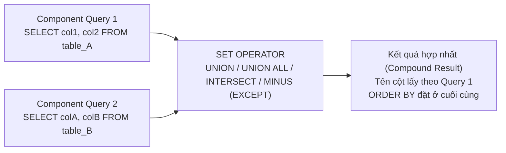

# Chương 9: Các Toán Tử Tập Hợp (Set Operators)

> **Mục tiêu chương học (Exam Objectives — OCA 1Z0-071 & OCP Developer — Oracle 21c):**
> - Làm chủ các toán tử tập hợp truyền thống của Oracle (`UNION`, `UNION ALL`, `INTERSECT`, `MINUS`) cùng các từ khóa mở rộng mới trong chuẩn SQL / Oracle 21c (`EXCEPT`, `EXCEPT ALL`, `MINUS ALL`, `INTERSECT ALL`).
> - Nắm vững các quy tắc bắt buộc về sự tương thích **Số lượng cột (Column Count)** và **Nhóm kiểu dữ liệu (Data Type Group Compatibility)** giữa các câu lệnh `SELECT` thành phần.
> - Hiểu rõ cơ chế khử trùng lặp (Duplicate Elimination), cách Set Operators đối xử với giá trị **`NULL`**, và kỹ thuật bù cột thiếu bằng hằng số / `CAST(NULL AS datatype)`.
> - Nắm chắc quy tắc lấy **Tên cột / Bí danh cột (Column Alias) từ câu `SELECT` đầu tiên** và các quy định nghiêm ngặt về mệnh đề **`ORDER BY`** trong truy vấn hợp (Compound Query).

---

## Mục Lục

1. [Tổng quan về Truy vấn Hợp (Compound Queries) và Set Operators](#1-tổng-quan-về-truy-vấn-hợp-compound-queries-và-set-operators)
2. [Chi tiết các Toán tử Tập hợp: `UNION`, `UNION ALL`, `INTERSECT`, `MINUS` (`EXCEPT`)](#2-chi-tiết-các-toán-tử-tập-hợp-union-union-all-intersect-minus-except)
3. [Quy tắc tương thích Số lượng cột và Kiểu dữ liệu](#3-quy tắc-tương-thích-số-lượng-cột-và-kiểu-dữ-liệu)
4. [Xử lý bản ghi trùng lặp, Giá trị `NULL` và Thứ tự ưu tiên toán tử](#4-xử-lý-bản-ghi-trùng-lặp-giá-trị-null-và-thứ-tự-ưu-tiên-toán-tử)
5. [Quy tắc đặt Tên cột (Column Alias) và Mệnh đề `ORDER BY` trong Set Operators](#5-quy-tắc-đặt-tên-cột-column-alias-và-mệnh-đề-order-by-trong-set-operators)
6. [Bài tập thực hành tự luyện (Kèm lời giải chi tiết)](#6-bài-tập-thực-hành-tự-luyện-kèm-lời-giải-chi-tiết)
7. [Tổng hợp Bẫy thi OCA/OCP (Exam Essentials)](#7-tổng-hợp-bẫy-thi-ocaocp-exam-essentials)

---

## 1. Tổng quan về Truy vấn Hợp (Compound Queries) và Set Operators

Trong khi phép **`JOIN`** ghép các cột của nhiều bảng theo **chiều ngang (Horizontal combination)**, thì các **Toán tử Tập hợp (Set Operators)** kết hợp kết quả của hai hay nhiều câu lệnh `SELECT` độc lập theo **chiều dọc (Vertical combination — nối thêm dòng)**. Một câu truy vấn sử dụng Set Operators được gọi là **Compound Query (Truy vấn hợp)**.



### Dữ liệu mẫu dùng xuyên suốt chương học

Để minh họa trực quan và chính xác 100% từng toán tử, ta xét 2 tập dữ liệu nhân sự `CURRENT_STAFF` (Nhân viên hiện tại) và `HISTORY_STAFF` (Lịch sử công việc cũ):

**Bảng `SET_A` (4 dòng — lưu ý dòng `(101, 'IT')` xuất hiện 2 lần và có 1 dòng `NULL`):**

| EMP_ID | JOB_CODE |
| :--- | :--- |
| `101` | `IT` |
| `101` | `IT` |
| `102` | `HR` |
| `103` | *(NULL)* |

**Bảng `SET_B` (3 dòng):**

| EMP_ID | JOB_CODE |
| :--- | :--- |
| `101` | `IT` |
| `103` | *(NULL)* |
| `104` | `SALES` |

---

## 2. Chi tiết các Toán tử Tập hợp: `UNION`, `UNION ALL`, `INTERSECT`, `MINUS` (`EXCEPT`)

### 2.1. Bảng so sánh 4 toán tử cốt lõi (và mở rộng chuẩn mới Oracle 21c)

| Toán tử | Phép toán Tập hợp | Khử dòng trùng lặp (DISTINCT)? | Tác động Hiệu năng (Sorting / Hashing) |
| :--- | :--- | :--- | :--- |
| **`UNION`** | Hợp của 2 tập hợp ($A \cup B$). | **CÓ!** Loại bỏ mọi dòng trùng lặp (cả trùng giữa 2 bảng lẫn trùng nội bộ trong cùng 1 bảng). | Chậm hơn `UNION ALL` vì phải thực hiện `SORT UNIQUE` hoặc `HASH UNIQUE` để khử trùng. |
| **`UNION ALL`** | Hợp tất cả phần tử của 2 tập hợp ($A \uplus B$). | **KHÔNG!** Giữ nguyên 100% tất cả các dòng từ cả hai câu `SELECT` (chỉ ghép nối đuôi nhau). | **Nhanh nhất!** Không tốn chi phí khử trùng lặp hay sắp xếp. |
| **`INTERSECT`** | Giao của 2 tập hợp ($A \cap B$): Chỉ lấy các dòng xuất hiện ở **cả hai** câu `SELECT`. | **CÓ!** Kết quả trả về luôn là các dòng duy nhất. *(Oracle 21c bổ sung thêm `INTERSECT ALL`)*. | Phải thực hiện bước so khớp và khử trùng giữa 2 tập hợp. |
| **`MINUS`** *(hoặc **`EXCEPT`** từ Oracle 21c)* | Hiệu của 2 tập hợp ($A \setminus B$): Lấy các dòng có trong câu `SELECT` thứ nhất nhưng **KHÔNG có** trong câu `SELECT` thứ hai. | **CÓ!** Kết quả trả về luôn là các dòng duy nhất. *(Oracle 21c bổ sung thêm `MINUS ALL` / `EXCEPT ALL`)*. | **Phụ thuộc thứ tự:** `A MINUS B` khác hoàn toàn với `B MINUS A`! |

> [!NOTE]
> **Điểm mới quan trọng trên Oracle Database 21c (OCA/OCP Update):**
> Trước phiên bản 21c, Oracle chỉ hỗ trợ từ khóa độc quyền `MINUS` (trong khi chuẩn ANSI SQL dùng từ khóa `EXCEPT`). Bắt đầu từ **Oracle 21c**, Oracle hỗ trợ đầy đủ từ khóa **`EXCEPT`** hoàn toàn tương đương với **`MINUS`**, đồng thời bổ sung từ khóa **`ALL`** cho cả `INTERSECT ALL` và `MINUS ALL` / `EXCEPT ALL`!

### 2.2. Minh họa kết quả thực thi trên bảng `SET_A` và `SET_B`

#### a) `UNION ALL` (4 dòng của `SET_A` + 3 dòng của `SET_B` = **7 dòng**)
```sql
SELECT emp_id, job_code FROM set_a
UNION ALL
SELECT emp_id, job_code FROM set_b;
```
**Kết quả (7 dòng — giữ nguyên mọi bản ghi trùng):** `(101, 'IT')`, `(101, 'IT')`, `(102, 'HR')`, `(103, NULL)`, `(101, 'IT')`, `(103, NULL)`, `(104, 'SALES')`.

#### b) `UNION` (Hợp và khử trùng lặp = **4 dòng**)
```sql
SELECT emp_id, job_code FROM set_a
UNION
SELECT emp_id, job_code FROM set_b;
```
**Kết quả (4 dòng duy nhất):**

| EMP_ID | JOB_CODE |
| :--- | :--- |
| `101` | `IT` |
| `102` | `HR` |
| `103` | *(NULL)* |
| `104` | `SALES` |

#### c) `INTERSECT` (Phần chung có mặt ở cả hai bảng = **2 dòng**)
```sql
SELECT emp_id, job_code FROM set_a
INTERSECT
SELECT emp_id, job_code FROM set_b;
```
**Kết quả (2 dòng duy nhất):**

| EMP_ID | JOB_CODE |
| :--- | :--- |
| `101` | `IT` |
| `103` | *(NULL)* |

*(Chú ý: Dòng `(103, NULL)` ở `SET_A` và `(103, NULL)` ở `SET_B` được coi là **khớp nhau 100%**!).*

#### d) `MINUS` / `EXCEPT` (Có ở `SET_A` nhưng không có ở `SET_B` = **1 dòng**)
```sql
SELECT emp_id, job_code FROM set_a
MINUS
SELECT emp_id, job_code FROM set_b;
```
**Kết quả (1 dòng duy nhất):**

| EMP_ID | JOB_CODE |
| :--- | :--- |
| `102` | `HR` |

*(Chú ý: Dù `(101, 'IT')` xuất hiện 2 lần trong `SET_A` và chỉ xuất hiện 1 lần trong `SET_B`, toán tử `MINUS` truyền thống vẫn loại bỏ **toàn bộ** dòng `(101, 'IT')`!).*

---

## 3. Quy tắc tương thích Số lượng cột và Kiểu dữ liệu

Để ghép nối kết quả của nhiều câu lệnh `SELECT` bằng Set Operators, bạn phải tuân thủ nghiêm ngặt 2 quy tắc vàng sau:

### Quy tắc 1: Cùng số lượng cột (Equal Number of Columns)
Tất cả các câu lệnh `SELECT` thành phần trong một Compound Query **bắt buộc phải có số lượng cột (biểu thức) bằng nhau tuyệt đối**!
- Nếu câu `SELECT` thứ nhất có 3 cột mà câu `SELECT` thứ hai chỉ có 2 cột, Oracle sẽ báo lỗi biên dịch ngay lập tức:
  **`ORA-01789: query block has incorrect number of result columns`**.
- **Kỹ thuật xử lý khi một bảng thiếu cột tương ứng:** Bù thêm một giá trị hằng số giả (dummy literal: `0`, `'N/A'`) hoặc giá trị **`NULL` ép kiểu** (`TO_CHAR(NULL)`, `TO_NUMBER(NULL)`, `TO_DATE(NULL)`, hoặc `CAST(NULL AS NUMBER)`) vào vị trí cột bị thiếu!

```sql
-- Bảng EMPLOYEES có cột salary (NUMBER), bảng RETIRED_EMPS không có cột salary:
SELECT employee_id, last_name, salary
FROM employees
UNION ALL
SELECT emp_id, full_name, TO_NUMBER(NULL) -- Hoặc viết số 0 hay NULL trực tiếp
FROM retired_emps;
```

### Quy tắc 2: Tương thích nhóm kiểu dữ liệu theo từng vị trí (Positional Data Type Compatibility)
Oracle đối chiếu kiểu dữ liệu **theo đúng thứ tự vị trí cột** (cột 1 của `SELECT` 1 ghép với cột 1 của `SELECT` 2; cột 2 ghép với cột 2...), hoàn toàn **không quan tâm tên cột là gì**!

> [!WARNING]
> **BẪY THI CỰC HIỂM: Set Operators KHÔNG tự động ép kiểu ngầm định (No Implicit Conversion) giữa các nhóm kiểu dữ liệu khác nhau!**
> - Giữa `NUMBER` và `NUMBER(8,2)` hoặc `INTEGER`: **Hợp lệ** (cùng nhóm số).
> - Giữa `CHAR(10)` và `VARCHAR2(50)`: **Hợp lệ** (cùng nhóm chuỗi ký tự).
> - Giữa `DATE` và `TIMESTAMP`: **Hợp lệ** (cùng nhóm thời gian — kết quả chung được nâng lên `TIMESTAMP`).
> - Nhưng giữa **`NUMBER` và `VARCHAR2`** (ví dụ cột 1 của `SELECT` trên là số `100`, cột 1 của `SELECT` dưới là chuỗi `'100'`): Trong khi các hàm thường tự động ép `'100'` thành số `100`, thì Set Operators sẽ **LẬP TỨC BÁO LỖI**:
>   **`ORA-01790: expression must have same datatype as corresponding expression`**!
>   Bạn **bắt buộc** phải dùng hàm chuyển đổi tường minh (`TO_CHAR(100)` hoặc `TO_NUMBER('100')`).
> - Ngoài ra, các kiểu dữ liệu dung lượng lớn như **`BLOB`, `CLOB`, `BFILE`, `LONG`** không được hỗ trợ trong các toán tử tập hợp cần khử trùng (`UNION`, `INTERSECT`, `MINUS`).

---

## 4. Xử lý bản ghi trùng lặp, Giá trị `NULL` và Thứ tự ưu tiên toán tử

### 4.1. Cách Set Operators đối xử với giá trị `NULL`

> [!IMPORTANT]
> Trong khi ở điều kiện `WHERE` và `JOIN`, hai giá trị `NULL` không bao giờ bằng nhau (`NULL = NULL` là `UNKNOWN`), thì trong **TẤT CẢ các toán tử tập hợp (`UNION`, `INTERSECT`, `MINUS`)**, Oracle coi **hai giá trị `NULL` ở cùng vị trí cột là BẰNG NHAU (Duplicates)**!

Hệ quả trực tiếp cần nhớ khi đi thi:
1. **`UNION`:** Hai dòng `(103, NULL)` được coi là trùng nhau và bị gộp lại còn **1 dòng `(103, NULL)`**.
2. **`INTERSECT`:** Nếu cả hai câu `SELECT` đều có dòng `(103, NULL)` (hoặc cả dòng toàn `NULL`), thì dòng đó **ĐƯỢC GIỮ LẠI** trong kết quả giao!
3. **`MINUS`:** Nếu câu `SELECT` trên có dòng `(103, NULL)` và câu `SELECT` dưới cũng có dòng `(103, NULL)`, thì dòng đó **BỊ TRỪ MẤT**!

### 4.2. Khử trùng lặp nội bộ của `UNION`, `INTERSECT`, `MINUS`
Một câu hỏi bẫy kinh điển: Giả sử bảng `A` có **2 dòng giống hệt nhau** là `(101, 'IT')`, còn bảng `B` rỗng (`0` dòng).
Khi chạy `SELECT * FROM A MINUS SELECT * FROM B;`, kết quả trả về mấy dòng?
- Nhiều người trả lời là `2` dòng vì nghĩ `B` rỗng nên không trừ đi dòng nào của `A`.
- **Đáp án đúng là `1` dòng!** Vì cả 3 toán tử `UNION`, `INTERSECT`, và `MINUS` đều thực hiện bước **khử trùng lặp (`DISTINCT`) trên tập kết quả cuối cùng**!

### 4.3. Thứ tự ưu tiên thực thi giữa các Set Operators
Trong Oracle SQL (theo chuẩn OCA 1Z0-071):
- Tất cả các toán tử tập hợp (`UNION`, `UNION ALL`, `INTERSECT`, `MINUS`) đều có **CÙNG MỨC ĐỘ ƯU TIÊN NGANG NHAU**!
- Khi một câu truy vấn kết hợp nhiều toán tử tập hợp liên tiếp nhau, Oracle sẽ thực thi tuần tự **từ TRÊN xuống DƯỚI (từ TRÁI sang PHẢI)**, trừ khi bạn sử dụng cặp dấu ngoặc đơn **`(...)`** để thay đổi thứ tự ưu tiên!

```sql
-- Thực thi (A UNION ALL B) trước, sau đó mới lấy kết quả đem MINUS C:
SELECT id FROM table_a
UNION ALL
SELECT id FROM table_b
MINUS
SELECT id FROM table_c;

-- Dùng ngoặc đơn để ép thực thi (B MINUS C) trước:
SELECT id FROM table_a
UNION ALL
(SELECT id FROM table_b
 MINUS
 SELECT id FROM table_c);
```

---

## 5. Quy tắc đặt Tên cột (Column Alias) và Mệnh đề `ORDER BY` trong Set Operators

Đây là khu vực xuất hiện nhiều câu hỏi kiểm tra lỗi cú pháp nhất của Chương 9 trong đề thi OCA 1Z0-071!

### 5.1. Quy tắc đặt Tên cột (Column Headers / Aliases)
1. **Tiêu đề cột của tập kết quả cuối cùng LUÔN LUÔN được lấy theo tên cột hoặc bí danh cột (Column Alias) của câu lệnh `SELECT` ĐẦU TIÊN (First Query)!**
2. Bạn vẫn có thể viết Column Alias ở câu `SELECT` thứ 2, thứ 3 (không báo lỗi), nhưng Oracle sẽ **bỏ qua không dùng làm tiêu đề hiển thị** và bạn cũng **không được phép** gọi tên/bí danh cột của câu `SELECT` thứ 2 trong mệnh đề `ORDER BY`!

### 5.2. Các quy tắc sống còn về mệnh đề `ORDER BY` trong Compound Query

1. **Vị trí duy nhất được phép đặt `ORDER BY`:**
   - Trong một Compound Query, mệnh đề `ORDER BY` **chỉ được phép xuất hiện ĐÚNG 1 LẦN ở cuối cùng của toàn bộ câu truy vấn** (tức là sau câu `SELECT` cuối cùng), và nó sẽ sắp xếp toàn bộ kết quả đã hợp nhất.
   - Tuyệt đối **CẤM** đặt `ORDER BY` ở cuối câu `SELECT` thứ nhất hoặc các câu `SELECT` ở giữa (vi phạm sẽ báo lỗi **`ORA-00933: SQL command not properly ended`**).
2. **Cách tham chiếu cột hợp lệ trong `ORDER BY` của Compound Query:**
   - Chỉ được phép sắp xếp theo:
     - **Tên cột hoặc Bí danh cột (Column Alias) của câu `SELECT` ĐẦU TIÊN**, HOẶC
     - **Vị trí số thứ tự cột (Positional notation: `ORDER BY 1, 2 DESC`)**.
   - **Nếu câu `SELECT` đầu tiên đã đặt Column Alias (`SELECT emp_id AS id ...`), thì trong `ORDER BY` bạn BẮT BUỘC phải dùng chính Alias đó (`ORDER BY id`) hoặc dùng vị trí số (`ORDER BY 1`)!** Nếu bạn quay lại gọi tên cột gốc `ORDER BY emp_id` khi cột đó đã bị đổi tên thành Alias `id` ở câu `SELECT` 1, Oracle sẽ báo lỗi **`ORA-00904: "EMP_ID": invalid identifier`**!
   - Không được phép sắp xếp theo một cột không nằm trong danh sách `SELECT` của câu truy vấn đầu tiên.

```sql
-- VÍ DỤ ĐÚNG CHUẨN:
SELECT employee_id AS id_num, last_name AS full_name, salary AS income
FROM employees
WHERE department_id = 10
UNION
SELECT employee_id, last_name, 0
FROM employees
WHERE department_id = 20
ORDER BY id_num, 3 DESC; -- Dùng Alias của SELECT 1 ('id_num') hoặc vị trí cột ('3') đều HỢP LỆ!
-- Nếu viết ORDER BY employee_id hoặc ORDER BY salary ở đây sẽ BÁO LỖI ORA-00904 vì đã bị Alias che khuất!
```

---

## 6. Bài tập thực hành tự luyện (Kèm lời giải chi tiết)

### Bài tập 1: Báo cáo tổng hợp từ 3 bảng khác cấu trúc
Cho 3 bảng:
- `EMPLOYEES(employee_id, last_name, department_id, salary)`
- `CONTRACTORS(contractor_id, full_name, dept_no, hourly_rate)` (không có lương tháng cố định `salary`)
- `DEPARTMENTS(department_id, department_name)`

Hãy viết câu lệnh sử dụng Set Operators để tạo một danh sách hợp nhất gồm 4 cột: `PERSON_ID`, `NAME`, `ROLE_TYPE` (`'Permanent'` cho nhân viên chính thức, `'Contractor'` cho cộng tác viên), và `MONTHLY_SALARY` (với cộng tác viên thì hiển thị là `0`), sắp xếp theo `ROLE_TYPE` tăng dần và `NAME` tăng dần.

<details>
<summary><b>👉 Xem Lời Giải Chi Tiết Bài Tập 1</b></summary>

```sql
SELECT employee_id   AS person_id,
       last_name     AS name,
       'Permanent'   AS role_type,
       salary        AS monthly_salary
FROM employees
UNION ALL
SELECT contractor_id,
       full_name,
       'Contractor',
       0
FROM contractors
ORDER BY role_type ASC, name ASC;
```
- **Giải thích:**
  - Dùng `UNION ALL` vì hai tập hợp đã phân biệt nhau hoàn toàn bởi cột `'Permanent'` vs `'Contractor'`, dùng `UNION ALL` tránh được bước sort khử trùng thừa thãi, giúp tăng tốc độ truy vấn.
  - Ở câu `SELECT` thứ 2, bù hằng số `0` (kiểu `NUMBER`) khớp kiểu dữ liệu với cột `salary` ở câu `SELECT` thứ 1.
  - Mệnh đề `ORDER BY` ở cuối cùng tham chiếu theo các Column Alias (`role_type`, `name`) đã định nghĩa ở câu `SELECT` đầu tiên.
</details>

### Bài tập 2: Tìm các nhân viên chưa từng thay đổi công việc bằng Set Operator
Cho bảng `EMPLOYEES(employee_id, job_id)` lưu công việc hiện tại và bảng `JOB_HISTORY(employee_id, job_id)` lưu lịch sử các công việc đã từng làm trong quá khứ. Hãy dùng toán tử tập hợp để lấy ra mã những nhân viên hiện đang làm việc tại công ty nhưng **chưa từng có bất kỳ bản ghi nào trong bảng `JOB_HISTORY`**.

<details>
<summary><b>👉 Xem Lời Giải Chi Tiết Bài Tập 2</b></summary>

```sql
SELECT employee_id
FROM employees
MINUS
SELECT employee_id
FROM job_history
ORDER BY 1;
```
- **Giải thích:** Toán tử `MINUS` (hoặc `EXCEPT` trên Oracle 21c) lấy toàn bộ danh sách `employee_id` từ bảng `employees` trừ đi các `employee_id` xuất hiện trong `job_history`, trả về danh sách các mã nhân viên duy nhất chưa từng chuyển việc, được sắp xếp tăng dần theo cột thứ nhất (`ORDER BY 1`).
</details>

---

## 7. Tổng hợp Bẫy thi OCA/OCP (Exam Essentials)

| STT | Chủ đề | Bẫy thi thường gặp trong đề OCA 1Z0-071 / VNPT | Quy tắc chuẩn cần nhớ |
| :--- | :--- | :--- | :--- |
| **1** | Khử trùng và Sắp xếp | Hỏi toán tử nào KHÔNG loại bỏ các dòng trùng lặp. | Chỉ có duy nhất **`UNION ALL`** giữ lại dòng trùng lặp. Cả `UNION`, `INTERSECT`, và `MINUS` đều tự động khử trùng lặp (`DISTINCT`). |
| **2** | Khác số lượng cột | Ghép `SELECT a, b` với `SELECT x, y, z`. | Báo lỗi **`ORA-01789`**. Phải bù thêm hằng số hoặc `NULL` vào câu `SELECT` bị thiếu cột. |
| **3** | Ép kiểu ngầm định trong Set Operators | Ghép cột `NUMBER` ở `SELECT` 1 với cột `VARCHAR2` ở `SELECT` 2 (`SELECT 100 ... UNION SELECT '100' ...`). | Báo lỗi **`ORA-01790`**! Set Operators **không tự động ép kiểu ngầm định** giữa `NUMBER`, `VARCHAR2`, và `DATE`. Phải dùng `TO_CHAR`/`TO_NUMBER`. |
| **4** | Giá trị `NULL` trong Set Operators | Nghĩ rằng `INTERSECT` hoặc `MINUS` bỏ qua các dòng có `NULL`. | Set Operators coi **`NULL` bằng `NULL`**! Hai dòng `NULL` sẽ được gộp làm 1 trong `UNION`, được giữ lại trong `INTERSECT`, và triệt tiêu nhau trong `MINUS`. |
| **5** | Vị trí mệnh đề `ORDER BY` | Đặt `ORDER BY` ở cuối câu `SELECT` đầu tiên trước từ khóa `UNION`. | Báo lỗi **`ORA-00933`**. `ORDER BY` chỉ được phép xuất hiện **1 lần duy nhất ở cuối cùng** của toàn bộ Compound Query. |
| **6** | Tên cột trong `ORDER BY` | Câu `SELECT` 1 đặt bí danh `SELECT emp_id AS id`, nhưng cuối cùng viết `ORDER BY emp_id` hoặc gọi tên cột của `SELECT` 2. | Báo lỗi **`ORA-00904`**! Khi câu `SELECT` 1 đã đặt Alias cho cột, `ORDER BY` **bắt buộc phải gọi theo Alias của `SELECT` 1** (hoặc dùng số thứ tự cột `ORDER BY 1`). |
| **7** | Thứ tự ưu tiên toán tử | Câu lệnh có cả `UNION`, `INTERSECT`, `MINUS` không có ngoặc đơn. | Trong Oracle SQL, các toán tử tập hợp có **cùng độ ưu tiên** và được thực thi tuần tự **từ trên xuống dưới** (trừ khi có ngoặc đơn `(...)`). |
