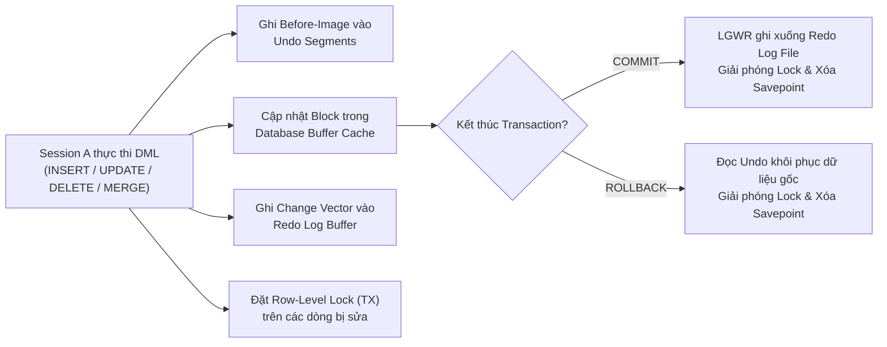
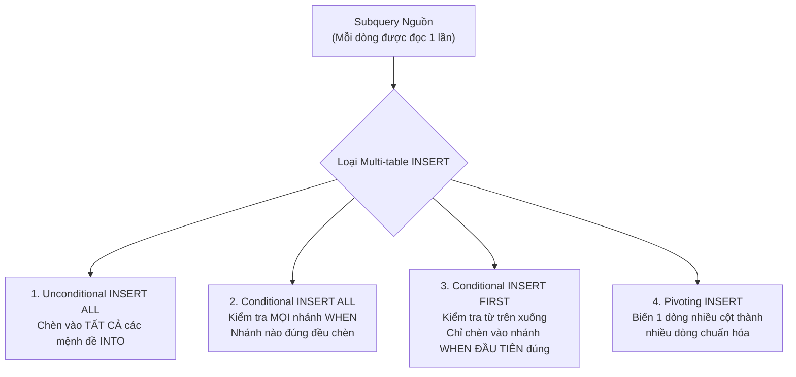
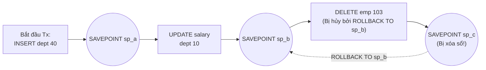
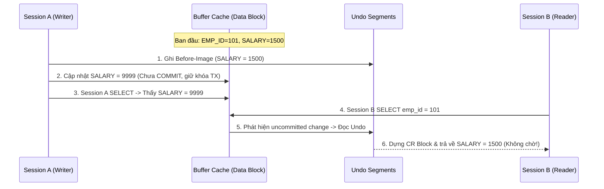

# Chương 10: DML và Quản Lý Giao Dịch (DML & Transaction Control) - Oracle SQL OCA & OCP (1Z0-071)

> **Tài liệu tham chiếu:** *OCA/OCP Oracle Database SQL Exam Guide (Exam 1Z0-071)* — Steve O'Hearn & Roopesh Ramklass.  
> **Mục tiêu khảo thí:** Sử dụng thành thạo nhóm lệnh thao tác dữ liệu (`INSERT`, `UPDATE`, `DELETE`, `MERGE`), Multi-table Insert (`INSERT ALL` vs `INSERT FIRST`), điều khiển giao dịch (`COMMIT`, `ROLLBACK`, `SAVEPOINT`), nắm vững kiến trúc Đọc nhất quán (Read Consistency qua Undo Segments), cơ chế khóa dòng (Row-level Locking) và `SELECT ... FOR UPDATE`.

---

## 📑 Mục Lục Chi Tiết

1. [Tổng Quan Về DML (Data Manipulation Language) Trong Oracle](#1-tổng-quan-về-dml-data-manipulation-language-trong-oracle)
2. [Lệnh `INSERT` — Thêm Mới Dữ Liệu Đơn Bảng & Đa Bảng](#2-lệnh-insert--thêm-mới-dữ-liệu-đơn-bảng--đa-bảng)
3. [Lệnh `UPDATE` — Cập Nhật Dữ Liệu & Subquery Update](#3-lệnh-update--cập-nhật-dữ-liệu--subquery-update)
4. [Lệnh `DELETE` — Xóa Dữ Liệu & Toàn Vẹn Tham Chiếu](#4-lệnh-delete--xóa-dữ-liệu--toàn-vẹn-tham-chiếu)
5. [Lệnh `MERGE` (Upsert) — Hợp Nhất Dữ Liệu Chuyên Sâu](#5-lệnh-merge-upsert--hợp-nhất-dữ-liệu-chuyên-sâu)
6. [Quản Lý Giao Dịch (TCL) & Tính Chất ACID Trong Oracle](#6-quản-lý-giao-dịch-tcl--tính-chất-acid-trong-oracle)
7. [Cơ Chế Read Consistency (Đọc Nhất Quán) & Undo Segments](#7-cơ-chế-read-consistency-đọc-nhất-quán--undo-segments)
8. [Row Locking, `SELECT ... FOR UPDATE` & Xung Đột Dữ Liệu](#8-row-locking-select--for-update--xung-đột-dữ-liệu)
9. [Bài Tập Thực Hành Tự Luyện Cuối Chương (Kèm Lời Giải)](#9-bài-tập-thực-hành-tự-luyện-cuối-chương-kèm-lời-giải)
10. [Tổng Hợp Bẫy Thi OCA/OCP & VNPT Cốt Lõi (Exam Essentials)](#10-tổng-hợp-bẫy-thi-ocaocp--vnpt-cốt-lõi-exam-essentials)

---

## 1. Tổng Quan Về DML (Data Manipulation Language) Trong Oracle

Trong Oracle SQL, các câu lệnh làm thay đổi dữ liệu bên trong bảng (nhưng không làm thay đổi cấu trúc bảng) thuộc nhóm **DML (Data Manipulation Language)**, bao gồm 4 câu lệnh cốt lõi:
* **`INSERT`**: Thêm một hoặc nhiều dòng mới vào bảng (hoặc nhiều bảng).
* **`UPDATE`**: Sửa đổi giá trị các cột trên các dòng hiện có.
* **`DELETE`**: Xóa không gian dữ liệu của một hoặc nhiều dòng khỏi bảng.
* **`MERGE`**: Kết hợp đồng thời `INSERT`, `UPDATE`, và `DELETE` dựa trên việc đối chiếu bảng nguồn (Source) và bảng đích (Target).

### 1.1. Đặc điểm kiến trúc của lệnh DML trong Oracle
Khi một câu lệnh DML được thực thi:
1. **Không tự động lưu vĩnh viễn (No Auto-Commit):** Mọi thay đổi của DML chỉ mới diễn ra trong vùng nhớ đệm **Database Buffer Cache** và được ghi nhận vào **Redo Log Buffer**. Dữ liệu chưa được chốt cho đến khi có lệnh `COMMIT`.
2. **Sinh dữ liệu hoàn tác (Undo Generation):** Trước khi thay đổi giá trị cũ, Oracle lưu hình ảnh trước khi sửa (*Before Image*) vào **Undo Segments** (thuộc Undo Tablespace). Nhờ đó, người dùng có thể `ROLLBACK` hoặc phục vụ cơ chế **Read Consistency** cho các phiên làm việc (Session) khác.
3. **Khóa mức dòng (Row-Level Exclusive Lock):** Oracle tự động đặt khóa độc quyền (`TX Lock`) chỉ trên đúng những dòng bị tác động bởi lệnh DML, tuyệt đối không khóa toàn bộ bảng (trừ khi có chỉ thị tường minh `LOCK TABLE`).



---

## 2. Lệnh `INSERT` — Thêm Mới Dữ Liệu Đơn Bảng & Đa Bảng

### 2.1. Bảng dữ liệu mẫu dùng xuyên suốt chương
Giả sử chúng ta có bảng `DEPARTMENTS` và `EMPLOYEES` với cấu trúc và dữ liệu ban đầu như sau:

**Bảng `DEPARTMENTS`:**

| DEPT_ID (PK) | DEPT_NAME | LOCATION_ID |
| :---: | :--- | :---: |
| 10 | Administration | 1700 |
| 20 | Marketing | 1800 |
| 30 | IT | 1700 |

**Bảng `EMPLOYEES`:**

| EMP_ID (PK) | FULL_NAME | SALARY | HIRE_DATE | DEPT_ID (FK) | COMMISSION_PCT |
| :---: | :--- | :---: | :---: | :---: | :---: |
| 101 | Nguyen Van A | 1500 | 2022-01-15 | 10 | NULL |
| 102 | Tran Thi B | 2500 | 2021-06-01 | 20 | 0.10 |
| 103 | Le Van C | 3200 | 2020-03-20 | 30 | NULL |

---

### 2.2. Single-Row `INSERT` (Thêm từng dòng đơn lẻ)

#### Cú pháp chuẩn:
```sql
INSERT INTO table_name [(column1, column2, ...)]
VALUES (value1, value2, ...);
```

#### Hai cách viết `INSERT` cơ bản:
1. **Liệt kê danh sách cột tường minh (Khuyến nghị):**
   ```sql
   INSERT INTO departments (dept_id, dept_name, location_id)
   VALUES (40, 'Human Resources', 2400);
   ```
   * Thứ tự các cột trong mệnh đề `(column1, column2, ...)` không cần giống thứ tự vật lý khi tạo bảng, miễn là tương ứng 1-1 với danh sách trong `VALUES (...)`.
   * Các cột bị lược bỏ khỏi danh sách cột sẽ tự động nhận giá trị `DEFAULT` (nếu cột có khai báo `DEFAULT`), hoặc nhận `NULL` (nếu không có `DEFAULT`). Nếu cột bị lược bỏ có ràng buộc `NOT NULL` mà không có `DEFAULT`, Oracle sẽ báo lỗi **`ORA-01400: cannot insert NULL into (...)`**.

2. **Không liệt kê danh sách cột (Ngầm định toàn bộ cột):**
   ```sql
   INSERT INTO departments
   VALUES (50, 'Finance', NULL);
   ```
   * Bắt buộc phải truyền **đủ số lượng cột** và **đúng thứ tự vật lý** của các cột trong bảng (trừ các cột ẩn *Invisible Columns*).

> [!WARNING]
> **Bẫy thi OCA/OCP về lỗi số lượng giá trị trong `INSERT`:**
> * Nếu số giá trị trong `VALUES` **ít hơn** số cột yêu cầu → Lỗi **`ORA-00947: not enough values`**.
> * Nếu số giá trị trong `VALUES` **nhiều hơn** số cột yêu cầu → Lỗi **`ORA-00913: too many values`**.
> * Trong Oracle SQL chuẩn, mệnh đề `INSERT INTO table VALUES (...), (...)` (nhiều bộ `VALUES` cách nhau bằng dấu phẩy để chèn nhiều dòng trước phiên bản 23ai) **KHÔNG HỢP LỆ** trong kỳ thi 1Z0-071 (Oracle 12c/19c/21c)! Để chèn nhiều dòng cùng lúc trong 1Z0-071, bạn bắt buộc phải dùng `INSERT INTO ... SELECT` hoặc `INSERT ALL`.

#### Sử dụng từ khóa `DEFAULT` trong `INSERT`:
Bạn có thể dùng trực tiếp từ khóa `DEFAULT` thay cho giá trị cụ thể:
```sql
INSERT INTO employees (emp_id, full_name, salary, hire_date, dept_id)
VALUES (104, 'Pham Minh D', DEFAULT, SYSDATE, 30);
```
Nếu cột `salary` không được định nghĩa giá trị `DEFAULT` lúc tạo bảng, từ khóa `DEFAULT` sẽ truyền giá trị `NULL` vào cột đó.

---

### 2.3. `INSERT INTO ... SELECT` (Chèn dữ liệu từ câu truy vấn con)

Dùng để sao chép nhiều dòng từ một hoặc nhiều bảng khác vào bảng đích chỉ trong một câu lệnh duy nhất.

```sql
INSERT INTO bonus_Archive (emp_id, full_name, bonus_amt)
SELECT emp_id, full_name, salary * 0.15
FROM employees
WHERE dept_id = 30;
```

> [!IMPORTANT]
> **Quy tắc bắt buộc khi dùng `INSERT INTO ... SELECT`:**
> 1. **Tuyệt đối KHÔNG có từ khóa `VALUES`**. Viết `INSERT INTO t VALUES (SELECT ...)` sẽ gây lỗi cú pháp `ORA-00936: missing expression` (trừ khi Subquery là một Scalar Subquery trả về 1 giá trị đơn nằm trong danh sách các biểu thức của `VALUES`).
> 2. Số lượng cột và kiểu dữ liệu trả về từ `SELECT` phải khớp với danh sách cột của `INSERT INTO`. Tên cột giữa hai bảng không cần giống nhau.

---

### 2.4. Multi-Table `INSERT` (Chèn Đa Bảng)

Multi-table `INSERT` cho phép lấy dữ liệu từ **một câu lệnh `SELECT` nguồn duy nhất** và phân phối dữ liệu đó vào **một hoặc nhiều bảng đích** (hoặc chèn nhiều lần vào cùng một bảng). Có 4 biến thể:



#### 2.4.1. Unconditional `INSERT ALL` (Chèn vô điều kiện)
Với mỗi dòng trả về từ Subquery, Oracle chèn vào **tất cả** các nhánh `INTO`.
```sql
INSERT ALL
    INTO emp_history (emp_id, hire_date, dept_id) VALUES (emp_id, hire_date, dept_id)
    INTO sal_history (emp_id, salary, review_date) VALUES (emp_id, salary, SYSDATE)
SELECT emp_id, hire_date, salary, dept_id
FROM employees
WHERE dept_id = 20;
```
* Nếu câu lệnh `SELECT` trả về `3` dòng và có `2` mệnh đề `INTO`, tổng số dòng được chèn sẽ là $3 \times 2 = 6$ dòng.

#### 2.4.2. Conditional `INSERT ALL` (Chèn có điều kiện - Đánh giá toàn bộ)
Mỗi nhánh `WHEN` được kiểm tra **độc lập**. Nếu một dòng thỏa mãn đồng thời 3 điều kiện `WHEN`, dòng đó sẽ được chèn vào cả 3 bảng! Mệnh đề `ELSE` (nếu có) chỉ thực thi khi **không có bất kỳ nhánh `WHEN` nào phía trên thỏa mãn**.

```sql
INSERT ALL
    WHEN salary < 2000 THEN
        INTO low_sal_emps VALUES (emp_id, full_name, salary)
    WHEN salary BETWEEN 1500 AND 3000 THEN
        INTO mid_sal_emps VALUES (emp_id, full_name, salary)
    ELSE
        INTO high_sal_emps VALUES (emp_id, full_name, salary)
SELECT emp_id, full_name, salary
FROM employees;
```

**Phân tích kết quả trên dữ liệu mẫu `EMPLOYEES`:**
* Dòng `101` (`salary = 1500`):
  * Thỏa `salary < 2000` → Chèn vào `low_sal_emps` (1 dòng).
  * Thỏa luôn `salary BETWEEN 1500 AND 3000` → Chèn tiếp vào `mid_sal_emps` (1 dòng).
* Dòng `102` (`salary = 2500`):
  * Không thỏa nhánh 1, thỏa nhánh 2 → Chèn vào `mid_sal_emps` (1 dòng).
* Dòng `103` (`salary = 3200`):
  * Không thỏa cả nhánh 1 và nhánh 2 → Rơi vào `ELSE` → Chèn vào `high_sal_emps` (1 dòng).
* **Tổng số dòng được chèn:** `4` dòng.

#### 2.4.3. Conditional `INSERT FIRST` (Chèn có điều kiện - Khớp nhánh đầu tiên)
Khác biệt sống còn so với `INSERT ALL`: Với mỗi dòng từ Subquery, Oracle kiểm tra các điều kiện `WHEN` từ trên xuống dưới. Ngay khi gặp nhánh `WHEN` **đầu tiên** đúng, nó thực hiện các mệnh đề `INTO` của nhánh đó rồi **bỏ qua toàn bộ các nhánh `WHEN` và `ELSE` bên dưới** cho dòng hiện tại!

```sql
INSERT FIRST
    WHEN salary < 2000 THEN
        INTO low_sal_emps VALUES (emp_id, full_name, salary)
    WHEN salary BETWEEN 1500 AND 3000 THEN
        INTO mid_sal_emps VALUES (emp_id, full_name, salary)
    ELSE
        INTO high_sal_emps VALUES (emp_id, full_name, salary)
SELECT emp_id, full_name, salary
FROM employees;
```
* Với dòng `101` (`salary = 1500`): Thỏa nhánh 1 (`salary < 2000`) → Chèn vào `low_sal_emps` và **dừng ngay**, KHÔNG kiểm tra nhánh 2 nữa!
* **Tổng số dòng được chèn:** Chỉ có `3` dòng (mỗi nhân viên vào đúng 1 bảng).

#### 2.4.4. Pivoting `INSERT` (Xoay bảng từ cột thành dòng)
Là ứng dụng của Unconditional `INSERT ALL` để chuyển đổi dữ liệu từ một bảng phi chuẩn hóa (ví dụ bảng doanh số theo các thứ trong tuần `SALES_SOURCE(emp_id, week_id, mon_sales, tue_sales, wed_sales)`) sang bảng chuẩn hóa theo dòng:
```sql
INSERT ALL
    INTO sales_info VALUES (emp_id, week_id, 'MON', mon_sales)
    INTO sales_info VALUES (emp_id, week_id, 'TUE', tue_sales)
    INTO sales_info VALUES (emp_id, week_id, 'WED', wed_sales)
SELECT emp_id, week_id, mon_sales, tue_sales, wed_sales
FROM sales_source;
```

> [!WARNING]
> **5 Quy tắc & Bẫy thi chết người của Multi-Table `INSERT`:**
> 1. **Bắt buộc phải có Subquery (`SELECT`) ở cuối.** Không thể dùng `INSERT ALL` mà không có `SELECT` (nhiều thí sinh dùng `SELECT * FROM dual;` khi muốn chèn dữ liệu tĩnh).
> 2. **Tên cột trong `WHEN` và `VALUES` phải lấy từ danh sách cột (hoặc Alias) của Subquery**, KHÔNG phải tên cột của bảng nguồn nếu cột đó đã được đặt Alias trong `SELECT`!
>    ```sql
>    INSERT ALL
>        WHEN sal > 2000 THEN INTO high_emp VALUES (id, sal) -- Phải dùng alias id, sal!
>    SELECT emp_id AS id, salary AS sal FROM employees;
>    ```
> 3. **Một nhánh `WHEN` có thể đi kèm NHIỀU mệnh đề `INTO`** liên tiếp nhau (không cần lặp lại từ khóa `THEN`).
> 4. **Không có `INSERT FIRST` vô điều kiện:** Viết `INSERT FIRST INTO t1 ... INTO t2 ... SELECT ...` (không có `WHEN`) sẽ báo lỗi cú pháp **`ORA-00928: missing SELECT keyword`** hoặc lỗi thiếu `WHEN`.
> 5. **Bẫy Sequence `NEXTVAL` trong `INSERT ALL`:** `seq.NEXTVAL` trong Multi-table Insert được đánh giá **1 lần duy nhất cho mỗi dòng trả về từ Subquery**, chứ KHÔNG phải mỗi mệnh đề `INTO`! Do đó nếu dùng `seq.NEXTVAL` ở 3 nhánh `INTO` cho cùng 1 dòng nguồn, cả 3 nhánh đều nhận **cùng một số Sequence giống hệt nhau**.

---

## 3. Lệnh `UPDATE` — Cập Nhật Dữ Liệu & Subquery Update

### 3.1. Cú pháp chuẩn
```sql
UPDATE table_name
SET column1 = expression1 [, column2 = expression2, ...]
[WHERE condition];
```

* Nếu lược bỏ mệnh đề `WHERE`, **tất cả các dòng** trong bảng sẽ bị cập nhật!
* Có thể gán `SET column = DEFAULT` để đưa cột về giá trị mặc định lúc khai báo bảng (hoặc `NULL` nếu cột không có `DEFAULT`).

### 3.2. Cập nhật nhiều cột bằng Subquery (Multiple-Column Update)
Oracle hỗ trợ gom nhóm các cột cần cập nhật trong cặp ngoặc đơn `(col1, col2)`:
```sql
UPDATE employees
SET (dept_id, salary) = (
    SELECT dept_id, salary
    FROM employees
    WHERE emp_id = 103
)
WHERE emp_id = 101;
```
* Sau khi chạy lệnh trên, nhân viên `101` sẽ có `dept_id = 30` và `salary = 3200`.

### 3.3. Correlated `UPDATE` và Bẫy gán `NULL` ngoài ý muốn
Giả sử ta muốn cập nhật lương của nhân viên trong bảng `EMPLOYEES` theo mức lương mới lưu trong bảng `EMP_RAISE` (chỉ chứa một số nhân viên được tăng lương):

```sql
-- ❌ CẨN THẬN BẪY THI: Không có mệnh đề WHERE ở câu UPDATE ngoài!
UPDATE employees e
SET e.salary = (
    SELECT r.new_salary
    FROM emp_raise r
    WHERE r.emp_id = e.emp_id
);
```
> [!CAUTION]
> **Điều gì xảy ra với câu lệnh trên?**
> Vì câu lệnh `UPDATE` ngoài cùng **không có mệnh đề `WHERE`**, Oracle sẽ quét qua **tất cả các dòng** của bảng `EMPLOYEES`. Với những nhân viên không có mặt trong bảng `EMP_RAISE`, Subquery trả về `NULL`. Kết quả là lương của những nhân viên đó bị cập nhật thành `NULL` (hoặc toàn bộ câu lệnh thất bại với lỗi `ORA-01407: cannot update ("HR"."EMPLOYEES"."SALARY") to NULL` nếu cột `salary` có ràng buộc `NOT NULL`)!
>
> **Cách khắc phục chuẩn mực:** Thêm điều kiện `WHERE EXISTS` (hoặc `WHERE emp_id IN (...)`) ở câu `UPDATE` ngoài:
> ```sql
> UPDATE employees e
> SET e.salary = (
>     SELECT r.new_salary
>     FROM emp_raise r
>     WHERE r.emp_id = e.emp_id
> )
> WHERE EXISTS (
>     SELECT 1
>     FROM emp_raise r
>     WHERE r.emp_id = e.emp_id
> );
> ```

---

## 4. Lệnh `DELETE` — Xóa Dữ Liệu & Toàn Vẹn Tham Chiếu

### 4.1. Cú pháp chuẩn
```sql
DELETE [FROM] table_name
[WHERE condition];
```

> [!TIP]
> **Mẹo thi OCA 1Z0-071:** Từ khóa `FROM` trong câu lệnh `DELETE` là **tùy chọn (optional)**! Cả hai câu lệnh `DELETE FROM employees WHERE emp_id = 101;` và `DELETE employees WHERE emp_id = 101;` đều **hoàn toàn hợp lệ** trong Oracle SQL.

### 4.2. Đặc điểm của lệnh `DELETE`
1. Nếu không có mệnh đề `WHERE`, toàn bộ các dòng trong bảng sẽ bị xóa (nhưng cấu trúc bảng, Index, Constraint, Trigger vẫn giữ nguyên).
2. `DELETE` không giải phóng không gian lưu trữ vật lý dưới vạch **High Water Mark (HWM)** trả về cho Tablespace, và sinh lượng dữ liệu **Undo** lớn nhất trong 3 lệnh DML (vì phải lưu toàn bộ dòng bị xóa vào Undo để phục vụ `ROLLBACK`), trong khi `INSERT` sinh ít Undo nhất (chỉ cần lưu `ROWID` của dòng mới chèn).
3. Nếu xóa một dòng ở bảng Cha (`DEPARTMENTS`) mà đang có dòng Con trong bảng `EMPLOYEES` tham chiếu tới qua khóa ngoại (Foreign Key) thông thường (không khai báo `ON DELETE CASCADE` hay `ON DELETE SET NULL`), lệnh `DELETE` sẽ báo lỗi:
   **`ORA-02292: integrity constraint (...) violated - child record found`**.
4. Tuy nhiên, nếu bảng Cha có một dòng (`dept_id = 40`) mà **chưa có bất kỳ dòng Con nào** trong `EMPLOYEES` tham chiếu tới `40`, bạn vẫn xóa dòng `dept_id = 40` thành công bình thường dù khóa ngoại đang bật!

---

## 5. Lệnh `MERGE` (Upsert) — Hợp Nhất Dữ Liệu Chuyên Sâu

Lệnh `MERGE` (còn gọi là **Upsert**) cho phép đồng bộ dữ liệu từ bảng nguồn (hoặc View / Subquery) vào bảng đích: nếu dòng đã tồn tại (khớp điều kiện `ON`) thì `UPDATE` (và tùy chọn `DELETE`), nếu chưa tồn tại thì `INSERT`.

### 5.1. Cú pháp đầy đủ của `MERGE`
```sql
MERGE INTO target_table t
USING source_table_or_query s
ON (t.join_col = s.join_col)
WHEN MATCHED THEN
    UPDATE SET
        t.col1 = s.col1,
        t.col2 = s.col2
    [WHERE update_filter_condition]
    [DELETE WHERE delete_filter_condition]
WHEN NOT MATCHED THEN
    INSERT (t.join_col, t.col1, t.col2)
    VALUES (s.join_col, s.col1, s.col2)
    [WHERE insert_filter_condition];
```

### 5.2. Ví dụ thực tế minh họa `MERGE` kèm `DELETE WHERE`
Giả sử bảng đích `EMP_TARGET` và bảng nguồn `EMP_SOURCE` có dữ liệu như sau:

**Bảng đích `EMP_TARGET` (Trước khi MERGE):**

| EMP_ID | FULL_NAME | SALARY | STATUS |
| :---: | :--- | :---: | :---: |
| 101 | Nguyen Van A | 1500 | ACTIVE |
| 102 | Tran Thi B | 2500 | ACTIVE |
| 103 | Le Van C | 3200 | INACTIVE |

**Bảng nguồn `EMP_SOURCE`:**

| EMP_ID | FULL_NAME | SALARY | STATUS |
| :---: | :--- | :---: | :---: |
| 101 | Nguyen Van A | 1800 | ACTIVE |
| 102 | Tran Thi B | 2600 | RESIGNED |
| 104 | Pham Minh D | 2000 | ACTIVE |

Thực thi câu lệnh `MERGE` sau:
```sql
MERGE INTO emp_target t
USING emp_source s
ON (t.emp_id = s.emp_id)
WHEN MATCHED THEN
    UPDATE SET
        t.salary = s.salary,
        t.status = s.status
    DELETE WHERE (t.status IN ('INACTIVE', 'RESIGNED'))
WHEN NOT MATCHED THEN
    INSERT (t.emp_id, t.full_name, t.salary, t.status)
    VALUES (s.emp_id, s.full_name, s.salary, s.status);
```

**Phân tích từng dòng khi chạy lệnh `MERGE` trên:**
1. **`EMP_ID = 101`**: Khớp điều kiện `ON (101 = 101)` → Chạy `WHEN MATCHED`: cập nhật `salary = 1800`, `status = 'ACTIVE'`. Kiểm tra `DELETE WHERE`: `status` là `'ACTIVE'` nên không xóa.
2. **`EMP_ID = 102`**: Khớp điều kiện `ON (102 = 102)` → Chạy `WHEN MATCHED`: cập nhật `salary = 2600`, `status = 'RESIGNED'`. Sau khi cập nhật, kiểm tra `DELETE WHERE`: giá trị mới của `t.status` là `'RESIGNED'` thỏa mãn điều kiện xóa → **Dòng `102` bị xóa khỏi `EMP_TARGET`!**
3. **`EMP_ID = 103` (trong `EMP_TARGET`)**: Không có trong `EMP_SOURCE` nên **không khớp điều kiện `ON`**. Mặc dù `EMP_ID = 103` đang có `status = 'INACTIVE'`, nhưng vì nó **không được cập nhật bởi mệnh đề `WHEN MATCHED`**, mệnh đề `DELETE WHERE` **HOÀN TOÀN BỎ QUA** dòng `103`! Dòng `103` vẫn nằm nguyên trong `EMP_TARGET`!
4. **`EMP_ID = 104` (trong `EMP_SOURCE`)**: Không khớp `ON` → Chạy `WHEN NOT MATCHED`: chèn dòng `104` vào `EMP_TARGET`.

**Kết quả bảng `EMP_TARGET` sau khi `MERGE`:**

| EMP_ID | FULL_NAME | SALARY | STATUS |
| :---: | :--- | :---: | :---: |
| 101 | Nguyen Van A | 1800 | ACTIVE |
| 103 | Le Van C | 3200 | INACTIVE |
| 104 | Pham Minh D | 2000 | ACTIVE |

> [!IMPORTANT]
> **5 Quy tắc Vàng của `MERGE` luôn xuất hiện trong đề thi OCP:**
> 1. **Cấm cập nhật cột nằm trong mệnh đề `ON (...)`:** Nếu điều kiện là `ON (t.emp_id = s.emp_id)` thì trong `UPDATE SET` tuyệt đối không được viết `t.emp_id = ...`. Nếu vi phạm sẽ bị lỗi **`ORA-38104: Columns referenced in the ON Clause cannot be updated`**.
> 2. **Quy tắc `DELETE WHERE` trong `MERGE`:**
>    * Mệnh đề `DELETE WHERE` chỉ có thể nằm bên trong khối `WHEN MATCHED THEN UPDATE ...` (không thể đứng độc lập nếu không có `UPDATE`).
>    * Nó **chỉ đánh giá trên những dòng vừa bị chạm bởi lệnh `UPDATE`** trong lần chạy `MERGE` đó, và kiểm tra dựa trên **giá trị sau khi đã UPDATE** (*post-update values*). Các dòng trong bảng đích không khớp `ON` (hoặc bị loại bởi `UPDATE ... WHERE`) sẽ không bao giờ bị xóa!
> 3. **Tính linh hoạt của `WHEN MATCHED` và `WHEN NOT MATCHED`:** Bạn có thể viết cả hai mệnh đề, hoặc **chỉ viết một trong hai** (`WHEN MATCHED` đơn lẻ hoặc `WHEN NOT MATCHED` đơn lẻ đều hợp lệ). Thứ tự giữa hai mệnh đề này có thể hoán đổi cho nhau.
> 4. **Lỗi `ORA-30926: unable to get a stable set of rows in the source tables`:** Xảy ra khi **1 dòng trong bảng đích khớp với nhiều hơn 1 dòng trong bảng nguồn** theo điều kiện `ON`, khiến Oracle không biết phải lấy dòng nguồn nào để `UPDATE` dòng đích đó. (Ngược lại, nếu 1 dòng trong bảng nguồn khớp với nhiều dòng trong bảng đích thì hoàn toàn hợp lệ!).
> 5. **Cú pháp `UPDATE SET` và `INSERT` trong `MERGE`:** Trong `MERGE`, bạn không viết tên bảng sau từ khóa `UPDATE` (chỉ viết `UPDATE SET ...`) và không viết `INTO table_name` sau từ khóa `INSERT` (chỉ viết `INSERT (cols) VALUES (vals)`).

---

## 6. Quản Lý Giao Dịch (TCL) & Tính Chất ACID Trong Oracle

Một **Giao dịch (Transaction)** là một đơn vị công việc logic (*Logical Unit of Work*) bao gồm một hoặc nhiều câu lệnh DML, bắt buộc phải được thực thi thành công trọn vẹn cùng nhau hoặc bị hủy bỏ hoàn toàn.

### 6.1. Vòng đời của một Transaction trong Oracle

| Sự kiện | Chi tiết cơ chế trong Oracle Database |
| :--- | :--- |
| **Khi nào Transaction BẮT ĐẦU?** | Bắt đầu tự động (ngầm định) ngay khi **câu lệnh DML đầu tiên** (`INSERT`, `UPDATE`, `DELETE`, `MERGE`, hoặc `SELECT ... FOR UPDATE`) được thực thi sau khi mới mở kết nối hoặc sau khi Transaction trước đó vừa kết thúc. *(Lưu ý: Trong SQL của Oracle KHÔNG có lệnh `BEGIN TRANSACTION` tường minh).* |
| **Khi nào Transaction KẾT THÚC?** | Khi xảy ra **1 trong 5 sự kiện** sau:<br>1. Thực thi lệnh `COMMIT` hoặc `ROLLBACK` (không kèm `TO SAVEPOINT`).<br>2. Thực thi một câu lệnh **DDL** (`CREATE`, `ALTER`, `DROP`, `TRUNCATE`, `RENAME`) hoặc **DCL** (`GRANT`, `REVOKE`) → Tự động chốt (`Auto-COMMIT`) giao dịch hiện tại.<br>3. Người dùng thoát khỏi công cụ (`EXIT` hoặc `QUIT` trong SQL*Plus) một cách bình thường → Tự động `COMMIT`.<br>4. Phiên làm việc (Session) bị ngắt kết nối bất thường, bị `ALTER SYSTEM KILL SESSION`, hoặc mất mạng → Tự động `ROLLBACK` bởi tiến trình nền `PMON`/`SMON`.<br>5. Hệ quản trị CSDL (Database Instance) bị sập (Crash) → Tự động `ROLLBACK` các giao dịch chưa commit trong quá trình *Instance Recovery* khi mở lại DB. |

---

### 6.2. Bốn tính chất ACID trong kiến trúc Oracle

1. **Atomicity (Tính nguyên tử - All or Nothing):**
   * Mọi câu lệnh DML trong một Transaction hoặc là cùng thành công hết, hoặc là cùng bị hủy bỏ hết.
   * **Lưu ý cực kỳ quan trọng về Statement-level Atomicity:** Nếu trong một Transaction gồm 3 lệnh DML, lệnh thứ 1 và thứ 2 đã chạy thành công, nhưng lệnh thứ 3 bị lỗi (ví dụ vi phạm ràng buộc `NOT NULL` hoặc `UNIQUE` hoặc chia cho 0), thì Oracle chỉ **tự động Rollback câu lệnh thứ 3 bị lỗi đó (Statement-level Rollback)**! Transaction hiện tại **vẫn đang mở**, và kết quả của lệnh thứ 1 và thứ 2 **vẫn còn nguyên**, chưa bị Rollback!
2. **Consistency (Tính nhất quán):**
   * Dữ liệu luôn chuyển từ trạng thái nhất quán này sang trạng thái nhất quán khác, đảm bảo mọi ràng buộc toàn vẹn (Constraints) đều được thỏa mãn khi Transaction kết thúc.
3. **Isolation (Tính cô lập):**
   * Các thay đổi của một Transaction đang chạy (chưa `COMMIT`) hoàn toàn **vô hình** đối với các Session khác. Oracle hỗ trợ các mức cô lập: `READ COMMITTED` (mặc định) và `SERIALIZABLE` (cùng chế độ `READ ONLY`).
4. **Durability (Tính bền vững):**
   * Một khi lệnh `COMMIT` báo thành công cho người dùng, tiến trình nền **LGWR (Log Writer)** đã ghi toàn bộ Redo records của giao dịch đó từ *Redo Log Buffer* xuống đĩa cứng (*Online Redo Log Files*). Kể cả khi máy chủ mất điện ngay lập tức sau khi `COMMIT` (trước khi tiến trình `DBWn` kịp ghi Data Block từ Buffer Cache xuống Datafile), dữ liệu đã commit vẫn được bảo toàn 100% nhờ cơ chế *Roll Forward (Redo)* khi khởi động lại DB.

---

### 6.3. Chi tiết các câu lệnh TCL: `COMMIT`, `ROLLBACK`, `SAVEPOINT`

#### 1. `COMMIT [WORK]`
* Lưu vĩnh viễn mọi thay đổi của Transaction hiện tại vào CSDL.
* Giải phóng tất cả các khóa dòng (Row Locks) và khóa bảng mà Transaction đang giữ.
* Xóa bỏ toàn bộ các `SAVEPOINT` đã được đánh dấu trong Transaction đó.
* Gán một số **SCN (System Change Number)** mới cho Transaction để các Session khác bắt đầu nhìn thấy dữ liệu mới.

#### 2. `SAVEPOINT savepoint_name` và `ROLLBACK TO [SAVEPOINT] savepoint_name`
Cho phép đánh dấu các mốc trung gian bên trong một Transaction dài để hoàn tác một phần công việc mà không làm mất toàn bộ Transaction.

```sql
-- Bắt đầu Transaction bằng lệnh DML đầu tiên:
INSERT INTO departments VALUES (40, 'HR', 1700);
SAVEPOINT sp_a;

UPDATE employees SET salary = salary + 500 WHERE dept_id = 10;
SAVEPOINT sp_b;

DELETE FROM employees WHERE emp_id = 103;
SAVEPOINT sp_c;

-- Hoàn tác về mốc sp_b:
ROLLBACK TO SAVEPOINT sp_b;
```



**Phân tích trạng thái chính xác sau lệnh `ROLLBACK TO SAVEPOINT sp_b;`:**
1. Lệnh `DELETE FROM employees WHERE emp_id = 103` (nằm sau `sp_b`) **bị hủy bỏ**, khóa dòng trên nhân viên `103` được giải phóng.
2. Mốc `SAVEPOINT sp_c` (được tạo sau `sp_b`) **bị xóa sổ hoàn toàn**! Nếu sau đó bạn gọi `ROLLBACK TO sp_c;`, Oracle sẽ báo lỗi **`ORA-01086: savepoint 'SP_C' never established in this session or is invalid`**.
3. Mốc `SAVEPOINT sp_b` và `SAVEPOINT sp_a` **VẪN CÒN TỒN TẠI**! Bạn có thể tiếp tục chạy DML mới rồi lại gọi `ROLLBACK TO sp_b;` hoặc `ROLLBACK TO sp_a;` hoàn toàn hợp lệ.
4. Lệnh `INSERT` và lệnh `UPDATE` (nằm trước `sp_b`) **vẫn đang giữ hiệu lực và giữ khóa dòng**, Transaction vẫn đang mở chờ `COMMIT` hoặc `ROLLBACK`.

> [!WARNING]
> **Bẫy đặt trùng tên Savepoint:**
> Nếu trong cùng một Transaction bạn chạy `SAVEPOINT sp1;`, thực hiện một số lệnh DML, rồi lại chạy `SAVEPOINT sp1;` lần thứ hai: Oracle **không báo lỗi**, mà tự động **dời mốc `sp1` đến vị trí mới nhất** (mốc `sp1` cũ bị ghi đè). Khi bạn gọi `ROLLBACK TO sp1;`, nó chỉ hoàn tác về vị trí của lệnh `SAVEPOINT sp1` lần thứ hai!

---

## 7. Cơ Chế Read Consistency (Đọc Nhất Quán) & Undo Segments

Một trong những câu hỏi kinh điển nhất trong cả đề thi chứng chỉ Oracle lẫn phỏng vấn/thi tuyển VNPT là: **"Khi Session A đang sửa dữ liệu mà chưa COMMIT, Session B vào đọc bảng đó thì thấy gì và có bị chờ (block) không?"**

### 7.1. Nguyên lý cốt lõi của Oracle
Trong Oracle Database:
1. **Đọc KHÔNG BAO GIỜ chặn Ghi (*Readers do NOT block Writers*).**
2. **Ghi KHÔNG BAO GIỜ chặn Đọc (*Writers do NOT block Readers*).** *(Ngoại trừ lệnh `SELECT ... FOR UPDATE` vì bản chất nó là lệnh xin cấp khóa Ghi).*
3. **Không bao giờ có hiện tượng Đọc bẩn (*No Dirty Reads*):** Một Session không bao giờ đọc được dữ liệu chưa `COMMIT` của một Session khác. (Tuy nhiên, bản thân Session đang thực hiện DML thì luôn nhìn thấy ngay các thay đổi chưa commit của chính mình!).

### 7.2. Cơ chế hoạt động của Undo Segments & CR Block
Giả sử lúc `09:00:00` (SCN = 1000), nhân viên `101` có `salary = 1500`.
* Lúc `09:01:00`, **Session A** thực thi:
  ```sql
  UPDATE employees SET salary = 9999 WHERE emp_id = 101;
  -- Chưa COMMIT!
  ```
  Oracle lưu giá trị cũ `1500` vào **Undo Segment**, và sửa giá trị trong Data Block trên Buffer Cache thành `9999` (kèm cờ khóa giao dịch của Session A).
* Lúc `09:02:00`, **Session B** thực thi:
  ```sql
  SELECT emp_id, salary FROM employees WHERE emp_id = 101;
  ```
  * Session B **không hề bị treo hay phải chờ Session A**.
  * Khi tiến trình đọc của Session B quét đến Data Block chứa nhân viên `101`, nó phát hiện dữ liệu `9999` thuộc về một Transaction chưa Commit của Session A.
  * Ngay lập tức, Oracle tìm đến **Undo Segment**, lấy giá trị trước khi sửa (`1500`) để tái tạo một bản sao **CR (Consistent Read) Block** trong vùng nhớ đệm và trả kết quả `salary = 1500` ngay tức khắc cho Session B!



> [!IMPORTANT]
> **Lỗi `ORA-01555: snapshot too old` là gì?**
> Khi một câu lệnh `SELECT` bắt đầu chạy tại thời điểm $T_0$ và kéo dài rất lâu (ví dụ 2 tiếng), nó cần đảm bảo toàn bộ dữ liệu đọc được phải nhất quán tại đúng mốc thời gian $T_0$ (*Statement-level Read Consistency*). Trong khoảng thời gian 2 tiếng đó, nếu các Session khác liên tục `UPDATE` và **`COMMIT`**, các khối Undo cũ (vốn đã được phép tái sử dụng sau khi Transaction kia Commit) có thể bị ghi đè mất. Khi câu lệnh `SELECT` cần đọc lại hình ảnh tại thời điểm $T_0$ mà khối Undo tương ứng đã bị ghi đè, Oracle sẽ ném lỗi **`ORA-01555: snapshot too old`**.

---

## 8. Row Locking, `SELECT ... FOR UPDATE` & Xung Đột Dữ Liệu

### 8.1. Xung đột Ghi - Ghi (Writer Blocks Writer)
Mặc dù Đọc và Ghi không chặn nhau, nhưng **Ghi sẽ chặn Ghi trên cùng một dòng dữ liệu**:
* **Session A** chạy: `UPDATE employees SET salary = 2000 WHERE emp_id = 101;` (Chưa Commit → Dòng `101` bị khóa độc quyền bởi Session A).
* **Session B** chạy: `DELETE FROM employees WHERE emp_id = 101;` (hoặc `UPDATE` dòng `101`).
  * Lúc này, **Session B sẽ bị treo (Wait / Blocked)**!
  * Session B sẽ chờ cho đến khi Session A thực hiện `COMMIT` hoặc `ROLLBACK`.
* Trong khi đó, nếu **Session C** chạy: `UPDATE employees SET salary = 3000 WHERE emp_id = 102;` → Session C chạy **thành công ngay lập tức** vì dòng `102` không hề bị khóa!

---

### 8.2. Lệnh `SELECT ... FOR UPDATE` (Khóa dòng chủ động)
Đôi khi ứng dụng muốn đọc một số dòng lên màn hình và **đặt khóa độc quyền ngay lập tức** để ngăn không cho bất kỳ Session nào khác sửa các dòng đó trong lúc người dùng đang xem xét trước khi bấm nút Lưu.

#### Cú pháp chuẩn:
```sql
SELECT column_list
FROM table_name
[WHERE condition]
FOR UPDATE [OF [schema.]table.column] [NOWAIT | WAIT n | SKIP LOCKED];
```

#### So sánh các tùy chọn xử lý khi dòng cần khóa đang bị Session khác giữ khóa:

| Tùy chọn | Hành vi khi dòng mục tiêu đang bị khóa bởi Session khác |
| :--- | :--- |
| **`FOR UPDATE`** *(Mặc định)* | Session hiện tại **bị treo (chờ vô thời hạn)** cho đến khi Session giữ khóa thực hiện `COMMIT` hoặc `ROLLBACK`. |
| **`FOR UPDATE NOWAIT`** | **Không chờ!** Trả quyền điều khiển ngay lập tức về cho người dùng kèm mã lỗi **`ORA-00054: resource busy and acquire with NOWAIT specified`**. |
| **`FOR UPDATE WAIT 5`** | Chờ tối đa `5` giây. Nếu trong vòng 5 giây khóa được giải phóng thì chiếm khóa và trả kết quả; nếu hết 5 giây vẫn bị khóa thì văng lỗi **`ORA-30006: resource busy; acquire with WAIT timeout expired`**. |
| **`FOR UPDATE SKIP LOCKED`** | **Không chờ và không báo lỗi!** Tự động bỏ qua các dòng đang bị khóa bởi Session khác, chỉ khóa và trả về những dòng đang rảnh. |

#### Bẫy cực hay về `FOR UPDATE` trong câu truy vấn JOIN nhiều bảng:
Xét câu truy vấn kết nối 2 bảng `EMPLOYEES` và `DEPARTMENTS`:

```sql
-- Trường hợp 1: FOR UPDATE không có mệnh đề OF
SELECT e.emp_id, e.full_name, d.dept_name
FROM employees e
JOIN departments d ON e.dept_id = d.dept_id
WHERE e.dept_id = 10
FOR UPDATE;
```
* **Kết quả Trường hợp 1:** Oracle đặt khóa độc quyền trên các dòng thỏa mãn điều kiện ở **CẢ HAI BẢNG** `EMPLOYEES` và `DEPARTMENTS`!

```sql
-- Trường hợp 2: FOR UPDATE OF column_name
SELECT e.emp_id, e.full_name, d.dept_name
FROM employees e
JOIN departments d ON e.dept_id = d.dept_id
WHERE e.dept_id = 10
FOR UPDATE OF e.salary;
```
* **Kết quả Trường hợp 2:** Vì `e.salary` là cột thuộc bảng `EMPLOYEES`, Oracle **chỉ khóa các dòng thuộc bảng `EMPLOYEES`**, còn dòng phòng ban `10` trong bảng `DEPARTMENTS` **KHÔNG bị khóa**! *(Lưu ý: tên cột sau từ khóa `OF` chỉ dùng để chỉ định bảng nào sẽ bị khóa, Oracle vẫn khóa toàn bộ dòng đó trên bảng `EMPLOYEES` chứ không phải chỉ khóa riêng cột `salary`)*.

---

### 8.3. Hiện tượng Deadlock (`ORA-00060`)
Deadlock (Khóa chết / Bế tắc vòng tròn) xảy ra khi 2 (hoặc nhiều) Session cùng chờ giải phóng khóa của nhau:
* **Thời điểm T1:** Session A cập nhật dòng `emp_id = 101` (Giữ khóa dòng `101`).
* **Thời điểm T2:** Session B cập nhật dòng `emp_id = 102` (Giữ khóa dòng `102`).
* **Thời điểm T3:** Session A yêu cầu cập nhật dòng `emp_id = 102` → Session A phải đứng chờ Session B.
* **Thời điểm T4:** Session B yêu cầu cập nhật dòng `emp_id = 101` → Session B chờ ngược lại Session A → **Deadlock xuất hiện!**

> [!WARNING]
> **Bẫy thi OCA/OCP về cách Oracle xử lý Deadlock:**
> Khi phát hiện Deadlock, Oracle tự động chọn một trong hai Session để ném ra lỗi **`ORA-00060: deadlock detected while waiting for resource`**.
> * Oracle **CHỈ ROLLBACK CÂU LỆNH DML VỪA GÂY RA DEADLOCK** (*Statement-level Rollback*), **TUYỆT ĐỐI KHÔNG rollback toàn bộ Transaction** của Session nhận lỗi!
> * Các câu lệnh DML trước đó của Session nhận lỗi (ví dụ dòng `101` của Session A) **vẫn còn giữ nguyên khóa**! Session nhận lỗi phải chủ động quyết định `COMMIT` hoặc `ROLLBACK` để giải phóng các khóa còn lại.

---

## 9. Bài Tập Thực Hành Tự Luyện Cuối Chương (Kèm Lời Giải)

### Bài tập 1: Phân tích `INSERT ALL` vs `INSERT FIRST`
Cho bảng `ORDERS` có 3 dòng dữ liệu:
* `(order_id = 1, total_amt = 5000)`
* `(order_id = 2, total_amt = 12000)`
* `(order_id = 3, total_amt = 25000)`

Các bảng `SMALL_ORDERS`, `MEDIUM_ORDERS`, `LARGE_ORDERS`, `VIP_ORDERS` hiện đang trống. Hãy tính tổng số dòng được chèn vào cả 4 bảng trong 2 trường hợp:
1. Chạy lệnh với `INSERT ALL`
2. Chạy lệnh với `INSERT FIRST`

```sql
INSERT [ALL | FIRST]
    WHEN total_amt >= 20000 THEN
        INTO vip_orders VALUES (order_id, total_amt)
        INTO large_orders VALUES (order_id, total_amt)
    WHEN total_amt >= 10000 THEN
        INTO medium_orders VALUES (order_id, total_amt)
    ELSE
        INTO small_orders VALUES (order_id, total_amt)
SELECT order_id, total_amt FROM orders;
```

<details>
<summary><b>💡 Xem Lời Giải Chi Tiết Bài Tập 1</b></summary>

1. **Khi dùng `INSERT ALL`:**
   * Dòng 1 (`5000`): Không thỏa cả 2 nhánh `WHEN` → Vào `ELSE` (`small_orders`: **1 dòng**).
   * Dòng 2 (`12000`): Không thỏa nhánh 1, thỏa nhánh 2 (`>= 10000`) → Vào `medium_orders` (**1 dòng**).
   * Dòng 3 (`25000`):
     * Thỏa nhánh 1 (`>= 20000`) → Chèn vào cả `vip_orders` và `large_orders` (**2 dòng**).
     * Vì là `INSERT ALL`, tiếp tục kiểm tra nhánh 2 (`>= 10000`): Vẫn thỏa mãn → Chèn tiếp vào `medium_orders` (**1 dòng**).
   * **Tổng cộng `INSERT ALL`:** $1 + 1 + 2 + 1 = \mathbf{5}$ **dòng**.

2. **Khi dùng `INSERT FIRST`:**
   * Dòng 1 (`5000`): Vào `ELSE` (`small_orders`: **1 dòng**).
   * Dòng 2 (`12000`): Thỏa nhánh 2 → Vào `medium_orders` (**1 dòng**).
   * Dòng 3 (`25000`): Thỏa nhánh 1 (`>= 20000`) → Thực hiện **cả 2 lệnh `INTO`** thuộc nhánh 1 (`vip_orders` và `large_orders`: **2 dòng**), sau đó bỏ qua nhánh 2!
   * **Tổng cộng `INSERT FIRST`:** $1 + 1 + 2 = \mathbf{4}$ **dòng**.
</details>

---

### Bài tập 2: Truy vết Transaction & Savepoint
Cho bảng `ACCOUNTS (acc_id NUMBER PRIMARY KEY, balance NUMBER NOT NULL)` đang có duy nhất 1 dòng: `(1, 1000)`. Hãy xác định giá trị `balance` của tài khoản `1` và số dòng trong bảng sau khi chạy kịch bản sau:

```sql
UPDATE accounts SET balance = 2000 WHERE acc_id = 1;
SAVEPOINT sp1;
INSERT INTO accounts VALUES (2, 500);
SAVEPOINT sp1;
UPDATE accounts SET balance = 3000 WHERE acc_id = 1;
UPDATE accounts SET balance = NULL WHERE acc_id = 2; -- Lỗi ORA-01400/ORA-01407!
ROLLBACK TO SAVEPOINT sp1;
COMMIT;
```

<details>
<summary><b>💡 Xem Lời Giải Chi Tiết Bài Tập 2</b></summary>

* **Bước 1:** `UPDATE` đổi `balance` của `acc_id = 1` thành `2000`.
* **Bước 2:** Tạo `SAVEPOINT sp1` lần thứ nhất.
* **Bước 3:** `INSERT` thêm dòng `(2, 500)`.
* **Bước 4:** Tạo lại `SAVEPOINT sp1` trùng tên → Mốc `sp1` bị dời xuống **sau lệnh `INSERT` dòng `(2, 500)`**!
* **Bước 5:** `UPDATE` đổi `balance` của `acc_id = 1` thành `3000`.
* **Bước 6:** `UPDATE` gán `balance = NULL` cho `acc_id = 2` bị lỗi vi phạm ràng buộc `NOT NULL` → Chỉ riêng câu lệnh bị lỗi này bị Statement-level Rollback.
* **Bước 7:** `ROLLBACK TO SAVEPOINT sp1;` → Hoàn tác về vị trí của `sp1` mới nhất (Bước 4). Do đó, lệnh `UPDATE` ở Bước 5 (`balance = 3000`) bị hủy bỏ, `acc_id = 1` quay về mức `2000`, và dòng `(2, 500)` (nằm trước `sp1` mới) **vẫn được giữ lại**!
* **Bước 8:** `COMMIT;` chốt giao dịch.
* **Kết quả cuối cùng:** Bảng có **2 dòng**: `(1, 2000)` và `(2, 500)`.
</details>

---

## 10. Tổng Hợp Bẫy Thi OCA/OCP & VNPT Cốt Lõi (Exam Essentials)

| # | Chủ đề | Bẫy đề thi thường gặp | Quy tắc chuẩn cần nhớ |
| :---: | :--- | :--- | :--- |
| **1** | `INSERT INTO ... SELECT` | Thêm từ khóa `VALUES` trước `SELECT` | **Sai cú pháp!** Khi chèn từ Subquery tuyệt đối không viết từ khóa `VALUES`. |
| **2** | `INSERT ALL` vs `INSERT FIRST` | Dùng tên cột gốc của bảng trong `WHEN`/`INTO` khi `SELECT` đã đặt Alias | **Báo lỗi `ORA-00904`!** Phải dùng đúng tên **Alias** được khai báo trong câu lệnh `SELECT` nguồn. |
| **3** | `DELETE` | Câu lệnh `DELETE employees WHERE ...` (thiếu chữ `FROM`) | **Hoàn toàn hợp lệ!** Từ khóa `FROM` trong lệnh `DELETE` là tùy chọn. |
| **4** | `MERGE` - Mệnh đề `ON` | Cập nhật cột nằm trong điều kiện `ON (t.id = s.id)` ở phần `UPDATE SET` | **Báo lỗi `ORA-38104`!** Không bao giờ được `UPDATE` cột dùng để kết nối trong `ON`. |
| **5** | `MERGE` - `DELETE WHERE` | Nghĩ rằng `DELETE WHERE` xóa mọi dòng trong bảng đích thỏa điều kiện | **Sai!** `DELETE WHERE` chỉ xóa những dòng **vừa được cập nhật bởi nhánh `WHEN MATCHED`**, và xét theo giá trị **sau khi đã UPDATE**. |
| **6** | Lỗi DML trong Transaction | Một câu lệnh DML bị lỗi (ví dụ vi phạm `NOT NULL`) sẽ Rollback toàn bộ Transaction | **Sai!** Chỉ câu lệnh bị lỗi bị hủy (*Statement-level Rollback*). Các lệnh DML chạy thành công trước đó vẫn còn nguyên hiệu lực. |
| **7** | `ROLLBACK TO sp` | Nghĩ rằng mốc Savepoint `sp` bị xóa sau khi gọi `ROLLBACK TO sp` | **Sai!** Bản thân mốc `sp` vẫn còn tồn tại; chỉ những Savepoint tạo **sau** `sp` mới bị xóa. |
| **8** | Read Consistency | Session A đang `UPDATE` chưa `COMMIT`, Session B vào `SELECT` sẽ bị treo hoặc đọc được giá trị mới | **Sai!** Đọc không chặn Ghi, Ghi không chặn Đọc. Session B đọc ngay lập tức giá trị cũ từ **Undo Segments**. |
| **9** | `FOR UPDATE OF col` | Dùng `FOR UPDATE` trên câu `JOIN` nhiều bảng | Nếu không có `OF col`, khóa dòng trên **tất cả các bảng** tham gia Join. Nếu có `FOR UPDATE OF col`, chỉ khóa dòng trên bảng chứa cột `col`. |
| **10** | Deadlock (`ORA-00060`) | Khi xảy ra Deadlock, Oracle tự động Rollback toàn bộ Transaction của Session bị chọn | **Sai!** Oracle chỉ Rollback **câu lệnh DML gây ra Deadlock**, Transaction của Session đó vẫn đang mở. |
