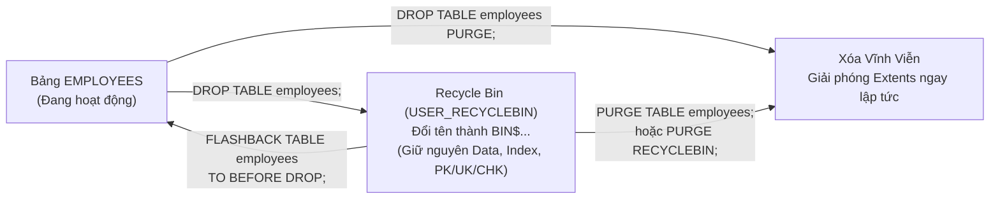
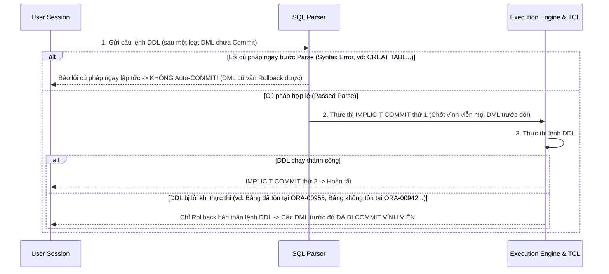

# Chương 11: DDL và Quản Lý Table (DDL & Schema Objects Management) - Oracle SQL OCA & OCP (1Z0-071)

> **Tài liệu tham chiếu:** *OCA/OCP Oracle Database SQL Exam Guide (Exam 1Z0-071)* — Steve O'Hearn & Roopesh Ramklass.  
> **Mục tiêu khảo thí:** Làm chủ nhóm lệnh định nghĩa dữ liệu (`CREATE TABLE`, `ALTER TABLE`, `DROP TABLE`, `TRUNCATE TABLE`, `RENAME`), hiểu sâu quy tắc `DEFAULT` vs `DEFAULT ON NULL`, cột tự tăng `IDENTITY`, tạo bảng từ truy vấn `CTAS`, quản lý cột `SET UNUSED`, thùng rác `Recycle Bin` & `FLASHBACK TABLE`, các loại bảng đặc biệt (`Global Temporary Table`, `Private Temporary Table`, `External Table`, `Heap`, `IOT`), phân biệt `DELETE`/`TRUNCATE`/`DROP` và cơ chế Auto-COMMIT của DDL.

---

## 📑 Mục Lục Chi Tiết

1. [Quy Tắc Đặt Tên Đối Tượng (Identifiers) & Lệnh `CREATE TABLE`](#1-quy-tắc-đặt-tên-đối-tượng-identifiers--lệnh-create-table)
2. [`DEFAULT`, `DEFAULT ON NULL` & Cột Tự Tăng `IDENTITY`](#2-default-default-on-null--cột-tự-tăng-identity)
3. [Tạo Bảng Bằng Subquery: `CREATE TABLE ... AS SELECT` (CTAS)](#3-tạo-bảng-bằng-subquery-create-table--as-select-ctas)
4. [Quản Lý Cấu Trúc Bảng Với `ALTER TABLE`](#4-quản-lý-cấu-trúc-bảng-với-alter-table)
5. [Xóa Bảng (`DROP TABLE`), Thùng Rác (Recycle Bin) & `FLASHBACK TABLE`](#5-xóa-bảng-drop-table-thùng-rác-recycle-bin--flashback-table)
6. [Làm Sạch Bảng Với `TRUNCATE TABLE` & Đổi Tên Với `RENAME`](#6-làm-sạch-bảng-với-truncate-table--đổi-tên-với-rename)
7. [Các Loại Bảng Đặc Biệt: Temporary, External, Heap, IOT & Cluster](#7-các-loại-bảng-đặc-biệt-temporary-external-heap-iot--cluster)
8. [So Sánh Toàn Diện: `DELETE` vs `TRUNCATE` vs `DROP`](#8-so-sánh-toàn-diện-delete-vs-truncate-vs-drop)
9. [Tác Động Tự Động `COMMIT` Của Lệnh DDL Đến Transaction](#9-tác-động-tự-động-commit-của-lệnh-ddl-đến-transaction)
10. [Bài Tập Thực Hành Tự Luyện Cuối Chương (Kèm Lời Giải)](#10-bài-tập-thực-hành-tự-luyện-cuối-chương-kèm-lời-giải)
11. [Tổng Hợp Bẫy Thi OCA/OCP & VNPT Cốt Lõi (Exam Essentials)](#11-tổng-hợp-bẫy-thi-ocaocp--vnpt-cốt-lõi-exam-essentials)

---

## 1. Quy Tắc Đặt Tên Đối Tượng (Identifiers) & Lệnh `CREATE TABLE`

### 1.1. Quy tắc đặt tên Bảng và Cột trong Oracle Database
Trong Oracle SQL, định danh (Identifier) được chia thành 2 loại: **Nonquoted Identifiers** (không bọc ngoặc kép) và **Quoted Identifiers** (bọc trong cặp ngoặc kép `"..."`).

| Tiêu chí | Nonquoted Identifier (`emp_table`) | Quoted Identifier (`"Emp Table!"`) |
| :--- | :--- | :--- |
| **Độ dài tối đa** | **128 bytes** (Từ Oracle 12cR2 trở đi; các bản 12cR1 trở về trước là **30 bytes**). | **128 bytes** (Không tính 2 dấu ngoặc kép ở hai đầu). |
| **Ký tự bắt đầu** | Bắt buộc phải là **chữ cái** (`A-Z`, `a-z` hoặc chữ cái ngôn ngữ bản địa). Không được bắt đầu bằng số, `_`, `$`, `#`. | Bắt đầu bằng **bất kỳ ký tự nào** (kể cả chữ số, dấu cách, ký tự đặc biệt), trừ ký tự rỗng hoặc dấu `"`. |
| **Ký tự tiếp theo** | Chữ cái, chữ số (`0-9`), và 3 ký tự đặc biệt: **`_`**, **`$`**, **`#`**. | Bất kỳ ký tự nào (trừ dấu ngoặc kép `"` và ký tự null `\0`). |
| **Phân biệt hoa thường** | **Không phân biệt** (Oracle tự động chuyển thành **CHỮ IN HOA** trong Data Dictionary). | **Phân biệt chính xác hoa thường!** Mọi câu truy vấn về sau đều bắt buộc phải bọc `"..."` đúng hoa thường. |
| **Từ khóa dành riêng** | **Cấm** dùng các Reserved Words (`SELECT`, `TABLE`, `NUMBER`, `ORDER`, `DATE`...). | **Được phép** dùng cả Reserved Words (ví dụ `"TABLE"`, `"SELECT"`). |

> [!WARNING]
> **Bẫy thi về Namespace (Không gian tên):**
> Trong cùng một Schema (User), những đối tượng nào **KHÔNG được phép đặt trùng tên nhau**?
> * **Table, View, Sequence, Private Synonym** (và User-defined Type, Package, Procedure, Function) chia sẻ **cùng một Namespace**! Do đó, bạn **không thể** tạo một `VIEW` hay `SEQUENCE` có cùng tên với một `TABLE` đã tồn tại trong cùng Schema.
> * Ngược lại, **`INDEX`**, **`CONSTRAINT`**, và **`TRIGGER`** nằm ở các Namespace riêng biệt! Vì vậy, một `INDEX` hoặc một `CONSTRAINT` hoàn toàn có thể có tên trùng với tên của một `TABLE` trong cùng Schema.

---

### 1.2. Cú pháp chuẩn `CREATE TABLE`
```sql
CREATE TABLE [schema.]table_name (
    column1 datatype [DEFAULT [ON NULL] expr] [column_constraint],
    column2 datatype [GENERATED ... AS IDENTITY] [column_constraint],
    ...,
    [table_constraint]
) [TABLESPACE tablespace_name];
```

**Điều kiện cần để tạo bảng:**
1. User phải có quyền hệ thống `CREATE TABLE` (để tạo trong Schema của chính mình) hoặc `CREATE ANY TABLE` (để tạo trong Schema của User khác).
2. User phải được cấp hạn ngạch dung lượng (**Quota**) trên Tablespace lưu trữ bảng (hoặc có quyền `UNLIMITED TABLESPACE`). Lưu ý: Từ Oracle 11gR2+, nhờ tính năng **Deferred Segment Creation** (`SEGMENT_CREATION_IMMEDIATE = FALSE`), câu lệnh `CREATE TABLE` vẫn chạy thành công ngay cả khi User chưa có Quota trên Tablespace; lỗi thiếu Quota (`ORA-01950`) chỉ văng ra khi thực hiện lệnh `INSERT` dòng dữ liệu đầu tiên vào bảng!

---

## 2. `DEFAULT`, `DEFAULT ON NULL` & Cột Tự Tăng `IDENTITY`

### 2.1. Phân biệt `DEFAULT` và `DEFAULT ON NULL` (Từ Oracle 12c+)
Đây là một trong những điểm khác biệt tinh tế nhất thường xuyên xuất hiện trong đề thi 1Z0-071:

```sql
CREATE TABLE emp_defaults (
    emp_id    NUMBER PRIMARY KEY,
    bonus_old NUMBER DEFAULT 100,
    bonus_new NUMBER DEFAULT ON NULL 200
);
```

Hãy xem điều gì xảy ra khi thực thi 3 câu lệnh `INSERT` sau:
```sql
-- Dòng 1: Lược bỏ cả 2 cột khỏi danh sách INSERT
INSERT INTO emp_defaults (emp_id) VALUES (1);

-- Dòng 2: Dùng từ khóa DEFAULT
INSERT INTO emp_defaults (emp_id, bonus_old, bonus_new) VALUES (2, DEFAULT, DEFAULT);

-- Dòng 3: Truyền tường minh giá trị NULL vào cả 2 cột!
INSERT INTO emp_defaults (emp_id, bonus_old, bonus_new) VALUES (3, NULL, NULL);
```

**Kết quả trong bảng `EMP_DEFAULTS`:**

| EMP_ID | BONUS_OLD (`DEFAULT 100`) | BONUS_NEW (`DEFAULT ON NULL 200`) | Giải thích cơ chế |
| :---: | :---: | :---: | :--- |
| **1** | `100` | `200` | Khi cột bị lược bỏ, cả `DEFAULT` và `DEFAULT ON NULL` đều phát huy tác dụng. |
| **2** | `100` | `200` | Từ khóa `DEFAULT` kích hoạt giá trị mặc định cho cả hai cột. |
| **3** | **`NULL`** | **`200`** | Với `DEFAULT` thường, truyền tường minh `NULL` sẽ lưu `NULL`. Với `DEFAULT ON NULL`, truyền tường minh `NULL` trong `INSERT` sẽ tự động được thay thế bằng `200`! |

> [!IMPORTANT]
> **2 Bẫy Thi Sống Còn Về `DEFAULT ON NULL`:**
> 1. Khi khai báo `DEFAULT ON NULL` cho một cột, Oracle **tự động thêm ràng buộc `NOT NULL` ngầm định** lên cột đó!
> 2. Cơ chế tự động biến `NULL` thành giá trị mặc định của `DEFAULT ON NULL` **chỉ hoạt động đối với lệnh `INSERT` (và nhánh `INSERT` của `MERGE`)**. Nếu bạn chạy lệnh **`UPDATE emp_defaults SET bonus_new = NULL WHERE emp_id = 1;`**, nó sẽ **KHÔNG** gán `200` mà sẽ báo lỗi **`ORA-01407: cannot update ("EMP_DEFAULTS"."BONUS_NEW") to NULL`** (do ràng buộc `NOT NULL` ngầm định)!

---

### 2.2. Cột Tự Tăng `IDENTITY` (Từ Oracle 12c+)

Oracle cung cấp 3 chế độ khai báo cột tự tăng `IDENTITY` (dưới nền Oracle tự động tạo một Sequence ẩn hệ thống có tiền tố `ISEQ$$_` để cấp số):

```sql
CREATE TABLE orders (
    order_id NUMBER GENERATED [ALWAYS | BY DEFAULT | BY DEFAULT ON NULL] AS IDENTITY
             (START WITH 100 INCREMENT BY 10),
    order_name VARCHAR2(50)
);
```

#### Bảng đối chiếu 3 chế độ của `IDENTITY` khi thực thi `INSERT`:

| Tình huống thực thi `INSERT` | `GENERATED ALWAYS AS IDENTITY` | `GENERATED BY DEFAULT AS IDENTITY` | `GENERATED BY DEFAULT ON NULL AS IDENTITY` |
| :--- | :--- | :--- | :--- |
| **1. Bỏ qua cột Identity trong danh sách cột `INSERT`**<br>`INSERT INTO orders(order_name) VALUES ('A');` | ✅ **Thành công:** Tự động sinh số từ Sequence. | ✅ **Thành công:** Tự động sinh số từ Sequence. | ✅ **Thành công:** Tự động sinh số từ Sequence. |
| **2. Truyền một giá trị số tường minh**<br>`INSERT INTO orders VALUES (555, 'B');` | ❌ **Báo lỗi `ORA-32795`:** Cấm tuyệt đối chèn giá trị vào cột `GENERATED ALWAYS`! | ✅ **Thành công:** Nhận giá trị `555` do người dùng truyền vào. | ✅ **Thành công:** Nhận giá trị `555` do người dùng truyền vào. |
| **3. Truyền tường minh giá trị `NULL`**<br>`INSERT INTO orders VALUES (NULL, 'C');` | ❌ **Báo lỗi `ORA-32795`:** Cấm chèn bất kỳ giá trị nào vào cột `GENERATED ALWAYS`. | ❌ **Báo lỗi `ORA-01400`:** Không thể chèn `NULL` vào cột Identity! | ✅ **Thành công:** Tự động thay `NULL` bằng số mới sinh từ Sequence! |

> [!WARNING]
> **6 Quy tắc bắt buộc phải nhớ về cột `IDENTITY` trong đề thi:**
> 1. **Số lượng tối đa:** Mỗi bảng chỉ được phép có **tối đa 1 cột `IDENTITY`**. Tạo cột `IDENTITY` thứ 2 trong cùng bảng sẽ báo lỗi `ORA-30673`.
> 2. **Kiểu dữ liệu:** Cột `IDENTITY` bắt buộc phải có kiểu dữ liệu số (**Numeric data type** như `NUMBER`, `INTEGER`), không thể dùng cho `VARCHAR2` hay `DATE`.
> 3. **Ràng buộc tự động:** Cột `IDENTITY` tự động có ràng buộc **`NOT NULL`** và **`NOT DEFERRABLE`**, nhưng **KHÔNG tự động là `PRIMARY KEY` hay `UNIQUE`**! Nếu dùng `BY DEFAULT` và người dùng cố tình truyền số trùng lặp, bảng vẫn nhận số trùng nếu bạn không khai báo thêm `PRIMARY KEY` hoặc `UNIQUE`.
> 4. **Không kết hợp với `DEFAULT`:** Không thể vừa khai báo `DEFAULT` vừa khai báo `GENERATED ... AS IDENTITY` trên cùng một cột.
> 5. **Không kế thừa qua CTAS:** Nếu tạo bảng mới bằng `CREATE TABLE new_tab AS SELECT * FROM orders`, cột `order_id` ở bảng `new_tab` chỉ là cột `NUMBER NOT NULL` bình thường, **mất hoàn toàn thuộc tính `IDENTITY`**!
> 6. **Xóa bảng có cột `IDENTITY`:** Nếu xóa bảng vào thùng rác (`DROP TABLE` không có `PURGE`), Sequence ẩn của cột `IDENTITY` vẫn được giữ lại để phục vụ `FLASHBACK TABLE`; nếu xóa bằng `DROP TABLE ... PURGE`, Sequence ẩn cũng bị xóa vĩnh viễn.

---

## 3. Tạo Bảng Bằng Subquery: `CREATE TABLE ... AS SELECT` (CTAS)

Lệnh **CTAS** giúp vừa tạo bảng mới vừa đổ dữ liệu từ kết quả của một câu lệnh `SELECT` vào bảng mới ngay lập tức.

### 3.1. Cú pháp chuẩn
```sql
CREATE TABLE new_table_name [(col_name1, col_name2, ...)]
AS
SELECT expr1, expr2, ...
FROM source_table
[WHERE condition];
```

### 3.2. Quy tắc kế thừa của CTAS (Bẫy thi cực kỳ phổ biến!)

Khi tạo bảng mới từ bảng cũ bằng `CREATE TABLE ... AS SELECT`:
* ✅ **NHỮNG GÌ ĐƯỢC SAO CHÉP SANG BẢNG MỚI:**
  1. Tên cột và kiểu dữ liệu / kích thước cột.
  2. Dữ liệu thỏa mãn câu lệnh `SELECT`.
  3. **DUY NHẤT ràng buộc `NOT NULL`** được khai báo tường minh trên bảng gốc (và đang ở trạng thái `ENABLE VALIDATE`).
* ❌ **NHỮNG GÌ KHÔNG ĐƯỢC SAO CHÉP SANG BẢNG MỚI:**
  1. **`PRIMARY KEY`** (Cột khóa chính ở bảng gốc chỉ tạo ra một ràng buộc `NOT NULL` ở bảng mới, bản thân khóa chính `PRIMARY KEY` bị mất!).
  2. **`UNIQUE`**, **`FOREIGN KEY`**, **`CHECK`**.
  3. Giá trị mặc định (**`DEFAULT`** / **`DEFAULT ON NULL`**).
  4. Thuộc tính tự tăng (**`IDENTITY`**).
  5. Các chỉ mục (**`INDEX`**), **`TRIGGER`**, và quyền truy cập (**Grants**).

> [!TIP]
> **Bẫy cột biểu thức trong CTAS (`ORA-00998`):**
> Nếu trong mệnh đề `SELECT` của CTAS có chứa biểu thức tính toán hoặc hàm (ví dụ `salary * 12`, `UPPER(full_name)`), bạn **bắt buộc** phải đặt **Column Alias** cho biểu thức đó, hoặc khai báo danh sách tên cột ngay sau `CREATE TABLE new_tab (...)`.
> ```sql
> -- ❌ LỖI ORA-00998: must name this expression with a column alias
> CREATE TABLE emp_annual AS
> SELECT emp_id, salary * 12 FROM employees;
>
> -- ✅ HỢP LỆ (Cách 1: Đặt Alias trong SELECT)
> CREATE TABLE emp_annual AS
> SELECT emp_id, salary * 12 AS annual_sal FROM employees;
>
> -- ✅ HỢP LỆ (Cách 2: Khai báo tên cột ở mệnh đề CREATE TABLE)
> CREATE TABLE emp_annual (id, annual_sal) AS
> SELECT emp_id, salary * 12 FROM employees;
> ```
> **Mẹo tạo bảng rỗng chỉ sao chép cấu trúc:** Dùng một điều kiện `WHERE` luôn sai như `WHERE 1 = 0`:
> ```sql
> CREATE TABLE emp_structure_only AS
> SELECT * FROM employees WHERE 1 = 0;
> ```

---

## 4. Quản Lý Cấu Trúc Bảng Với `ALTER TABLE`

### 4.1. Thêm cột mới (`ALTER TABLE ... ADD`)
```sql
ALTER TABLE employees
ADD (
    email      VARCHAR2(100) DEFAULT 'no_email@vnpt.vn' NOT NULL,
    birth_date DATE
);
```
* Cột mới thêm vào luôn nằm ở vị trí cuối cùng của bảng.
* **Quy tắc khi bảng đang có sẵn dữ liệu:** Nếu bảng đã có ít nhất 1 dòng dữ liệu, bạn **không thể** thêm một cột mới có ràng buộc `NOT NULL` trừ khi đi kèm mệnh đề **`DEFAULT`** (như cột `email` ở ví dụ trên). Nếu thiếu `DEFAULT`, Oracle sẽ báo lỗi **`ORA-01758: table must be empty to add mandatory (NOT NULL) column`**.

---

### 4.2. Sửa đổi cột hiện có (`ALTER TABLE ... MODIFY`)
```sql
ALTER TABLE employees
MODIFY (
    full_name VARCHAR2(150),
    salary    DEFAULT 2000
);
```

#### Các quy tắc vàng của `ALTER TABLE ... MODIFY` trong đề thi:
1. **Tăng kích thước cột (`VARCHAR2(20)` → `VARCHAR2(100)` hoặc `NUMBER(6,2)` → `NUMBER(10,2)`):** Luôn thực hiện thành công bất kể bảng đang có dữ liệu hay không.
2. **Đổi kiểu dữ liệu (ví dụ `NUMBER` ↔ `VARCHAR2`, `DATE` ↔ `VARCHAR2`) hoặc giảm độ rộng cột kiểu `NUMBER`:** Tất cả các dòng trong bảng phải có giá trị của cột đó là **`NULL`** (hoặc bảng đang hoàn toàn trống)! Nếu có dù chỉ 1 dòng khác `NULL`, Oracle sẽ báo lỗi `ORA-01439` hoặc `ORA-01440`.
3. **Giảm độ rộng cột kiểu chuỗi (`VARCHAR2` / `CHAR`):** Oracle **cho phép giảm độ rộng** ngay cả khi cột đang có dữ liệu khác `NULL`, miễn là **độ dài thực tế của mọi giá trị hiện có trong cột đều nhỏ hơn hoặc bằng độ rộng mới**! Nếu có bất kỳ dòng nào dài hơn kích thước mới, Oracle báo lỗi **`ORA-01441: cannot decrease column length because some value is too big`**.
4. **Thay đổi giá trị `DEFAULT`:** Việc sửa `DEFAULT` chỉ áp dụng cho các dòng mới được `INSERT` **sau thời điểm chạy lệnh `MODIFY`**. Các dòng dữ liệu cũ đã nằm trong bảng (kể cả những dòng đang mang giá trị `NULL`) **không hề bị thay đổi**.
5. **Thêm `NOT NULL` bằng `MODIFY`:** Chỉ thành công nếu hiện tại trong bảng không có dòng nào đang chứa `NULL` ở cột đó.

---

### 4.3. Đổi tên cột, Xóa cột (`DROP COLUMN`) và Đánh dấu không sử dụng (`SET UNUSED`)

#### 1. Đổi tên cột:
```sql
ALTER TABLE employees RENAME COLUMN full_name TO emp_name;
```
*(Lưu ý: Từ khóa `COLUMN` là bắt buộc! Viết `ALTER TABLE employees RENAME full_name TO emp_name` sẽ bị lỗi cú pháp).*

#### 2. Xóa cột trực tiếp (`DROP COLUMN`):
```sql
-- Xóa 1 cột (có hoặc không có từ khóa COLUMN):
ALTER TABLE employees DROP COLUMN birth_date;
ALTER TABLE employees DROP (birth_date);

-- Xóa nhiều cột cùng lúc (BẮT BUỘC đặt trong ngoặc đơn và KHÔNG có từ khóa COLUMN!):
ALTER TABLE employees DROP (email, commission_pct);
```

> [!WARNING]
> **3 Bẫy Thi Về `DROP COLUMN`:**
> 1. Khi xóa **nhiều cột** cùng lúc, cú pháp đúng là **`ALTER TABLE t DROP (col1, col2);`**. Nếu viết `ALTER TABLE t DROP COLUMN (col1, col2);` (có chữ `COLUMN` trước ngoặc đơn) sẽ bị **lỗi cú pháp `ORA-00905: missing keyword`**!
> 2. Không bao giờ được xóa hết tất cả các cột của bảng (bảng phải còn lại ít nhất 1 cột). Nếu bảng chỉ có 2 cột mà bạn xóa cả 2, Oracle ném lỗi **`ORA-12983: cannot drop all columns in a table`**.
> 3. Nếu cột cần xóa là `PRIMARY KEY` (hoặc `UNIQUE`) đang được tham chiếu bởi `FOREIGN KEY` của bảng khác, hoặc cột đó nằm trong một ràng buộc đa cột (Composite Constraint), bạn bắt buộc phải thêm mệnh đề **`CASCADE CONSTRAINTS`**:
>    ```sql
>    ALTER TABLE departments DROP COLUMN dept_id CASCADE CONSTRAINTS;
>    ```

#### 3. Cơ chế `SET UNUSED` và `DROP UNUSED COLUMNS`:
Trên một bảng sản xuất (Production) có hàng trăm triệu dòng, lệnh `DROP COLUMN` phải quét và xóa dữ liệu vật lý trên từng Data Block nên chạy rất lâu và gây nghẽn I/O. Giải pháp tối ưu của Oracle gồm 2 giai đoạn:

```sql
-- Giai đoạn 1 (Thực hiện tức thì trong giờ cao điểm - chỉ cập nhật Data Dictionary):
ALTER TABLE employees SET UNUSED (commission_pct);
-- Hoặc: ALTER TABLE employees SET UNUSED COLUMN commission_pct;

-- Giai đoạn 2 (Thực hiện vào ban đêm để giải phóng ổ đĩa vật lý):
ALTER TABLE employees DROP UNUSED COLUMNS [CHECKPOINT 1000];
```

**Đặc điểm sống còn của cột đã bị `SET UNUSED`:**
* Ngay sau lệnh `SET UNUSED`, cột đó biến mất hoàn toàn khỏi lệnh `DESCRIBE` và `SELECT *`.
* Bạn có thể ngay lập tức dùng `ALTER TABLE ... ADD` để **tạo một cột mới có cùng tên** với cột vừa bị `SET UNUSED`.
* Các Index, Constraint và thống kê gắn riêng với cột đó cũng bị gỡ bỏ.
* **KHÔNG THỂ KHÔI PHỤC:** Một khi đã `SET UNUSED`, **tuyệt đối không có cách nào bật lại cột đó** (không tồn tại lệnh `SET USED` và không thể `ROLLBACK` vì `ALTER TABLE` là lệnh DDL!).
* Có thể tra cứu xem bảng nào đang có bao nhiêu cột `UNUSED` thông qua view từ điển dữ liệu **`USER_UNUSED_COL_TABS`**.

---

### 4.4. Bảng Chế Độ Chỉ Đọc (`ALTER TABLE ... READ ONLY` / `READ WRITE`)
Từ Oracle 11g+, bạn có thể khóa không cho phép thay đổi dữ liệu trong bảng bằng lệnh:
```sql
-- Chuyển bảng sang chế độ Chỉ Đọc:
ALTER TABLE employees READ ONLY;

-- Đưa bảng trở lại chế độ Đọc - Ghi bình thường:
ALTER TABLE employees READ WRITE;
```

> [!IMPORTANT]
> **Bảng phân loại những thao tác BỊ CẤM vs ĐƯỢC PHÉP khi bảng đang `READ ONLY` (Cực kỳ hay ra thi!):**
>
> | ❌ BỊ CẤM trên bảng `READ ONLY` (`ORA-12081`) | ✅ VẪN ĐƯỢC PHÉP trên bảng `READ ONLY` |
> | :--- | :--- |
> | • Mọi lệnh DML: `INSERT`, `UPDATE`, `DELETE`, `MERGE` | • Truy vấn `SELECT` thông thường |
> | • Lệnh khóa dòng: `SELECT ... FOR UPDATE` | • **Xóa toàn bộ bảng: `DROP TABLE`!** *(Vì chỉ xóa trong Data Dictionary)* |
> | • Lệnh làm rỗng bảng: `TRUNCATE TABLE` | • Đổi tên bảng (`RENAME`), đổi tên cột (`RENAME COLUMN`) |
> | • Xóa vật lý cột: `ALTER TABLE ... DROP COLUMN` và `DROP UNUSED COLUMNS` | • Thêm cột (`ADD`), sửa cột (`MODIFY`), và đánh dấu **`SET UNUSED`** cột! |
> | • `FLASHBACK TABLE` (về thời điểm cũ) | • Tạo/Xóa `INDEX`, bật/tắt `CONSTRAINT` (`NOVALIDATE`), chuyển sang `READ WRITE` |

---

## 5. Xóa Bảng (`DROP TABLE`), Thùng Rác (Recycle Bin) & `FLASHBACK TABLE`

### 5.1. Cú pháp `DROP TABLE`
```sql
DROP TABLE [schema.]table_name [CASCADE CONSTRAINTS] [PURGE];
```

### 5.2. Cơ chế Thùng Rác (Recycle Bin) và `FLASHBACK TABLE ... TO BEFORE DROP`
Khi tham số hệ thống `RECYCLEBIN = ON` (mặc định):
1. Khi bạn chạy `DROP TABLE employees;` (không có từ khóa `PURGE`), Oracle **không xóa vật lý** bảng đó ngay! Thay vào đó, bảng và các Index của nó được đổi sang một tên hệ thống bắt đầu bằng **`BIN$...`** và vẫn nằm nguyên trong cùng Tablespace đó.
2. Bạn có thể xem danh sách các bảng nằm trong thùng rác qua view **`USER_RECYCLEBIN`** (hoặc đồng nghĩa rút gọn là **`RECYCLEBIN`**).
3. Để khôi phục bảng cùng toàn bộ dữ liệu, Index và các Constraint (trừ Foreign Key) từ thùng rác, sử dụng lệnh:
   ```sql
   FLASHBACK TABLE employees TO BEFORE DROP;
   
   -- Hoặc khôi phục và đổi sang tên mới (nếu tên cũ đã bị bảng mới chiếm chỗ):
   FLASHBACK TABLE employees TO BEFORE DROP RENAME TO employees_restored;
   ```



> [!WARNING]
> **4 Quy tắc & Bẫy thi về Recycle Bin và `FLASHBACK TABLE`:**
> 1. **Quy tắc LIFO (Vào sau Ra trước):** Nếu bạn tạo bảng `EMP`, xóa `DROP TABLE emp`, rồi lại tạo bảng `EMP` thứ 2 và xóa tiếp `DROP TABLE emp`, trong thùng rác sẽ có 2 bảng cùng mang `ORIGINAL_NAME = 'EMP'`. Khi bạn gọi `FLASHBACK TABLE emp TO BEFORE DROP;`, Oracle sẽ khôi phục **bảng vừa bị xóa gần nhất** (tức là bảng `EMP` thứ 2)!
> 2. **Ràng buộc Khóa ngoại (`FOREIGN KEY`) không được khôi phục:** Khi khôi phục bảng bằng `FLASHBACK TABLE ... TO BEFORE DROP`, các `INDEX`, `PRIMARY KEY`, `UNIQUE`, `CHECK`, `NOT NULL` đều được khôi phục lại (nhưng mang tên hệ thống `BIN$...`), riêng các ràng buộc **`FOREIGN KEY` bị mất vĩnh viễn** và phải tạo lại thủ công.
> 3. **Từ khóa `PURGE`:** Nếu xóa bảng bằng `DROP TABLE employees PURGE;`, hoặc sau khi xóa thường bạn chạy `PURGE TABLE employees;` / `PURGE RECYCLEBIN;`, bảng sẽ bị xóa vĩnh viễn và **không thể** dùng `FLASHBACK TABLE ... TO BEFORE DROP` được nữa.
> 4. **Bảng thuộc `SYSTEM` tablespace hoặc Temporary Table:** Các bảng nằm trong `SYSTEM` tablespace hoặc bảng tạm (`GLOBAL/PRIVATE TEMPORARY TABLE`) khi bị `DROP` sẽ bị xóa hẳn ngay lập tức, không bao giờ đi vào Recycle Bin!

---

## 6. Làm Sạch Bảng Với `TRUNCATE TABLE` & Đổi Tên Với `RENAME`

### 6.1. Lệnh `TRUNCATE TABLE`
```sql
TRUNCATE TABLE [schema.]table_name [DROP STORAGE | REUSE STORAGE] [CASCADE];
```
* **`DROP STORAGE`** *(Mặc định)*: Giải phóng toàn bộ các Extents đã cấp phát vượt quá dung lượng khởi tạo ban đầu (`MINEXTENTS`) trả về cho Tablespace, và kéo vạch **High Water Mark (HWM)** về đầu bảng.
* **`REUSE STORAGE`**: Xóa sạch dữ liệu và kéo HWM về đầu bảng nhưng **giữ nguyên các Extents đã cấp phát** dành riêng cho chính bảng đó (rất hữu ích khi bạn xóa tạm để nạp lại một lượng dữ liệu lớn tương đương ngay sau đó).
* **Quy tắc Khóa ngoại:** Không thể `TRUNCATE` một bảng đang được tham chiếu bởi một ràng buộc `FOREIGN KEY` đang ở trạng thái **`ENABLED`** của bảng khác (báo lỗi `ORA-02266: unique/primary keys in table referenced by enabled foreign keys`), **kể cả khi bảng Con đang hoàn toàn trống (0 dòng)**! *(Ngoại lệ: Từ Oracle 12c+, nếu khóa ngoại ở bảng Con được khai báo kèm `ON DELETE CASCADE`, bạn có thể chạy `TRUNCATE TABLE parent_tab CASCADE;` để làm rỗng đồng thời cả bảng Cha lẫn bảng Con).*

### 6.2. Đổi tên đối tượng (`RENAME`)
Có 2 cú pháp để đổi tên một bảng:
```sql
-- Cách 1: Dùng lệnh RENAME trực tiếp (Không viết từ khóa TABLE!)
RENAME old_table_name TO new_table_name;

-- Cách 2: Dùng lệnh ALTER TABLE
ALTER TABLE old_table_name RENAME TO new_table_name;
```

---

## 7. Các Loại Bảng Đặc Biệt: Temporary, External, Heap, IOT & Cluster

### 7.1. Global Temporary Table (GTT) vs Private Temporary Table (PTT)

#### 1. Global Temporary Table (GTT):
Dùng để lưu trữ dữ liệu trung gian trong quá trình xử lý nghiệp vụ hoặc báo cáo phức tạp.
```sql
-- Tùy chọn 1 (Mặc định): Xóa sạch dữ liệu khi kết thúc Transaction (COMMIT / ROLLBACK)
CREATE GLOBAL TEMPORARY TABLE temp_cart_tx (
    item_id NUMBER,
    qty     NUMBER
) ON COMMIT DELETE ROWS;

-- Tùy chọn 2: Giữ dữ liệu xuyên suốt các lần COMMIT, chỉ xóa khi thoát Session
CREATE GLOBAL TEMPORARY TABLE temp_cart_sess (
    item_id NUMBER,
    qty     NUMBER
) ON COMMIT PRESERVE ROWS;
```
* **Đặc điểm cốt lõi của GTT:**
  * Cấu trúc bảng (Metadata) được lưu cố định trong Data Dictionary — mọi User có quyền đều nhìn thấy bảng này tồn tại.
  * **Dữ liệu bên trong là hoàn toàn cô lập theo từng Session**: Session A chèn 100 dòng và `COMMIT` (với `ON COMMIT PRESERVE ROWS`), Session B truy vấn cùng bảng GTT đó sẽ thấy **0 dòng**! Do đó, thao tác DML trên GTT không gây tranh chấp khóa dòng giữa các Session khác nhau.
  * Có thể tạo `INDEX`, `VIEW`, `TRIGGER` trên GTT.

#### 2. Private Temporary Table (PTT - Từ Oracle 18c+):
Khác với GTT (nơi cấu trúc bảng tồn tại vĩnh viễn trong Dictionary), với **Private Temporary Table**, **cả cấu trúc bảng lẫn dữ liệu đều nằm trong bộ nhớ (Memory) và chỉ tồn tại riêng cho đúng Session tạo ra nó**!
```sql
-- Mặc định: ON COMMIT DROP DEFINITION (Xóa luôn cả bảng ngay khi COMMIT!)
CREATE PRIVATE TEMPORARY TABLE ora$ptt_sales_temp (
    sale_id NUMBER,
    amount  NUMBER
) ON COMMIT DROP DEFINITION;

-- Giữ cả bảng và dữ liệu cho đến khi kết thúc Session:
CREATE PRIVATE TEMPORARY TABLE ora$ptt_session_cache (
    sale_id NUMBER,
    amount  NUMBER
) ON COMMIT PRESERVE DEFINITION;
```
* **Bẫy thi về PTT:** Tên của một Private Temporary Table **bắt buộc phải bắt đầu bằng tiền tố được định nghĩa trong tham số `PRIVATE_TEMP_TABLE_PREFIX`** (giá trị mặc định là **`ORA$PTT_`**). Nếu đặt tên không có tiền tố `ORA$PTT_`, Oracle sẽ báo lỗi `ORA-00903: invalid table name`! Ngoài ra, không thể tạo `INDEX` hoặc `VIEW` cố định trên PTT.

---

### 7.2. External Table (Bảng Ngoại)
Là bảng mà cấu trúc (Metadata) nằm trong Oracle Data Dictionary, nhưng dữ liệu thực tế nằm trong các file bên ngoài hệ điều hành (OS Flat Files hoặc Data Pump Files), được ánh xạ qua đối tượng `DIRECTORY` của Oracle.

```sql
CREATE TABLE ext_employees (
    emp_id    NUMBER(6),
    full_name VARCHAR2(50),
    salary    NUMBER(8,2)
)
ORGANIZATION EXTERNAL (
    TYPE ORACLE_LOADER
    DEFAULT DIRECTORY data_dir
    ACCESS PARAMETERS (
        RECORDS DELIMITED BY NEWLINE
        FIELDS TERMINATED BY ','
    )
    LOCATION ('employees_data.csv')
)
REJECT LIMIT UNLIMITED;
```
* **Các quy tắc thi về External Table:**
  1. Có 2 loại Access Driver: **`ORACLE_LOADER`** (mặc định, dùng để đọc file văn bản/CSV) và **`ORACLE_DATAPUMP`** (dùng để đọc và kết xuất file nhị phân định dạng độc quyền của Data Pump qua CTAS).
  2. **Không bao giờ được thực hiện lệnh DML (`INSERT`, `UPDATE`, `DELETE`, `MERGE`)** trên bất kỳ External Table nào!
  3. **Không thể tạo `INDEX`** trên External Table, và không hỗ trợ các ràng buộc `PRIMARY KEY`, `UNIQUE`, `FOREIGN KEY` thực thi dữ liệu.
  4. Khi chạy `DROP TABLE ext_employees;`, Oracle chỉ xóa định nghĩa bảng trong Data Dictionary, còn file vật lý `employees_data.csv` trên hệ điều hành **vẫn còn nguyên vẹn**!

---

### 7.3. Heap Table vs Index-Organized Table (IOT) vs Clustered Table

| Loại Bảng | Từ khóa tạo bảng | Đặc điểm kiến trúc &Ứng dụng |
| :--- | :--- | :--- |
| **Heap-Organized Table** | *(Mặc định - không cần từ khóa)* | Dữ liệu được lưu trữ như một "đống" (Heap) không theo thứ tự cụ thể; dòng mới được chèn vào bất kỳ block nào còn đủ chỗ trống. |
| **Index-Organized Table (IOT)** | `ORGANIZATION INDEX` | Toàn bộ các cột dữ liệu của dòng được lưu trực tiếp bên trong các nút lá (Leaf nodes) của cấu trúc cây **B-Tree Index** sắp xếp theo khóa chính. **Bắt buộc phải khai báo `PRIMARY KEY`** khi tạo bảng IOT! Truy vấn theo khóa chính cực nhanh vì không cần bước đọc bảng qua `ROWID`. |
| **Clustered Table** | `CLUSTER cluster_name (col)` | Nhiều bảng có mối quan hệ kết nối chặt chẽ (ví dụ `DEPARTMENTS` và `EMPLOYEES` chung cột `DEPT_ID`) được lưu trữ vật lý **chung trong cùng một Data Block** để tăng tốc độ truy vấn `JOIN`, nhưng làm chậm thao tác `INSERT`/`UPDATE` khóa Cluster. |

---

## 8. So Sánh Toàn Diện: `DELETE` vs `TRUNCATE` vs `DROP`

Bảng đối chiếu kinh điển này xuất hiện trong hầu hết các đề thi OCA/OCP 1Z0-071 và phỏng vấn Developer tại VNPT:

| Tiêu chí so sánh | `DELETE` | `TRUNCATE TABLE` | `DROP TABLE` |
| :--- | :--- | :--- | :--- |
| **Phân loại ngôn ngữ SQL** | **DML** (Data Manipulation) | **DDL** (Data Definition) | **DDL** (Data Definition) |
| **Tự động `COMMIT` (Auto-commit)?** | ❌ **Không** (Cần `COMMIT` thủ công) | ✅ **Có** (Tự động Commit) | ✅ **Có** (Tự động Commit) |
| **Có thể `ROLLBACK` không?** | ✅ **Có** (Trước khi Commit) | ❌ **Không thể Rollback** | ❌ **Không thể Rollback** *(nhưng có thể `FLASHBACK ... TO BEFORE DROP` nếu không dùng `PURGE`)* |
| **Lọc dòng bằng mệnh đề `WHERE`?** | ✅ **Có** (Xóa có chọn lọc) | ❌ **Không** (Xóa sạch 100% dòng) | ❌ **Không** (Xóa cả bảng) |
| **Lượng dữ liệu Undo sinh ra** | **Rất lớn** (Lưu toàn bộ dòng bị xóa) | **Tối thiểu** (Chỉ lưu metadata) | **Tối thiểu** (Chỉ lưu metadata) |
| **Tốc độ thực thi trên bảng lớn** | Chậm nhất (Quét và ghi Undo từng dòng) | Rất nhanh (Chỉ cập nhật Dictionary & HWM) | Nhanh nhất |
| **Kích hoạt DML Triggers (`ON DELETE`)?** | ✅ **Có kích hoạt** | ❌ **Không kích hoạt** | ❌ **Không kích hoạt** (Và xóa luôn cả Trigger của bảng) |
| **Giải phóng không gian & Hạ HWM?** | ❌ **Không** (HWM giữ nguyên) | ✅ **Có** (Đưa HWM về đầu bảng) | ✅ **Có** (Khi kèm `PURGE`) |
| **Cấu trúc bảng, Index, Quyền (Grant)** | Giữ nguyên hoàn toàn | Giữ nguyên hoàn toàn (Index được làm rỗng và giữ lại) | Bị xóa bỏ (Quyền Grant bị mất; Index vào Recycle Bin cùng bảng) |
| **Khi bảng Cha có FK `ENABLED` trỏ vào (mà bảng Con đang trống 0 dòng)** | ✅ **Xóa thành công!** | ❌ **Báo lỗi `ORA-02266`!** | ❌ **Báo lỗi `ORA-02449`!** *(Trừ khi dùng `CASCADE CONSTRAINTS`)* |

---

## 9. Tác Động Tự Động `COMMIT` Của Lệnh DDL Đến Transaction

Trong Oracle Database, mọi câu lệnh **DDL** (`CREATE`, `ALTER`, `DROP`, `TRUNCATE`, `RENAME`, `COMMENT`) đều được Oracle thực thi theo quy trình 3 bước ngầm định:



### Ví dụ bẫy thi kinh điển về DDL bị lỗi vẫn làm Auto-COMMIT:
Giả sử bảng `EMP_TEST` đang có `0` dòng, và trong Schema **đã tồn tại sẵn** một bảng tên là `DEPARTMENTS`. Bạn chạy tuần tự kịch bản sau:

```sql
INSERT INTO emp_test VALUES (101, 'Alice');
INSERT INTO emp_test VALUES (102, 'Bob');

-- Câu lệnh DDL đúng cú pháp nhưng THẤT BẠI lúc thực thi vì bảng DEPARTMENTS đã tồn tại (ORA-00955):
CREATE TABLE departments (id NUMBER);

-- Ngay sau khi lệnh CREATE TABLE báo lỗi, người dùng gọi ROLLBACK:
ROLLBACK;
```

> [!CAUTION]
> **Hỏi: Sau lệnh `ROLLBACK;` ở cuối, bảng `EMP_TEST` có bao nhiêu dòng?**
> * **Đáp án chính xác:** Có **2 dòng** (`101` và `102`)!
> * **Giải thích:** Vì câu lệnh `CREATE TABLE departments (id NUMBER);` hoàn toàn đúng cú pháp SQL, nó đã vượt qua bộ phân tích cú pháp (Parser) và kích hoạt **Implicit COMMIT đầu tiên** trước khi phát hiện ra tên bảng `DEPARTMENTS` đã bị trùng! Do đó, 2 dòng `Alice` và `Bob` đã được lưu vĩnh viễn vào CSDL trước khi lỗi `ORA-00955` xuất hiện; câu lệnh `ROLLBACK;` phía sau không còn tác dụng gì với 2 dòng đó nữa!

---

## 10. Bài Tập Thực Hành Tự Luyện Cuối Chương (Kèm Lời Giải)

### Bài tập 1: Phân tích `DEFAULT`, `DEFAULT ON NULL` và `IDENTITY`
Cho câu lệnh tạo bảng sau:
```sql
CREATE TABLE invoices (
    inv_id   NUMBER GENERATED BY DEFAULT AS IDENTITY (START WITH 1 INCREMENT BY 1),
    client   VARCHAR2(50) DEFAULT 'Guest',
    tax_rate NUMBER       DEFAULT ON NULL 10
);
```
Hãy cho biết từng câu lệnh dưới đây **Thành công** hay **Báo lỗi** (nếu thành công, hãy ghi rõ bộ giá trị `(inv_id, client, tax_rate)` được lưu vào bảng):
1. `INSERT INTO invoices (client) VALUES ('VNPT');`
2. `INSERT INTO invoices (inv_id, client, tax_rate) VALUES (NULL, 'FPT', NULL);`
3. `INSERT INTO invoices (inv_id, client, tax_rate) VALUES (50, NULL, NULL);`
4. `UPDATE invoices SET tax_rate = NULL WHERE inv_id = 50;`

<details>
<summary><b>💡 Xem Lời Giải Chi Tiết Bài Tập 1</b></summary>

1. **Lệnh 1:** ✅ **Thành công.** `inv_id` bị lược bỏ nên tự sinh số `1`; `client` là `'VNPT'`; `tax_rate` bị lược bỏ nên nhận giá trị mặc định `10`. Bộ giá trị: **`(1, 'VNPT', 10)`**.
2. **Lệnh 2:** ❌ **Báo lỗi `ORA-01400: cannot insert NULL into ("INVOICES"."INV_ID")`!** Vì `inv_id` dùng chế độ `GENERATED BY DEFAULT` (không có `ON NULL`), nên không cho phép truyền tường minh giá trị `NULL` vào cột `inv_id`.
3. **Lệnh 3:** ✅ **Thành công.** `inv_id` nhận giá trị tường minh `50`; `client` dùng `DEFAULT` thường nên khi truyền tường minh `NULL` sẽ lưu **`NULL`**; `tax_rate` dùng `DEFAULT ON NULL 10` nên khi truyền tường minh `NULL` trong `INSERT` sẽ tự động đổi thành **`10`**. Bộ giá trị: **`(50, NULL, 10)`**.
4. **Lệnh 4:** ❌ **Báo lỗi `ORA-01407: cannot update ("INVOICES"."TAX_RATE") to NULL`!** Vì `DEFAULT ON NULL` chỉ tự động thay thế `NULL` khi `INSERT`, còn đồng thời nó áp đặt ràng buộc `NOT NULL` lên cột `tax_rate`, khiến lệnh `UPDATE ... SET tax_rate = NULL` bị chặn lại.
</details>

---

### Bài tập 2: Truy vết `READ ONLY`, `SET UNUSED` và `DROP TABLE`
Xét đoạn kịch bản SQL sau trên bảng `PRODUCTS (prod_id NUMBER PRIMARY KEY, prod_name VARCHAR2(30), old_code VARCHAR2(10))` đang có 10 dòng dữ liệu:
```sql
ALTER TABLE products READ ONLY;
ALTER TABLE products SET UNUSED (old_code); -- Câu lệnh (1)
ALTER TABLE products DROP UNUSED COLUMNS;   -- Câu lệnh (2)
DROP TABLE products;                        -- Câu lệnh (3)
FLASHBACK TABLE products TO BEFORE DROP;    -- Câu lệnh (4)
```
Hãy xác định xem các câu lệnh `(1)`, `(2)`, `(3)`, `(4)` câu nào chạy thành công, câu nào báo lỗi?

<details>
<summary><b>💡 Xem Lời Giải Chi Tiết Bài Tập 2</b></summary>

* **Câu lệnh (1) `ALTER TABLE products SET UNUSED (old_code);`:** ✅ **Thành công!** Dù bảng đang ở chế độ `READ ONLY`, thao tác `SET UNUSED` chỉ sửa đổi metadata trong Data Dictionary chứ không đụng đến các Data Block của bảng nên vẫn được phép thực thi.
* **Câu lệnh (2) `ALTER TABLE products DROP UNUSED COLUMNS;`:** ❌ **Báo lỗi `ORA-12081: update operation not allowed on table "PRODUCTS"`!** Vì `DROP UNUSED COLUMNS` thực hiện xóa dữ liệu vật lý của cột khỏi các Data Block nên bị chặn khi bảng đang `READ ONLY`.
* **Câu lệnh (3) `DROP TABLE products;`:** ✅ **Thành công!** Bảng `READ ONLY` vẫn cho phép thực hiện lệnh `DROP TABLE` (đưa bảng vào Recycle Bin).
* **Câu lệnh (4) `FLASHBACK TABLE products TO BEFORE DROP;`:** ✅ **Thành công!** Bảng `products` được khôi phục lại từ Recycle Bin (và vẫn giữ trạng thái `READ ONLY` cùng cột `old_code` đang ở trạng thái `UNUSED`).
</details>

---

## 11. Tổng Hợp Bẫy Thi OCA/OCP & VNPT Cốt Lõi (Exam Essentials)

| # | Chủ đề | Bẫy đề thi thường gặp | Quy tắc chuẩn cần nhớ |
| :---: | :--- | :--- | :--- |
| **1** | `DEFAULT` vs `DEFAULT ON NULL` | Truyền `INSERT ... VALUES (NULL)` vào cột có `DEFAULT 100` | Cột có `DEFAULT 100` sẽ nhận giá trị **`NULL`**. Chỉ cột có `DEFAULT ON NULL 100` mới tự đổi `NULL` thành `100` (và tự có ràng buộc `NOT NULL`). |
| **2** | Cột `IDENTITY` | Nghĩ rằng cột `IDENTITY` tự động là `PRIMARY KEY` và được sao chép qua `CTAS` | **Sai!** `IDENTITY` chỉ tự động là `NOT NULL`, không phải `PRIMARY KEY`. Khi chạy `CTAS`, thuộc tính `IDENTITY` không được sao chép sang bảng mới. |
| **3** | `CREATE TABLE ... AS SELECT` | Hỏi những ràng buộc nào được sao chép sang bảng mới khi dùng CTAS | **Chỉ duy nhất `NOT NULL`** được sao chép. Mọi `PRIMARY KEY`, `UNIQUE`, `FOREIGN KEY`, `CHECK`, `DEFAULT`, `INDEX` đều bị mất! |
| **4** | `ALTER TABLE ... MODIFY` | Giảm độ rộng cột `VARCHAR2(50)` xuống `VARCHAR2(20)` khi bảng đang có dữ liệu | **Thành công** nếu tất cả các chuỗi hiện có trong cột đều có độ dài $\le 20$ ký tự. (Ngược lại, giảm độ rộng cột `NUMBER` bắt buộc cột phải toàn `NULL`). |
| **5** | `DROP COLUMN` nhiều cột | Viết `ALTER TABLE t DROP COLUMN (c1, c2);` | **Lỗi cú pháp!** Khi xóa nhiều cột trong ngoặc đơn, bắt buộc bỏ chữ `COLUMN`: `ALTER TABLE t DROP (c1, c2);`. |
| **6** | `SET UNUSED` | Hỏi cách khôi phục lại cột đã bị đánh dấu `SET UNUSED` | **Không thể khôi phục!** Không tồn tại lệnh bật lại cột `UNUSED`, nhưng có thể tạo cột mới trùng tên với cột đã `SET UNUSED`. |
| **7** | Bảng `READ ONLY` | Hỏi lệnh `DROP TABLE` và `SET UNUSED` có chạy được trên bảng `READ ONLY` không | **Chạy thành công!** `READ ONLY` chặn DML, `TRUNCATE`, `SELECT FOR UPDATE` và `DROP COLUMN`, nhưng **cho phép `DROP TABLE` và `SET UNUSED`**. |
| **8** | `TRUNCATE` vs `DELETE` | Bảng Cha có khóa ngoại `ENABLED` từ bảng Con trỏ vào, nhưng bảng Con đang rỗng (0 dòng) | `DELETE` bảng Cha **thành công**, nhưng `TRUNCATE` bảng Cha **bị lỗi `ORA-02266`**! |
| **9** | Temporary Tables | Phân biệt tiền tố và phạm vi của GTT và PTT | **GTT**: cấu trúc cố định trong Dictionary, dữ liệu riêng từng Session. **PTT**: cả cấu trúc và dữ liệu đều riêng từng Session, tên bắt buộc bắt đầu bằng **`ORA$PTT_`**. |
| **10** | DDL bị lỗi trong Transaction | Chạy `INSERT`, sau đó chạy `CREATE TABLE` bị lỗi trùng tên bảng (`ORA-00955`), rồi gọi `ROLLBACK` | Dòng `INSERT` **đã bị Auto-COMMIT vĩnh viễn**! Lệnh DDL vượt qua bước Parse sẽ luôn chạy `COMMIT` ngầm định trước khi thực thi. |
