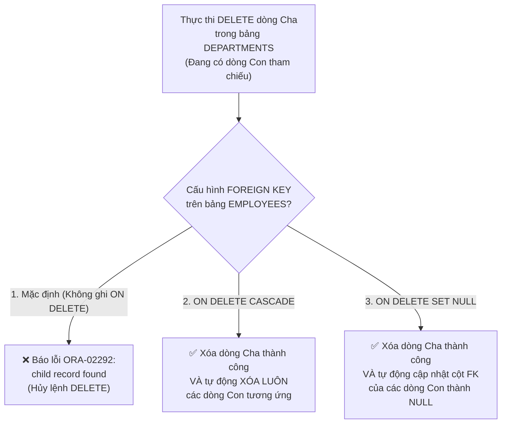
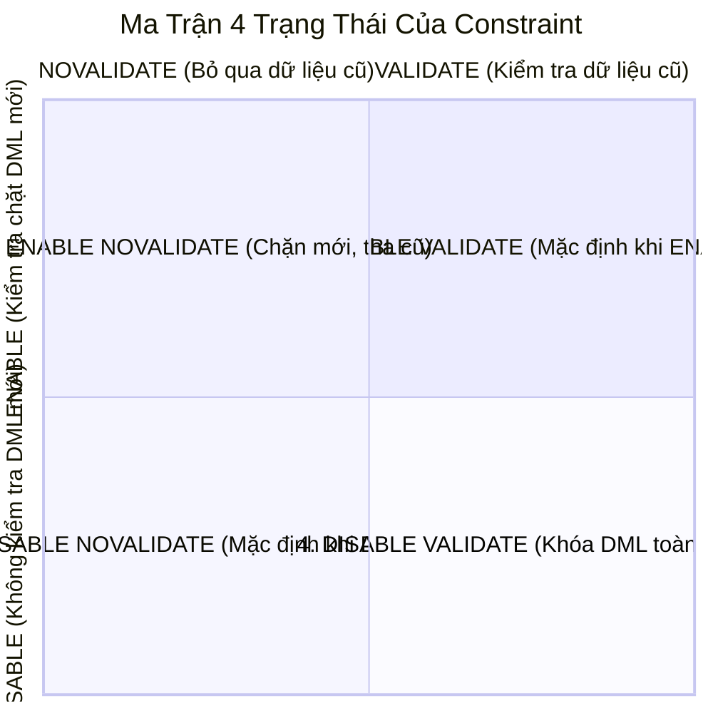

# Chương 12: Constraints — Ràng Buộc Toàn Vẹn Dữ Liệu (Data Integrity Constraints) - Oracle SQL OCA & OCP (1Z0-071)

> **Tài liệu tham chiếu:** *OCA/OCP Oracle Database SQL Exam Guide (Exam 1Z0-071)* — Steve O'Hearn & Roopesh Ramklass.  
> **Mục tiêu khảo thí:** Nắm vững 5 loại ràng buộc toàn vẹn (`NOT NULL`, `UNIQUE`, `PRIMARY KEY`, `FOREIGN KEY`, `CHECK`), phân biệt khai báo mức cột (Inline) và mức bảng (Out-of-line), khóa ghép (Composite Key), hành vi của `NULL` trong `UNIQUE` và `CHECK`, tùy chọn `ON DELETE CASCADE` vs `ON DELETE SET NULL` (cùng các từ khóa bẫy không tồn tại trong Oracle), 4 trạng thái `ENABLE`/`DISABLE` kết hợp `VALIDATE`/`NOVALIDATE`, và cơ chế trì hoãn kiểm tra `DEFERRABLE` (`INITIALLY IMMEDIATE` vs `INITIALLY DEFERRED`).

---

## 📑 Mục Lục Chi Tiết

1. [Tổng Quan Về Constraints & Cú Pháp Khai Báo (Inline vs Out-of-Line)](#1-tổng-quan-về-constraints--cú-pháp-khai-báo-inline-vs-out-of-line)
2. [Ràng Buộc `NOT NULL` & `UNIQUE` (Quy Tắc Xử Lý Giá Trị `NULL`)](#2-ràng-buộc-not-null--unique-quy-tắc-xử-lý-giá-trị-null)
3. [Ràng Buộc Khóa Chính (`PRIMARY KEY`) & Khóa Ghép (Composite Key)](#3-ràng-buộc-khóa-chính-primary-key--khóa-ghép-composite-key)
4. [Ràng Buộc Khóa Ngoại (`FOREIGN KEY`) & Các Bẫy `ON DELETE`](#4-ràng-buộc-khóa-ngoại-foreign-key--các-bẫy-on-delete)
5. [Ràng Buộc Kiểm Tra (`CHECK`) & Danh Sách Biểu Thức Bị Cấm](#5-ràng-buộc-kiểm-tra-check--danh-sách-biểu-thức-bị-cấm)
6. [Quản Lý Constraints Với `ALTER TABLE` (Thêm, Sửa, Đổi Tên, Xóa)](#6-quản-lý-constraints-với-alter-table-thêm-sửa-đổi-tên-xóa)
7. [Bốn Trạng Thái Của Constraint: `ENABLE`/`DISABLE` & `VALIDATE`/`NOVALIDATE`](#7-bốn-trạng-thái-của-constraint-enabledisable--validatenovalidate)
8. [Trì Hoãn Kiểm Tra Ràng Buộc: `DEFERRABLE` (`IMMEDIATE` vs `DEFERRED`)](#8-trì-hoãn-kiểm-tra-ràng-buộc-deferrable-immediate-vs-deferred)
9. [Bài Tập Thực Hành Tự Luyện Cuối Chương (Kèm Lời Giải)](#9-bài-tập-thực-hành-tự-luyện-cuối-chương-kèm-lời-giải)
10. [Tổng Hợp Bẫy Thi OCA/OCP & VNPT Cốt Lõi (Exam Essentials)](#10-tổng-hợp-bẫy-thi-ocaocp--vnpt-cốt-lõi-exam-essentials)

---

## 1. Tổng Quan Về Constraints & Cú Pháp Khai Báo (Inline vs Out-of-Line)

**Constraints (Ràng buộc toàn vẹn)** là các quy tắc được áp đặt ở cấp độ bảng dữ liệu nhằm ngăn chặn dữ liệu không hợp lệ được đưa vào CSDL thông qua các thao tác DML (`INSERT`, `UPDATE`, `DELETE`, `MERGE`).

### 1.1. Năm loại Constraint trong Oracle Database

| Loại Constraint | Ký hiệu trong `USER_CONSTRAINTS` (`CONSTRAINT_TYPE`) | Ý nghĩa cốt lõi |
| :--- | :---: | :--- |
| **`NOT NULL`** | **`C`** | Đảm bảo cột không bao giờ chứa giá trị rỗng (`NULL`). |
| **`UNIQUE`** | **`U`** | Đảm bảo mọi giá trị khác `NULL` trong cột (hoặc nhóm cột) là duy nhất. |
| **`PRIMARY KEY`** | **`P`** | Định danh duy nhất cho mỗi dòng (`NOT NULL` + `UNIQUE`). Tối đa **1 PK / bảng**. |
| **`FOREIGN KEY`** | **`R`** *(Referential)* | Thiết lập mối quan hệ Cha - Con, tham chiếu đến `PRIMARY KEY` hoặc `UNIQUE` của bảng Cha (hoặc chính bảng đó). |
| **`CHECK`** | **`C`** | Đảm bảo giá trị cột thỏa mãn một điều kiện logic cụ thể (không nhận giá trị `FALSE`). |

> [!TIP]
> **Mẹo nhớ ký hiệu trong `USER_CONSTRAINTS`:**
> Cả **`NOT NULL`** và **`CHECK`** đều được lưu với `CONSTRAINT_TYPE = 'C'` (vì về bản chất nội bộ, Oracle xem `NOT NULL` là một ràng buộc `CHECK (col IS NOT NULL)`). Khóa ngoại (`FOREIGN KEY`) có ký hiệu là **`'R'`** (*Referential Integrity*), **KHÔNG PHẢI `'F'`**!

---

### 1.2. Khai báo mức Cột (Column-Level / Inline) vs Mức Bảng (Table-Level / Out-of-Line)

Khi tạo bảng, bạn có thể định nghĩa Constraint theo 2 vị trí:
1. **Column-Level (Inline Constraint):** Viết ngay trên cùng dòng định nghĩa cột (trước dấu phẩy `,` ngăn cách các cột).
2. **Table-Level (Out-of-Line Constraint):** Viết tách riêng như một mệnh đề độc lập sau khi đã khai báo các cột (ngăn cách bằng dấu phẩy `,`).

```sql
CREATE TABLE employees (
    -- 1. Khai báo mức Cột (Inline):
    emp_id     NUMBER(6)    CONSTRAINT emp_pk PRIMARY KEY,
    full_name  VARCHAR2(50) CONSTRAINT emp_name_nn NOT NULL,
    email      VARCHAR2(80) UNIQUE, -- Không đặt tên -> Oracle tự đặt tên SYS_Cxxxxx
    salary     NUMBER(8,2)  CONSTRAINT emp_sal_chk CHECK (salary > 0),
    dept_id    NUMBER(4)    CONSTRAINT emp_dept_fk REFERENCES departments (dept_id),
    start_date DATE,
    end_date   DATE,

    -- 2. Khai báo mức Bảng (Out-of-Line):
    CONSTRAINT emp_email_dept_uk UNIQUE (email, dept_id),
    CONSTRAINT emp_dates_chk     CHECK (end_date >= start_date)
);
```

> [!IMPORTANT]
> **3 Quy tắc phân biệt Inline vs Out-of-Line bắt buộc phải thuộc lòng:**
> 1. **`NOT NULL` CHỈ ĐƯỢC KHAI BÁO Ở MỨC CỘT (Inline)!** Tuyệt đối không thể viết `CONSTRAINT nn_name NOT NULL (full_name)` ở mức bảng (sẽ báo lỗi cú pháp `ORA-00904`). Nếu muốn viết ở mức bảng, bạn phải dùng `CHECK (full_name IS NOT NULL)`.
> 2. **Composite Constraint (Ràng buộc trên 2 cột trở lên) hoặc `CHECK` so sánh 2 cột với nhau BẮT BUỘC PHẢI KHAI BÁO Ở MỨC BẢNG (Out-of-Line)!**
> 3. **Sự khác biệt cú pháp của `FOREIGN KEY` giữa 2 mức:**
>    * Ở **mức Cột (Inline)**: **CẤM viết từ khóa `FOREIGN KEY`**! Chỉ viết `dept_id NUMBER REFERENCES departments(dept_id)`.
>    * Ở **mức Bảng (Out-of-Line)**: **BẮT BUỘC phải viết từ khóa `FOREIGN KEY (dept_id)`** trước `REFERENCES`!

---

## 2. Ràng Buộc `NOT NULL` & `UNIQUE` (Quy Tắc Xử Lý Giá Trị `NULL`)

### 2.1. Ràng buộc `NOT NULL`
* Ngăn không cho chèn `NULL` hoặc cập nhật cột thành `NULL`.
* Một cột có thể vừa có `DEFAULT` vừa có `NOT NULL`.
* Nếu cột có `NOT NULL` mà không có `DEFAULT`, mọi lệnh `INSERT` bắt buộc phải truyền giá trị khác `NULL` cho cột đó.

---

### 2.2. Ràng buộc `UNIQUE` và Bẫy `NULL` cực hiểm trong Oracle!

Ràng buộc `UNIQUE` đảm bảo không có hai dòng nào có giá trị trùng nhau. Một bảng có thể có **nhiều** ràng buộc `UNIQUE`. Tuy nhiên, cách Oracle xử lý giá trị `NULL` giữa **Single-column `UNIQUE`** và **Composite `UNIQUE`** hoàn toàn khác nhau!

#### Trường hợp 1: Single-Column `UNIQUE` (Ràng buộc duy nhất trên 1 cột đơn)
```sql
CREATE TABLE users_single (
    user_id NUMBER PRIMARY KEY,
    phone   VARCHAR2(15) UNIQUE
);

INSERT INTO users_single VALUES (1, '0912345678');
INSERT INTO users_single VALUES (2, NULL); -- ✅ Thành công!
INSERT INTO users_single VALUES (3, NULL); -- ✅ Thành công!
INSERT INTO users_single VALUES (4, NULL); -- ✅ Thành công!
```
* **Quy tắc:** Trên một cột đơn có ràng buộc `UNIQUE`, bạn có thể chèn **bao nhiêu dòng `NULL` tùy thích**! Lý do là trong SQL, `NULL` không bằng `NULL` (và B-Tree Index của Oracle không lưu các khóa hoàn toàn `NULL`).

#### Trường hợp 2: Composite `UNIQUE` (Khóa duy nhất ghép trên nhiều cột — Bẫy thi OCP!)
Giả sử ta tạo ràng buộc `UNIQUE` trên cặp 2 cột `(area_code, phone_num)`:
```sql
CREATE TABLE users_comp (
    user_id   NUMBER PRIMARY KEY,
    area_code VARCHAR2(5),
    phone_num VARCHAR2(15),
    CONSTRAINT uk_area_phone UNIQUE (area_code, phone_num)
);
```
Hãy xem kết quả của 5 câu lệnh `INSERT` dưới đây:
```sql
INSERT INTO users_comp VALUES (1, '024', '38889999'); -- ✅ Thành công
INSERT INTO users_comp VALUES (2, NULL,  NULL);       -- ✅ Thành công (Cả 2 cột đều NULL)
INSERT INTO users_comp VALUES (3, NULL,  NULL);       -- ✅ Thành công! (Cả 2 cột đều NULL nên được lặp lại vô hạn)
INSERT INTO users_comp VALUES (4, '024', NULL);       -- ✅ Thành công (Lần đầu xuất hiện cặp ('024', NULL))
INSERT INTO users_comp VALUES (5, '024', NULL);       -- ❌ BÁO LỖI ORA-00001: unique constraint violated!
```

> [!CAUTION]
> **Giải thích Bẫy Thi Composite `UNIQUE` với giá trị `NULL`:**
> Trong Oracle Database, đối với một ràng buộc `UNIQUE` ghép từ nhiều cột `(col1, col2)`:
> * Nếu **TẤT CẢ các cột trong bộ khóa đều là `NULL`** `(NULL, NULL)` → Được phép chèn lặp lại **vô số dòng**.
> * Nhưng nếu **có ít nhất 1 cột khác `NULL`** còn cột kia là `NULL` (như `('024', NULL)`), thì bộ giá trị đó được ghi vào B-Tree Unique Index. Lần thứ hai bạn cố chèn tiếp một dòng `('024', NULL)`, Oracle coi hai bộ `('024', NULL)` là **TRÙNG NHAU** và lập tức ném lỗi **`ORA-00001: unique constraint violated`**!

---

## 3. Ràng Buộc Khóa Chính (`PRIMARY KEY`) & Khóa Ghép (Composite Key)

### 3.1. Đặc điểm của `PRIMARY KEY`
1. Mỗi bảng chỉ được phép có **tối đa 1 `PRIMARY KEY`**. Nếu cố tạo `PRIMARY KEY` thứ hai, Oracle báo lỗi **`ORA-02260: table can have only one primary key`**.
2. `PRIMARY KEY` tự động kết hợp cả hai tính chất: **`UNIQUE`** và **`NOT NULL`**.
3. Khi tạo `PRIMARY KEY` (hoặc `UNIQUE`), Oracle sẽ kiểm tra xem trên cột (hoặc bộ cột) đó đã có sẵn một `INDEX` nào chưa:
   * Nếu **chưa có Index**: Oracle **tự động tạo một `Unique Index`** có cùng tên với tên của Constraint (trừ khi Constraint là `DEFERRABLE` thì Oracle tự tạo một *Non-Unique Index*).
   * Nếu **đã có sẵn một Index** (dù là Unique hay Non-Unique Index) có các cột dẫn đầu khớp với cột của PK/UK: Oracle sẽ **tái sử dụng luôn Index có sẵn đó** mà không tạo Index mới!

### 3.2. Khóa ghép (Composite Primary Key)
Khi một khóa chính được tạo từ 2 cột trở lên (ví dụ bảng chi tiết đơn hàng `ORDER_ITEMS` có khóa chính gồm `(order_id, item_id)`):
```sql
CREATE TABLE order_items (
    order_id NUMBER(10),
    item_id  NUMBER(10),
    quantity NUMBER(5) NOT NULL,
    -- Bắt buộc khai báo ở mức Bảng (Table-level):
    CONSTRAINT ord_items_pk PRIMARY KEY (order_id, item_id)
);
```
* **Quy tắc của Composite Primary Key:**
  1. **Không có bất kỳ cột thành phần nào được phép nhận `NULL`** (`order_id` không được `NULL` và `item_id` cũng không được `NULL`).
  2. Giá trị riêng lẻ của `order_id` có thể trùng lặp (nhiều mặt hàng chung đơn hàng `100`), giá trị riêng lẻ của `item_id` có thể trùng lặp, miễn là **tổ hợp cặp `(order_id, item_id)` là duy nhất** trên toàn bảng!
  3. Không thể khai báo Composite Primary Key ở mức cột (nếu bạn viết chữ `PRIMARY KEY` ở cả 2 cột `order_id` và `item_id` tại mức cột, Oracle sẽ hiểu là bạn đang cố tạo 2 khóa chính riêng biệt và báo lỗi `ORA-02260`!).

---

## 4. Ràng Buộc Khóa Ngoại (`FOREIGN KEY`) & Các Bẫy `ON DELETE`

### 4.1. Cú pháp khai báo `FOREIGN KEY`
```sql
-- Cách 1: Khai báo ở mức Cột (Inline - KHÔNG có từ khóa FOREIGN KEY!)
CREATE TABLE emp_inline (
    emp_id  NUMBER PRIMARY KEY,
    dept_id NUMBER CONSTRAINT fk_emp_dept REFERENCES departments (dept_id)
);

-- Cách 2: Khai báo ở mức Bảng (Out-of-line - BẮT BUỘC có từ khóa FOREIGN KEY!)
CREATE TABLE emp_outline (
    emp_id  NUMBER PRIMARY KEY,
    dept_id NUMBER,
    CONSTRAINT fk_emp_dept2 FOREIGN KEY (dept_id) REFERENCES departments (dept_id)
);
```

### 4.2. Các quy tắc bắt buộc của `FOREIGN KEY`
1. **Yêu cầu đối với cột được tham chiếu ở bảng Cha:** Cột (hoặc bộ cột) nằm trong `REFERENCES parent_table(col)` **bắt buộc phải đang có ràng buộc `PRIMARY KEY` hoặc `UNIQUE`** trên bảng Cha! Nếu cột ở bảng Cha chỉ là cột thường (kể cả đã tạo Unique Index nhưng chưa khai báo Constraint `PRIMARY KEY` hay `UNIQUE`), lệnh tạo `FOREIGN KEY` sẽ thất bại với lỗi **`ORA-02270: no matching unique or primary key for this column-list`**.
2. **Lược bỏ tên cột bảng Cha:** Nếu bạn chỉ viết `REFERENCES departments` (không ghi `(dept_id)`), Oracle sẽ tự động tham chiếu đến cột **`PRIMARY KEY`** của bảng `departments`.
3. **Giá trị hợp lệ của cột Khóa ngoại ở bảng Con:** Một cột `FOREIGN KEY` ở bảng Con chỉ chấp nhận:
   * Một giá trị **đang tồn tại** trong cột PK/UK của bảng Cha, HOẶC
   * Giá trị **`NULL`** (nếu cột FK ở bảng Con không khai báo thêm `NOT NULL`).
4. **Khóa ngoại tự tham chiếu (Self-Referencing Foreign Key):** Một bảng có thể có khóa ngoại tham chiếu đến chính khóa chính của bảng đó (ví dụ cột `MANAGER_ID` tham chiếu đến cột `EMP_ID` ngay trong bảng `EMPLOYEES`).
5. **Khóa ngoại KHÔNG tự động tạo Index:** Khác với `PRIMARY KEY` và `UNIQUE`, việc tạo `FOREIGN KEY` **không tự động sinh ra bất kỳ Index nào** trên bảng Con.

---

### 4.3. Các hành vi khi xóa dữ liệu bảng Cha (`ON DELETE`) & Bẫy Từ Khóa Giả!



```sql
-- Tùy chọn 1: ON DELETE CASCADE (Xóa dây chuyền dòng con)
CONSTRAINT fk_dept_casc FOREIGN KEY (dept_id)
    REFERENCES departments (dept_id) ON DELETE CASCADE

-- Tùy chọn 2: ON DELETE SET NULL (Đổi khóa ngoại dòng con thành NULL)
CONSTRAINT fk_dept_null FOREIGN KEY (dept_id)
    REFERENCES departments (dept_id) ON DELETE SET NULL
```

> [!WARNING]
> **BẪY ĐỀ THI CỰC LỚN: Những từ khóa `ON DELETE` / `ON UPDATE` KHÔNG TỒN TẠI trong Oracle SQL!**
> Đề thi OCA/OCP 1Z0-071 và đề thi VNPT cực kỳ thích đưa các cú pháp của MySQL / SQL Server / chuẩn ANSI vào các phương án nhiễu. Hãy nhớ kỹ: Trong Oracle SQL chỉ có đúng **2 mệnh đề** được phép viết là `ON DELETE CASCADE` và `ON DELETE SET NULL` (hoặc không viết gì để dùng mặc định). Mọi mệnh đề dưới đây đều gây **LỖI CÚ PHÁP** trong Oracle:
> * ❌ `ON DELETE RESTRICT` *(Không tồn tại từ khóa này! Mặc định là Restrict nhưng không được viết chữ này ra).*
> * ❌ `ON DELETE NO ACTION` *(Không tồn tại cú pháp này trong `CREATE/ALTER TABLE` của Oracle!).*
> * ❌ `ON DELETE SET DEFAULT` *(Không tồn tại trong Oracle!).*
> * ❌ `ON UPDATE CASCADE` / `ON UPDATE SET NULL` / `ON UPDATE RESTRICT` *(Oracle hoàn toàn KHÔNG hỗ trợ bất kỳ mệnh đề `ON UPDATE ...` nào cho Foreign Key!).*
>
> **Bẫy phụ của `ON DELETE SET NULL`:** Nếu cột `dept_id` ở bảng Con vừa được khai báo là `NOT NULL`, vừa được khai báo `REFERENCES departments(dept_id) ON DELETE SET NULL`: Câu lệnh `CREATE TABLE` **vẫn chạy thành công**! Nhưng đến khi bạn xóa một phòng ban ở bảng Cha đang có nhân viên tham chiếu, Oracle cố gán `NULL` vào `dept_id` của nhân viên đó và sẽ ném lỗi **`ORA-01407: cannot update ("EMPLOYEES"."DEPT_ID") to NULL`**!

---

## 5. Ràng Buộc Kiểm Tra (`CHECK`) & Danh Sách Biểu Thức Bị Cấm

### 5.1. Cú pháp và Nguyên lý Logic 3 Giá Trị (`TRUE`, `FALSE`, `UNKNOWN`)
```sql
CREATE TABLE contracts (
    contract_id NUMBER PRIMARY KEY,
    salary      NUMBER CONSTRAINT chk_sal CHECK (salary >= 1000),
    start_date  DATE,
    end_date    DATE,
    CONSTRAINT chk_dates CHECK (end_date >= start_date)
);
```

> [!IMPORTANT]
> **Quy tắc `NULL` trong `CHECK` Constraint:**
> Ràng buộc `CHECK (condition)` chỉ từ chối dòng dữ liệu khi biểu thức `condition` được đánh giá là **`FALSE`**! Nếu biểu thức được đánh giá là **`TRUE`** hoặc **`UNKNOWN` (do có chứa `NULL`)**, dòng dữ liệu đó **HOÀN TOÀN ĐƯỢC CHẤP NHẬN**!
> * Ví dụ trên bảng `CONTRACTS`:
>   * Chèn `salary = 500` → `500 >= 1000` là `FALSE` → ❌ Báo lỗi `ORA-02290: check constraint violated`.
>   * Chèn `salary = NULL` → `NULL >= 1000` là `UNKNOWN` (không phải `FALSE`) → ✅ **Chèn thành công!**
>   * Chèn `start_date = SYSDATE, end_date = NULL` → `NULL >= SYSDATE` là `UNKNOWN` → ✅ **Chèn thành công!**

---

### 5.2. Những gì ĐƯỢC PHÉP và BỊ CẤM trong biểu thức `CHECK`

Đây là mục kiến thức bắt buộc phải thuộc lòng để làm các câu hỏi bắt lỗi cú pháp `CREATE TABLE`:

| ❌ BỊ CẤM TUYỆT ĐỐI trong `CHECK` | ✅ ĐƯỢC PHÉP trong `CHECK` |
| :--- | :--- |
| • Các hàm thời gian động: **`SYSDATE`**, **`CURRENT_DATE`**, **`SYSTIMESTAMP`**, **`CURRENT_TIMESTAMP`**, **`LOCALTIMESTAMP`** (`ORA-02436`) | • Các hằng số ngày tháng tĩnh: `CHECK (hire_date >= DATE '2020-01-01')` |
| • Các hàm thông tin phiên làm việc: **`USER`**, **`UID`**, **`USERENV(...)`**, **`SYS_CONTEXT(...)`** | • Các toán tử so sánh, `BETWEEN`, `IN (...)`, `LIKE`, `IS NULL`, `IS NOT NULL`, `AND`, `OR`, `NOT` |
| • Các cột giả (Pseudocolumns): **`NEXTVAL`**, **`CURRVAL`**, **`LEVEL`**, **`ROWNUM`**, **`ROWID`** | • Các hàm SQL chuẩn tất định (Deterministic): `UPPER(code) = code`, `LENGTH(pin) = 6`, `MOD(qty, 5) = 0`, `NVL(comm, 0) >= 0` |
| • Các câu truy vấn con (**Subquery**): `CHECK (dept_id IN (SELECT dept_id FROM depts))` | • **Tham chiếu đến cột khác trên cùng dòng của chính bảng đó** *(khi khai báo `CHECK` ở mức Bảng)*: `CHECK (salary + NVL(bonus, 0) <= 50000)` |
| • Các hàm tự định nghĩa bằng PL/SQL (User-defined Functions) | *(Lưu ý: Nếu khai báo `CHECK` ở mức Cột (Inline), nó chỉ được tham chiếu đến chính cột đó, không được nhắc tới tên cột khác!).* |

---

## 6. Quản Lý Constraints Với `ALTER TABLE` (Thêm, Sửa, Đổi Tên, Xóa)

### 6.1. Thêm Constraint vào bảng đã tồn tại
```sql
-- 1. Thêm PRIMARY KEY, UNIQUE, FOREIGN KEY, CHECK -> Dùng ALTER TABLE ... ADD CONSTRAINT:
ALTER TABLE employees
ADD CONSTRAINT emp_pk PRIMARY KEY (emp_id);

ALTER TABLE employees
ADD CONSTRAINT emp_dept_fk FOREIGN KEY (dept_id)
REFERENCES departments (dept_id) ON DELETE SET NULL;

ALTER TABLE employees
ADD CONSTRAINT emp_sal_chk CHECK (salary >= 1000);

-- 2. Thêm NOT NULL -> BẮT BUỘC dùng ALTER TABLE ... MODIFY (KHÔNG dùng ADD CONSTRAINT!):
ALTER TABLE employees
MODIFY (full_name CONSTRAINT emp_name_nn NOT NULL);
```

### 6.2. Đổi tên Constraint
```sql
ALTER TABLE employees
RENAME CONSTRAINT emp_sal_chk TO emp_min_salary_chk;
```

### 6.3. Xóa Constraint (`DROP CONSTRAINT`)
```sql
-- Cách 1: Xóa bất kỳ Constraint nào theo tên:
ALTER TABLE employees DROP CONSTRAINT emp_min_salary_chk;

-- Cách 2: Xóa PRIMARY KEY mà không cần nhớ tên Constraint:
ALTER TABLE employees DROP PRIMARY KEY;

-- Cách 3: Xóa UNIQUE mà không cần nhớ tên Constraint (chỉ định tên cột):
ALTER TABLE employees DROP UNIQUE (email);

-- Cách 4: Xóa PRIMARY KEY / UNIQUE đang được bảng Con tham chiếu -> Phải có CASCADE!
ALTER TABLE departments DROP PRIMARY KEY CASCADE;
-- (Tự động xóa luôn các ràng buộc FOREIGN KEY ở bảng EMPLOYEES đang trỏ vào PK này!)

-- Cách 5: Giữ lại Index khi xóa PRIMARY KEY / UNIQUE:
ALTER TABLE departments DROP PRIMARY KEY KEEP INDEX;
```

> [!TIP]
> **Tùy chọn `ONLINE` khi thao tác Constraint:**
> Bạn có thể thêm từ khóa `ONLINE` (ví dụ `ALTER TABLE emp DROP CONSTRAINT emp_sal_chk ONLINE;`) để cho phép các giao dịch DML của người dùng khác vẫn chạy bình thường mà không bị chặn trong lúc DDL đang cập nhật Constraint.

---

## 7. Bốn Trạng Thái Của Constraint: `ENABLE`/`DISABLE` & `VALIDATE`/`NOVALIDATE`

Mỗi Constraint trong Oracle luôn có trạng thái là sự kết hợp của 2 chiều:
* **Chiều 1 (Áp dụng cho dữ liệu MỚI từ lệnh DML sắp tới):** `ENABLE` vs `DISABLE`.
* **Chiều 2 (Kiểm tra dữ liệu CŨ đang có sẵn trong bảng):** `VALIDATE` vs `NOVALIDATE`.



### Bảng phân tích chi tiết 4 trạng thái (Cực kỳ quan trọng cho kỳ thi OCP!):

| Trạng thái kết hợp | Dữ liệu CŨ đang có trong bảng | Dữ liệu MỚI (`INSERT` / `UPDATE`) | Hành vi thực tế & Tình huống ứng dụng |
| :--- | :---: | :---: | :--- |
| **1. `ENABLE VALIDATE`**<br>*(Mặc định khi viết `ENABLE`)* | ✅ **Phải hợp lệ 100%** | ✅ **Kiểm tra nghiêm ngặt** | Trạng thái chuẩn mặc định. Nếu trong bảng đang có dù chỉ 1 dòng cũ vi phạm, lệnh chuyển sang `ENABLE VALIDATE` sẽ **báo lỗi ngay lập tức**. |
| **2. `ENABLE NOVALIDATE`** | ⚠️ **Không kiểm tra** *(Cho phép giữ lại dòng cũ vi phạm)* | ✅ **Kiểm tra nghiêm ngặt** | Rất hữu ích khi bảng lịch sử đã lỡ có vài dòng cũ không đúng chuẩn, nhưng từ nay trở đi bạn muốn ép mọi dòng mới thêm vào hoặc sửa đổi phải tuân thủ đúng quy tắc! |
| **3. `DISABLE NOVALIDATE`**<br>*(Mặc định khi viết `DISABLE`)* | ❌ **Không kiểm tra** | ❌ **Không kiểm tra** | Tắt hoàn toàn ràng buộc. *(Lưu ý: Khi `DISABLE` một `PRIMARY KEY` hoặc `UNIQUE` mà không ghi `KEEP INDEX`, Oracle sẽ tự động xóa luôn `Unique Index` do hệ thống tạo cho nó).* |
| **4. `DISABLE VALIDATE`** | ✅ **Phải hợp lệ 100%** | 🚫 **CẤM TOÀN BỘ DML (`ORA-25128`)!** | Ràng buộc bị tắt (và Index của PK/UK bị xóa), nhưng để đảm bảo dữ liệu trong bảng luôn giữ trạng thái `VALIDATED`, Oracle **cấm tuyệt đối mọi lệnh `INSERT`, `UPDATE`, `DELETE` trên bảng đó**! |

#### Ví dụ câu lệnh chuyển đổi trạng thái:
```sql
-- Tắt ràng buộc (tương đương DISABLE NOVALIDATE):
ALTER TABLE employees DISABLE CONSTRAINT emp_sal_chk;

-- Bật lại ràng buộc cho các dòng mới nhưng bỏ qua các dòng cũ đang vi phạm:
ALTER TABLE employees ENABLE NOVALIDATE CONSTRAINT emp_sal_chk;

-- Hoặc dùng cú pháp MODIFY CONSTRAINT:
ALTER TABLE employees MODIFY CONSTRAINT emp_sal_chk ENABLE NOVALIDATE;
```

---

## 8. Trì Hoãn Kiểm Tra Ràng Buộc: `DEFERRABLE` (`IMMEDIATE` vs `DEFERRED`)

Thông thường, Oracle kiểm tra Constraint ngay tại thời điểm kết thúc từng câu lệnh DML. Tuy nhiên, trong một số nghiệp vụ (ví dụ: bạn muốn chèn dòng Con vào bảng `EMPLOYEES` với `dept_id = 99` trước, rồi câu lệnh tiếp theo trong cùng Transaction mới chèn phòng ban `99` vào bảng `DEPARTMENTS`), bạn cần **trì hoãn việc kiểm tra ràng buộc cho đến lúc bấm `COMMIT`**.

### 8.1. Phân biệt `NOT DEFERRABLE` và `DEFERRABLE` ngay lúc tạo Constraint

```sql
CREATE TABLE child_emp (
    emp_id  NUMBER PRIMARY KEY,
    -- 1. Mặc định: NOT DEFERRABLE (Không bao giờ được phép trì hoãn)
    name    VARCHAR2(50) NOT NULL NOT DEFERRABLE,

    -- 2. Cho phép trì hoãn, nhưng mặc định kiểm tra ngay (INITIALLY IMMEDIATE):
    sal     NUMBER CONSTRAINT chk_sal CHECK (sal > 0)
            DEFERRABLE INITIALLY IMMEDIATE,

    -- 3. Cho phép trì hoãn, và mặc định tự động hoãn đến lúc COMMIT (INITIALLY DEFERRED):
    dept_id NUMBER CONSTRAINT fk_dept REFERENCES departments(dept_id)
            DEFERRABLE INITIALLY DEFERRED
);
```

> [!WARNING]
> **4 Quy tắc & Bẫy Thi Sống Còn Về `DEFERRABLE` Constraints:**
> 1. **Mặc định là `NOT DEFERRABLE`:** Nếu khi tạo Constraint bạn không viết từ khóa `DEFERRABLE`, nó sẽ là `NOT DEFERRABLE`. Với một Constraint `NOT DEFERRABLE`, nếu bạn cố chạy lệnh `SET CONSTRAINT const_name DEFERRED;`, Oracle sẽ báo lỗi **`ORA-02447: cannot defer a constraint that is not deferrable`**!
> 2. **Không thể sửa `NOT DEFERRABLE` thành `DEFERRABLE` bằng `ALTER TABLE`:** Một khi Constraint đã được tạo là `NOT DEFERRABLE`, bạn **KHÔNG THỂ** dùng `ALTER TABLE ... MODIFY CONSTRAINT` để biến nó thành `DEFERRABLE`! Cách duy nhất là `DROP CONSTRAINT` rồi `ADD CONSTRAINT` lại từ đầu kèm từ khóa `DEFERRABLE`.
> 3. **Nếu chỉ viết `DEFERRABLE` (không ghi `INITIALLY ...`):** Mặc định sẽ là **`DEFERRABLE INITIALLY IMMEDIATE`**. Bạn có thể đổi trạng thái trong phiên giao dịch hiện tại bằng lệnh:
>    ```sql
>    SET CONSTRAINT chk_sal DEFERRED;
>    -- Hoặc cho tất cả các constraint deferrable trong Transaction:
>    SET CONSTRAINTS ALL DEFERRED;
>    ```
> 4. **Bẫy `COMMIT` khi vi phạm Constraint `DEFERRED` (Cực kỳ quan trọng!):**
>    * Khi một Constraint đang ở chế độ **`IMMEDIATE`**, nếu câu lệnh `INSERT` vi phạm ràng buộc, câu lệnh `INSERT` đó báo lỗi ngay lập tức và chỉ mình nó bị hủy (*Statement-level Rollback*), Transaction vẫn còn sống.
>    * Nhưng khi một Constraint đang ở chế độ **`DEFERRED`**, câu lệnh `INSERT` vi phạm ràng buộc **vẫn báo thực thi thành công (`1 row created`)**! Đến thời điểm bạn gọi lệnh **`COMMIT;`**, Oracle mới kiểm tra ràng buộc: nếu lúc này dữ liệu vẫn vi phạm, lệnh `COMMIT` sẽ báo lỗi và **Oracle TỰ ĐỘNG `ROLLBACK` TOÀN BỘ TRANSACTION ĐÓ** (mọi lệnh DML khác trong cùng Transaction đều bị hủy sạch)!
> 5. **Loại Index của PK/UK `DEFERRABLE`:** Khi tạo `PRIMARY KEY` hoặc `UNIQUE` kèm từ khóa `DEFERRABLE`, Oracle tự động tạo một **Non-Unique Index** (thay vì Unique Index) để cho phép bảng tạm thời chứa các giá trị trùng lặp trong suốt thời gian giao dịch chưa Commit.

---

## 9. Bài Tập Thực Hành Tự Luyện Cuối Chương (Kèm Lời Giải)

### Bài tập 1: Phân tích Composite `UNIQUE`, `CHECK` và `NULL`
Cho bảng `STAFF` được tạo bằng câu lệnh hợp lệ sau:
```sql
CREATE TABLE staff (
    staff_id  NUMBER PRIMARY KEY,
    branch_id NUMBER,
    badge_no  VARCHAR2(10),
    age       NUMBER CONSTRAINT chk_age CHECK (age BETWEEN 18 AND 60),
    CONSTRAINT uk_branch_badge UNIQUE (branch_id, badge_no)
);
```
Nếu chạy tuần tự 5 câu lệnh `INSERT` dưới đây, những câu lệnh nào **Thành công**, những câu lệnh nào **Báo lỗi**?
1. `INSERT INTO staff VALUES (1, 10, 'B01', NULL);`
2. `INSERT INTO staff VALUES (2, NULL, NULL, 25);`
3. `INSERT INTO staff VALUES (3, NULL, NULL, 30);`
4. `INSERT INTO staff VALUES (4, 10, NULL, 40);`
5. `INSERT INTO staff VALUES (5, 10, NULL, 45);`

<details>
<summary><b>💡 Xem Lời Giải Chi Tiết Bài Tập 1</b></summary>

1. **Lệnh 1:** ✅ **Thành công!** Cột `age = NULL` làm cho biểu thức `NULL BETWEEN 18 AND 60` trả về `UNKNOWN` (không phải `FALSE`), nên hoàn toàn vượt qua ràng buộc `CHECK`.
2. **Lệnh 2:** ✅ **Thành công!** Cặp `(branch_id, badge_no)` là `(NULL, NULL)`.
3. **Lệnh 3:** ✅ **Thành công!** Vì cả 2 cột trong Composite `UNIQUE` đều là `NULL` `(NULL, NULL)`, Oracle không lưu vào B-Tree Index nên cho phép chèn bao nhiêu cặp `(NULL, NULL)` tùy ý.
4. **Lệnh 4:** ✅ **Thành công!** Cặp `(10, NULL)` xuất hiện lần đầu tiên.
5. **Lệnh 5:** ❌ **Báo lỗi `ORA-00001: unique constraint (UK_BRANCH_BADGE) violated`!** Vì trong Composite `UNIQUE` của Oracle, khi có ít nhất 1 cột khác `NULL` (`branch_id = 10`), cặp `(10, NULL)` đã được lưu vào Index ở Lệnh 4, nên Lệnh 5 chèn tiếp `(10, NULL)` sẽ bị coi là trùng lặp!
</details>

---

### Bài tập 2: Truy vết Constraint `DEFERRABLE INITIALLY DEFERRED` khi `COMMIT`
Cho bảng `ITEMS (id NUMBER CONSTRAINT pk_items PRIMARY KEY DEFERRABLE INITIALLY DEFERRED, name VARCHAR2(20))` hiện đang trống (`0` dòng). Bạn chạy kịch bản sau:
```sql
INSERT INTO items VALUES (1, 'Laptop');
INSERT INTO items VALUES (2, 'Mouse');
INSERT INTO items VALUES (2, 'Keyboard'); -- Trùng id = 2! (Dòng lệnh 3)
COMMIT;                                   -- (Dòng lệnh 4)
SELECT COUNT(*) FROM items;               -- (Dòng lệnh 5)
```
Hãy cho biết:
1. Lệnh `INSERT` ở Dòng lệnh 3 có báo lỗi ngay lúc chạy không?
2. Kết quả của câu lệnh `SELECT COUNT(*) FROM items;` ở Dòng lệnh 5 là bao nhiêu?

<details>
<summary><b>💡 Xem Lời Giải Chi Tiết Bài Tập 2</b></summary>

1. **Tại Dòng lệnh 3:** Câu lệnh `INSERT INTO items VALUES (2, 'Keyboard');` **KHÔNG báo lỗi** mà thông báo `1 row created` thành công! Lý do là khóa chính `pk_items` được khai báo là `DEFERRABLE INITIALLY DEFERRED` (và dùng Non-Unique Index dưới nền), nên việc kiểm tra trùng lặp được hoãn lại cho đến khi gọi `COMMIT`.
2. **Tại Dòng lệnh 4 & 5:** Khi chạy `COMMIT;`, Oracle bắt đầu kiểm tra ràng buộc `pk_items`, phát hiện hai dòng có cùng `id = 2` nên ném lỗi:
   `ORA-02091: transaction rolled back` kèm `ORA-00001: unique constraint (PK_ITEMS) violated`.
   Toàn bộ Transaction bị **tự động Rollback sạch sẽ** (mất cả dòng `1` lẫn dòng `2`). Do đó, `SELECT COUNT(*) FROM items;` ở Dòng lệnh 5 trả về **`0`**!
</details>

---

## 10. Tổng Hợp Bẫy Thi OCA/OCP & VNPT Cốt Lõi (Exam Essentials)

| # | Chủ đề | Bẫy đề thi thường gặp | Quy tắc chuẩn cần nhớ |
| :---: | :--- | :--- | :--- |
| **1** | Vị trí khai báo `NOT NULL` | Khai báo `NOT NULL` ở mức bảng (Out-of-line) | **Báo lỗi cú pháp!** `NOT NULL` bắt buộc phải khai báo ở mức Cột (Inline). Khi thêm vào bảng đã có, phải dùng `ALTER TABLE ... MODIFY`, không dùng `ADD CONSTRAINT`. |
| **2** | Khai báo `FOREIGN KEY` | Viết `dept_id NUMBER FOREIGN KEY REFERENCES depts(id)` ở mức cột | **Báo lỗi cú pháp!** Ở mức cột chỉ viết `REFERENCES ...` (không có chữ `FOREIGN KEY`). Ở mức bảng mới bắt buộc có `FOREIGN KEY (col) REFERENCES ...`. |
| **3** | Composite `UNIQUE` với `NULL` | Chèn 2 dòng `(100, NULL)` và `(100, NULL)` vào bảng có `UNIQUE(col1, col2)` | **Dòng thứ 2 báo lỗi `ORA-00001`!** Composite `UNIQUE` trong Oracle cho phép nhiều dòng `(NULL, NULL)`, nhưng cấm lặp lại bộ có 1 cột khác `NULL` như `(100, NULL)`. |
| **4** | Tùy chọn của `FOREIGN KEY` | Các phương án có `ON DELETE RESTRICT`, `ON DELETE SET DEFAULT`, `ON UPDATE CASCADE` | **Tất cả đều SAI CÚ PHÁP trong Oracle!** Oracle chỉ hỗ trợ đúng 2 mệnh đề là `ON DELETE CASCADE` và `ON DELETE SET NULL`. |
| **5** | Biểu thức trong `CHECK` | Dùng `CHECK (hire_date <= SYSDATE)` hoặc `CHECK (id > NEXTVAL)` | **Báo lỗi!** `CHECK` cấm tuyệt đối `SYSDATE`, `USER`, `ROWNUM`, `LEVEL`, `NEXTVAL`, `CURRVAL` và Subquery. Nhưng `CHECK` mức bảng được phép so sánh 2 cột trên cùng 1 dòng. |
| **6** | Giá trị `NULL` trong `CHECK` | Chèn `NULL` vào cột có `CHECK (salary > 1000)` | **Thành công!** Biểu thức trả về `UNKNOWN` (không phải `FALSE`) nên vượt qua `CHECK`. |
| **7** | `ENABLE NOVALIDATE` | Bảng đang có dòng cũ vi phạm quy tắc nhưng muốn chặn các dòng mới | Dùng **`ENABLE NOVALIDATE`**: giữ nguyên các dòng cũ không kiểm tra, nhưng kiểm tra chặt mọi lệnh `INSERT`/`UPDATE` mới. |
| **8** | `DISABLE VALIDATE` | Hỏi điều gì xảy ra với các lệnh DML trên bảng có Constraint `DISABLE VALIDATE` | **Mọi lệnh `INSERT`, `UPDATE`, `DELETE` trên bảng đều bị cấm (`ORA-25128`)**, bảng chỉ cho phép đọc `SELECT`. |
| **9** | Sửa `NOT DEFERRABLE` | Dùng `ALTER TABLE` để đổi Constraint đang có sang `DEFERRABLE` | **Không thể sửa!** Phải `DROP CONSTRAINT` rồi `ADD CONSTRAINT` lại từ đầu kèm từ khóa `DEFERRABLE`. |
| **10** | Lỗi `DEFERRED` lúc `COMMIT` | Vi phạm Constraint đang ở chế độ `DEFERRED` khi thực thi lệnh `COMMIT` | Lệnh `COMMIT` thất bại và Oracle **tự động `ROLLBACK` toàn bộ Transaction** đó! |
