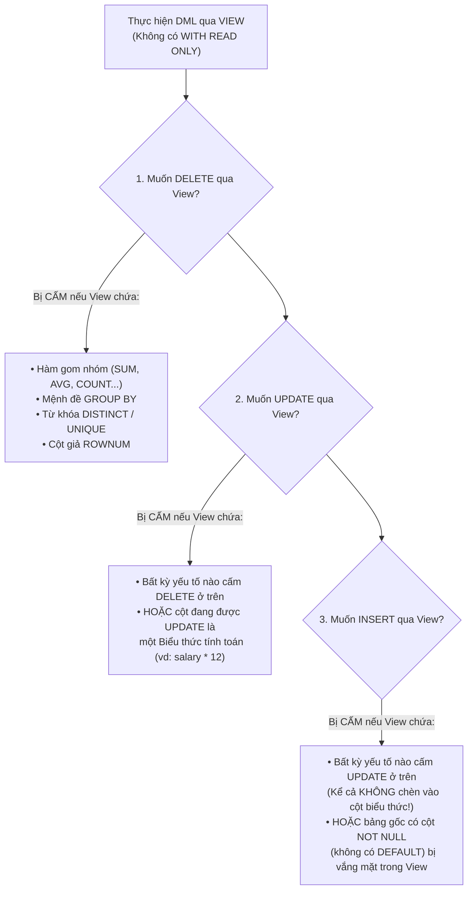
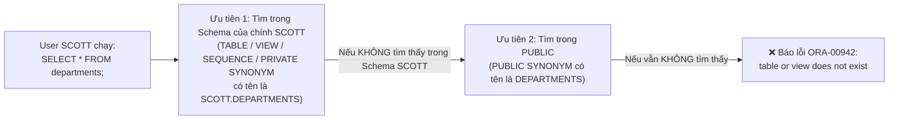

# Chương 13: Các Database Objects & Phân Quyền (Views, Sequences, Indexes, Synonyms, Data Dictionary & DCL) - Oracle SQL OCA & OCP (1Z0-071)

> **Tài liệu tham chiếu:** *OCA/OCP Oracle Database SQL Exam Guide (Exam 1Z0-071)* — Steve O'Hearn & Roopesh Ramklass.  
> **Mục tiêu khảo thí:** Làm chủ cách tạo và quản lý `VIEW` (Simple vs Complex View, quy tắc DML qua View, `WITH CHECK OPTION`, `WITH READ ONLY`, `FORCE`), `INDEX` (`B-Tree`, `Bitmap`, `Unique`, `Composite`, `Function-Based`, `VISIBLE`/`INVISIBLE`), `SEQUENCE` (`NEXTVAL`, `CURRVAL`, `CACHE`, `CYCLE`, hiện tượng nhảy số Gap), `SYNONYM` (Private vs Public, thứ tự ưu tiên phân giải tên), tra cứu Data Dictionary (`USER_*`, `ALL_*`, `DBA_*`, `V$*`) và phân quyền DCL (`GRANT`, `REVOKE`, `ROLE`, sự khác biệt sống còn giữa `WITH ADMIN OPTION` và `WITH GRANT OPTION`).

---

## 📑 Mục Lục Chi Tiết

1. [Khung Nhìn Logic (`VIEW`) — Phân Loại, Quy Tắc DML & Các Tùy Chọn](#1-khung-nhìn-logic-view--phân-loại-quy-tắc-dml--các-tùy-chọn)
2. [Chỉ Mục (`INDEX`) — Các Loại Index, `VISIBLE`/`INVISIBLE` & Tối Ưu Hóa](#2-chỉ-mục-index--các-loại-index-visibleinvisible--tối-ưu-hóa)
3. [Bộ Sinh Số Tự Động (`SEQUENCE`) — `NEXTVAL`, `CURRVAL`, `CYCLE` & Gaps](#3-bộ-sinh-số-tự-động-sequence--nextval-currval-cycle--gaps)
4. [Tên Đồng Nghĩa (`SYNONYM`) & Thứ Tự Ưu Tiên Phân Giải Tên Đối Tượng](#4-tên-đồng-nghĩa-synonym--thứ-tự-ưu-tiên-phân-giải-tên-đối-tượng)
5. [Hệ Thống Từ Điển Dữ Liệu (Data Dictionary Views: `USER_`, `ALL_`, `DBA_`, `V$`)](#5-hệ-thống-từ-điển-dữ-liệu-data-dictionary-views-user_-all_-dba_-v)
6. [Quản Lý Quyền Truy Cập (DCL): System vs Object Privileges & `ROLE`](#6-quản-lý-quyền-truy-cập-dcl-system-vs-object-privileges--role)
7. [Bài Tập Thực Hành Tự Luyện Cuối Chương (Kèm Lời Giải)](#7-bài-tập-thực-hành-tự-luyện-cuối-chương-kèm-lời-giải)
8. [Tổng Hợp Bẫy Thi OCA/OCP & VNPT Cốt Lõi (Exam Essentials)](#8-tổng-hợp-bẫy-thi-ocaocp--vnpt-cốt-lõi-exam-essentials)

---

## 1. Khung Nhìn Logic (`VIEW`) — Phân Loại, Quy Tắc DML & Các Tùy Chọn

Một **View (Khung nhìn)** là một câu lệnh truy vấn `SELECT` đã được đặt tên và lưu trữ định nghĩa trong Data Dictionary. Bản thân View thông thường **không chứa dữ liệu vật lý** và không chiếm dung lượng lưu trữ dữ liệu trong Tablespace; mỗi khi người dùng truy vấn View, Oracle thực thi câu lệnh `SELECT` bên dưới trên các bảng cơ sở (*Base Tables*).

### 1.1. Cú pháp chuẩn `CREATE VIEW`
```sql
CREATE [OR REPLACE] [FORCE | NOFORCE] VIEW [schema.]view_name
    [(alias1 [VISIBLE | INVISIBLE], alias2, ...)]
AS
    SELECT ...
[WITH READ ONLY | WITH CHECK OPTION [CONSTRAINT constraint_name]];
```

#### Các tùy chọn quan trọng khi tạo View:
1. **`OR REPLACE`**: Ghi đè định nghĩa mới lên View đã tồn tại mà **không làm mất các quyền truy cập (Object Privileges)** đã cấp trên View đó trước đây!
2. **`NOFORCE` *(Mặc định)* vs `FORCE`**:
   * `NOFORCE`: Bảng cơ sở bắt buộc phải tồn tại và người tạo View phải có quyền `SELECT` trực tiếp trên bảng cơ sở ngay tại thời điểm chạy `CREATE VIEW`.
   * `FORCE`: Cho phép tạo View **ngay cả khi bảng cơ sở chưa tồn tại** hoặc người tạo chưa có quyền trên bảng cơ sở! View được lưu vào Data Dictionary với trạng thái **`INVALID`**. Ngay sau khi bảng cơ sở được tạo và cấp quyền hợp lệ, lần đầu tiên có người `SELECT` từ View đó, Oracle sẽ tự động biên dịch lại (*Auto-recompile*) View sang trạng thái **`VALID`**.

---

### 1.2. Simple View vs Complex View & Quy tắc thực hiện DML qua View



Hãy xét một ví dụ thực tế cực kỳ hay ra thi để thấy rõ sự khác biệt giữa `DELETE`, `UPDATE` và `INSERT` trên View có chứa cột biểu thức:

```sql
-- Bảng EMPLOYEES có: emp_id (PK), full_name (NOT NULL), salary, dept_id
CREATE OR REPLACE VIEW v_emp_annual AS
SELECT emp_id, full_name, salary, salary * 12 AS annual_sal
FROM employees
WHERE dept_id = 20;
```

**Phân tích 4 câu lệnh DML chạy trên View `v_emp_annual`:**
1. **`DELETE FROM v_emp_annual WHERE emp_id = 102;`**
   * ✅ **THÀNH CÔNG!** Dù View có chứa cột biểu thức `salary * 12`, nhưng View không có `GROUP BY`, `DISTINCT`, Group function hay `ROWNUM`, nên lệnh `DELETE` chạy hoàn toàn bình thường!
2. **`UPDATE v_emp_annual SET salary = 3000 WHERE emp_id = 102;`**
   * ✅ **THÀNH CÔNG!** Vì `salary` là một cột gốc đơn thuần, không phải là cột biểu thức.
3. **`UPDATE v_emp_annual SET annual_sal = 36000 WHERE emp_id = 102;`**
   * ❌ **BÁO LỖI `ORA-01733: virtual column not allowed here`!** Vì `annual_sal` là cột ảo được tính từ biểu thức `salary * 12`.
4. **`INSERT INTO v_emp_annual (emp_id, full_name, salary) VALUES (201, 'Le Minh', 2000);`**
   * ❌ **BÁO LỖI `ORA-01733: virtual column not allowed here`!** (Bẫy thi rất nhiều người sập!): Ngay cả khi bạn không liệt kê cột `annual_sal` trong danh sách cột `INSERT`, quy tắc của Oracle là: **Nếu định nghĩa của View có chứa bất kỳ cột biểu thức nào, bạn KHÔNG THỂ thực hiện lệnh `INSERT` qua View đó** (trừ khi viết `INSTEAD OF` Trigger)!

---

### 1.3. Mệnh đề `WITH CHECK OPTION` và `WITH READ ONLY`

#### 1. `WITH CHECK OPTION`:
Mệnh đề này bảo vệ điều kiện `WHERE` của View: Mọi thao tác `INSERT` hoặc `UPDATE` thực hiện **thông qua View** bắt buộc phải tạo ra các dòng dữ liệu **tiếp tục thỏa mãn mệnh đề `WHERE` của View đó**!

```sql
CREATE OR REPLACE VIEW v_dept20 AS
SELECT emp_id, full_name, salary, dept_id
FROM employees
WHERE dept_id = 20
WITH CHECK OPTION CONSTRAINT v_dept20_ck;
```
* `INSERT INTO v_dept20 VALUES (205, 'Hoa', 2500, 20);` → ✅ **Thành công** (vì `dept_id = 20` thỏa mãn `WHERE dept_id = 20`).
* `INSERT INTO v_dept20 VALUES (206, 'Nam', 2500, 30);` → ❌ **Báo lỗi `ORA-01402: view WITH CHECK OPTION where-clause violation`** (vì `dept_id = 30` không thỏa mãn điều kiện của View).
* `UPDATE v_dept20 SET salary = 4000 WHERE emp_id = 102;` → ✅ **Thành công** (vì `dept_id` vẫn là `20`).
* `UPDATE v_dept20 SET dept_id = 10 WHERE emp_id = 102;` → ❌ **Báo lỗi `ORA-01402`** (vì chuyển nhân viên sang phòng `10` sẽ làm dòng đó biến mất khỏi View `v_dept20`!).
* `DELETE FROM v_dept20 WHERE emp_id = 102;` → ✅ **Thành công** (`WITH CHECK OPTION` không bao giờ chặn lệnh `DELETE`!).

> [!WARNING]
> **Bẫy thi về `WITH CHECK OPTION`:**
> Nếu một người dùng không thao tác qua View `v_dept20`, mà chạy lệnh trực tiếp trên bảng gốc:
> `UPDATE employees SET dept_id = 10 WHERE emp_id = 102;`
> → Câu lệnh này **CHẠY THÀNH CÔNG 100%**! Ràng buộc `WITH CHECK OPTION` của View chỉ kiểm soát các lệnh DML đi qua tên của chính View đó, hoàn toàn không áp đặt lên bảng cơ sở!

#### 2. `WITH READ ONLY`:
Ngăn chặn tuyệt đối mọi câu lệnh `INSERT`, `UPDATE`, `DELETE`, `MERGE` thông qua View (`ORA-42399: cannot perform a DML operation on a read-only view`).

---

## 2. Chỉ Mục (`INDEX`) — Các Loại Index, `VISIBLE`/`INVISIBLE` & Tối Ưu Hóa

**Index (Chỉ mục)** là một đối tượng Schema độc lập về mặt vật lý (có Segment lưu trữ riêng), giúp tăng tốc độ truy xuất các dòng dữ liệu thông qua con trỏ `ROWID` thay vì phải quét toàn bộ bảng (*Full Table Scan*). Tuy nhiên, có quá nhiều Index trên một bảng sẽ làm **chậm các thao tác DML (`INSERT`, `UPDATE`, `DELETE`)** vì Oracle phải cập nhật đồng thời cả bảng lẫn tất cả các Index liên quan.

### 2.1. Phân loại các loại Index trong Oracle

| Loại Index | Cú pháp khởi tạo | Đặc điểm & Trường hợp sử dụng tối ưu |
| :--- | :--- | :--- |
| **B-Tree Index**<br>*(Mặc định)* | `CREATE INDEX idx_name ON tab(col);` | Cấu trúc cây cân bằng (*Balanced Tree*). Tối ưu cho các cột có **độ chọn lọc cao (High Cardinality)** — chứa nhiều giá trị khác nhau (như `EMP_ID`, `EMAIL`, `PHONE`) và môi trường **OLTP** nhiều giao dịch. |
| **Bitmap Index** | `CREATE BITMAP INDEX idx_name ON tab(col);` | Lưu mảng bit (`0`/`1`) cho từng giá trị khóa. Tối ưu cho cột có **độ chọn lọc thấp (Low Cardinality)** — ít giá trị phân biệt (như `GENDER`, `STATUS`) và truy vấn kết hợp nhiều điều kiện `AND`/`OR` trong **Data Warehouse**. *(Kỵ môi trường OLTP vì khóa Bitmap khóa hàng loạt dòng cùng lúc!).* |
| **Unique Index** | `CREATE UNIQUE INDEX idx_name ON tab(col);` | Đảm bảo không có 2 dòng nào trùng giá trị khóa khác `NULL`. Tự động được tạo khi khai báo `PRIMARY KEY` hoặc `UNIQUE` (nếu chưa có Index). |
| **Composite Index** | `CREATE INDEX idx_name ON tab(col1, col2);` | Đánh chỉ mục trên nhiều cột (tối đa 32 cột cho B-Tree). Tối ưu khi mệnh đề `WHERE` sử dụng cột dẫn đầu (*Leading column* `col1`) hoặc cả bộ cột. |
| **Function-Based Index** | `CREATE INDEX idx_name ON tab(UPPER(col));` | Lưu sẵn kết quả của hàm hoặc biểu thức. Giúp Optimizer dùng được Index khi câu lệnh `SELECT` có chứa hàm/biểu thức tương ứng trong `WHERE` (`WHERE UPPER(col) = 'ABC'`). |

---

### 2.2. `VISIBLE` vs `INVISIBLE` Index & Nhiều Index trên cùng một cột (Từ Oracle 12c+)

```sql
-- Tạo một Invisible Index:
CREATE INDEX idx_emp_sal ON employees(salary) INVISIBLE;

-- Chuyển đổi qua lại giữa VISIBLE và INVISIBLE:
ALTER INDEX idx_emp_sal VISIBLE;
ALTER INDEX idx_emp_sal INVISIBLE;
```

> [!IMPORTANT]
> **3 Quy tắc Vàng về `INVISIBLE` Index và Đa Chỉ Mục trên cùng cột (Rất hay ra thi OCP!):**
> 1. **Hành vi của `INVISIBLE` Index:** Khi một Index ở trạng thái `INVISIBLE`, bộ tối ưu hóa truy vấn (**Optimizer**) sẽ **bỏ qua không sử dụng** Index đó khi chạy các câu lệnh `SELECT` (trừ khi phiên làm việc bật `ALTER SESSION SET OPTIMIZER_USE_INVISIBLE_INDEXES = TRUE`). **NHƯNG mọi câu lệnh DML (`INSERT`, `UPDATE`, `DELETE`) trên bảng VẪN TIẾP TỤC CẬP NHẬT `INVISIBLE` Index đó** bình thường!
> 2. **Tạo nhiều Index trên cùng một cột (hoặc cùng danh sách cột):** Từ Oracle 12c+, bạn **được phép** tạo nhiều hơn 1 Index trên cùng một tập hợp cột (ví dụ tạo cả B-Tree Index lẫn Bitmap Index trên cột `dept_id`), miễn là thỏa mãn đồng thời **2 điều kiện**:
>    * Các Index đó phải **khác nhau về loại hoặc tính chất** (ví dụ: 1 B-Tree và 1 Bitmap; hoặc 1 Unique và 1 Non-Unique), **VÀ**
>    * Tại bất kỳ thời điểm nào, **chỉ được phép có tối đa 1 Index ở trạng thái `VISIBLE`**, tất cả các Index còn lại trên cùng cột đó bắt buộc phải là **`INVISIBLE`**!
> 3. **Sửa đổi Index (`ALTER INDEX`):** Bạn **KHÔNG THỂ** dùng `ALTER INDEX` để thêm cột hay đổi tên cột trong Index! Để thay đổi cấu trúc cột của Index, bắt buộc phải `DROP INDEX` rồi `CREATE INDEX` lại. (Lệnh `ALTER INDEX` chỉ dùng để `REBUILD`, `RENAME TO`, `VISIBLE`/`INVISIBLE`, `UNUSABLE`).

---

## 3. Bộ Sinh Số Tự Động (`SEQUENCE`) — `NEXTVAL`, `CURRVAL`, `CYCLE` & Gaps

Một **Sequence** là một đối tượng độc lập dùng để sinh các số nguyên tuần tự duy nhất (thường dùng để tạo giá trị khóa chính). Một Sequence không gắn cứng với riêng bảng nào mà có thể được dùng chung bởi nhiều bảng.

### 3.1. Cú pháp đầy đủ `CREATE SEQUENCE`
```sql
CREATE SEQUENCE [schema.]seq_name
    [START WITH n]              -- Số bắt đầu đầu tiên (Mặc định: MINVALUE nếu tăng)
    [INCREMENT BY n]            -- Bước nhảy (Mặc định: 1; nếu n < 0 thì đếm lùi!)
    [MAXVALUE n | NOMAXVALUE]   -- Giá trị tối đa (Mặc định: NOMAXVALUE = 10^28 - 1)
    [MINVALUE n | NOMINVALUE]   -- Giá trị tối thiểu (Mặc định: 1 nếu đếm tiến)
    [CYCLE | NOCYCLE]           -- Quay vòng khi chạm ngưỡng (Mặc định: NOCYCLE)
    [CACHE n | NOCACHE]         -- Cấp sẵn n số trong RAM (Mặc định: CACHE 20; n >= 2)
    [ORDER | NOORDER];          -- Đảm bảo thứ tự trên RAC (Mặc định: NOORDER)
```

---

### 3.2. Quy tắc sử dụng `NEXTVAL` và `CURRVAL`

```sql
-- Lấy số mới tiếp theo từ Sequence:
INSERT INTO departments VALUES (dept_seq.NEXTVAL, 'R&D', 1700);

-- Lấy lại chính con số vừa sinh ra ở trên để chèn vào bảng Con:
INSERT INTO employees (emp_id, full_name, dept_id)
VALUES (emp_seq.NEXTVAL, 'Hoang Van E', dept_seq.CURRVAL);
```

> [!WARNING]
> **5 Bẫy Thi Kinh Điển Nhất Về `SEQUENCE` Trong Kỳ Thi 1Z0-071:**
>
> 1. **Gọi `CURRVAL` trước `NEXTVAL` (`ORA-08002`):**
>    Trong một Session vừa mới kết nối, bạn **BẮT BUỘC phải gọi `seq.NEXTVAL` ít nhất 1 lần trong Session đó trước khi được phép gọi `seq.CURRVAL`**! Dù Sequence đã được các Session khác lấy đến số `1000`, nếu Session của bạn vừa mở lên mà chạy ngay `SELECT dept_seq.CURRVAL FROM dual;`, Oracle sẽ lập tức báo lỗi **`ORA-08002: sequence DEPT_SEQ.CURRVAL is not yet defined in this session`**!
>
> 2. **Gọi nhiều `NEXTVAL` trên cùng một dòng lệnh:**
>    Nếu bạn chạy câu lệnh:
>    ```sql
>    SELECT dept_seq.NEXTVAL, dept_seq.NEXTVAL, dept_seq.CURRVAL FROM dual;
>    ```
>    Oracle chỉ tăng Sequence **đúng 1 lần duy nhất cho mỗi dòng kết quả**! Do đó nếu số tiếp theo là `10`, cả 3 cột trong câu lệnh trên đều trả về **`10, 10, 10`** (chứ không phải `10, 11, 11`)!
>
> 3. **Bẫy quay vòng `CYCLE` — Quay về `MINVALUE` chứ KHÔNG quay về `START WITH`!**
>    Xét Sequence sau:
>    ```sql
>    CREATE SEQUENCE my_seq
>    START WITH 10
>    INCREMENT BY 5
>    MAXVALUE 20
>    MINVALUE 1
>    CYCLE NOCACHE;
>    ```
>    * Lần gọi `NEXTVAL` thứ 1: trả về `10` (`START WITH`).
>    * Lần gọi `NEXTVAL` thứ 2: trả về `15`.
>    * Lần gọi `NEXTVAL` thứ 3: trả về `20` (`MAXVALUE`).
>    * **Hỏi: Lần gọi `NEXTVAL` thứ 4 trả về bao nhiêu?**
>      → Đáp án chính xác là **`1` (`MINVALUE`)**, **KHÔNG PHẢI `10` (`START WITH`)**! Với một Sequence đếm tiến (`INCREMENT BY > 0`), khi đạt `MAXVALUE` và quay vòng `CYCLE`, nó luôn bắt đầu chu kỳ mới tại **`MINVALUE`** (và nếu bạn không khai báo `MINVALUE`, mặc định `MINVALUE` là **`1`**!). Ngược lại, với Sequence đếm lùi (`INCREMENT BY < 0`), khi chạm `MINVALUE` và quay vòng, nó sẽ nhảy về **`MAXVALUE`**.
>
> 4. **Cấm sửa `START WITH` bằng `ALTER SEQUENCE` (`ORA-02283`):**
>    Trong câu lệnh `ALTER SEQUENCE`, bạn có thể sửa `INCREMENT BY`, `MAXVALUE`, `MINVALUE`, `CYCLE`, `CACHE`, nhưng **TUYỆT ĐỐI KHÔNG ĐƯỢC PHÉP sửa `START WITH`**! Viết `ALTER SEQUENCE my_seq START WITH 100;` sẽ báo lỗi **`ORA-02283: cannot alter starting sequence number`**.
>
> 5. **Các vị trí BỊ CẤM dùng `NEXTVAL` và `CURRVAL`:**
>    Không được dùng `NEXTVAL`/`CURRVAL` trong: câu lệnh `SELECT` có từ khóa **`DISTINCT`**, **`GROUP BY`**, **`HAVING`**, **`ORDER BY`**, toán tử tập hợp (**`UNION`**, **`INTERSECT`**, **`MINUS`**), mệnh đề **`WHERE`**, trong câu truy vấn định nghĩa **`VIEW`**, hoặc trong điều kiện **`CHECK`** constraint!

---

### 3.3. Bốn nguyên nhân gây ra khoảng trống / nhảy số (Sequence Gaps)
Đề thi rất hay hỏi: *"Trong những tình huống nào thì dãy số sinh bởi Sequence trên một bảng sẽ bị hổng (Gaps)?"*
1. **Giao dịch thực hiện `ROLLBACK`** (hoặc câu lệnh `INSERT` bị lỗi Statement-level Rollback sau khi đã lấy `NEXTVAL`): Số Sequence đã cấp **không bao giờ được trả lại**.
2. **Hệ thống gặp sự cố (`Instance Crash` / `SHUTDOWN ABORT`)**: Toàn bộ các số đã được cấp sẵn trong bộ nhớ RAM (do tùy chọn **`CACHE n`**) sẽ bị mất vĩnh viễn; khi mở lại Database, Sequence sẽ lấy tiếp từ số sau đoạn Cache cũ.
3. **Nhiều bảng cùng dùng chung một Sequence**: Bảng A lấy số `1`, Bảng B lấy số `2`, Bảng A lấy tiếp số `3` (nhìn trên Bảng A sẽ thấy thiếu số `2`).
4. **Vùng nhớ Shared Pool bị dọn dẹp (Aged out)**: Khiến tập số trong `CACHE` bị đẩy khỏi bộ nhớ.

---

## 4. Tên Đồng Nghĩa (`SYNONYM`) & Thứ Tự Ưu Tiên Phân Giải Tên Đối Tượng

**Synonym** là một bí danh (Alias) cố định được lưu trong Data Dictionary dùng để đại diện cho một Table, View, Sequence, Materialized View, PL/SQL Procedure/Function/Package, hoặc thậm chí một Synonym khác.

### 4.1. Phân biệt `PRIVATE SYNONYM` và `PUBLIC SYNONYM`

```sql
-- 1. Tạo Private Synonym (Chỉ dùng riêng trong Schema của người tạo):
CREATE [OR REPLACE] SYNONYM emp_syn FOR hr.employees;
DROP SYNONYM emp_syn;

-- 2. Tạo Public Synonym (Mọi User trong toàn Database đều nhìn thấy tên này):
CREATE [OR REPLACE] PUBLIC SYNONYM pub_emp FOR hr.employees;
DROP PUBLIC SYNONYM pub_emp;
```

| Tiêu chí | `PRIVATE SYNONYM` | `PUBLIC SYNONYM` |
| :--- | :--- | :--- |
| **Quyền hệ thống cần có** | `CREATE SYNONYM` | `CREATE PUBLIC SYNONYM` (và `DROP PUBLIC SYNONYM` khi xóa) |
| **Chủ sở hữu (Owner)** | Thuộc Schema của User tạo ra nó | Thuộc nhóm đặc biệt `PUBLIC` |
| **Ai nhìn thấy tên Synonym?** | Chỉ mình User tạo ra nó (trừ khi người khác gọi kèm tên Schema `userA.emp_syn`) | Tất cả mọi User trong Database (không cần gõ tiền tố Schema) |
| **Có thể tạo cho một bảng chưa tồn tại không?** | ✅ **Có!** (Tạo thành công ngay mà không cần từ khóa `FORCE`) | ✅ **Có!** (Tạo thành công ngay mà không cần từ khóa `FORCE`) |

> [!CAUTION]
> **Bẫy Bảo Mật Với `PUBLIC SYNONYM`:**
> Một `PUBLIC SYNONYM` chỉ giúp ẩn tên Schema gốc (`hr.employees` → `pub_emp`), nó **HOÀN TOÀN KHÔNG CẤP QUYỀN TRUY CẬP DỮ LIỆU**! Nếu DBA tạo `PUBLIC SYNONYM pub_emp FOR hr.employees;`, nhưng User `SCOTT` chưa được cấp quyền `SELECT` trên bảng `hr.employees`, thì khi `SCOTT` chạy `SELECT * FROM pub_emp;`, câu lệnh vẫn bị từ chối với lỗi không tìm thấy hoặc không có quyền truy cập!

---

### 4.2. Thứ tự ưu tiên phân giải tên đối tượng (Name Resolution Precedence)

Giả sử User `SCOTT` thực thi câu lệnh:
```sql
SELECT * FROM departments;
```
*(Không ghi tiền tố Schema trước tên `departments`)*. Oracle sẽ tìm kiếm đối tượng tên là `DEPARTMENTS` theo thứ tự ưu tiên từ cao xuống thấp như sau:



> [!IMPORTANT]
> **Ví dụ Bẫy Thi Thực Tế:**
> Trong Database đang có sẵn một **`PUBLIC SYNONYM`** tên là `EMP` trỏ tới bảng `HR.EMPLOYEES` (có 107 dòng).
> User `SCOTT` tạo một **`PRIVATE SYNONYM`** cũng tên là `EMP` trỏ tới bảng `SCOTT.MY_EMP` (có 5 dòng) — hoặc tạo trực tiếp một bảng `SCOTT.EMP` có 5 dòng.
> * **Hỏi:** Khi `SCOTT` chạy `SELECT COUNT(*) FROM emp;`, kết quả trả về là `107` hay `5`?
> * **Đáp án:** Trả về **`5`**! Vì mọi đối tượng cục bộ trong Schema của `SCOTT` (`TABLE`, `VIEW`, hoặc `PRIVATE SYNONYM`) luôn có độ ưu tiên **cao hơn** `PUBLIC SYNONYM`!

---

## 5. Hệ Thống Từ Điển Dữ Liệu (Data Dictionary Views: `USER_`, `ALL_`, `DBA_`, `V$`)

Oracle lưu trữ toàn bộ siêu dữ liệu (Metadata) của cơ sở dữ liệu trong các bảng cơ sở thuộc sở hữu của tài khoản `SYS` và cung cấp các View chỉ đọc (Read-only Views) chia làm 4 nhóm tiền tố:

| Tiền tố View | Phạm vi dữ liệu hiển thị | Có cột `OWNER` không? | Ai có quyền truy vấn? |
| :--- | :--- | :---: | :--- |
| **`USER_*`**<br>*(vd: `USER_TABLES`, `USER_OBJECTS`)* | Chỉ hiển thị các đối tượng **thuộc sở hữu của chính User hiện tại** (trong Schema hiện tại). | ❌ **Không** *(Ngoại trừ một vài view như `USER_CONSTRAINTS`)* | Mọi User đã đăng nhập. |
| **`ALL_*`**<br>*(vd: `ALL_TABLES`, `ALL_USERS`)* | Hiển thị mọi đối tượng mà **User hiện tại có quyền truy cập** (bao gồm cả đối tượng do chính mình sở hữu **+** đối tượng của người khác mà mình được Grant quyền). | ✅ **Có** | Mọi User đã đăng nhập. |
| **`DBA_*`**<br>*(vd: `DBA_TABLES`, `DBA_USERS`)* | Hiển thị **tất cả các đối tượng trong toàn bộ Database** của mọi Schema. | ✅ **Có** | Chỉ DBA hoặc User có quyền `SELECT ANY DICTIONARY` / `SELECT_CATALOG_ROLE`. |
| **`V$*`**<br>*(vd: `V$SESSION`, `V$LOCK`, `V$SQL`)* | **Dynamic Performance Views:** Hiển thị số liệu thống kê hiệu năng, bộ nhớ, phiên kết nối, khóa giao dịch theo thời gian thực của Instance đang chạy. | Tùy từng View | Chỉ DBA hoặc người được cấp quyền. |

### Một số Data Dictionary Views quan trọng cần nhớ tên cho kỳ thi 1Z0-071:
* **`DICTIONARY`** (hoặc Public Synonym là **`DICT`**): Chứa danh sách tên (`TABLE_NAME`) và mô tả (`COMMENTS`) của toàn bộ các Data Dictionary Views trong Oracle.
* **`USER_OBJECTS`** (đồng nghĩa rút gọn là **`OBJ`**): Liệt kê tất cả các đối tượng (`TABLE`, `VIEW`, `INDEX`, `SEQUENCE`, `SYNONYM`, `PROCEDURE`...) của User hiện tại cùng cột trạng thái `STATUS` (`VALID` / `INVALID`).
* **`USER_TABLES`** (đồng nghĩa rút gọn là **`TABS`**): Liệt kê tất cả các bảng của User hiện tại.
* **`USER_TAB_COLUMNS`** (đồng nghĩa rút gọn là **`COLS`**): Liệt kê chi tiết các cột, kiểu dữ liệu, độ dài của các bảng/view thuộc User hiện tại.
* **`USER_CONSTRAINTS`** & **`USER_CONS_COLUMNS`**: Tra cứu thông tin Constraint và các cột thuộc Constraint.
* **`USER_INDEXES`** (đồng nghĩa **`IND`**) & **`USER_IND_COLUMNS`**: Tra cứu thông tin Index và các cột được đánh Index.
* **`USER_SEQUENCES`** (đồng nghĩa **`SEQ`**): Tra cứu `MIN_VALUE`, `MAX_VALUE`, `INCREMENT_BY`, `LAST_NUMBER` của các Sequence.

---

## 6. Quản Lý Quyền Truy Cập (DCL): System vs Object Privileges & `ROLE`

### 6.1. Phân biệt System Privileges (Quyền hệ thống) và Object Privileges (Quyền đối tượng)

| Tiêu chí | System Privileges (Quyền hệ thống) | Object Privileges (Quyền đối tượng) |
| :--- | :--- | :--- |
| **Mục đích** | Cho phép thực hiện một hành động cấp hệ thống hoặc tạo loại đối tượng mới trong Database. | Cho phép thao tác trên một đối tượng cụ thể đã tồn tại (Table, View, Sequence...). |
| **Ví dụ tiêu biểu** | • `CREATE SESSION` *(Bắt buộc để đăng nhập!)*<br>• `CREATE TABLE`, `CREATE VIEW`, `CREATE SEQUENCE`<br>• `CREATE SYNONYM`, `CREATE PUBLIC SYNONYM`<br>• `CREATE ROLE`, `UNLIMITED TABLESPACE`<br>• `SELECT ANY TABLE`, `DROP ANY TABLE` | • `SELECT` *(Table, View, Sequence)*<br>• `INSERT`, `UPDATE`, `DELETE` *(Table, View)*<br>• `ALTER` *(Table, Sequence)*<br>• `INDEX`, `REFERENCES` *(Table)*<br>• `EXECUTE` *(Procedure, Function, Package)* |
| **Cú pháp `GRANT`** | `GRANT sys_priv TO user \| role \| PUBLIC [WITH ADMIN OPTION];` | `GRANT obj_priv [(cols)] ON obj TO user \| role \| PUBLIC [WITH GRANT OPTION];` |
| **Cú pháp `REVOKE`** | `REVOKE sys_priv FROM user \| role \| PUBLIC;` | `REVOKE obj_priv ON obj FROM user \| role \| PUBLIC;` |

> [!WARNING]
> **3 Bẫy Thi Về Quyền Hệ Thống & Quyền Đối Tượng:**
> 1. **Không tồn tại quyền hệ thống `CREATE INDEX`:** Quyền hệ thống **`CREATE TABLE`** đã tự động bao hàm luôn quyền tạo `INDEX`, sửa bảng (`ALTER TABLE`) và xóa bảng (`DROP TABLE`) đối với các bảng thuộc Schema của chính User đó!
> 2. **Cấp quyền mức cột (Column-level Object Privileges):**
>    Bạn chỉ được phép chỉ định danh sách cột cho đúng 3 quyền đối tượng là **`INSERT (col1, col2)`**, **`UPDATE (col1, col2)`**, và **`REFERENCES (col1)`**!
>    **TUYỆT ĐỐI KHÔNG ĐƯỢC** chỉ định cột cho quyền `SELECT` hay `DELETE`! Viết `GRANT SELECT (emp_id, full_name) ON employees TO scott;` sẽ báo lỗi **`ORA-00969: missing ON keyword`**!
> 3. **Thu hồi quyền mức cột (`REVOKE`):** Nếu trước đó bạn đã cấp `GRANT UPDATE (salary, dept_id) ON employees TO scott;`, khi muốn thu hồi lại bạn phải thu hồi toàn bộ quyền `UPDATE` trên bảng: **`REVOKE UPDATE ON employees FROM scott;`** (không được viết tên cột trong lệnh `REVOKE`, nếu không sẽ báo lỗi `ORA-01750`!).

---

### 6.2. Sự khác biệt SỐNG CÒN giữa `WITH ADMIN OPTION` và `WITH GRANT OPTION` khi `REVOKE`!

Đây là câu hỏi **chắc chắn 100% xuất hiện** trong kỳ thi chứng chỉ 1Z0-071 và các bài thi tuyển dụng DBA/Developer:

#### Kịch bản 1: System Privilege với `WITH ADMIN OPTION` (KHÔNG thu hồi dây chuyền!)
1. `DBA` chạy: `GRANT CREATE TABLE TO alice WITH ADMIN OPTION;`
2. `ALICE` chạy: `GRANT CREATE TABLE TO bob;`
3. `DBA` chạy: `REVOKE CREATE TABLE FROM alice;`
* **Hỏi: Sau bước 3, `BOB` còn quyền `CREATE TABLE` không?**
* **Đáp án:** ✅ **`BOB` VẪN GIỮ NGUYÊN QUYỀN `CREATE TABLE`!** Đối với System Privileges (và Roles) được cấp qua `WITH ADMIN OPTION`, việc thu hồi quyền từ người trung gian (`ALICE`) **KHÔNG gây ra hiệu ứng dây chuyền (No Cascade)** sang những người mà `ALICE` đã cấp! Nếu `ALICE` đã tạo một số bảng trước khi bị thu hồi quyền `CREATE TABLE`, các bảng đó của `ALICE` vẫn tồn tại bình thường.

#### Kịch bản 2: Object Privilege với `WITH GRANT OPTION` (THU HỒI DÂY CHUYỀN - CASCADE!)
1. `HR` chạy: `GRANT SELECT ON hr.employees TO alice WITH GRANT OPTION;`
2. `ALICE` chạy: `GRANT SELECT ON hr.employees TO bob;`
3. `HR` chạy: `REVOKE SELECT ON hr.employees FROM alice;`
* **Hỏi: Sau bước 3, `BOB` còn quyền `SELECT` trên bảng `hr.employees` không?**
* **Đáp án:** ❌ **`BOB` BỊ MẤT QUYỀN NGAY LẬP TỨC!** Đối với Object Privileges được cấp qua `WITH GRANT OPTION`, việc thu hồi quyền từ người trung gian (`ALICE`) sẽ **tự động thu hồi dây chuyền (Cascading Revoke)** đối với tất cả những người dùng mà `ALICE` đã chuyển tiếp quyền đó!

---

### 6.3. Quản lý Nhóm Quyền (`ROLE`)
Một **Role** là một tập hợp được đặt tên gồm các System Privileges, Object Privileges, hoặc các Role khác, giúp đơn giản hóa việc cấp phát quyền cho hàng trăm người dùng cùng vị trí công việc.

```sql
-- 1. Tạo Role (Cần quyền hệ thống CREATE ROLE):
CREATE ROLE hr_clerk;

-- 2. Gán cả System Privileges và Object Privileges vào Role:
GRANT CREATE SESSION, CREATE VIEW TO hr_clerk;
GRANT SELECT, INSERT, UPDATE (salary) ON hr.employees TO hr_clerk;

-- 3. Cấp Role cho các User hoặc cho một Role cấp cao hơn:
GRANT hr_clerk TO scott, alice;
GRANT hr_clerk TO hr_manager;
```

* **Các quy tắc thi về `ROLE`:**
  1. Tên của `ROLE` không thuộc về Schema của bất kỳ User nào (nằm chung Namespace toàn cục với tên các User và `PUBLIC`). Do đó tên `ROLE` không được trùng với tên của bất kỳ `USER` nào đang có trong Database!
  2. Bạn **không thể** cấp một Object Privilege kèm mệnh đề **`WITH GRANT OPTION` cho một `ROLE`** (`ORA-01926: cannot GRANT to a role WITH GRANT OPTION`). (Nhưng có thể cấp `GRANT SELECT ... TO PUBLIC`).
  3. Khi một quyền mới được thêm vào Role, mọi User đang được gán Role đó (và Role đó đang được bật `SET ROLE`) sẽ nhận được quyền mới ngay lập tức mà không cần đăng nhập lại.
  4. **Hạn chế của Role khi tạo `VIEW` hoặc `PROCEDURE`:** Để User `SCOTT` tạo được một `VIEW` truy vấn từ bảng `HR.EMPLOYEES` (ví dụ `CREATE VIEW v_emp AS SELECT * FROM hr.employees`), User `SCOTT` bắt buộc phải được cấp quyền `SELECT ON hr.employees` **trực tiếp cho User `SCOTT`** (hoặc cho `PUBLIC`), chứ nếu `SCOTT` chỉ nhận quyền `SELECT ON hr.employees` thông qua một **`ROLE`** thì câu lệnh `CREATE VIEW` sẽ báo lỗi `ORA-01031: insufficient privileges`!

---

## 7. Bài Tập Thực Hành Tự Luyện Cuối Chương (Kèm Lời Giải)

### Bài tập 1: Phân tích Sequence với `CYCLE` và `CURRVAL`
Một Sequence được tạo bằng câu lệnh sau:
```sql
CREATE SEQUENCE ord_seq
START WITH 100
INCREMENT BY 50
MAXVALUE 200
CYCLE
NOCACHE;
```
Trong một Session mới tinh vừa đăng nhập, người dùng thực thi tuần tự 5 câu lệnh dưới đây:
1. `SELECT ord_seq.CURRVAL FROM dual;`
2. `SELECT ord_seq.NEXTVAL, ord_seq.NEXTVAL FROM dual;`
3. `SELECT ord_seq.NEXTVAL FROM dual;`
4. `SELECT ord_seq.NEXTVAL FROM dual;`
5. `SELECT ord_seq.NEXTVAL FROM dual;`

Hãy xác định kết quả trả về (hoặc lỗi) của từng câu lệnh từ `1` đến `5`.

<details>
<summary><b>💡 Xem Lời Giải Chi Tiết Bài Tập 1</b></summary>

1. **Câu lệnh 1 (`SELECT ord_seq.CURRVAL FROM dual;`):** ❌ **Báo lỗi `ORA-08002: sequence ORD_SEQ.CURRVAL is not yet defined in this session`** vì trong Session mới chưa gọi `NEXTVAL` lần nào!
2. **Câu lệnh 2 (`SELECT ord_seq.NEXTVAL, ord_seq.NEXTVAL FROM dual;`):** ✅ Trả về **`100, 100`**! Vì trong cùng một dòng kết quả của một câu lệnh `SELECT`, `NEXTVAL` chỉ được tăng đúng 1 lần (lấy số đầu tiên `START WITH 100`).
3. **Câu lệnh 3 (`SELECT ord_seq.NEXTVAL FROM dual;`):** ✅ Trả về **`150`** (`100 + 50`).
4. **Câu lệnh 4 (`SELECT ord_seq.NEXTVAL FROM dual;`):** ✅ Trả về **`200`** (Chạm ngưỡng `MAXVALUE 200`).
5. **Câu lệnh 5 (`SELECT ord_seq.NEXTVAL FROM dual;`):** ✅ Trả về **`1`**! Vì Sequence có `CYCLE` và khi tạo không chỉ định `MINVALUE`, nên giá trị mặc định của `MINVALUE` là **`1`**. Khi vượt quá `MAXVALUE 200`, nó quay vòng về **`MINVALUE` (`1`)** chứ không quay về `START WITH` (`100`)!
</details>

---

### Bài tập 2: Truy vết Phân quyền `WITH ADMIN OPTION` vs `WITH GRANT OPTION`
Cho bảng `HR.PROJECTS` thuộc sở hữu của `HR`. Quản trị viên `DBA` và `HR` thực hiện các câu lệnh phân quyền sau:
```sql
-- Tại Session của DBA:
GRANT CREATE TABLE, CREATE VIEW TO user_a WITH ADMIN OPTION;

-- Tại Session của HR:
GRANT SELECT, INSERT ON hr.projects TO user_a WITH GRANT OPTION;

-- Tại Session của USER_A:
GRANT CREATE TABLE, CREATE VIEW TO user_b;
GRANT SELECT, INSERT ON hr.projects TO user_b;

-- Sau đó, DBA và HR thu hồi quyền từ USER_A:
-- Tại Session của DBA:
REVOKE CREATE VIEW FROM user_a;
-- Tại Session của HR:
REVOKE INSERT ON hr.projects FROM user_a;
```
**Hỏi:** Sau khi các câu lệnh trên hoàn tất, `USER_B` còn giữ những quyền nào trong 4 quyền (`CREATE TABLE`, `CREATE VIEW`, `SELECT ON hr.projects`, `INSERT ON hr.projects`)?

<details>
<summary><b>💡 Xem Lời Giải Chi Tiết Bài Tập 2</b></summary>

* Đối với **System Privileges** (`CREATE TABLE`, `CREATE VIEW`) được cấp qua **`WITH ADMIN OPTION`**: Khi DBA thu hồi `CREATE VIEW` từ `USER_A`, việc thu hồi **không có tính dây chuyền**. Do đó, `USER_B` vẫn giữ nguyên cả **`CREATE TABLE`** lẫn **`CREATE VIEW`**!
* Đối với **Object Privileges** (`SELECT`, `INSERT` trên `hr.projects`) được cấp qua **`WITH GRANT OPTION`**: Khi `HR` thu hồi quyền `INSERT ON hr.projects` từ `USER_A`, việc thu hồi **diễn ra theo dây chuyền (Cascade)** nên `USER_B` bị mất luôn quyền `INSERT ON hr.projects`! Tuy nhiên quyền `SELECT ON hr.projects` không bị thu hồi nên `USER_B` vẫn giữ quyền `SELECT`.
* **Kết luận:** `USER_B` còn giữ 3 quyền: **`CREATE TABLE`**, **`CREATE VIEW`**, và **`SELECT ON hr.projects`**.
</details>

---

## 8. Tổng Hợp Bẫy Thi OCA/OCP & VNPT Cốt Lõi (Exam Essentials)

| # | Chủ đề | Bẫy đề thi thường gặp | Quy tắc chuẩn cần nhớ |
| :---: | :--- | :--- | :--- |
| **1** | DML trên `VIEW` | View có chứa cột biểu thức `salary * 12 AS ann_sal`, hỏi lệnh `INSERT`, `UPDATE`, `DELETE` nào chạy được | • **`DELETE`**: Chạy được!<br>• **`UPDATE`**: Sửa cột thường chạy được, sửa cột `ann_sal` báo lỗi!<br>• **`INSERT`**: **Bị cấm hoàn toàn** trên mọi cột của View! |
| **2** | `WITH CHECK OPTION` | Sửa dữ liệu trực tiếp trên bảng gốc làm dòng dữ liệu không còn thỏa điều kiện `WHERE` của View | **Hoàn toàn thành công!** `WITH CHECK OPTION` chỉ kiểm tra khi thao tác DML đi qua tên của chính View đó. |
| **3** | `INVISIBLE` Index | Hỏi các lệnh DML (`INSERT`/`UPDATE`/`DELETE`) có cập nhật `INVISIBLE` Index không | **Vẫn cập nhật bình thường!** `INVISIBLE` chỉ làm cho Optimizer không dùng Index khi `SELECT`, nhưng DML vẫn luôn duy trì Index. |
| **4** | Nhiều Index trên 1 cột | Tạo 2 Index trên cùng 1 cột `dept_id` | **Hợp lệ từ Oracle 12c+** nếu 2 Index khác loại (vd: 1 B-Tree, 1 Bitmap) và **chỉ có tối đa 1 Index là `VISIBLE`**, cái kia phải là `INVISIBLE`. |
| **5** | `SEQUENCE` - `CYCLE` | Sequence `START WITH 10 MAXVALUE 20 CYCLE` (không ghi `MINVALUE`), hỏi sau `20` là số mấy | Là số **`1`** (mặc định của `MINVALUE`), **không phải `10`** (`START WITH`)! |
| **6** | `ALTER SEQUENCE` | Dùng `ALTER SEQUENCE seq START WITH 50;` để đặt lại số bắt đầu | **Báo lỗi `ORA-02283`!** Không bao giờ được sửa `START WITH` trong `ALTER SEQUENCE`. |
| **7** | `SYNONYM` Precedence | Có cả `PUBLIC SYNONYM emp` và bảng/Private Synonym `emp` trong Schema của User | Khi chạy `SELECT * FROM emp;`, Oracle luôn ưu tiên đối tượng trong **Schema của User hiện tại** trước, rồi mới đến `PUBLIC SYNONYM`. |
| **8** | Data Dictionary | Hỏi cột `OWNER` trong các View `USER_TABLES`, `USER_OBJECTS` | Các View nhóm **`USER_*` không có cột `OWNER`** (chỉ `ALL_*` và `DBA_*` mới có cột `OWNER`). |
| **9** | Quyền mức cột | Viết `GRANT SELECT (emp_id, salary) ON employees TO scott;` | **Báo lỗi cú pháp!** Không thể cấp quyền `SELECT` hay `DELETE` ở mức cột (chỉ `INSERT`, `UPDATE`, `REFERENCES` mới hỗ trợ mức cột). |
| **10** | `ADMIN` vs `GRANT OPTION` | Thu hồi quyền (`REVOKE`) từ người trung gian đã cấp tiếp cho người thứ 3 | • **`WITH ADMIN OPTION`** (System Privs / Roles): Người thứ 3 **KHÔNG mất quyền**.<br>• **`WITH GRANT OPTION`** (Object Privs): Người thứ 3 **BỊ MẤT QUYỀN dây chuyền**! |
