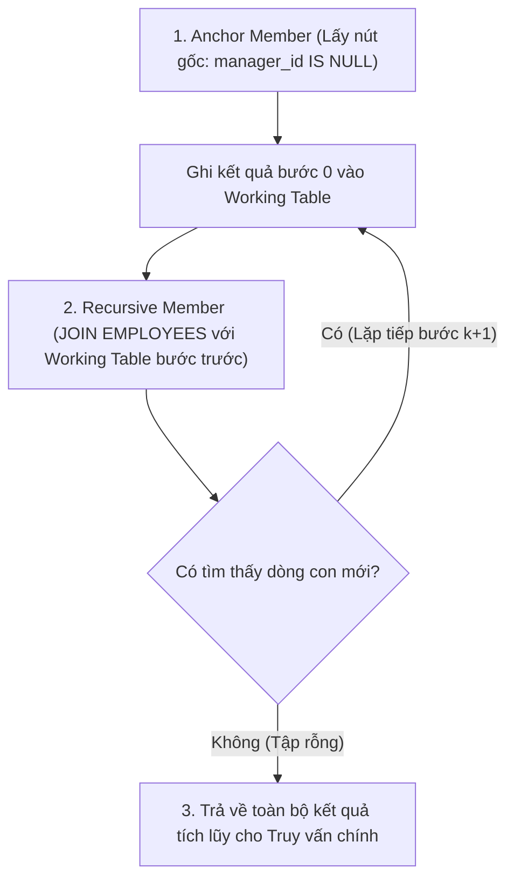

# Chương 14: Truy Vấn Con Nâng Cao & CTE (Advanced Subqueries & Common Table Expressions)

> **Thuộc Phần II:** Oracle SQL Nâng Cao (Advanced Oracle SQL for Developers)  
> **Mục tiêu khảo thí:** Oracle Database SQL Certified Associate / Professional (1Z0-071 & 1Z0-047) & Tuyển dụng Kỹ sư CNTT (VNPT, Viettel, FPT, Ngân hàng)  
> **Trọng tâm:** Subquery Factoring (`WITH` Clause), Recursive CTE (`SEARCH`, `CYCLE`), Inline View & Top-N Query, `LATERAL` / `CROSS APPLY` / `OUTER APPLY`, và Cơ chế tối ưu hóa Truy vấn con (`Semi-Join`, `Anti-Join`, `Subquery Unnesting`).

---

## 📑 Mục Lục Chi Tiết

1. [Mệnh Đề `WITH` — Common Table Expressions (Subquery Factoring)](#1-mệnh-đề-with--common-table-expressions-subquery-factoring)
2. [Đệ Quy Với CTE (Recursive Subquery Factoring)](#2-đệ-quy-với-cte-recursive-subquery-factoring)
3. [Inline View & Kỹ Thuật Top-N Query Nâng Cao](#3-inline-view--kỹ-thuật-top-n-query-nâng-cao)
4. [`LATERAL` Inline View, `CROSS APPLY` & `OUTER APPLY` (Oracle 12c+)](#4-lateral-inline-view-cross-apply--outer-apply-oracle-12c)
5. [Cơ Chế Tối Ưu Hóa Truy Vấn Con (Subquery Optimization)](#5-cơ-chế-tối-ưu-hóa-truy-vấn-con-subquery-optimization)
6. [Bài Tập Thực Hành Tự Luyện (Kèm Lời Giải Chi Tiết)](#6-bài-tập-thực-hành-tự-luyện-kèm-lời-giải-chi-tiết)
7. [Tổng Hợp Bẫy Thi OCA/OCP Cốt Lõi Cần Nhớ (Exam Essentials)](#7-tổng-hợp-bẫy-thi-ocaocp-cốt-lõi-cần-nhớ-exam-essentials)

---

## 🗂️ Dữ Liệu Mẫu Xuyên Suốt Chương

Để dễ dàng kiểm chứng kết quả của các truy vấn trong chương này, giả sử chúng ta có hai bảng `DEPARTMENTS` và `EMPLOYEES` với dữ liệu thực tế như sau:

**Bảng `DEPARTMENTS`:**

| DEPARTMENT_ID | DEPARTMENT_NAME | LOCATION_ID |
| :--- | :--- | :--- |
| 10 | Administration | 1700 |
| 20 | Marketing | 1800 |
| 30 | IT | 1700 |
| 40 | Empty_Dept | 1900 |

**Bảng `EMPLOYEES`:**

| EMPLOYEE_ID | FIRST_NAME | JOB_ID | SALARY | MANAGER_ID | DEPARTMENT_ID |
| :--- | :--- | :--- | :--- | :--- | :--- |
| 100 | Steven | AD_PRES | 24000 | *NULL* | 10 |
| 101 | Neena | AD_VP | 17000 | 100 | 10 |
| 102 | Lex | AD_VP | 17000 | 100 | 20 |
| 103 | Alexander | IT_PROG | 9000 | 102 | 30 |
| 104 | Bruce | IT_PROG | 6000 | 103 | 30 |
| 105 | Diana | IT_PROG | 6000 | 103 | 30 |
| 106 | Grant | SA_REP | 7000 | 101 | *NULL* |

---

## 1. Mệnh Đề `WITH` — Common Table Expressions (Subquery Factoring)

### 1.1. Bản chất của Subquery Factoring
Trong các câu truy vấn báo cáo phức tạp, một khối truy vấn con (Subquery) thường phải xuất hiện lặp đi lặp lại nhiều lần ở mệnh đề `FROM` hoặc `WHERE`. **Mệnh đề `WITH`** (trong tài liệu Oracle gọi là **Subquery Factoring Clause**, chuẩn ANSI SQL gọi là **Common Table Expression - CTE**) cho phép bạn đặt tên cho một hoặc nhiều khối truy vấn con ngay ở đầu câu lệnh `SELECT` và tái sử dụng chúng như một bảng hoặc view tạm thời trong suốt câu truy vấn chính.

### 1.2. Cú pháp chuẩn

```sql
WITH
    cte_name_1 [(col_alias_1, col_alias_2, ...)] AS (
        SELECT ...
    ),
    cte_name_2 AS (
        -- Có thể tham chiếu trực tiếp đến cte_name_1 đứng trước nó!
        SELECT ... FROM cte_name_1 ...
    )
SELECT ...
FROM cte_name_1
JOIN cte_name_2 ON ...;
```

**Các quy tắc cú pháp bắt buộc:**
1. Nếu khai báo nhiều CTE trong cùng một câu lệnh, từ khóa `WITH` **chỉ viết duy nhất 1 lần ở đầu**, các khối CTE ngăn cách nhau bằng **dấu phẩy `,`**.
2. Một CTE đứng sau (`cte_name_2`) **được phép tham chiếu** đến CTE đứng trước nó (`cte_name_1`), nhưng **không được phép tham chiếu ngược** (forward reference) tới CTE khai báo phía sau nó.
3. Phạm vi tồn tại (Scope) của CTE chỉ gói gọn trong duy nhất câu lệnh SQL đó. Khi câu lệnh kết thúc, CTE tự động biến mất.
4. Kể từ Oracle 12c, mệnh đề `WITH` còn có thể chứa hàm/thủ tục PL/SQL cục bộ (`WITH FUNCTION ...`) để tăng tốc độ gọi hàm trong SQL mà không tốn chi phí Context Switch đầy đủ.

### 1.3. Ví dụ thực tế: Tìm các phòng ban có tổng lương lớn hơn mức tổng lương trung bình của mọi phòng ban

Nếu không dùng `WITH`, bạn phải viết lặp lại phép `GROUP BY` hai lần. Với `WITH`, câu lệnh trở nên cực kỳ sáng sủa:

```sql
WITH
    dept_costs AS (
        SELECT d.department_name,
               SUM(e.salary) AS dept_total
        FROM departments d
        JOIN employees e ON d.department_id = e.department_id
        GROUP BY d.department_name
    ),
    avg_cost AS (
        SELECT AVG(dept_total) AS avg_all_depts
        FROM dept_costs
    )
SELECT dc.department_name,
       dc.dept_total,
       ROUND(ac.avg_all_depts, 2) AS avg_all_depts
FROM dept_costs dc
CROSS JOIN avg_cost ac
WHERE dc.dept_total > ac.avg_all_depts
ORDER BY dc.dept_total DESC;
```

**Kết quả đầu ra:**
* `dept_costs` tính ra: `Administration` ($24000 + 17000 = 41000$), `IT` ($9000 + 6000 + 6000 = 21000$), `Marketing` ($17000$).
* `avg_cost` tính trung bình của 3 phòng ban: $(41000 + 21000 + 17000) / 3 = 26333.33$.
* Kết quả cuối cùng:

| DEPARTMENT_NAME | DEPT_TOTAL | AVG_ALL_DEPTS |
| :--- | :--- | :--- |
| Administration | 41000 | 26333.33 |

### 1.4. Cơ chế Tối ưu hóa của Oracle CBO: `MATERIALIZE` vs `INLINE`
Nhiều lập trình viên lầm tưởng mệnh đề `WITH` chỉ là "cú pháp viết tắt" (syntactic sugar) của Inline View. Thực tế, bộ tối ưu hóa chi phí của Oracle (**Cost-Based Optimizer - CBO**) xử lý mệnh đề `WITH` theo **hai chiến lược thực thi hoàn toàn khác nhau**:

| Chiến lược | Cơ chế hoạt động bên dưới (Under the Hood) | Khi nào Oracle tự động chọn? | Hint ép buộc (Undocumented Hints) |
| :--- | :--- | :--- | :--- |
| **Inlining (Trộn trực tiếp)** | CBO thay thế tên CTE bằng câu SQL gốc vào thẳng câu truy vấn chính (giống hệt Inline View) rồi mới tối ưu hóa tổng thể (cho phép đẩy vị từ `Filter Pushdown`). | Khi CTE chỉ được tham chiếu **1 lần** trong truy vấn chính, hoặc khi việc đẩy điều kiện `WHERE` từ ngoài vào trong CTE lợi hơn nhiều. | `/*+ INLINE */` |
| **Materialization (Vật chất hóa tạm thời)** | Oracle thực thi CTE **1 lần duy nhất**, ghi kết quả ra một bảng tạm ngầm định trên `TEMP` tablespace (`SYS_TEMP_0FD9...` - hiển thị trong Execution Plan là `TEMP TABLE TRANSFORMATION` và `LOAD AS SELECT`), sau đó đọc lại nhiều lần từ bảng tạm này. | Khi CTE được tham chiếu **từ 2 lần trở lên** trong truy vấn chính và chi phí tính toán CTE rất lớn (nhiều phép JOIN, GROUP BY). | `/*+ MATERIALIZE */` |

```sql
WITH dept_summary AS (
    SELECT /*+ MATERIALIZE */ department_id, COUNT(*) AS emp_cnt, SUM(salary) AS sum_sal
    FROM employees
    GROUP BY department_id
)
SELECT * FROM dept_summary WHERE emp_cnt > 1
UNION ALL
SELECT * FROM dept_summary WHERE sum_sal > 20000;
```

> [!WARNING]
> **Bẫy thi OCP về CTE:**
> 1. Nếu bạn định nghĩa một CTE trong mệnh đề `WITH` nhưng **không hề gọi tới nó** ở truy vấn chính (và không được gọi bởi CTE nào khác được dùng ở truy vấn chính), Oracle sẽ báo lỗi: **`ORA-32035: unreferenced query name defined in WITH clause`**.
> 2. Khi muốn dùng mệnh đề `WITH` bên trong một câu lệnh `INSERT` thông thường, vị trí chuẩn là `INSERT INTO table_name WITH cte AS (...) SELECT * FROM cte;` (chứ không đặt `WITH` đứng trước từ khóa `INSERT`).

---

## 2. Đệ Quy Với CTE (Recursive Subquery Factoring)

### 2.1. Giới thiệu & So sánh với `CONNECT BY`
Trước Oracle 11gR2, để duyệt cây phân cấp (như sơ đồ tổ chức nhân sự, danh mục đa cấp, BOM - Bill of Materials), lập trình viên buộc phải dùng cú pháp độc quyền `START WITH ... CONNECT BY PRIOR` (sẽ học chi tiết ở Chương 17).
Từ **Oracle 11gR2**, Oracle hỗ trợ **Recursive Subquery Factoring** (CTE đệ quy) tuân thủ chuẩn **ANSI SQL:1999**.

### 2.2. Cấu trúc giải phẫu của một Recursive CTE
Một CTE đệ quy bắt buộc phải gồm **3 thành phần cốt lõi**:
1. **Danh sách bí danh cột (Column Alias List):** Bắt buộc phải khai báo tường minh trong cặp ngoặc đơn ngay sau tên CTE: `WITH cte_name (col1, col2, ...) AS (...)`.
2. **Anchor Member (Nhánh neo / Khởi tạo):** Câu lệnh `SELECT` đầu tiên dùng để lấy ra các nút gốc (Root nodes). Nhánh này **không** được tham chiếu tới tên CTE.
3. **Recursive Member (Nhánh đệ quy):** Nối với nhánh neo bằng toán tử **`UNION ALL`** (bắt buộc là `UNION ALL`), bên trong `FROM`/`JOIN` có tham chiếu lại chính tên `cte_name` để tìm các nút con ở tầng kế tiếp. Đệ quy dừng lại khi nhánh đệ quy không trả về thêm dòng nào nữa.



### 2.3. Ví dụ thực tế: Duyệt cây phân cấp nhân sự kèm cấp bậc (`lvl`) và đường dẫn (`path`)

```sql
WITH org_chart (emp_id, first_name, mgr_id, lvl, org_path) AS (
    -- 1. Anchor Member: Lấy tổng giám đốc (Root)
    SELECT employee_id,
           first_name,
           manager_id,
           1 AS lvl,
           first_name AS org_path
    FROM employees
    WHERE manager_id IS NULL
    UNION ALL
    -- 2. Recursive Member: Tìm nhân viên cấp dưới trực tiếp của tầng trước
    SELECT e.employee_id,
           e.first_name,
           e.manager_id,
           oc.lvl + 1,
           oc.org_path || ' -> ' || e.first_name
    FROM employees e
    JOIN org_chart oc ON e.manager_id = oc.emp_id
)
SELECT emp_id,
       LPAD(' ', (lvl - 1) * 2, ' ') || first_name AS hierarchy_tree,
       lvl,
       org_path
FROM org_chart;
```

**Kết quả đầu ra:**

| EMP_ID | HIERARCHY_TREE | LVL | ORG_PATH |
| :--- | :--- | :--- | :--- |
| 100 | Steven | 1 | Steven |
| 101 | &nbsp;&nbsp;Neena | 2 | Steven -> Neena |
| 102 | &nbsp;&nbsp;Lex | 2 | Steven -> Lex |
| 106 | &nbsp;&nbsp;&nbsp;&nbsp;Grant | 3 | Steven -> Neena -> Grant |
| 103 | &nbsp;&nbsp;&nbsp;&nbsp;Alexander | 3 | Steven -> Lex -> Alexander |
| 104 | &nbsp;&nbsp;&nbsp;&nbsp;&nbsp;&nbsp;Bruce | 4 | Steven -> Lex -> Alexander -> Bruce |
| 105 | &nbsp;&nbsp;&nbsp;&nbsp;&nbsp;&nbsp;Diana | 4 | Steven -> Lex -> Alexander -> Diana |

> [!IMPORTANT]
> **Các ràng buộc nghiêm ngặt trong Recursive Member (Rất hay hỏi trong đề thi OCP):**
> 1. Giữa Anchor Member và Recursive Member **BẮT BUỘC phải dùng `UNION ALL`** (không được dùng `UNION`, `INTERSECT`, `MINUS`).
> 2. Danh sách cột `(col1, col2, ...)` sau tên CTE là **bắt buộc** đối với CTE đệ quy (trong khi với CTE thường là tùy chọn).
> 3. Bên trong nhánh **Recursive Member KHÔNG ĐƯỢC PHÉP chứa**:
>    - Từ khóa `DISTINCT` hoặc `GROUP BY` / `HAVING`
>    - Hàm tổng hợp (Aggregate functions: `SUM`, `COUNT`, `AVG`...) hoặc hàm phân tích (Analytic functions: `ROW_NUMBER() OVER(...)`)
>    - Truy vấn con tham chiếu tới tên CTE đệ quy
>    - Tên CTE đệ quy nằm ở phía **không bắt buộc** (nullable side) của một phép `OUTER JOIN` (ví dụ: `employees LEFT JOIN org_chart` là bị cấm!).

### 2.4. Điều khiển thứ tự duyệt cây: `SEARCH DEPTH FIRST` vs `SEARCH BREADTH FIRST`
Mặc định ở ví dụ trên, bạn thấy `Neena` (lvl 2) và `Lex` (lvl 2) xuất hiện liền nhau trước khi xuống `Grant` (lvl 3) và `Alexander` (lvl 3) — đó là kiểu duyệt theo chiều rộng (**Breadth-First**). Nếu muốn in sơ đồ cây chuẩn (duyệt hết nhánh con cháu của `Neena` rồi mới sang nhánh của `Lex`), ta dùng mệnh đề `SEARCH`:

* **`SEARCH DEPTH FIRST BY col1 [ASC|DESC] SET order_col`:** Duyệt theo chiều sâu (đi kịch xuống nhánh con cháu sâu nhất của một nút rồi mới quay lên duyệt nút anh em tiếp theo - giống hành vi mặc định của `CONNECT BY`).
* **`SEARCH BREADTH FIRST BY col1 [ASC|DESC] SET order_col`:** Duyệt theo chiều rộng (duyệt hết toàn bộ các nút cùng cấp `lvl` rồi mới xuống cấp `lvl + 1`).

> **Lưu ý:** Cột `order_col` được sinh tự động bởi mệnh đề `SEARCH` dùng để đặt vào `ORDER BY order_col` của câu truy vấn ngoài cùng.

```sql
WITH org_chart (emp_id, first_name, mgr_id, lvl) AS (
    SELECT employee_id, first_name, manager_id, 1
    FROM employees WHERE manager_id IS NULL
    UNION ALL
    SELECT e.employee_id, e.first_name, e.manager_id, oc.lvl + 1
    FROM employees e JOIN org_chart oc ON e.manager_id = oc.emp_id
)
SEARCH DEPTH FIRST BY first_name ASC SET seq_order
SELECT emp_id,
       LPAD(' ', (lvl - 1) * 2, ' ') || first_name AS tree_name,
       lvl,
       seq_order
FROM org_chart
ORDER BY seq_order;
```

**Kết quả khi duyệt `SEARCH DEPTH FIRST BY first_name ASC`:**

| EMP_ID | TREE_NAME | LVL | SEQ_ORDER |
| :--- | :--- | :--- | :--- |
| 100 | Steven | 1 | 1 |
| 102 | &nbsp;&nbsp;Lex | 2 | 2 |
| 103 | &nbsp;&nbsp;&nbsp;&nbsp;Alexander | 3 | 3 |
| 104 | &nbsp;&nbsp;&nbsp;&nbsp;&nbsp;&nbsp;Bruce | 4 | 4 |
| 105 | &nbsp;&nbsp;&nbsp;&nbsp;&nbsp;&nbsp;Diana | 4 | 5 |
| 101 | &nbsp;&nbsp;Neena | 2 | 6 |
| 106 | &nbsp;&nbsp;&nbsp;&nbsp;Grant | 3 | 7 |

### 2.5. Phát hiện và ngăn chặn vòng lặp vô hạn với mệnh đề `CYCLE`
Nếu dữ liệu bị lỗi tạo thành vòng tròn khép kín (ví dụ: `Steven (100)` có `manager_id = 104 (Bruce)`), đệ quy sẽ lặp vô tận và văng lỗi **`ORA-32044: cycle detected while executing recursive WITH query`**.
Để bắt vòng lặp an toàn (tương đương với `CONNECT BY NOCYCLE` và `CONNECT_BY_ISCYCLE`), ta dùng mệnh đề `CYCLE`:

```sql
WITH org_chart (emp_id, first_name, mgr_id, lvl) AS (
    SELECT employee_id, first_name, manager_id, 1
    FROM employees WHERE employee_id = 100
    UNION ALL
    SELECT e.employee_id, e.first_name, e.manager_id, oc.lvl + 1
    FROM employees e JOIN org_chart oc ON e.manager_id = oc.emp_id
)
SEARCH DEPTH FIRST BY emp_id SET seq_order
CYCLE emp_id SET is_cycle TO 'Y' DEFAULT 'N'
SELECT emp_id, first_name, lvl, is_cycle
FROM org_chart
ORDER BY seq_order;
```
* Khi phát hiện giá trị `emp_id` lặp lại trên cùng một nhánh cha-con, Oracle gán cột giả `is_cycle = 'Y'` cho dòng gây lặp đó và **dừng không duyệt sâu thêm nhánh bị lặp nữa**, các nhánh khác vẫn chạy bình thường.

---

## 3. Inline View & Kỹ Thuật Top-N Query Nâng Cao

### 3.1. Inline View là gì?
Một **Inline View** là một câu truy vấn con có đặt bí danh (alias) nằm trực tiếp trong mệnh đề **`FROM`** của truy vấn cha, đóng vai trò như một bảng dữ liệu ảo tạo ra ngay tại thời điểm chạy (on-the-fly).

```sql
SELECT d.department_name, emp_stats.emp_count, emp_stats.max_sal
FROM departments d
JOIN (
    SELECT department_id, COUNT(*) AS emp_count, MAX(salary) AS max_sal
    FROM employees
    GROUP BY department_id
) emp_stats ON d.department_id = emp_stats.department_id;
```

### 3.2. Bẫy kinh điển: `ROWNUM` với `ORDER BY` và Bài toán Top-N / Phân trang (Pagination)
Trong Oracle truyền thống (trước 12c), giả cột `ROWNUM` được cấp phát ngay khi dòng dữ liệu vượt qua bước lọc `WHERE`, **TRƯỚC KHI mệnh đề `ORDER BY` được thực thi**.

> [!WARNING]
> **Bẫy thi số 1 về `ROWNUM`:**
> Nếu viết câu lệnh sau để lấy 3 nhân viên lương cao nhất:
> ```sql
> -- SAI BẢN CHẤT!
> SELECT first_name, salary
> FROM employees
> WHERE ROWNUM <= 3
> ORDER BY salary DESC;
> ```
> Oracle sẽ bốc ngẫu nhiên **3 dòng đầu tiên bất kỳ** mà nó đọc được từ bảng (gán `ROWNUM` 1, 2, 3), sau đó mới đem 3 dòng ngẫu nhiên đó sắp xếp giảm dần theo lương!
> Ngoài ra, điều kiện `WHERE ROWNUM = 2` hoặc `WHERE ROWNUM > 3` **luôn luôn trả về 0 dòng (tập rỗng)** vì `ROWNUM` bắt đầu từ `1` và chỉ tăng lên `2` khi dòng số `1` đã thỏa mãn điều kiện `WHERE`!

**Cách giải quyết chuẩn với Inline View:**
1. **Lấy Top 3 lương cao nhất (Dùng 1 lớp Inline View):**
   ```sql
   SELECT first_name, salary
   FROM (
       SELECT first_name, salary
       FROM employees
       ORDER BY salary DESC
   )
   WHERE ROWNUM <= 3;
   ```
2. **Phân trang (Pagination) lấy từ dòng số 4 đến dòng số 6 (Bắt buộc dùng 2 lớp Inline View lồng nhau nếu dùng `ROWNUM`):**
   ```sql
   SELECT first_name, salary, rnum
   FROM (
       SELECT sorted_emp.*, ROWNUM AS rnum
       FROM (
           SELECT first_name, salary
           FROM employees
           ORDER BY salary DESC
       ) sorted_emp
       WHERE ROWNUM <= 6 -- Chặn cận trên ở lớp giữa để tối ưu hiệu năng (STOPKEY)
   )
   WHERE rnum >= 4;      -- Lọc cận dưới bằng bí danh cột rnum ở lớp ngoài cùng
   ```

### 3.3. Cú pháp Row Limiting Clause hiện đại (Oracle 12c+)
Từ Oracle 12c, chuẩn ANSI SQL cung cấp mệnh đề `OFFSET ... FETCH ...` giúp viết Top-N và phân trang chỉ trong 1 câu lệnh phẳng:

```sql
SELECT first_name, salary
FROM employees
ORDER BY salary DESC
OFFSET 0 ROWS FETCH NEXT 3 ROWS WITH TIES;
```
* **`ONLY` vs `WITH TIES`:**
  * `FETCH FIRST 2 ROWS ONLY`: Lấy đúng 2 dòng (`Steven: 24000` và 1 trong 2 người có lương `17000`).
  * `FETCH FIRST 2 ROWS WITH TIES`: Vì dòng thứ 2 (`Neena: 17000`) đồng hạng với `Lex: 17000`, nên Oracle trả về **cả 3 dòng** (`Steven`, `Neena`, `Lex`).
* **Bản chất bên dưới:** Khi chạy `EXPLAIN PLAN`, Oracle tự động biến đổi (transform) câu lệnh `FETCH FIRST ...` thành một Inline View sử dụng hàm phân tích `ROW_NUMBER() OVER (ORDER BY ...)` (với `ONLY`) hoặc `RANK() OVER (ORDER BY ...)` (với `WITH TIES`)!

---

## 4. `LATERAL` Inline View, `CROSS APPLY` & `OUTER APPLY` (Oracle 12c+)

### 4.1. Giới hạn của Inline View truyền thống (Lỗi `ORA-00904`)
Theo quy tắc phạm vi chuẩn của SQL truyền thống, một truy vấn con nằm trong mệnh đề `WHERE` hoặc `SELECT` có thể tham chiếu tới cột của bảng ở truy vấn cha (Correlated Subquery). Tuy nhiên, một **Inline View nằm trong mệnh đề `FROM` KHÔNG ĐƯỢC PHÉP tham chiếu tới cột của các bảng đứng trước nó trong cùng mệnh đề `FROM`**!

```sql
-- LỖI ORA-00904: "D"."DEPARTMENT_ID": invalid identifier
SELECT d.department_name, top_emp.first_name, top_emp.salary
FROM departments d,
     (SELECT first_name, salary
      FROM employees e
      WHERE e.department_id = d.department_id -- ❌ Inline View thường không nhìn thấy d.department_id!
      ORDER BY e.salary DESC
      FETCH FIRST 2 ROWS ONLY) top_emp;
```

Từ **Oracle 12c**, Oracle bổ sung 3 công cụ mạnh mẽ giải quyết triệt để bài toán này: **`LATERAL`**, **`CROSS APPLY`**, và **`OUTER APPLY`**.

### 4.2. `LATERAL` Inline View
Thêm từ khóa `LATERAL` ngay trước dấu mở ngoặc của Inline View cho phép nó nhìn thấy và tham chiếu trực tiếp tới các cột của những bảng được liệt kê **phía bên trái (đứng trước) nó** trong mệnh đề `FROM`.

```sql
SELECT d.department_name, top_emp.first_name, top_emp.salary
FROM departments d,
     LATERAL (
         SELECT first_name, salary
         FROM employees e
         WHERE e.department_id = d.department_id -- ✅ Hợp lệ nhờ từ khóa LATERAL!
         ORDER BY e.salary DESC, e.employee_id ASC
         FETCH FIRST 2 ROWS ONLY
     ) top_emp;
```

### 4.3. `CROSS APPLY` và `OUTER APPLY` (Ứng dụng thực tế: Top-N per Group)
Thay vì dùng dấu phẩy `,` kết hợp với `LATERAL` (hoặc `JOIN LATERAL (...) ON (1=1)`), cú pháp **`CROSS APPLY`** và **`OUTER APPLY`** gọn gàng hơn vì **không cần viết mệnh đề `ON`**.

| Cú pháp | Bản chất tương đương | Hành vi với dòng bảng bên trái không có dữ liệu khớp ở Inline View bên phải |
| :--- | :--- | :--- |
| `table_A CROSS APPLY (subquery)` | `table_A INNER JOIN LATERAL (subquery) ON 1=1` | **Loại bỏ** dòng của `table_A` nếu `subquery` trả về 0 dòng (giống `INNER JOIN`). |
| `table_A OUTER APPLY (subquery)` | `table_A LEFT OUTER JOIN LATERAL (subquery) ON 1=1` | **Giữ lại** dòng của `table_A` và điền `NULL` vào các cột của `subquery` (giống `LEFT JOIN`). |

#### Ví dụ so sánh trực quan với dữ liệu mẫu (Lấy tối đa 2 nhân viên lương cao nhất của MỖI phòng ban):

```sql
SELECT d.department_id,
       d.department_name,
       top_emp.first_name,
       top_emp.salary
FROM departments d
OUTER APPLY (
    SELECT e.first_name, e.salary
    FROM employees e
    WHERE e.department_id = d.department_id
    ORDER BY e.salary DESC, e.employee_id ASC
    FETCH FIRST 2 ROWS ONLY
) top_emp
ORDER BY d.department_id, top_emp.salary DESC NULLS LAST;
```

**Kết quả đầu ra khi dùng `OUTER APPLY`:** (Phòng `40 - Empty_Dept` không có nhân viên nào vẫn được giữ lại!)

| DEPARTMENT_ID | DEPARTMENT_NAME | FIRST_NAME | SALARY |
| :--- | :--- | :--- | :--- |
| 10 | Administration | Steven | 24000 |
| 10 | Administration | Neena | 17000 |
| 20 | Marketing | Lex | 17000 |
| 30 | IT | Alexander | 9000 |
| 30 | IT | Bruce | 6000 |
| 40 | Empty_Dept | *NULL* | *NULL* |

*(Nếu đổi `OUTER APPLY` thành `CROSS APPLY`, dòng `40 | Empty_Dept` sẽ bị loại bỏ khỏi kết quả).*

> [!TIP]
> **Mẹo thi OCP & Phỏng vấn:**
> - `CROSS APPLY` và `OUTER APPLY` cũng được dùng cực kỳ phổ biến để gọi các **Table Function** (`TABLE(fn_split_string(d.csv_text))`) hoặc `JSON_TABLE` mà nhận đầu vào là cột của bảng bên trái.
> - Một Inline View có `LATERAL` / `APPLY` chỉ được tham chiếu tới bảng đứng **bên trái** nó, tuyệt đối không được tham chiếu tới bảng đứng **bên phải** nó trong mệnh đề `FROM`.

---

## 5. Cơ Chế Tối Ưu Hóa Truy Vấn Con (Subquery Optimization)

Khi bạn viết một truy vấn con, Oracle Cost-Based Optimizer (CBO) hiếm khi chạy truy vấn con theo kiểu vòng lặp ngây thơ (Nested Loop đọc đi đọc lại cho từng dòng cha), mà thực hiện **Query Transformation (Biến đổi truy vấn)** để đưa về các phép kết nối tập hợp tốc độ cao.

### 5.1. Subquery Unnesting (Mở tổ truy vấn con)
* **Subquery Unnesting** là quá trình CBO "phá vỡ" rào cản của truy vấn con và biến nó thành một phép Join ngang hàng với truy vấn cha (hoặc biến thành một Inline View được gộp vào `FROM`), giúp CBO tự do lựa chọn thứ tự Join và thuật toán `HASH JOIN` / `MERGE JOIN`.
* Nếu một truy vấn con không thể Unnest (ví dụ có chứa `ROWNUM`, hoặc một số cấu trúc phức tạp), Oracle buộc phải dùng toán tử `FILTER` (tương đương vòng lặp thực thi lại subquery cho mỗi dòng cha).
* Các Hint điều khiển: `/*+ UNNEST */` (ép mở tổ) và `/*+ NO_UNNEST */` (giữ nguyên truy vấn con, chạy dạng `FILTER`).

### 5.2. `Semi-Join` (Bán kết nối): Bản chất của `EXISTS` và `IN`
**Semi-Join** trả về các dòng từ bảng thứ nhất (bảng trái) nếu tìm thấy **ít nhất 1 dòng khớp** ở bảng thứ hai (truy vấn con), và **dừng tìm kiếm ngay khi gặp dòng khớp đầu tiên** — đảm bảo dòng của bảng trái **không bao giờ bị nhân bản (duplicate)** dù bảng con có 1000 dòng khớp!

```sql
-- Cách 1: Dùng IN
SELECT d.department_id, d.department_name
FROM departments d
WHERE d.department_id IN (SELECT e.department_id FROM employees e);

-- Cách 2: Dùng EXISTS
SELECT d.department_id, d.department_name
FROM departments d
WHERE EXISTS (
    SELECT 1 FROM employees e
    WHERE e.department_id = d.department_id
);
```

* Trong Oracle hiện đại (từ 10g trở đi), nhờ **Cost-Based Subquery Unnesting**, cả `IN` và `EXISTS` trong ví dụ trên đều được CBO biến đổi về cùng một Execution Plan là **`HASH JOIN SEMI`** (hoặc `NESTED LOOPS SEMI`) với hiệu năng **tương đương nhau**!
* **Khi nào dùng `IN` vs `EXISTS` theo góc nhìn truyền thống (nếu không Unnest được)?**
  * `IN`: Phù hợp khi tập kết quả của truy vấn con **rất nhỏ** và bảng ngoài rất lớn.
  * `EXISTS`: Phù hợp khi bảng ngoài **nhỏ** và bảng trong truy vấn con cực lớn nhưng có đánh Index trên cột kết nối (nhờ cơ chế dừng sớm - short-circuit).

### 5.3. `Anti-Join` (Phản kết nối): Bẫy sinh tử giữa `NOT IN` và `NOT EXISTS`
**Anti-Join** trả về các dòng từ bảng bên trái khi **KHÔNG tìm thấy bất kỳ dòng nào khớp** ở truy vấn con bên phải (trong Execution Plan hiển thị là `HASH JOIN ANTI` hoặc `HASH JOIN RIGHT ANTI NA`).

Tuy nhiên, giữa `NOT IN` và `NOT EXISTS` có một **khác biệt chí mạng về logic 3 giá trị (`TRUE`, `FALSE`, `UNKNOWN`) khi dữ liệu có chứa `NULL`!**

#### Phân tích trên dữ liệu mẫu:
Trong bảng `EMPLOYEES` ở đầu chương, nhân viên `Grant (106)` có `department_id` là **`NULL`**. Các giá trị `department_id` trong bảng `EMPLOYEES` gồm tập: `{10, 20, 30, NULL}`.
Ta muốn tìm các phòng ban chưa có nhân viên nào (kết quả đúng phải là phòng `40 - Empty_Dept`).

```sql
-- TRUY VẤN 1: Dùng NOT IN (GẶP BẪY NULL -> TRẢ VỀ 0 DÒNG!)
SELECT department_id, department_name
FROM departments
WHERE department_id NOT IN (
    SELECT department_id FROM employees
);
```
**Tại sao Truy vấn 1 trả về 0 dòng (tập rỗng)?**
* Biểu thức `d.department_id NOT IN (10, 20, 30, NULL)` tương đương với phép hội (`AND`):
  $$(d.\text{id} \neq 10) \text{ AND } (d.\text{id} \neq 20) \text{ AND } (d.\text{id} \neq 30) \text{ AND } (d.\text{id} \neq \text{NULL})$$
* Khi kiểm tra phòng ban `40`:
  $$(40 \neq 10) [\text{TRUE}] \text{ AND } (40 \neq 20) [\text{TRUE}] \text{ AND } (40 \neq 30) [\text{TRUE}] \text{ AND } (40 \neq \text{NULL}) [\text{UNKNOWN}]$$
* Trong logic 3 giá trị của SQL: **`TRUE AND UNKNOWN` $\rightarrow$ `UNKNOWN`!**
* Mệnh đề `WHERE` chỉ lấy những dòng có kết quả là `TRUE`. Vì vậy phòng `40` bị loại bỏ, câu lệnh trả về **0 dòng**!

```sql
-- TRUY VẤN 2: Dùng NOT EXISTS (AN TOÀN TUYỆT ĐỐI VỚI NULL -> TRẢ VỀ ĐÚNG PHÒNG 40)
SELECT d.department_id, d.department_name
FROM departments d
WHERE NOT EXISTS (
    SELECT 1
    FROM employees e
    WHERE e.department_id = d.department_id
);
```
**Tại sao `NOT EXISTS` trả về đúng phòng 40?**
* Toán tử `EXISTS` chỉ kiểm tra xem truy vấn con có trả về dòng nào hay không (chỉ trả về `TRUE` hoặc `FALSE`, không bao giờ trả về `UNKNOWN`).
* Với phòng `40`, dòng có `e.department_id IS NULL` tạo ra phép so sánh `NULL = 40` $\rightarrow$ `UNKNOWN`, nên dòng đó không được chọn vào tập kết quả của subquery. Kết thúc subquery không có dòng nào trả về $\rightarrow$ `EXISTS` là `FALSE` $\rightarrow$ `NOT EXISTS` là **`TRUE`** $\rightarrow$ Phòng `40` được giữ lại!

> [!IMPORTANT]
> **Quy tắc vàng khi đi thi & làm dự án thực tế:**
> - Nếu bắt buộc dùng `NOT IN`, bạn **phải** loại bỏ `NULL` trong truy vấn con: `WHERE dept_id NOT IN (SELECT dept_id FROM employees WHERE dept_id IS NOT NULL)` (hoặc cột trong subquery có ràng buộc `NOT NULL`).
> - Từ Oracle 11g+, CBO bổ sung thuật toán **Null-Aware Anti-Join (`HASH JOIN RIGHT ANTI NA` / `HASH JOIN ANTI SNA`)** giúp tối ưu tốc độ thực thi của `NOT IN` mà không cần quét lặp bảng (`FILTER`), nhưng **kết quả logic của `NOT IN` khi gặp `NULL` vẫn là 0 dòng**!
> - Do đó, luôn ưu tiên sử dụng **`NOT EXISTS`** thay cho `NOT IN` khi cột tham gia so sánh có khả năng mang giá trị `NULL`.

---

## 6. Bài Tập Thực Hành Tự Luyện (Kèm Lời Giải Chi Tiết)

### Bài tập 1: CTE kết hợp `OUTER APPLY` (Top-N per Group)
**Đề bài:** Viết một câu truy vấn liệt kê tất cả các phòng ban trong bảng `DEPARTMENTS`, kèm theo thông tin của **nhân viên có lương cao nhất** trong từng phòng ban đó (nếu có nhiều người cùng mức lương cao nhất thì lấy người có `employee_id` nhỏ hơn). Nếu phòng ban chưa có nhân viên nào, vẫn phải hiển thị tên phòng ban và để `NULL` ở tên nhân viên, mức lương.

<details>
<summary><b>💡 Xem Lời Giải & Phân Tích</b></summary>

```sql
SELECT d.department_id,
       d.department_name,
       top_e.employee_id,
       top_e.first_name,
       top_e.salary
FROM departments d
OUTER APPLY (
    SELECT e.employee_id, e.first_name, e.salary
    FROM employees e
    WHERE e.department_id = d.department_id
    ORDER BY e.salary DESC, e.employee_id ASC
    FETCH FIRST 1 ROW ONLY
) top_e
ORDER BY d.department_id;
```
* **Giải thích:** Nhờ `OUTER APPLY`, truy vấn con bên trong được phép tham chiếu trực tiếp đến `d.department_id` của bảng `DEPARTMENTS` đứng trước nó, đồng thời `FETCH FIRST 1 ROW ONLY` lấy đúng 1 nhân viên đứng đầu mỗi phòng. Các phòng trống (`Empty_Dept`) vẫn được giữ lại nhờ tính chất `LEFT OUTER JOIN` của `OUTER APPLY`.
</details>

---

### Bài tập 2: Sinh dãy ngày liên tiếp bằng Recursive CTE
**Đề bài:** Không sử dụng `CONNECT BY LEVEL`, hãy viết câu truy vấn dùng **Recursive Subquery Factoring (`WITH` đệ quy)** để sinh ra danh sách 7 ngày liên tiếp tính từ ngày `DATE '2026-01-01'` đến `DATE '2026-01-07'`.

<details>
<summary><b>💡 Xem Lời Giải & Phân Tích</b></summary>

```sql
WITH date_series (day_num, calendar_date) AS (
    -- Anchor member: Ngày đầu tiên
    SELECT 1, DATE '2026-01-01'
    FROM dual
    UNION ALL
    -- Recursive member: Cộng thêm 1 ngày cho đến khi đủ 7 ngày
    SELECT day_num + 1, calendar_date + 1
    FROM date_series
    WHERE day_num < 7
)
SELECT day_num, TO_CHAR(calendar_date, 'YYYY-MM-DD (DY)') AS formatted_date
FROM date_series;
```
* **Giải thích:** Đây là mẫu (pattern) chuẩn ANSI SQL để sinh chuỗi dữ liệu (Data Generator). Điều kiện dừng đệ quy `WHERE day_num < 7` đặt ở nhánh Recursive Member đảm bảo khi `day_num = 7`, vòng lặp tiếp theo trả về tập rỗng và kết thúc đệ quy.
</details>

---

## 7. Tổng Hợp Bẫy Thi OCA/OCP Cốt Lõi Cần Nhớ (Exam Essentials)

| Chủ đề | Điểm mấu chốt / Bẫy thi thường gặp trong đề OCA & OCP |
| :--- | :--- |
| **Cú pháp `WITH` nhiều CTE** | Chỉ viết từ khóa `WITH` **1 lần duy nhất**, các CTE cách nhau bằng dấu phẩy `,`. CTE sau được gọi CTE trước, nhưng CTE trước **không** được gọi CTE sau. |
| **CTE không được sử dụng** | Khai báo một CTE trong `WITH` nhưng không tham chiếu đến nó ở bất kỳ đâu sẽ gây lỗi biên dịch **`ORA-32035`**. |
| **`/*+ MATERIALIZE */` vs `/*+ INLINE */`** | `MATERIALIZE` lưu kết quả CTE vào bảng tạm trên `TEMP` tablespace (tối ưu khi CTE được gọi $\ge 2$ lần). `INLINE` gộp thẳng câu SQL của CTE vào truy vấn chính. |
| **Recursive CTE** | Bắt buộc phải khai báo danh sách cột `WITH cte (c1, c2) AS (...)` và bắt buộc nối 2 nhánh bằng **`UNION ALL`**. Nhánh đệ quy cấm dùng `DISTINCT`, `GROUP BY`, Aggregate/Analytic functions. |
| **`SEARCH` & `CYCLE` trong CTE** | Mệnh đề `SEARCH DEPTH FIRST BY ... SET order_col` luôn đứng **trước** mệnh đề `CYCLE ... SET cycle_col TO ... DEFAULT ...`. |
| **Bẫy `ROWNUM` cổ điển** | `ROWNUM` được gán **trước** `ORDER BY`. Điều kiện `WHERE ROWNUM = 2` hoặc `WHERE ROWNUM > 1` luôn trả về **0 dòng**. Muốn lấy Top-N bằng `ROWNUM` phải bọc `ORDER BY` trong một Inline View trước. |
| **Inline View trong `FROM`** | Inline View thường **không thể** tham chiếu cột của bảng bên trái trong cùng mệnh đề `FROM` (lỗi `ORA-00904`). Muốn tham chiếu phải thêm từ khóa **`LATERAL`** hoặc dùng **`CROSS APPLY` / `OUTER APPLY`**. |
| **`CROSS APPLY` vs `OUTER APPLY`** | `CROSS APPLY` loại bỏ dòng bảng bên trái nếu subquery rỗng (như `INNER JOIN`). `OUTER APPLY` giữ lại dòng bảng bên trái kèm giá trị `NULL` (như `LEFT OUTER JOIN`). Không dùng mệnh đề `ON` với `APPLY`. |
| **`NOT IN` vs `NOT EXISTS`** | `x NOT IN (subquery)` sẽ trả về **0 dòng** nếu `subquery` chứa bất kỳ giá trị **`NULL`** nào (do `x <> NULL` trả về `UNKNOWN`). `NOT EXISTS` hoàn toàn miễn nhiễm với bẫy `NULL` này. |
