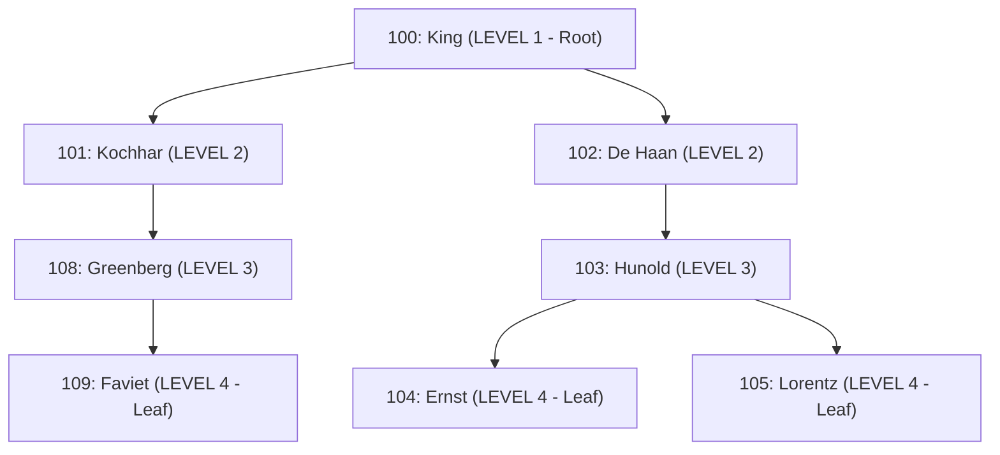
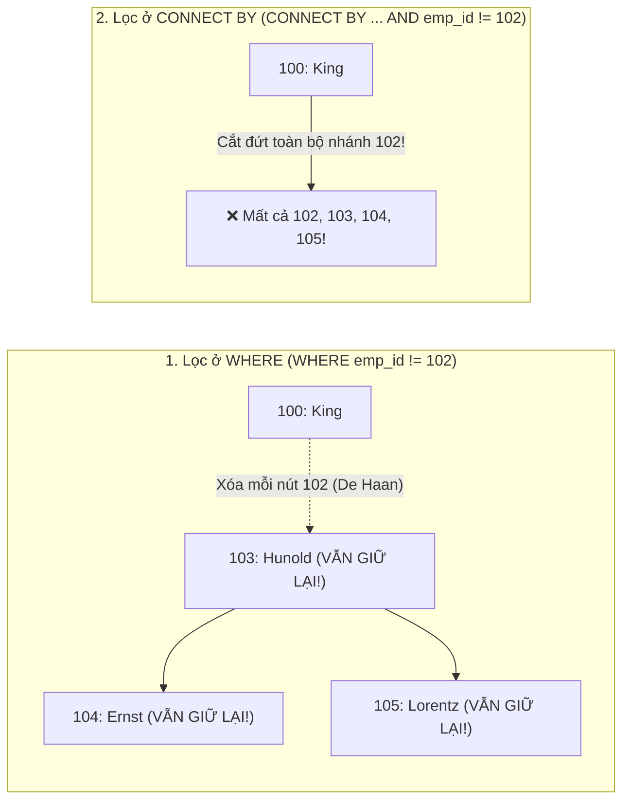

# Chương 17: Truy Vấn Phân Cấp (Hierarchical Queries — `CONNECT BY`)

> **Thuộc Phần II:** Oracle SQL Nâng Cao (Advanced Oracle SQL for Developers)  
> **Mục tiêu khảo thí:** Oracle Database SQL Certified Associate / Professional (1Z0-071 & 1Z0-047) & Tuyển dụng Kỹ sư CNTT (VNPT, Viettel, FPT, Ngân hàng)  
> **Trọng tâm:** Cấu trúc `START WITH ... CONNECT BY PRIOR ...`, Quy tắc định hướng `PRIOR` (Top-Down vs Bottom-Up), Giả cột `LEVEL`, `CONNECT_BY_ISLEAF`, `CONNECT_BY_ISCYCLE`, Toán tử `CONNECT_BY_ROOT`, Hàm `SYS_CONNECT_BY_PATH`, Sắp xếp `ORDER SIBLINGS BY`, Xử lý vòng lặp `NOCYCLE`, và Sự khác biệt sinh tử giữa lọc nút tại `WHERE` vs cắt nhánh tại `CONNECT BY`.

---

## 📑 Mục Lục Chi Tiết

1. [Tổng Quan Về Dữ Liệu Phân Cấp & Cấu Trúc `START WITH ... CONNECT BY`](#1-tổng-quan-về-dữ-liệu-phân-cấp--cấu-trúc-start-with--connect-by)
2. [Quy Tắc Vàng Đặt Từ Khóa `PRIOR`: Top-Down vs Bottom-Up](#2-quy-tắc-vàng-đặt-từ-khóa-prior-top-down-vs-bottom-up)
3. [Các Giả Cột Phân Cấp: `LEVEL`, `CONNECT_BY_ISLEAF`, `CONNECT_BY_ISCYCLE`](#3-các-giả-cột-phân-cấp-level-connect_by_isleaf-connect_by_iscycle)
4. [Toán Tử `CONNECT_BY_ROOT` & Hàm `SYS_CONNECT_BY_PATH`](#4-toán-tử-connect_by_root--hàm-sys_connect_by_path)
5. [Sắp Xếp Cây Với `ORDER SIBLINGS BY` & Xử Lý Vòng Lặp Với `NOCYCLE`](#5-sắp-xếp-cây-với-order-siblings-by--xử-lý-vòng-lặp-với-nocycle)
6. [Bẫy Thi Kinh Điển: Cắt Nhánh Ở `CONNECT BY` vs Lọc Nút Ở `WHERE`](#6-bẫy-thi-kinh-điển-cắt-nhánh-ở-connect-by-vs-lọc-nút-ở-where)
7. [Bài Tập Thực Hành Tự Luyện (Kèm Lời Giải Chi Tiết)](#7-bài-tập-thực-hành-tự-luyện-kèm-lời-giải-chi-tiết)
8. [Tổng Hợp Bẫy Thi OCA/OCP Cốt Lõi Cần Nhớ (Exam Essentials)](#8-tổng-hợp-bẫy-thi-ocaocp-cốt-lõi-cần-nhớ-exam-essentials)

---

## 🗂️ Dữ Liệu Mẫu & Sơ Đồ Cây Xuyên Suốt Chương

Giả sử chúng ta có bảng `ORG_EMP` lưu trữ sơ đồ tổ chức của một công ty với mối quan hệ tự tham chiếu (Self-Referencing) giữa `EMP_ID` (Mã nhân viên) và `MGR_ID` (Mã người quản lý trực tiếp):

| EMP_ID | FIRST_NAME | JOB_ID | SALARY | MGR_ID |
| :--- | :--- | :--- | :--- | :--- |
| 100 | King | AD_PRES | 24000 | *NULL* |
| 101 | Kochhar | AD_VP | 17000 | 100 |
| 102 | De Haan | AD_VP | 17000 | 100 |
| 103 | Hunold | IT_PROG | 9000 | 102 |
| 104 | Ernst | IT_PROG | 6000 | 103 |
| 105 | Lorentz | IT_PROG | 4200 | 103 |
| 108 | Greenberg | FI_MGR | 12000 | 101 |
| 109 | Faviet | FI_ACCOUNT | 9000 | 108 |

**Biểu diễn trực quan dưới dạng Sơ đồ Cây (Tree Hierarchy):**



---

## 1. Tổng Quan Về Dữ Liệu Phân Cấp & Cấu Trúc `START WITH ... CONNECT BY`

### 1.1. Các thuật ngữ trong Cây phân cấp (Hierarchy Terminology)
* **Root Node (Nút gốc):** Nút cao nhất trong nhánh cây đang xét (có `LEVEL = 1`, ví dụ `100: King`).
* **Parent Node (Nút cha):** Nút có ít nhất một nút con trực thuộc bên dưới nó (ví dụ `100`, `101`, `102`, `103`, `108`).
* **Child Node (Nút con):** Nút trực thuộc một nút cha (mọi nút trừ nút gốc `King`).
* **Leaf Node (Nút lá):** Nút nằm ở tận cùng của nhánh, **không có bất kỳ nút con nào** bên dưới (ví dụ `104: Ernst`, `105: Lorentz`, `109: Faviet`).
* **Branch (Nhánh):** Tập hợp một nút cùng toàn bộ các nút con, cháu, chắt... nằm bên dưới nó.
* **Siblings (Các nút anh em):** Các nút có **cùng một nút cha trực tiếp** (ví dụ `Kochhar` và `De Haan` là hai nút anh em vì cùng có `mgr_id = 100`).

### 1.2. Cú pháp chuẩn của Hierarchical Query trong Oracle

```sql
SELECT [LEVEL], column, expr...
FROM table_name
[WHERE filter_node_conditions]
[START WITH root_conditions]
CONNECT BY [NOCYCLE] PRIOR parent_col = child_col
[ORDER [SIBLINGS] BY order_cols];
```

*(Lưu ý: Trong cú pháp của Oracle, mệnh đề `START WITH` có thể viết trước hoặc viết ngay sau mệnh đề `CONNECT BY` đều hợp lệ, nhưng viết `START WITH ... CONNECT BY ...` là chuẩn dễ đọc nhất).*

> [!WARNING]
> **Điều gì xảy ra nếu BỎ QUA mệnh đề `START WITH`?**
> Mệnh đề `CONNECT BY` là bắt buộc, nhưng mệnh đề **`START WITH` là tùy chọn (optional)**!
> Nếu bạn viết `CONNECT BY PRIOR emp_id = mgr_id` mà **không có `START WITH`**, câu lệnh **KHÔNG báo lỗi cú pháp**, nhưng Oracle sẽ lấy **TẤT CẢ các dòng trong bảng lần lượt làm nút gốc (`LEVEL = 1`)** và duyệt cây cho từng dòng đó, dẫn đến các dòng cấp dưới bị lặp lại nhiều lần ở các độ sâu khác nhau!

---

## 2. Quy Tắc Vàng Đặt Từ Khóa `PRIOR`: Top-Down vs Bottom-Up

Đây là phần gây nhầm lẫn nhiều nhất cho thí sinh khi đi thi OCA/OCP! Toán tử một ngôi **`PRIOR`** chỉ định cột nào lấy giá trị từ **dòng của bước duyệt liền trước (Previous Row / Parent Row trong luồng duyệt)**.

### 2.1. Công thức "Bất Bại" để nhớ vị trí `PRIOR`
Hãy luôn đọc dấu `=` theo nghĩa:
> **`PRIOR <cột_của_dòng_vừa_tìm_được_ở_bước_trước> = <cột_của_dòng_sẽ_tìm_ở_bước_tiếp_theo>`**

Do đó, nếu viết dưới dạng: `CONNECT BY PRIOR col_A = col_B` (hoặc `col_B = PRIOR col_A` — hai vế qua dấu `=` có tính giao hoán!):

| Hướng duyệt cây | Mục tiêu tìm kiếm ở bước kế tiếp | Cách đặt `PRIOR` (4 cách viết chuẩn) | Khẩu quyết nhớ nhanh |
| :--- | :--- | :--- | :--- |
| **Top-Down (Từ Cha xuống Con)**<br>*(Ví dụ: Từ `King` tìm xuống toàn bộ nhân viên cấp dưới)* | Dòng bước tiếp theo là **Con**, nên `mgr_id` của dòng tiếp theo phải bằng `emp_id` của dòng Cha vừa đứng trước. | `CONNECT BY PRIOR emp_id = mgr_id`<br>*(hoặc `CONNECT BY mgr_id = PRIOR emp_id`)* | **`PRIOR` đứng cạnh Khóa Chính (`emp_id`) $\implies$ Top-Down (Cha $\rightarrow$ Con)** |
| **Bottom-Up (Từ Con lên Cha)**<br>*(Ví dụ: Từ `Ernst (104)` tìm ngược lên sếp trực tiếp, sếp của sếp... tới `King`)* | Dòng bước tiếp theo là **Sếp (Cha)**, nên `emp_id` của dòng tiếp theo phải bằng `mgr_id` của dòng Con vừa đứng trước. | `CONNECT BY PRIOR mgr_id = emp_id`<br>*(hoặc `CONNECT BY emp_id = PRIOR mgr_id`)* | **`PRIOR` đứng cạnh Khóa Ngoại (`mgr_id`) $\implies$ Bottom-Up (Con $\rightarrow$ Cha)** |

### 2.2. Ví dụ đối chiếu Top-Down và Bottom-Up

#### Trường hợp 1: Duyệt Top-Down từ `De Haan (102)` xuống các nhân viên cấp dưới
```sql
SELECT emp_id, first_name, mgr_id, LEVEL
FROM org_emp
START WITH emp_id = 102
CONNECT BY PRIOR emp_id = mgr_id;
```
**Kết quả Top-Down:**

| EMP_ID | FIRST_NAME | MGR_ID | LEVEL |
| :--- | :--- | :--- | :--- |
| 102 | De Haan | 100 | 1 |
| 103 | Hunold | 102 | 2 |
| 104 | Ernst | 103 | 3 |
| 105 | Lorentz | 103 | 3 |

#### Trường hợp 2: Duyệt Bottom-Up từ `Ernst (104)` ngược lên các cấp quản lý phía trên
```sql
SELECT emp_id, first_name, mgr_id, LEVEL
FROM org_emp
START WITH emp_id = 104
CONNECT BY PRIOR mgr_id = emp_id;
```
**Kết quả Bottom-Up:**

| EMP_ID | FIRST_NAME | MGR_ID | LEVEL |
| :--- | :--- | :--- | :--- |
| 104 | Ernst | 103 | 1 *(Bắt đầu tại Ernst)* |
| 103 | Hunold | 102 | 2 *(Sếp trực tiếp của Ernst)* |
| 102 | De Haan | 100 | 3 *(Sếp của Hunold)* |
| 100 | King | *NULL* | 4 *(Tổng giám đốc)* |

---

## 3. Các Giả Cột Phân Cấp: `LEVEL`, `CONNECT_BY_ISLEAF`, `CONNECT_BY_ISCYCLE`

Khi sử dụng mệnh đề `CONNECT BY`, Oracle cung cấp **3 giả cột (Pseudocolumns)** đặc biệt:

| Giả cột | Giá trị trả về & Ý nghĩa | Điều kiện sử dụng |
| :--- | :--- | :--- |
| **`LEVEL`** | Số nguyên dương (`1, 2, 3...`): Trả về **`1`** cho dòng thỏa mãn `START WITH` (Root), **`2`** cho con trực tiếp của Root, **`3`** cho cháu... | Dùng được trong mọi câu lệnh có `CONNECT BY`. |
| **`CONNECT_BY_ISLEAF`** | Trả về **`1`** nếu dòng hiện tại là **Nút lá (Leaf node)** (không có con nào bên dưới trong cây kết quả); trả về **`0`** nếu dòng hiện tại là nút cha (có con). | Dùng được trong mọi câu lệnh có `CONNECT BY`. |
| **`CONNECT_BY_ISCYCLE`** | Trả về **`1`** nếu dòng hiện tại có một nút con mà nút con đó đồng thời lại là **tổ tiên (ancestor)** của dòng hiện tại (gây ra vòng lặp); ngược lại trả về **`0`**. | **BẮT BUỘC phải có từ khóa `NOCYCLE`** trong mệnh đề `CONNECT BY NOCYCLE ...`! Nếu thiếu `NOCYCLE`, gọi `CONNECT_BY_ISCYCLE` sẽ báo lỗi **`ORA-30930`**! |

### Ứng dụng kinh điển của `LEVEL`: Kỹ thuật Sinh dòng (Row Generator) với bảng `DUAL`
Trong Oracle SQL, khi cần sinh ra một bảng ảo gồm $N$ dòng đánh số từ $1$ đến $N$ (ví dụ sinh 12 tháng trong năm hoặc tách chuỗi), cách ngắn gọn và nhanh nhất là dùng `CONNECT BY LEVEL <= N` trên bảng `DUAL`:

```sql
-- Sinh 5 dòng từ 1 đến 5
SELECT LEVEL AS row_num,
       ADD_MONTHS(DATE '2026-01-01', LEVEL - 1) AS month_start
FROM dual
CONNECT BY LEVEL <= 5;
```

---

## 4. Toán Tử `CONNECT_BY_ROOT` & Hàm `SYS_CONNECT_BY_PATH`

### 4.1. Toán tử một ngôi `CONNECT_BY_ROOT expr`
Khi đang đứng ở một dòng bất kỳ ở tầng sâu (`LEVEL 3`, `LEVEL 4`...), nếu bạn muốn lấy thông tin của **Nút gốc (`LEVEL 1`) đã khởi phát ra nhánh hiện tại**, hãy đặt từ khóa **`CONNECT_BY_ROOT`** ngay trước tên cột hoặc biểu thức:
* Ví dụ: `CONNECT_BY_ROOT first_name` trả về tên của vị lãnh đạo đứng ở đỉnh gốc (`LEVEL = 1`) của nhánh đó.

### 4.2. Hàm `SYS_CONNECT_BY_PATH(column, 'char_delimiter')`
Hàm `SYS_CONNECT_BY_PATH` nối giá trị của `column` đi từ nút gốc (`LEVEL = 1`) qua các nút trung gian cho tới dòng hiện tại, ngăn cách bởi chuỗi ký tự `'char_delimiter'`:
* Ví dụ: `SYS_CONNECT_BY_PATH(first_name, '/')` tại dòng `Ernst` sẽ trả về chuỗi: `'/King/De Haan/Hunold/Ernst'`.

> [!WARNING]
> **Bẫy thi OCP về `SYS_CONNECT_BY_PATH(col, 'delimiter')`:**
> Chuỗi ký tự phân cách `'delimiter'` **TUYỆT ĐỐI KHÔNG ĐƯỢC PHÉP xuất hiện bên trong dữ liệu của cột `col`**!
> Ví dụ: Nếu tên nhân viên có chứa dấu gạch chéo `'/'` (như `'Smith/Jr'`) mà bạn gọi `SYS_CONNECT_BY_PATH(first_name, '/')`, Oracle sẽ lập tức văng lỗi runtime: **`ORA-30004: when using SYS_CONNECT_BY_PATH function, cannot have separator as part of column value`**!

### 4.3. Ví dụ tổng hợp: Hiển thị đầy đủ Cây phân cấp, Nút gốc, Nút lá và Đường dẫn

```sql
SELECT emp_id,
       LPAD(' ', (LEVEL - 1) * 2, ' ') || first_name AS emp_tree,
       LEVEL AS lvl,
       CONNECT_BY_ISLEAF AS is_leaf,
       CONNECT_BY_ROOT first_name AS top_boss,
       SYS_CONNECT_BY_PATH(first_name, ' -> ') AS full_path
FROM org_emp
START WITH emp_id IN (101, 102) -- Khởi tạo từ 2 Phó tổng giám đốc (Kochhar & De Haan)
CONNECT BY PRIOR emp_id = mgr_id;
```

**Kết quả đầu ra:**

| EMP_ID | EMP_TREE | LVL | IS_LEAF | TOP_BOSS | FULL_PATH |
| :--- | :--- | :--- | :--- | :--- | :--- |
| 101 | Kochhar | 1 | 0 | **Kochhar** | ` -> Kochhar` |
| 108 | &nbsp;&nbsp;Greenberg | 2 | 0 | **Kochhar** | ` -> Kochhar -> Greenberg` |
| 109 | &nbsp;&nbsp;&nbsp;&nbsp;Faviet | 3 | **1** | **Kochhar** | ` -> Kochhar -> Greenberg -> Faviet` |
| 102 | De Haan | 1 | 0 | **De Haan** | ` -> De Haan` |
| 103 | &nbsp;&nbsp;Hunold | 2 | 0 | **De Haan** | ` -> De Haan -> Hunold` |
| 104 | &nbsp;&nbsp;&nbsp;&nbsp;Ernst | 3 | **1** | **De Haan** | ` -> De Haan -> Hunold -> Ernst` |
| 105 | &nbsp;&nbsp;&nbsp;&nbsp;Lorentz | 3 | **1** | **De Haan** | ` -> De Haan -> Hunold -> Lorentz` |

*(Hãy quan sát cột `TOP_BOSS`: nhờ `CONNECT_BY_ROOT first_name`, mọi nhân viên dưới nhánh `101` đều biết sếp gốc của nhánh mình là `Kochhar`, còn nhánh `102` biết sếp gốc là `De Haan`!).*

---

## 5. Sắp Xếp Cây Với `ORDER SIBLINGS BY` & Xử Lý Vòng Lặp Với `NOCYCLE`

### 5.1. Tại sao `ORDER BY` thông thường lại phá vỡ cấu trúc cây?
Khi bạn viết một truy vấn phân cấp rồi thêm `ORDER BY first_name ASC` (hoặc `ORDER BY salary DESC`) ở cuối câu lệnh, Oracle sẽ gom toàn bộ các dòng kết quả (không phân biệt cha con hay tầng bậc) và trộn đều để sắp xếp theo bảng chữ cái! Kết quả là nhân viên cấp 4 có thể nhảy lên đứng trước Tổng giám đốc cấp 1, làm **phá hủy hoàn toàn cấu trúc cây phân cấp**!

### 5.2. Giải pháp: Mệnh đề `ORDER SIBLINGS BY`
Để giữ nguyên vẹn cấu trúc cha-con của cây phân cấp nhưng vẫn sắp xếp thứ tự giữa **các nút anh em ruột (Siblings — các nút có cùng cha trực tiếp)**, bạn bắt buộc phải dùng **`ORDER SIBLINGS BY`**:

```sql
SELECT emp_id,
       LPAD(' ', (LEVEL - 1) * 2, ' ') || first_name AS emp_tree,
       salary
FROM org_emp
START WITH mgr_id IS NULL
CONNECT BY PRIOR emp_id = mgr_id
ORDER SIBLINGS BY first_name ASC;
```
* **Cơ chế:** Dưới gốc `King (100)` có hai con là `Kochhar` và `De Haan`. Do `'De Haan'` đứng trước `'Kochhar'` theo bảng chữ cái, Oracle sẽ xếp `De Haan` và **toàn bộ nhánh con cháu của `De Haan`** (`Hunold`, `Ernst`, `Lorentz`) lên trước, rồi mới đến `Kochhar` và nhánh con cháu của `Kochhar` (`Greenberg`, `Faviet`)!

> [!IMPORTANT]
> **Quy tắc cú pháp với `ORDER SIBLINGS BY`:**
> Khi đã sử dụng `ORDER SIBLINGS BY`, bạn **không được phép** dùng biểu thức vị trí cột hoặc hàm phân tích tổng quát làm hỏng cấp bậc anh em, và từ khóa `SIBLINGS` chỉ được phép dùng trong câu truy vấn có mệnh đề `CONNECT BY` (nếu dùng trong câu `SELECT` thường không có `CONNECT BY` sẽ báo lỗi **`ORA-30929: ORDER SIBLINGS BY clause not allowed here`**).

### 5.3. Xử lý vòng lặp dữ liệu (`ORA-01436`) với `CONNECT BY NOCYCLE`
Giả sử dữ liệu bị cập nhật nhầm khiến `King (100)` có `mgr_id = 109 (Faviet)` (trong khi `Faviet` là cấp dưới của `King`: $100 \rightarrow 101 \rightarrow 108 \rightarrow 109 \rightarrow 100$).
* Nếu chạy `CONNECT BY PRIOR emp_id = mgr_id` thông thường, Oracle phát hiện vòng lặp và lập tức dừng câu lệnh với lỗi runtime:
  **`ORA-01436: CONNECT BY loop in user data`**.
* **Cách khắc phục:** Thêm từ khóa **`NOCYCLE`** ngay sau `CONNECT BY`, kết hợp với giả cột **`CONNECT_BY_ISCYCLE`** để tìm ra dòng gây lỗi:

```sql
SELECT emp_id,
       first_name,
       LEVEL,
       CONNECT_BY_ISCYCLE AS cycle_flag,
       SYS_CONNECT_BY_PATH(emp_id, '/') AS id_path
FROM org_emp
START WITH emp_id = 100
CONNECT BY NOCYCLE PRIOR emp_id = mgr_id;
```
* Khi gặp dòng `109 (Faviet)` trỏ ngược lại `100 (King)`, Oracle không báo lỗi nữa mà gán `CONNECT_BY_ISCYCLE = 1` tại dòng `109` và ngắt không duyệt tiếp sang `100` lần thứ hai.

---

## 6. Bẫy Thi Kinh Điển: Cắt Nhánh Ở `CONNECT BY` vs Lọc Nút Ở `WHERE`

Đây là câu hỏi **CHẮC CHẮN XUẤT HIỆN** trong đề thi chứng chỉ Oracle OCA/OCP cũng như các bài thi tuyển dụng SQL nâng cao!

Hãy xét bài toán: Trong cây phân cấp bắt đầu từ `King (100)`, chuyện gì xảy ra nếu ta đặt điều kiện loại trừ nhân viên `De Haan (emp_id = 102)` ở **mệnh đề `WHERE`** so với đặt ở **mệnh đề `CONNECT BY`**?



### 6.1. Trường hợp 1: Đặt điều kiện lọc ở mệnh đề `WHERE` (Chỉ loại bỏ nút đơn lẻ — Prunes a single node)
* **Thứ tự thực thi của Oracle đối với Hierarchical Query:**
  1. Thực hiện phép `JOIN` (nếu có).
  2. Xây dựng **TOÀN BỘ cây phân cấp** bằng `START WITH ... CONNECT BY ...`.
  3. **Sau khi cây đã dựng xong xuôi**, mới áp dụng điều kiện lọc ở mệnh đề **`WHERE`** để vứt bỏ các dòng không thỏa mãn!

```sql
-- CHỈ LOẠI BỎ DÒNG 102 (De Haan), NHƯNG CON CHÁU CỦA 102 (103, 104, 105) VẪN CÒN NGUYÊN!
SELECT emp_id, first_name, mgr_id, LEVEL
FROM org_emp
WHERE emp_id != 102
START WITH mgr_id IS NULL
CONNECT BY PRIOR emp_id = mgr_id;
```
**Kết quả (7 dòng — chỉ mất đúng 1 dòng `102: De Haan`, còn `103, 104, 105` vẫn xuất hiện!):**

| EMP_ID | FIRST_NAME | MGR_ID | LEVEL |
| :--- | :--- | :--- | :--- |
| 100 | King | *NULL* | 1 |
| 101 | Kochhar | 100 | 2 |
| 108 | Greenberg | 101 | 3 |
| 109 | Faviet | 108 | 4 |
| **103** | **Hunold** | **102** | **3** |
| **104** | **Ernst** | **103** | **4** |
| **105** | **Lorentz** | **103** | **4** |

### 6.2. Trường hợp 2: Đặt điều kiện lọc ở mệnh đề `CONNECT BY` (Cắt bỏ toàn bộ nhánh — Prunes an entire branch)
Khi đặt `AND emp_id != 102` ngay trong mệnh đề `CONNECT BY`, Oracle kiểm tra điều kiện này **ngay trong lúc đang leo cây**. Khi từ `King (100)` chuẩn bị bước sang `De Haan (102)`, điều kiện `emp_id != 102` bị vi phạm nên Oracle **không bước vào nút `102`** $\implies$ hệ quả là nó cũng **không bao giờ đi tiếp xuống các nút con cháu `103 (Hunold)`, `104 (Ernst)`, `105 (Lorentz)`**!

```sql
-- CẮT BỎ TOÀN BỘ NHÁNH TỪ 102 TRỞ XUỐNG (Mất cả 102, 103, 104, 105)!
SELECT emp_id, first_name, mgr_id, LEVEL
FROM org_emp
START WITH mgr_id IS NULL
CONNECT BY PRIOR emp_id = mgr_id
       AND emp_id != 102;
```
**Kết quả (Chỉ còn 4 dòng — toàn bộ nhánh của `De Haan` biến mất hoàn toàn!):**

| EMP_ID | FIRST_NAME | MGR_ID | LEVEL |
| :--- | :--- | :--- | :--- |
| 100 | King | *NULL* | 1 |
| 101 | Kochhar | 100 | 2 |
| 108 | Greenberg | 101 | 3 |
| 109 | Faviet | 108 | 4 |

---

## 7. Bài Tập Thực Hành Tự Luyện (Kèm Lời Giải Chi Tiết)

### Bài tập 1: Tìm tất cả các nhân viên là "Nút lá" (Không quản lý ai) cùng tên Quản lý cấp cao nhất của nhánh
**Đề bài:** Trên bảng `ORG_EMP`, hãy viết câu truy vấn duyệt cây từ các Phó tổng giám đốc (`job_id = 'AD_VP'`), nhưng chỉ hiển thị ra những nhân viên **không quản lý bất kỳ ai** (nút lá), kèm theo độ sâu `LEVEL`, tên của Phó tổng giám đốc đứng đầu nhánh đó (`vp_boss`), và đường dẫn chuỗi tên từ Phó tổng giám đốc xuống nhân viên đó.

<details>
<summary><b>💡 Xem Lời Giải & Phân Tích</b></summary>

```sql
SELECT emp_id,
       first_name,
       LEVEL AS depth_from_vp,
       CONNECT_BY_ROOT first_name AS vp_boss,
       LTRIM(SYS_CONNECT_BY_PATH(first_name, ' -> '), ' -> ') AS report_chain
FROM org_emp
WHERE CONNECT_BY_ISLEAF = 1
START WITH job_id = 'AD_VP'
CONNECT BY PRIOR emp_id = mgr_id
ORDER SIBLINGS BY first_name ASC;
```
* **Giải thích:**
  * `START WITH job_id = 'AD_VP'` chọn `Kochhar (101)` và `De Haan (102)` làm các nút gốc (`LEVEL = 1`).
  * `WHERE CONNECT_BY_ISLEAF = 1` lọc lấy đúng các nút lá (`Faviet`, `Ernst`, `Lorentz`) sau khi đã dựng xong cây phân cấp.
  * `CONNECT_BY_ROOT first_name` trả về tên của vị `AD_VP` đứng ở gốc `LEVEL = 1` của từng nhánh.
</details>

---

### Bài tập 2: Tính tổng quỹ lương của từng nhánh quản lý (Subtree Salary Aggregation)
**Đề bài:** Với mỗi nhân viên trong bảng `ORG_EMP`, hãy tính **tổng lương của chính nhân viên đó cộng với toàn bộ các nhân viên cấp dưới (trực tiếp và gián tiếp)** thuộc nhánh do người đó quản lý.

<details>
<summary><b>💡 Xem Lời Giải & Phân Tích</b></summary>

```sql
SELECT root_emp_id AS manager_emp_id,
       root_name   AS manager_name,
       COUNT(*)    AS subtree_headcount,
       SUM(salary) AS subtree_total_salary
FROM (
    SELECT CONNECT_BY_ROOT emp_id     AS root_emp_id,
           CONNECT_BY_ROOT first_name AS root_name,
           salary
    FROM org_emp
    -- Không dùng START WITH để mọi nhân viên đều lần lượt được làm Root của nhánh con do mình quản lý!
    CONNECT BY PRIOR emp_id = mgr_id
)
GROUP BY root_emp_id, root_name
ORDER BY root_emp_id;
```
* **Giải thích:** Đây là kỹ thuật cực kỳ thông minh khi **cố tình bỏ qua `START WITH`**: mỗi nhân viên trong công ty sẽ lần lượt đóng vai trò là Nút gốc (`CONNECT_BY_ROOT emp_id`), và `CONNECT BY PRIOR emp_id = mgr_id` sẽ quét toàn bộ cây con bên dưới người đó. Sau đó ta chỉ cần `GROUP BY root_emp_id` ở ngoài để cộng tổng lương của cả nhánh con!
</details>

---

## 8. Tổng Hợp Bẫy Thi OCA/OCP Cốt Lõi Cần Nhớ (Exam Essentials)

| Chủ đề | Điểm mấu chốt / Bẫy thi thường gặp trong đề OCA & OCP |
| :--- | :--- |
| **Hướng duyệt với `PRIOR`** | - **`PRIOR emp_id = mgr_id`** (hoặc `mgr_id = PRIOR emp_id`): Duyệt **Top-Down** (từ Cha xuống Con).<br>- **`PRIOR mgr_id = emp_id`** (hoặc `emp_id = PRIOR mgr_id`): Duyệt **Bottom-Up** (từ Con ngược lên Cha). |
| **Bỏ qua `START WITH`** | Hợp lệ về cú pháp! Khi không có `START WITH`, Oracle lấy **mọi dòng trong bảng** làm nút gốc `LEVEL = 1` và duyệt cây cho từng dòng. |
| **Lọc ở `WHERE` vs `CONNECT BY`** | - Điều kiện trong **`WHERE`** chạy **SAU** khi dựng cây $\implies$ chỉ xóa **1 nút đơn lẻ**, con cháu của nút đó vẫn giữ nguyên.<br>- Điều kiện trong **`CONNECT BY`** chạy **TRONG LÚC** dựng cây $\implies$ **cắt đứt toàn bộ nhánh** (mất cả nút đó lẫn toàn bộ con cháu). |
| **`ORDER BY` vs `ORDER SIBLINGS BY`** | `ORDER BY` thường làm vỡ cấu trúc cây phân cấp. Phải dùng **`ORDER SIBLINGS BY`** để sắp xếp các nút anh em cùng cha mà vẫn bảo toàn cấu trúc cây. |
| **Vòng lặp & `CONNECT_BY_ISCYCLE`** | Dữ liệu lặp vòng gây lỗi `ORA-01436`. Dùng `CONNECT BY NOCYCLE` để chặn lỗi. Giả cột `CONNECT_BY_ISCYCLE` **bắt buộc phải đi kèm với từ khóa `NOCYCLE`** (thiếu `NOCYCLE` báo lỗi `ORA-30930`). |
| **`SYS_CONNECT_BY_PATH(col, sep)`** | Nếu giá trị của cột `col` có chứa chuỗi ký tự phân cách `sep`, Oracle sẽ báo lỗi **`ORA-30004`**. |
| **Những thứ bị cấm trong `CONNECT BY`** | Bên trong mệnh đề `CONNECT BY` **không được phép dùng Subquery (truy vấn con)**! |
