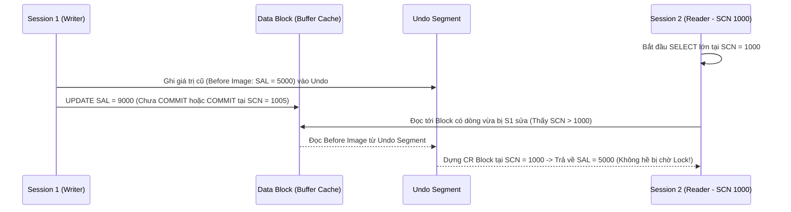

# Chương 19: Quản Lý Giao Dịch và Xử Lý Đồng Thời Nâng Cao (Advanced Transactions & Concurrency) - Oracle SQL OCA & OCP

> **Tài liệu tham chiếu:** *OCA/OCP Oracle Database SQL Exam Guide (Exam 1Z0-071)* & *Oracle Database Concepts (Data Concurrency and Consistency)*.  
> **Mục tiêu khảo thí & thực chiến:** Làm chủ cơ chế Multi-Version Read Consistency (MVCC) dựa trên SCN và Undo; nắm vững các mức cô lập giao dịch (`READ COMMITTED`, `SERIALIZABLE`, `READ ONLY`); hiểu sâu cơ chế khóa dòng (`TX Lock`) và khóa bảng (`TM Lock`); giải thích tại sao cột Foreign Key không có Index lại gây khóa cứng bảng con; thành thạo `SELECT ... FOR UPDATE [NOWAIT | WAIT n | SKIP LOCKED]`; xử lý `ORA-01555 (Snapshot too old)`, `ORA-00060 (Deadlock)`, `ORA-08177` và thiết kế Optimistic vs. Pessimistic Locking trong ứng dụng Enterprise.

---

## 📑 Mục Lục Chi Tiết

1. [Cơ Chế Multi-Version Read Consistency (MVCC), SCN & Lỗi ORA-01555](#1-cơ-chế-multi-version-read-consistency-mvcc-scn--lỗi-ora-01555)
2. [Các Mức Cô Lập Giao Dịch (Transaction Isolation Levels) & Lỗi ORA-08177](#2-các-mức-cô-lập-giao-dịch-transaction-isolation-levels--lỗi-ora-08177)
3. [Kiến Trúc Khóa Trong Oracle: TX Lock (Row Lock) vs. TM Lock (Table Lock)](#3-kiến-trúc-khóa-trong-oracle-tx-lock-row-lock-vs-tm-lock-table-lock)
4. [Tại Sao Phải Đánh Index Trên Cột Foreign Key? (Unindexed Foreign Key Trap)](#4-tại-sao-phải-đánh-index-trên-cột-foreign-key-unindexed-foreign-key-trap)
5. [Lệnh SELECT ... FOR UPDATE [OF ...] [NOWAIT | WAIT n | SKIP LOCKED]](#5-lệnh-select--for-update-of--nowait--wait-n--skip-locked)
6. [Cơ Chế Phát Hiện và Xử Lý Deadlock (ORA-00060)](#6-cơ-chế-phát-hiện-và-xử-lý-deadlock-ora-00060)
7. [Bài Toán Lost Update: Pessimistic Locking vs. Optimistic Locking](#7-bài-toán-lost-update-pessimistic-locking-vs-optimistic-locking)
8. [Bài Tập Thực Hành Tự Luyện (Kèm Lời Giải Chi Tiết)](#8-bài-tập-thực-hành-tự-luyện-kèm-lời-giải-chi-tiết)
9. [Tổng Hợp Bẫy Thi OCA/OCP & Phỏng Vấn Cốt Lõi (Exam Essentials)](#9-tổng-hợp-bẫy-thi-ocaocp--phỏng-vấn-cốt-lõi-exam-essentials)

---

## 1. Cơ Chế Multi-Version Read Consistency (MVCC), SCN & Lỗi ORA-01555

Một trong những triết lý kiến trúc vĩ đại nhất giúp Oracle Database thống trị phân khúc Enterprise là:
> **"Readers NEVER block Writers, and Writers NEVER block Readers!"**  
> *(Người đọc không bao giờ chặn người ghi, và người ghi không bao giờ chặn người đọc!)*

### 1.1. System Change Number (SCN) & Undo Segments hoạt động như thế nào?
* **SCN (System Change Number):** Là chiếc "đồng hồ logic" nội bộ của Oracle Database, luôn tăng đơn điệu mỗi khi có một giao dịch `COMMIT` hoặc có thay đổi trạng thái hệ thống.
* Khi một câu lệnh `SELECT` bắt đầu thực thi tại thời điểm có mốc `Query SCN = 1000`:
  1. Oracle quét qua các Data Blocks của bảng.
  2. Nếu một Data Block có `Block SCN <= 1000` (dữ liệu không bị sửa đổi kể từ lúc câu lệnh `SELECT` bắt đầu), Oracle đọc trực tiếp block đó.
  3. Nếu một Data Block đã bị một Session khác `UPDATE` (dù đã `COMMIT` ở `SCN = 1005` hay **chưa `COMMIT`**), nghĩa là `Block SCN > 1000`:
     * Oracle **KHÔNG** đọc dữ liệu mới đó (để tránh *Dirty Read* và đảm bảo *Statement-Level Read Consistency*).
     * Oracle cũng **KHÔNG** bắt câu lệnh `SELECT` phải đứng chờ khóa!
     * Thay vào đó, Oracle lần theo con trỏ lưu trong Header của Data Block để tìm vào **Undo Segments (Undo Tablespace)**, lấy lại bản ảnh cũ (**Before Image**) của dữ liệu và dựng nên một bản sao của block trong bộ nhớ Buffer Cache gọi là **Consistent Read (CR) Clone Block** đúng tại thời điểm `SCN = 1000`!



### 1.2. Hai cấp độ Read Consistency trong Oracle
1. **Statement-Level Read Consistency (Nhất quán mức câu lệnh - Luôn tự động bật):**
   * Đảm bảo toàn bộ dữ liệu trả về bởi **một câu lệnh `SELECT` đơn lẻ** phản ánh đúng trạng thái nhất quán tại duy nhất một thời điểm (**mốc SCN lúc câu lệnh `SELECT` đó bắt đầu chạy**), cho dù câu lệnh chạy mất 1 giây hay 2 giờ!
2. **Transaction-Level Read Consistency (Nhất quán mức giao dịch):**
   * Đảm bảo **mọi câu lệnh `SELECT`** trong cùng một giao dịch đều nhìn thấy dữ liệu tại cùng một mốc SCN lúc **giao dịch bắt đầu** (áp dụng khi dùng chế độ `SERIALIZABLE` hoặc `READ ONLY`).

---

### 1.3. Giải phẫu lỗi kinh điển `ORA-01555: snapshot too old`

> [!WARNING]
> **Khi nào xảy ra lỗi `ORA-01555: snapshot too old: rollback segment number ... too small`?**  
> Giả sử câu lệnh `SELECT` báo cáo của bạn bắt đầu chạy lúc `08:00:00` (`SCN = 1000`) và mất 45 phút để quét bảng 100 triệu dòng.  
> Trong khoảng thời gian từ `08:00` đến `08:30`, các giao dịch khác thực hiện `UPDATE` dữ liệu và đã **`COMMIT`**.  
> Khi một giao dịch đã `COMMIT`, vùng dữ liệu cũ (Before Image) của nó trong **Undo Tablespace** chuyển từ trạng thái `ACTIVE` sang `EXPIRED`/`UNEXPIRED` và **có thể bị các giao dịch mới ghi đè lên (Overwritten)** nếu Undo Tablespace hết chỗ hoặc quá hạn `UNDO_RETENTION`.  
> Đến phút thứ 40 (`08:40`), câu lệnh `SELECT` đọc tới một block đã bị sửa sau `08:00`. Nó quay vào Undo Segment để tìm lại bản ảnh cũ tại `SCN = 1000`, nhưng phát hiện **bản ảnh Undo đó đã bị ghi đè mất rồi**! Không thể dựng lại bức tranh nhất quán tại `SCN = 1000`, Oracle buộc phải hủy câu lệnh `SELECT` và quăng lỗi **`ORA-01555: snapshot too old`**!

#### Các nguyên nhân thực tế và cách phòng chống `ORA-01555`:
1. **Câu lệnh `SELECT` chạy quá lâu:** Tối ưu lại SQL để giảm thời gian chạy.
2. **Undo Tablespace quá nhỏ hoặc `UNDO_RETENTION` quá thấp:** Tăng kích thước Undo Tablespace và cấu hình `UNDO_RETENTION` (hoặc bật `RETENTION GUARANTEE`).
3. **Thủ phạm số 1 từ phía Developer — `COMMIT` bên trong vòng lặp đọc Cursor (Fetch Across Commits):**
   ```sql
   -- ❌ PHẢN MẪU (ANTI-PATTERN) GÂY LỖI ORA-01555:
   FOR r IN (SELECT rowid AS rid, amount FROM big_invoices WHERE status = 'NEW') LOOP
       UPDATE big_invoices SET status = 'PROCESSED' WHERE rowid = r.rid;
       COMMIT; -- ❌ Cực kỳ nguy hiểm! Giải phóng chính các slot Undo mà con trỏ SELECT đang cần đọc!
   END LOOP;
   ```
   **Cách khắc phục:** Tuyệt đối không `COMMIT` lắt nhắt trong vòng lặp đọc chính bảng đang sửa; hãy gộp thành câu lệnh `UPDATE` tập hợp (Set-based SQL) hoặc `COMMIT` sau khi kết thúc xử lý!

---

## 2. Các Mức Cô Lập Giao Dịch (Transaction Isolation Levels) & Lỗi ORA-08177

### 2.1. Ba hiện tượng bất thường khi đọc đồng thời theo chuẩn ANSI SQL
1. **Dirty Read (Đọc bẩn):** Giao dịch A đọc được dữ liệu do Giao dịch B vừa `UPDATE/INSERT` nhưng **chưa `COMMIT`**. Nếu B `ROLLBACK`, A đã sử dụng dữ liệu ma.
   * **Trong Oracle:** **KHÔNG BAO GIỜ XẢY RA** ở bất kỳ mức cô lập nào nhờ cơ chế Undo & SCN! Oracle không hỗ trợ mức `READ UNCOMMITTED`.
2. **Non-Repeatable Read (Fuzzy Read - Đọc không lặp lại):** Trong cùng Giao dịch A, chạy cùng một câu lệnh `SELECT` dòng `id = 10` hai lần nhưng nhận được giá trị cột khác nhau (do giữa 2 lần đọc, Giao dịch B đã `UPDATE` dòng đó và `COMMIT`).
3. **Phantom Read (Đọc bóng ma):** Trong cùng Giao dịch A, chạy cùng câu lệnh `SELECT ... WHERE dept_id = 10` hai lần nhưng lần thứ hai xuất hiện thêm các dòng mới (do giữa 2 lần đọc, Giao dịch B đã `INSERT` dòng mới và `COMMIT`).

---

### 2.2. Các mức cô lập được hỗ trợ trong Oracle Database

| Mức cô lập (Isolation Level) | Cú pháp thiết lập trong Oracle | Dirty Read | Non-Repeatable Read | Phantom Read | Cho phép DML? |
| :--- | :--- | :---: | :---: | :---: | :---: |
| **`READ COMMITTED`** *(Mặc định)* | `SET TRANSACTION ISOLATION LEVEL READ COMMITTED;` | ❌ Không | ⚠️ Có thể | ⚠️ Có thể | ✅ Có |
| **`SERIALIZABLE`** | `SET TRANSACTION ISOLATION LEVEL SERIALIZABLE;` | ❌ Không | ❌ Không | ❌ Không | ✅ Có (Có thể lỗi `ORA-08177`) |
| **`READ ONLY`** | `SET TRANSACTION READ ONLY;` | ❌ Không | ❌ Không | ❌ Không | ❌ **Không** (Chỉ đọc) |

> [!IMPORTANT]
> **Quy tắc bắt buộc khi dùng `SET TRANSACTION`:**  
> Lệnh `SET TRANSACTION ...` **BẮT BUỘC phải là câu lệnh đầu tiên** của một giao dịch (ngay sau khi mở Session hoặc ngay sau lệnh `COMMIT` / `ROLLBACK`). Nếu bạn đã chạy một lệnh DML trước đó rồi mới gõ `SET TRANSACTION`, Oracle sẽ báo lỗi `ORA-01453: SET TRANSACTION must be first statement of transaction`.

---

### 2.3. Chế độ `SERIALIZABLE` và Lỗi `ORA-08177`
Khi một giao dịch được đặt ở mức **`SERIALIZABLE`**:
* Toàn bộ giao dịch nhìn thấy dữ liệu đóng băng tại **mốc SCN lúc giao dịch bắt đầu** (`Transaction-Level Read Consistency`). Dù các Session khác có `INSERT`, `UPDATE`, `DELETE` và `COMMIT` bao nhiêu lần, giao dịch `SERIALIZABLE` vẫn hoàn toàn không thấy các thay đổi đó (loại bỏ cả *Non-Repeatable Read* và *Phantom Read*).
* **Chuyện gì xảy ra nếu giao dịch `SERIALIZABLE` cố tình `UPDATE` hoặc `DELETE` một dòng dữ liệu mà dòng đó ĐÃ BỊ một giao dịch khác sửa đổi và `COMMIT` sau thời điểm giao dịch `SERIALIZABLE` bắt đầu?**
  * Nếu dòng đó đang bị khóa bởi giao dịch kia (chưa `COMMIT`), Session `SERIALIZABLE` sẽ đứng chờ khóa.
  * Ngay khi giao dịch kia `COMMIT` (hoặc đã `COMMIT` từ trước đó nhưng sau mốc SCN bắt đầu của giao dịch `SERIALIZABLE`), Oracle phát hiện xung đột tuần tự hóa và lập tức ném lỗi:
    **`ORA-08177: can't serialize access for this transaction`**!

```sql
-- Minh họa kịch bản gây lỗi ORA-08177:
-- [Thời điểm T1] Session 1 bắt đầu giao dịch SERIALIZABLE:
SET TRANSACTION ISOLATION LEVEL SERIALIZABLE;
SELECT salary FROM employees WHERE employee_id = 100; -- Thấy salary = 24000 (SCN = 500)

-- [Thời điểm T2] Session 2 cập nhật cùng dòng employee_id = 100 và COMMIT:
UPDATE employees SET salary = 25000 WHERE employee_id = 100;
COMMIT; -- Thành công tại SCN = 510

-- [Thời điểm T3] Session 1 SELECT lại:
SELECT salary FROM employees WHERE employee_id = 100; -- Vẫn thấy 24000 (nhờ SCN = 500)!

-- [Thời điểm T4] Session 1 cố gắng UPDATE chính dòng employee_id = 100 đó:
UPDATE employees SET salary = 26000 WHERE employee_id = 100;
-- ❌ LỖI NGAY LẬP TỨC: ORA-08177: can't serialize access for this transaction!
```

### 2.4. Chế độ `READ ONLY`
```sql
SET TRANSACTION READ ONLY;
-- Hữu ích khi cần chạy một chuỗi gồm 10 câu lệnh SELECT báo cáo tài chính liên tiếp nhau
-- và yêu cầu số liệu giữa cả 10 bảng báo cáo phải khớp nhau tuyệt đối tại cùng 1 mốc thời gian (SCN)!
-- Mọi lệnh INSERT, UPDATE, DELETE, MERGE trong giao dịch READ ONLY sẽ bị từ chối (ORA-01456).
```

---

## 3. Kiến Trúc Khóa Trong Oracle: TX Lock (Row Lock) vs. TM Lock (Table Lock)

### 3.1. Cơ chế khóa tự động khi thực hiện DML (`INSERT`, `UPDATE`, `DELETE`, `MERGE`)
Khi một Session thực hiện câu lệnh sửa đổi dữ liệu (ví dụ: `UPDATE employees SET salary = 9000 WHERE employee_id = 105;`), Oracle **tự động cấp phát ĐỒNG THỜI 2 loại khóa**:

1. **`TX` Lock (Transaction / Row-Level Lock - Khóa độc quyền cấp độ dòng - Mode `X`):**
   * Khóa trực tiếp lên từng dòng dữ liệu bị ảnh hưởng (`employee_id = 105`).
   * Các Session khác vẫn `SELECT` dòng `105` bình thường (đọc từ Undo), vẫn `UPDATE` các dòng khác (`106`, `107`) bình thường, nhưng nếu cố `UPDATE/DELETE` đúng dòng `105` thì sẽ phải **xếp hàng chờ (Wait)** cho đến khi Session giữ khóa `COMMIT` hoặc `ROLLBACK`.
2. **`TM` Lock (DML / Table-Level Lock - Khóa chia sẻ cấp độ bảng - Mode `RX` / `Row Exclusive`):**
   * Đặt trên bảng `EMPLOYEES` để ngăn chặn các Session khác thực hiện lệnh DDL phá hủy cấu trúc bảng (như `DROP TABLE`, `ALTER TABLE ... DROP COLUMN`) trong khi giao dịch DML đang diễn ra dở dang!
   * Vì `TM` Lock ở chế độ `RX (Row Exclusive)` tương thích với các `TM` Lock `RX` khác, nên hàng nghìn Session vẫn có thể cùng lúc giữ `TM` Lock `RX` trên bảng `EMPLOYEES` để sửa các dòng khác nhau.

> [!TIP]
> **Đặc điểm kiến trúc độc đáo của Row Lock (`TX` Lock) trong Oracle:**  
> Khác với SQL Server hay DB2 (vốn lưu danh sách các Row Lock trong một bảng Lock Manager trên bộ nhớ RAM, nên khi khóa hàng triệu dòng sẽ bị tràn RAM và phải nâng cấp khóa lên khóa toàn bảng - gọi là **Lock Escalation**), Oracle lưu thông tin khóa dòng **ngay bên trong chính Data Block trên đĩa** (thông qua **ITL - Interested Transaction List** ở Block Header và byte trạng thái khóa trên từng Row Header).  
> **Hệ quả (Câu hỏi thi OCP kinh điển):**  
> 1. Trong Oracle, khóa 1 dòng hay khóa 100 triệu dòng tiêu tốn lượng bộ nhớ RAM quản lý khóa gần như nhau!  
> 2. Oracle Database **KHÔNG BAO GIỜ thực hiện Lock Escalation** (không bao giờ tự động biến Row Locks thành Table Lock)!

---

## 4. Tại Sao Phải Đánh Index Trên Cột Foreign Key? (Unindexed Foreign Key Trap)

Đây là một trong những sự cố Production nổi tiếng nhất và là câu hỏi phỏng vấn Senior/Architect bắt buộc phải nắm vững!

### 4.1. Kịch bản thảm họa khi cột Foreign Key KHÔNG có Index
Giả sử có bảng Cha `DEPARTMENTS (department_id PK)` và bảng Con `EMPLOYEES (department_id FK tham chiếu tới DEPARTMENTS)`.
* Khi tạo `PRIMARY KEY` trên `DEPARTMENTS(department_id)`, Oracle **tự động tạo Unique Index**.
* Nhưng khi tạo `FOREIGN KEY` trên `EMPLOYEES(department_id)`, Oracle **KHÔNG tự động tạo Index** trên bảng con `EMPLOYEES`!

**Chuyện gì xảy ra nếu cột `EMPLOYEES.department_id` KHÔNG có Index?**
Khi một Session thực hiện một trong các thao tác sau trên **bảng Cha (`DEPARTMENTS`)**:
* `DELETE FROM departments WHERE department_id = 10;` (Xóa dòng ở bảng cha), HOẶC
* `UPDATE departments SET department_id = 99 WHERE department_id = 10;` (Sửa giá trị cột khóa chính ở bảng cha — rất hay do các ORM như Hibernate tự sinh câu lệnh `UPDATE` tất cả các cột!), HOẶC
* `MERGE` vào bảng cha có nhánh `DELETE`.

Khi đó:
1. Để bảo vệ toàn vẹn tham chiếu và ngăn không cho bất kỳ Session nào khác lén chèn nhân viên vào phòng 10 trong lúc đang xóa phòng 10, nếu không có Index trên `EMPLOYEES(department_id)`, Oracle sẽ phải yêu cầu một khóa **Table-level `TM` Lock ở chế độ Share (`S` - Mode 4) hoặc Share Sub-Exclusive (`SSX` - Mode 5) trên TOÀN BỘ bảng con `EMPLOYEES`** trong suốt thời gian câu lệnh thực thi!
2. Trong thời gian bảng con `EMPLOYEES` bị khóa `TM` ở mức `S`/`SSX`, mọi giao dịch `INSERT`, `UPDATE`, `DELETE` trên **BẤT KỲ phòng ban nào khác** (phòng 20, 30, 50...) của bảng `EMPLOYEES` đều bị **chặn đứng hoàn toàn**! Ngược lại, nếu bảng `EMPLOYEES` đang có bất kỳ dòng nào chưa `COMMIT`, lệnh `DELETE` trên bảng `DEPARTMENTS` cũng phải đứng chờ!

### 4.2. Giải pháp khi ĐÃ ĐÁNH INDEX trên cột Foreign Key
Khi bạn tạo B-Tree Index trên cột khóa ngoại của bảng con:
```sql
CREATE INDEX idx_emp_dept_fk ON employees(department_id);
```
* Oracle chỉ cần tra cứu và khóa đúng mục chỉ mục tương ứng với `department_id = 10` trong B-Tree Index mà **KHÔNG CẦN khóa toàn bộ bảng con `EMPLOYEES`**.
* Thêm vào đó, khi xóa 1 dòng ở bảng cha (`DELETE FROM departments WHERE department_id = 10`), Oracle phải kiểm tra xem có dòng con nào đang tham chiếu tới `10` hay không. Nếu không có Index trên cột FK, mỗi lần xóa 1 dòng ở bảng cha là Oracle phải quét **`TABLE ACCESS FULL`** toàn bộ bảng con!

> [!IMPORTANT]
> **Khi nào có thể KHÔNG cần đánh Index trên cột Foreign Key?**  
> Chỉ khi thỏa mãn **đồng thời cả 3 điều kiện**:  
> 1. Bảng cha **không bao giờ bị `DELETE`**.  
> 2. Cột Primary Key / Unique Key của bảng cha **không bao giờ bị `UPDATE`**.  
> 3. Bạn **không bao giờ Join** từ bảng cha sang bảng con (hoặc lọc bảng con) theo cột Foreign Key đó.  
> Trong thực tế 99% các bảng nghiệp vụ đều cần đánh Index cho cột Foreign Key!

---

## 5. Lệnh SELECT ... FOR UPDATE [OF ...] [NOWAIT | WAIT n | SKIP LOCKED]

Mặc định câu lệnh `SELECT` không đặt bất kỳ khóa nào lên các dòng dữ liệu được đọc. Tuy nhiên, nếu bạn muốn đọc dữ liệu lên để kiểm tra nghiệp vụ rồi chắc chắn sẽ `UPDATE`/`DELETE` ngay sau đó và muốn **khóa giữ chỗ các dòng đó ngay từ lúc đọc** (Pessimistic Locking), bạn dùng mệnh đề **`FOR UPDATE`**.

### 5.1. Cú pháp và các tùy chọn chờ khóa

```sql
-- 1. Mặc định (Chờ vô thời hạn cho đến khi lấy được khóa trên TẤT CẢ các dòng thỏa mãn):
SELECT employee_id, salary
FROM employees
WHERE department_id = 60
FOR UPDATE;

-- 2. NOWAIT (Không chờ: nếu có bất kỳ dòng nào đang bị Session khác khóa -> Báo lỗi ORA-00054 ngay lập tức!):
SELECT employee_id, salary
FROM employees
WHERE department_id = 60
FOR UPDATE NOWAIT;
-- Lỗi nếu bị kẹt khóa: ORA-00054: resource busy and acquire with NOWAIT specified or timeout expired

-- 3. WAIT n (Chờ tối đa n giây; hết n giây vẫn chưa lấy được khóa -> Báo lỗi ORA-00054):
SELECT employee_id, salary
FROM employees
WHERE department_id = 60
FOR UPDATE WAIT 5;

-- 4. SKIP LOCKED (Bỏ qua các dòng đang bị khóa, chỉ khóa và trả về những dòng đang RẢNH!):
SELECT ticket_id, sub_phone, issue_type
FROM support_tickets
WHERE status = 'PENDING'
FOR UPDATE SKIP LOCKED;
```

### 5.2. Bẫy thi với mệnh đề `FOR UPDATE OF column_name` khi Join nhiều bảng

> [!WARNING]
> **Cẩn thận bẫy thi OCA/OCP khi dùng `FOR UPDATE` trong câu truy vấn có `JOIN`:**  
> * Nếu bạn viết `SELECT e.last_name, d.department_name FROM employees e JOIN departments d ... FOR UPDATE;` (không có `OF`): Oracle sẽ **khóa các dòng thỏa mãn ở CẢ HAI BẢNG** (`EMPLOYEES` và `DEPARTMENTS`)!  
> * Nếu bạn chỉ định **`FOR UPDATE OF e.salary`** (nêu tên một cột thuộc bảng `EMPLOYEES`): Oracle sẽ **CHỈ khóa các dòng thuộc bảng `EMPLOYEES`** (bảng chứa cột `salary`), còn các dòng ở bảng `DEPARTMENTS` **KHÔNG bị khóa**!  
> * Lưu ý: `FOR UPDATE OF e.salary` vẫn khóa **toàn bộ dòng (Row-level lock)** của bảng `EMPLOYEES`, chứ không phải chỉ khóa riêng cột `salary` (Oracle không có khái niệm Column-level lock). Tên cột sau `OF` chỉ đóng vai trò chỉ định **bảng nào** cần bị khóa!

### 5.3. Ứng dụng thực chiến của `FOR UPDATE SKIP LOCKED`
Trong các hệ thống xử lý cước viễn thông hoặc cổng thanh toán có 20 Worker Threads cùng đọc từ một bảng `JOB_QUEUE (status = 'NEW')` để xử lý song song:
* Nếu dùng `FOR UPDATE`: 19 Worker sẽ bị đứng chờ Worker 1.
* Nếu dùng `FOR UPDATE NOWAIT`: 19 Worker sẽ bị văng lỗi `ORA-00054`.
* Nếu dùng **`FOR UPDATE SKIP LOCKED`** kết hợp `FETCH FIRST 10 ROWS ONLY`: Worker 1 lấy và khóa 10 dòng đầu tiên; Worker 2 chạy đồng thời sẽ **tự động nhảy qua 10 dòng đang bị Worker 1 khóa** để lấy 10 dòng tiếp theo (`11..20`) ngay lập tức mà không hề chặn nhau hay báo lỗi!

---

## 6. Cơ Chế Phát Hiện và Xử Lý Deadlock (ORA-00060)

### 6.1. Khi nào xảy ra Deadlock (Khóa chết chéo)?
**Deadlock** xảy ra khi hai (hoặc nhiều) Session giữ khóa trên tài nguyên của mình và cùng chờ tài nguyên đang bị đối phương nắm giữ, tạo thành một vòng tròn chờ đợi khép kín:

| Thời gian | Session 1 | Session 2 |
| :---: | :--- | :--- |
| **T1** | `UPDATE accounts SET bal = bal - 100 WHERE id = 1;` *(Giữ khóa dòng `id = 1`)* | `UPDATE accounts SET bal = bal - 200 WHERE id = 2;` *(Giữ khóa dòng `id = 2`)* |
| **T2** | `UPDATE accounts SET bal = bal + 100 WHERE id = 2;` *(Đứng chờ Session 2 nhả dòng `id = 2`)* | `UPDATE accounts SET bal = bal + 200 WHERE id = 1;` *(Đứng chờ Session 1 nhả dòng `id = 1` $\rightarrow$ **DEADLOCK!**)* |

### 6.2. Oracle xử lý Deadlock như thế nào? (Bẫy thi cực kỳ quan trọng!)

> [!CAUTION]
> **3 Quy tắc vàng về Deadlock (`ORA-00060`) trong kỳ thi OCA/OCP:**  
> 1. Oracle **tự động phát hiện Deadlock** sau khoảng vài giây (nhờ đồ thị chờ Wait-for Graph) và chọn một trong hai Session làm nạn nhân để ném lỗi:  
>    **`ORA-00060: deadlock detected while waiting for resource`** (kèm ghi chi tiết vào file alert/trace log).  
> 2. **QUAN TRỌNG NHẤT:** Khi ném lỗi `ORA-00060`, Oracle **CHỈ thực hiện `Statement-Level Rollback`** (chỉ hủy bỏ đúng **câu lệnh DML ở bước T2** gây ra vòng lặp Deadlock), chứ **KHÔNG ROLLBACK toàn bộ giao dịch (Transaction)** của Session nhận lỗi!  
> 3. Hệ quả: Ở ví dụ trên, sau khi Session 2 (hoặc Session 1) nhận lỗi `ORA-00060` ở bước T2, câu lệnh ở bước **T1 của nó VẪN CÒN NGUYÊN HIỆU LỰC và nó VẪN ĐANG GIỮ KHÓA** trên dòng ở bước T1! Do đó, Session còn lại vẫn tiếp tục phải đứng chờ cho đến khi Session nhận lỗi `ORA-00060` chủ động thực hiện `ROLLBACK` hoặc `COMMIT` trong khối bắt ngoại lệ (`EXCEPTION`)!

#### Cách phòng tránh Deadlock trong thiết kế ứng dụng:
* Luôn truy cập và khóa các bảng / các dòng theo **cùng một thứ tự nhất quán** (ví dụ: khi chuyển tiền giữa 2 tài khoản, luôn khóa tài khoản có `account_id` nhỏ hơn trước, `account_id` lớn hơn sau: `WHERE account_id IN (:id1, :id2) ORDER BY account_id FOR UPDATE`).

---

## 7. Bài Toán Lost Update: Pessimistic Locking vs. Optimistic Locking

### 7.1. Hiện tượng Lost Update (Mất dữ liệu cập nhật) trong ứng dụng Web/API
Giả sử tài khoản `id = 100` có số dư `1,000,000đ`:
1. Giao dịch viên A mở màn hình Web đọc số dư lên: `1,000,000đ` (Kết nối DB đã đóng hoặc đã kết thúc câu `SELECT`).
2. Giao dịch viên B cũng mở màn hình Web đọc số dư lên: `1,000,000đ`.
3. Giao dịch viên A cộng thêm `500,000đ` trên bộ nhớ ứng dụng và chạy lệnh:
   `UPDATE accounts SET balance = 1500000 WHERE id = 100; COMMIT;`
4. Giao dịch viên B trừ đi `200,000đ` từ con số cũ (`1,000,000đ`) trên màn hình của B và chạy lệnh:
   `UPDATE accounts SET balance = 800000 WHERE id = 100; COMMIT;`
5. **Kết quả:** Khoản tiền `+500,000đ` của A đã bị B ghi đè biến mất hoàn toàn (**Lost Update**)!

### 7.2. Hai chiến lược phòng chống Lost Update

#### Chiến lược 1: Pessimistic Locking (Khóa bi quan)
* Ngay khi đọc dữ liệu để chuẩn bị sửa trong cùng một Database Transaction ngắn, dùng `SELECT ... FOR UPDATE [NOWAIT | WAIT n]` để khóa cứng dòng đó lại, không cho ai khác nhảy vào sửa cho tới khi mình `COMMIT`.
* **Phù hợp với:** Xử lý Batch / Backend Service / Stored Procedure nơi toàn bộ bước đọc - tính toán - cập nhật diễn ra trong vài mili-giây bên trong cùng 1 kết nối DB.
* **Không phù hợp với:** Giao diện người dùng nhiều bước (Stateless REST API / HTTP Request), vì không thể giữ mở kết nối DB và giữ khóa dòng trong lúc chờ người dùng gõ bàn phím 5 phút!

#### Chiến lược 2: Optimistic Locking (Khóa lạc quan)
* Không khóa dòng khi đọc. Thay vào đó, thêm một cột **`VERSION` (kiểu `NUMBER`)** hoặc **`UPDATED_AT` (`TIMESTAMP`)** (hoặc dùng cột giả `ORA_ROWSCN` trên bảng được tạo với tùy chọn `ROWDEPENDENCIES`).
* Khi đọc dữ liệu lên màn hình, lấy kèm giá trị `version` hiện tại (ví dụ `old_version = 3`).
* Khi thực hiện `UPDATE`, đính kèm điều kiện kiểm tra `WHERE version = :old_version` và tự động tăng `version = version + 1`:
```sql
UPDATE accounts
SET balance = :new_balance,
    version = version + 1
WHERE account_id = :acc_id
  AND version    = :old_version; -- Kiểm tra xem đã có ai sửa dòng này từ lúc mình đọc chưa!
```
* Kiểm tra số dòng cập nhật được (`SQL%ROWCOUNT` hoặc `PreparedStatement.executeUpdate()`):
  * Nếu trả về `1`: Cập nhật thành công, `COMMIT`.
  * Nếu trả về `0`: Chứng tỏ dòng dữ liệu đã bị người khác sửa mất (`version` trong DB đã tăng lên `4`). Ứng dụng thông báo *"Dữ liệu đã thay đổi bởi người dùng khác, vui lòng tải lại trang!"*.

---

## 8. Bài Tập Thực Hành Tự Luyện (Kèm Lời Giải Chi Tiết)

### Đề bài thực hành:
Quan sát chuỗi sự kiện diễn ra theo thứ tự thời gian giữa 2 phiên làm việc (`Session A` và `Session B`) đều đang ở chế độ mặc định (`READ COMMITTED`) trên bảng `INVENTORY (item_id PK, qty NUMBER)`:
Ban đầu dòng `item_id = 1` có `qty = 100` (đã `COMMIT`).

```sql
-- [T1] Session A:
UPDATE inventory SET qty = 80 WHERE item_id = 1;

-- [T2] Session B:
SELECT qty FROM inventory WHERE item_id = 1;

-- [T3] Session B:
SELECT qty FROM inventory WHERE item_id = 1 FOR UPDATE WAIT 3;
```

Hãy trả lời:
1. Tại bước `[T2]`, `Session B` nhận được giá trị `qty` là bao nhiêu hay bị đứng chờ? Tại sao?
2. Tại bước `[T3]`, chuyện gì xảy ra với `Session B` nếu `Session A` vẫn chưa `COMMIT` sau 3 giây?
3. Viết câu lệnh PL/SQL/SQL sử dụng `Optimistic Locking` để trừ `qty` đi `20` đơn vị mà không cần dùng `FOR UPDATE`.

<details>
<summary><b>👉 Xem Lời Giải Chi Tiết</b></summary>

1. **Tại bước `[T2]`:**
   * `Session B` **KHÔNG hề bị đứng chờ** và nhận được kết quả ngay lập tức là **`qty = 100`**!
   * **Giải thích:** Trong Oracle, người ghi không bao giờ chặn người đọc. Vì `Session A` chưa `COMMIT`, Oracle đọc bản ảnh trước khi sửa (`Before Image: qty = 100`) từ **Undo Segment** để trả về cho `Session B` (đảm bảo không bao giờ có *Dirty Read*).

2. **Tại bước `[T3]`:**
   * Câu lệnh `SELECT ... FOR UPDATE WAIT 3` yêu cầu đặt khóa độc quyền cấp độ dòng (`TX Lock`) lên dòng `item_id = 1`.
   * Vì dòng này đang bị `Session A` giữ khóa `TX`, `Session B` sẽ bị **đứng chờ đúng 3 giây**.
   * Hết 3 giây mà `Session A` vẫn chưa `COMMIT`/`ROLLBACK`, câu lệnh của `Session B` sẽ văng ngoại lệ: **`ORA-00054: resource busy and acquire with NOWAIT specified or timeout expired`**.

3. **Câu lệnh cập nhật an toàn (Atomic Update / Optimistic Locking):**
   * Cách 1 (Cập nhật tương đối trực tiếp kiêm kiểm tra tồn kho trong 1 câu SQL nguyên tử):
     ```sql
     UPDATE inventory
     SET qty = qty - 20
     WHERE item_id = 1
       AND qty >= 20;
     -- Nếu SQL%ROWCOUNT = 0 -> Hết hàng hoặc không tồn tại item_id = 1
     ```
   * Cách 2 (Optimistic Locking với cột `version` khi giá trị mới được tính từ ứng dụng):
     ```sql
     UPDATE inventory
     SET qty     = :new_qty,
         version = version + 1
     WHERE item_id = 1
       AND version = :old_version;
     ```
</details>

---

## 9. Tổng Hợp Bẫy Thi OCA/OCP & Phỏng Vấn Cốt Lõi (Exam Essentials)

| # | Tình huống / Bẫy thường gặp trong đề thi | Quy tắc chuẩn Oracle / Cách nhận diện |
| :---: | :--- | :--- |
| **1** | Oracle hỗ trợ những mức cô lập giao dịch (Isolation Levels) nào? | Hỗ trợ **3 mức**: `READ COMMITTED` (mặc định), `SERIALIZABLE`, và `READ ONLY`. **Không hỗ trợ** `READ UNCOMMITTED` hay `REPEATABLE READ`. |
| **2** | Khi xảy ra Deadlock (`ORA-00060`), Oracle rollback cái gì? | Chỉ **Rollback câu lệnh hiện tại (Statement-level Rollback)** phát hiện ra Deadlock, **KHÔNG rollback toàn bộ Transaction**! |
| **3** | Nguyên nhân gây lỗi `ORA-01555: snapshot too old` | Câu lệnh `SELECT` chạy lâu cần đọc bản ảnh cũ trong **Undo Segment**, nhưng vùng Undo đó đã bị ghi đè sau khi giao dịch khác `COMMIT`. |
| **4** | Nguyên nhân gây lỗi `ORA-08177: can't serialize access` | Giao dịch ở chế độ **`SERIALIZABLE`** cố `UPDATE`/`DELETE` một dòng đã bị giao dịch khác sửa đổi và `COMMIT` kể từ khi giao dịch `SERIALIZABLE` bắt đầu. |
| **5** | Hậu quả khi cột Foreign Key ở bảng con không có Index | Khi `DELETE` hoặc `UPDATE` khóa chính ở bảng cha, Oracle sẽ khóa toàn bộ bảng con (`TM Lock` mode `S`/`SSX`), làm treo mọi DML trên bảng con! |
| **6** | Khi khóa hàng triệu dòng trong 1 bảng, Oracle có thực hiện Lock Escalation (nâng lên khóa toàn bảng) không? | **KHÔNG BAO GIỜ!** Oracle lưu khóa dòng (`TX`) ngay trong Data Block Header (ITL) nên không bao giờ có Lock Escalation. |
| **7** | Hành vi của `SELECT ... FROM emp e JOIN dept d ... FOR UPDATE OF e.salary` | **Chỉ khóa các dòng của bảng `EMP`** (bảng chứa cột `salary`), không khóa các dòng của bảng `DEPT`. Nếu viết `FOR UPDATE` trần thì khóa cả 2 bảng! |
| **8** | Khác biệt giữa `FOR UPDATE NOWAIT` và `FOR UPDATE SKIP LOCKED` | `NOWAIT` văng lỗi `ORA-00054` ngay nếu gặp dòng bị khóa; `SKIP LOCKED` không báo lỗi mà lặng lẽ bỏ qua các dòng đang bị khóa để lấy các dòng rảnh. |
| **9** | Vị trí hợp lệ của lệnh `SET TRANSACTION ISOLATION LEVEL ...` | Bắt buộc phải là **câu lệnh đầu tiên** của giao dịch (trước mọi lệnh DML). Nếu gọi sau DML sẽ bị lỗi `ORA-01453`. |
| **10** | Trong Oracle, câu lệnh `SELECT` thông thường có bị chặn bởi câu lệnh `UPDATE` chưa `COMMIT` không? | **Không bao giờ!** Câu lệnh `SELECT` luôn đọc bản ảnh nhất quán từ Undo Segment mà không cần chờ khóa. |
