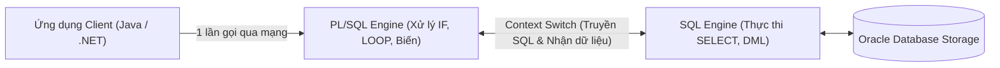

# Chương 21: Nhập Môn Lập Trình PL/SQL (PL/SQL Fundamentals) - Oracle SQL & PL/SQL OCA/OCP

> **Tài liệu tham chiếu:** *Oracle Database PL/SQL Language Reference* & *OCA/OCP Oracle Database SQL & PL/SQL Exam Guide*.  
> **Mục tiêu khảo thí & thực chiến:** Hiểu rõ kiến trúc PL/SQL Engine và cơ chế Context Switching; nắm vững cấu trúc khối lệnh PL/SQL (`DECLARE`, `BEGIN`, `EXCEPTION`, `END;`); quy tắc khai báo biến, hằng (`CONSTANT`), phạm vi biến trong Nested Blocks & Labels (`<<label>>`); làm chủ neo kiểu dữ liệu `%TYPE` và `%ROWTYPE`; thành thạo các cấu trúc điều khiển (`IF-ELSIF`, `CASE` statement vs. `CASE` expression, `LOOP`, `WHILE`, `FOR ... IN [REVERSE]`, `CONTINUE`); nhúng SQL trong PL/SQL (`SELECT ... INTO`, `NO_DATA_FOUND` vs. `TOO_MANY_ROWS`, DML, `RETURNING ... INTO`) và phân biệt các hàm SQL không gọi trực tiếp được trong biểu thức PL/SQL (`DECODE`, `NVL2`).

---

## 📑 Mục Lục Chi Tiết

1. [Kiến Trúc PL/SQL Engine & Cấu Trúc Khối Lệnh (Block Structure)](#1-kiến-trúc-plsql-engine--cấu-trúc-khối-lệnh-block-structure)
2. [Biến (Variables), Hằng (Constants) & Các Kiểu Dữ Liệu Cốt Lõi](#2-biến-variables-hằng-constants--các-kiểu-dữ-liệu-cốt-lõi)
3. [Phạm Vi Biến (Scope), Nhãn Khối (Labels) & Bẫy Trùng Tên Cột Bảng](#3-phạm-vi-biến-scope-nhãn-khối-labels--bẫy-trùng-tên-cột-bảng)
4. [Neo Kiểu Dữ Liệu Động Với %TYPE và %ROWTYPE](#4-neo-kiểu-dữ-liệu-động-với-type-và-rowtype)
5. [Cấu Trúc Điều Khiển Rẽ Nhánh: IF-ELSIF-ELSE & CASE](#5-cấu-trúc-điều-khiển-rẽ-nhánh-if-elsif-else--case)
6. [Cấu Trúc Vòng Lặp: Basic LOOP, WHILE LOOP, FOR LOOP & CONTINUE](#6-cấu-trúc-vòng-lặp-basic-loop-while-loop-for-loop--continue)
7. [Nhúng SQL Trong PL/SQL: SELECT INTO, DML & RETURNING INTO](#7-nhúng-sql-trong-plsql-select-into-dml--returning-into)
8. [Các Hàm SQL Không Gọi Trực Tiếp Được Trong Biểu Thức PL/SQL](#8-các-hàm-sql-không-gọi-trực-tiếp-được-trong-biểu-thức-plsql)
9. [Bài Tập Thực Hành Tự Luyện (Kèm Lời Giải Chi Tiết)](#9-bài-tập-thực-hành-tự-luyện-kèm-lời-giải-chi-tiết)
10. [Tổng Hợp Bẫy Thi OCA/OCP & Phỏng Vấn Cốt Lõi (Exam Essentials)](#10-tổng-hợp-bẫy-thi-ocaocp--phỏng-vấn-cốt-lõi-exam-essentials)

---

## 1. Kiến Trúc PL/SQL Engine & Cấu Trúc Khối Lệnh (Block Structure)

### 1.1. Kiến trúc PL/SQL Engine và SQL Engine (Context Switching)
**PL/SQL (Procedural Language extension to SQL)** là ngôn ngữ lập trình thủ tục tích hợp chặt chẽ bên trong Oracle Database Server.
* Khi bạn gửi một khối lệnh PL/SQL lên Oracle Server:
  1. **PL/SQL Engine** biên dịch và thực thi các câu lệnh thủ tục (`IF`, `LOOP`, phép gán biến `:=`, xử lý mảng...).
  2. Mỗi khi gặp một câu lệnh SQL (`SELECT`, `INSERT`, `UPDATE`, `DELETE`, `MERGE`), PL/SQL Engine thực hiện chuyển ngữ cảnh (**Context Switch**) để gửi câu lệnh SQL đó sang cho **SQL Statement Executor (SQL Engine)** xử lý, sau đó nhận lại kết quả.
* **Lợi ích cốt lõi của PL/SQL:**
  * Giảm thiểu lưu lượng mạng (**Network Round-trips**): Thay vì ứng dụng Java/.NET phải gửi 20 câu lệnh SQL qua mạng, chỉ cần gửi 1 lời gọi PL/SQL duy nhất.
  * Tự động sử dụng **Bind Variables**: Mọi biến PL/SQL đặt trong câu lệnh SQL tĩnh đều được biên dịch thành Bind Variables tự động, triệt tiêu hoàn toàn Hard Parse!



---

### 1.2. Cấu trúc của một khối lệnh PL/SQL (PL/SQL Block)

Đơn vị cơ bản nhất của mọi chương trình PL/SQL là **Khối lệnh (Block)**, gồm 4 phần theo đúng thứ tự:

```sql
DECLARE
    /* 1. Phần Khai báo (Declarative Section) - TÙY CHỌN (Optional)
       Khai báo biến, hằng, kiểu dữ liệu, con trỏ (Cursor), ngoại lệ... */
    v_emp_name VARCHAR2(100);
    v_salary   NUMBER(10, 2);
BEGIN
    /* 2. Phần Thực thi (Executable Section) - BẮT BUỘC (Mandatory)
       Chứa các câu lệnh PL/SQL và SQL. Phải có ít nhất 1 câu lệnh (hoặc lệnh NULL;). */
    SELECT first_name || ' ' || last_name, salary
    INTO   v_emp_name, v_salary
    FROM   employees
    WHERE  employee_id = 100;

    DBMS_OUTPUT.PUT_LINE('Nhân viên: ' || v_emp_name || ' - Lương: ' || v_salary);
EXCEPTION
    /* 3. Phần Xử lý Ngoại lệ (Exception-Handling Section) - TÙY CHỌN (Optional)
       Bắt và xử lý các lỗi runtime phát sinh từ phần BEGIN. */
    WHEN NO_DATA_FOUND THEN
        DBMS_OUTPUT.PUT_LINE('Không tìm thấy nhân viên!');
END; /* 4. Kết thúc khối lệnh - BẮT BUỘC (Mandatory, có dấu chấm phẩy ;) */
/
```

> [!IMPORTANT]
> **Quy tắc thi bắt buộc phải nhớ về Cấu trúc Khối lệnh:**  
> 1. Chỉ có phần **`BEGIN ... END;`** là **BẮT BUỘC**. Phần `DECLARE` và `EXCEPTION` là tùy chọn.  
> 2. Bên trong phần `BEGIN ... END;` **không được phép bỏ trống hoàn toàn**! Nếu bạn chưa muốn viết code thực thi gì, bắt buộc phải đặt câu lệnh rỗng **`NULL;`** (ví dụ: `BEGIN NULL; END;`).  
> 3. Phân biệt **Anonymous Block** (Khối vô danh: bắt đầu bằng `DECLARE` hoặc `BEGIN`, không lưu vào Database, biên dịch mỗi lần chạy) và **Named Block / Subprogram** (Thủ tục `PROCEDURE`, Hàm `FUNCTION`, `PACKAGE`, `TRIGGER`: có tên, dùng từ khóa `IS` hoặc `AS` thay cho `DECLARE`, được biên dịch và lưu trữ lâu dài trong Database Schema).

---

## 2. Biến (Variables), Hằng (Constants) & Các Kiểu Dữ Liệu Cốt Lõi

### 2.1. Khai báo Biến và Hằng số

```sql
DECLARE
    -- 1. Biến thông thường (Nếu không gán giá trị khởi tạo -> Mặc định luôn là NULL!)
    v_counter     PLS_INTEGER;               -- Giá trị ban đầu là NULL (KHÔNG PHẢI 0!)
    
    -- 2. Khởi tạo giá trị bằng toán tử gán (:=) hoặc từ khóa DEFAULT
    v_bonus_rate  NUMBER(4, 2) := 0.15;
    v_status      VARCHAR2(20) DEFAULT 'ACTIVE';
    
    -- 3. Biến có ràng buộc NOT NULL -> BẮT BUỘC phải gán giá trị ngay lúc khai báo!
    v_dept_id     NUMBER(4) NOT NULL := 10;
    -- v_bad_var  NUMBER(4) NOT NULL;        -- ❌ LỖI BIÊN DỊCH (PLS-00218)!
    
    -- 4. Hằng số (CONSTANT) -> Từ khóa CONSTANT phải đứng TRƯỚC kiểu dữ liệu và BẮT BUỘC khởi tạo!
    c_vat_rate    CONSTANT NUMBER(4, 2) := 0.10;
    -- c_bad_con  NUMBER CONSTANT := 1;      -- ❌ LỖI CÚ PHÁP (CONSTANT phải đứng trước kiểu dữ liệu)!
BEGIN
    v_counter := NVL(v_counter, 0) + 1;
    -- c_vat_rate := 0.08;                   -- ❌ LỖI BIÊN DỊCH (PLS-00363): Không thể sửa hằng số!
END;
/
```

> [!WARNING]
> **3 Bẫy thi kinh điển về Khai báo Biến trong PL/SQL:**  
> 1. **Mọi biến chưa khởi tạo đều mang giá trị `NULL`:** Khác với Java (nơi thuộc tính `int` mặc định bằng `0`), trong PL/SQL biến `v_num NUMBER;` chưa khởi tạo sẽ bằng **`NULL`**. Và biểu thức `v_num := v_num + 10;` sẽ cho kết quả là **`NULL`** (`NULL + 10 = NULL`)!  
> 2. **Mỗi dòng khai báo chỉ được khai báo DUY NHẤT 1 biến:**  
>    Viết `v_a, v_b NUMBER;` là **LỖI BIÊN DỊCH**! Phải tách thành `v_a NUMBER; v_b NUMBER;`.  
> 3. **Biến `NOT NULL` và `CONSTANT`:** Cả hai đều **bắt buộc phải được gán giá trị khác `NULL` ngay tại dòng khai báo**. Với hằng số, đúng thứ tự là: `tên_hằng CONSTANT kiểu_dữ_liệu := giá_trị;`.

---

### 2.2. Các kiểu dữ liệu đặc trưng của PL/SQL
* **`PLS_INTEGER` / `BINARY_INTEGER`:** Số nguyên có dấu 32-bit (`-2,147,483,648` đến `2,147,483,647`). Tính toán bằng phần cứng CPU trực tiếp nên **nhanh hơn kiểu `NUMBER`** rất nhiều (dùng cho biến đếm vòng lặp, chỉ số mảng).
* **`SIMPLE_INTEGER`:** Kiểu con của `PLS_INTEGER` nhưng có ràng buộc **`NOT NULL`** và không kiểm tra tràn số (Overflow), tốc độ nhanh nhất trong các kiểu số nguyên.
* **`BOOLEAN`:** Nhận 1 trong 3 giá trị: **`TRUE`**, **`FALSE`**, hoặc **`NULL`**.

> [!CAUTION]
> **Bẫy thi với kiểu `BOOLEAN` trong PL/SQL:**  
> 1. Thủ tục `DBMS_OUTPUT.PUT_LINE(...)` **KHÔNG có bản nạp chồng (overload) nhận tham số kiểu `BOOLEAN`**!  
>    Nếu bạn viết `DBMS_OUTPUT.PUT_LINE(TRUE);` hoặc `DBMS_OUTPUT.PUT_LINE(v_flag);` (với `v_flag BOOLEAN`) $\rightarrow$ **Lỗi biên dịch `PLS-00306: wrong number or types of arguments in call to 'PUT_LINE'`!**  
> 2. Trong chuẩn SQL truyền thống của Oracle (trước 23ai), kiểu `BOOLEAN` chỉ tồn tại trong PL/SQL, không thể dùng trong câu lệnh `SELECT` hoặc làm cột của bảng.

---

## 3. Phạm Vi Biến (Scope), Nhãn Khối (Labels) & Bẫy Trùng Tên Cột Bảng

### 3.1. Nested Blocks (Khối lồng nhau) và Nhãn khối (`<<label>>`)
Một khối PL/SQL có thể chứa nhiều khối con lồng bên trong phần `BEGIN` hoặc `EXCEPTION`.
* **Biến ở khối ngoài (Outer Block)** có hiệu lực trong toàn bộ khối ngoài và các khối con bên trong (**Global to inner blocks**).
* **Biến ở khối trong (Inner Block)** chỉ tồn tại bên trong khối con đó; khối ngoài **không thể** nhìn thấy biến của khối trong.
* Nếu khối trong khai báo một biến **trùng tên** với biến của khối ngoài, biến của khối ngoài sẽ bị che khuất (Shadowed). Để truy cập biến của khối ngoài từ bên trong khối con, ta gắn **Nhãn (`<<outer_block>>`)** cho khối ngoài:

```sql
<<outer_block>>
DECLARE
    v_sal NUMBER := 5000;
BEGIN
    DECLARE
        v_sal NUMBER := 9000; -- Che khuất v_sal của outer_block
    BEGIN
        DBMS_OUTPUT.PUT_LINE('Lương khối trong: ' || v_sal);             -- In ra: 9000
        DBMS_OUTPUT.PUT_LINE('Lương khối ngoài: ' || outer_block.v_sal); -- In ra: 5000
    END;
END outer_block;
/
```

---

### 3.2. Bẫy Chết Người: Đặt Tên Biến PL/SQL Trùng Với Tên Cột Của Bảng!

> [!CAUTION]
> **Tuyệt đối không đặt tên biến PL/SQL trùng với tên cột của bảng!**  
> Giả sử bảng `EMPLOYEES` có cột `employee_id`. Một lập trình viên viết khối lệnh xóa nhân viên số `999` nhưng đặt tên biến cũng là `employee_id`:
> ```sql
> DECLARE
>     employee_id NUMBER := 999; -- ❌ ĐẶT TÊN BIẾN TRÙNG HỆT TÊN CỘT!
> BEGIN
>     DELETE FROM employees
>     WHERE employee_id = employee_id; -- ❌ THẢM HỌA!
> END;
> /
> ```
> **Chuyện gì xảy ra?**  
> Khi một định danh xuất hiện bên trong câu lệnh SQL nhúng (`SELECT`, `UPDATE`, `DELETE`), **Oracle ưu tiên giải nghĩa định danh đó là TÊN CỘT CỦA BẢNG trước, sau đó mới đến tên biến PL/SQL**!  
> Do đó, điều kiện `WHERE employee_id = employee_id` được hiểu là: *"Xóa mọi dòng mà cột `employees.employee_id` bằng chính cột `employees.employee_id` của dòng đó"* (luôn đúng với mọi dòng khác `NULL`) $\rightarrow$ **XÓA SẠCH TOÀN BỘ BẢNG `EMPLOYEES`!**  
> **Cách khắc phục:**  
> 1. Luôn đặt tiền tố cho biến PL/SQL (`v_employee_id`, `p_employee_id`, `l_employee_id`).  
> 2. Hoặc gắn nhãn khối `<<main_block>>` và viết `WHERE employees.employee_id = main_block.employee_id`.

---

## 4. Neo Kiểu Dữ Liệu Động Với %TYPE và %ROWTYPE

### 4.1. Thuộc tính `%TYPE` (Neo theo kiểu của 1 cột bảng hoặc 1 biến khác)
Thay vì viết cứng kiểu dữ liệu (`VARCHAR2(25)`), dùng `table_name.column_name%TYPE` hoặc `variable_name%TYPE` giúp mã nguồn PL/SQL tự động thích ứng khi DBA thay đổi độ rộng cột bằng lệnh `ALTER TABLE`:

```sql
DECLARE
    v_last_name  employees.last_name%TYPE;  -- Tự động lấy kiểu VARCHAR2(25) của cột last_name
    v_min_sal    employees.salary%TYPE := 1000;
    v_max_sal    v_min_sal%TYPE;            -- Neo theo một biến PL/SQL đã khai báo trước đó
BEGIN
    NULL;
END;
/
```

### 4.2. Thuộc tính `%ROWTYPE` (Neo theo cấu trúc toàn bộ 1 dòng của Bảng, View, hoặc Cursor)
Biến khai báo với `%ROWTYPE` là một **Bản ghi (PL/SQL Record)** có các trường (fields) trùng tên và trùng kiểu dữ liệu với toàn bộ các cột của bảng/view/cursor đó:

```sql
DECLARE
    r_emp  employees%ROWTYPE; -- Chứa r_emp.employee_id, r_emp.first_name, r_emp.salary, ...
BEGIN
    -- Đọc toàn bộ 1 dòng vào biến %ROWTYPE cực gọn:
    SELECT * INTO r_emp
    FROM   employees
    WHERE  employee_id = 100;

    DBMS_OUTPUT.PUT_LINE(r_emp.first_name || ' hưởng lương: ' || r_emp.salary);

    -- Cập nhật hoặc Chèn trực tiếp bằng biến %ROWTYPE:
    r_emp.salary := r_emp.salary * 1.1;
    UPDATE employees SET ROW = r_emp WHERE employee_id = r_emp.employee_id;
    -- Hoặc chèn nguyên dòng: INSERT INTO employees_backup VALUES r_emp;
END;
/
```

> [!IMPORTANT]
> **Quy tắc Bẫy thi OCA/OCP về `%TYPE` và `%ROWTYPE`:**  
> Khi dùng `%TYPE` hoặc `%ROWTYPE` neo vào cột của một bảng:  
> 1. Biến PL/SQL **CHỈ kế thừa Kiểu dữ liệu (Data Type) và Độ dài (Precision/Scale)**.  
> 2. Biến PL/SQL **KHÔNG kế thừa ràng buộc `NOT NULL`** của cột bảng! (Ví dụ cột `employees.last_name` là `NOT NULL`, nhưng biến `v_lname employees.last_name%TYPE;` hoàn toàn có thể chứa giá trị `NULL` và không cần khởi tạo ngay lúc khai báo!).  
> 3. Biến PL/SQL **KHÔNG kế thừa giá trị `DEFAULT`** của cột bảng!

---

## 5. Cấu Trúc Điều Khiển Rẽ Nhánh: IF-ELSIF-ELSE & CASE

### 5.1. Câu lệnh `IF - THEN - ELSIF - ELSE - END IF;`

```sql
DECLARE
    v_score NUMBER := 85;
    v_grade VARCHAR2(20);
BEGIN
    IF v_score >= 90 THEN
        v_grade := 'Xuất sắc';
    ELSIF v_score >= 80 THEN       -- ⚠️ Chú ý: Viết là ELSIF (KHÔNG có chữ E ở giữa: không phải ELSEIF!)
        v_grade := 'Giỏi';
    ELSIF v_score >= 65 THEN
        v_grade := 'Khá';
    ELSE
        v_grade := 'Trung bình';
    END IF;                        -- ⚠️ Kết thúc bằng END IF; (có khoảng trắng giữa END và IF)
END;
/
```

> [!WARNING]
> **Bẫy logic 3 giá trị (`TRUE`, `FALSE`, `NULL`) trong câu lệnh `IF`:**  
> Trong PL/SQL, nhánh `THEN` chỉ chạy khi điều kiện đánh giá ra **`TRUE`**. Nếu điều kiện đánh giá ra `FALSE` hoặc **`NULL`**, luồng thực thi sẽ nhảy sang nhánh `ELSIF` / `ELSE`!  
> ```sql
> DECLARE
>     v_a NUMBER := 10;
>     v_b NUMBER := NULL;
> BEGIN
>     IF v_a = v_b THEN
>         DBMS_OUTPUT.PUT_LINE('Bằng nhau');
>     ELSIF v_a != v_b THEN
>         DBMS_OUTPUT.PUT_LINE('Khác nhau');
>     ELSE
>         -- Cả (10 = NULL) và (10 != NULL) đều ra UNKNOWN (NULL)!
>         -- Nên luồng chạy rơi vào nhánh ELSE này!
>         DBMS_OUTPUT.PUT_LINE('Không xác định do có NULL!');
>     END IF;
> END;
> /
> ```

---

### 5.2. Phân biệt `CASE Statement` (Câu lệnh CASE) vs. `CASE Expression` (Biểu thức CASE)

Đây là một câu hỏi phân loại cực kỳ phổ biến trong đề thi:

| Tiêu chí | `CASE Expression` (Biểu thức CASE) | `CASE Statement` (Câu lệnh CASE) |
| :--- | :--- | :--- |
| **Mục đích** | Tính toán và **trả về 1 giá trị đơn** để gán vào biến hoặc truyền vào hàm. | Thực thi **một khối các câu lệnh thủ tục** (như `UPDATE`, `INSERT`, `DBMS_OUTPUT`...). |
| **Từ khóa kết thúc** | Kết thúc bằng **`END`** (không có chữ `CASE`). | Kết thúc bằng **`END CASE;`** (bắt buộc có chữ `CASE;`). |
| **Dấu kết thúc nhánh `THEN`** | Không có dấu chấm phẩy `;` sau giá trị trả về của mỗi nhánh `THEN`. | Có dấu chấm phẩy `;` kết thúc từng câu lệnh bên trong mỗi nhánh `THEN`. |
| **Hành vi khi KHÔNG khớp nhánh nào và thiếu `ELSE`** | **Không báo lỗi**, tự động trả về giá trị **`NULL`**! | **Ném ngoại lệ Runtime `CASE_NOT_FOUND` (`ORA-06592`)** ngay lập tức! |

```sql
DECLARE
    v_role  VARCHAR2(20) := 'GUEST';
    v_level NUMBER;
BEGIN
    -- 1. CASE EXPRESSION (Kết thúc bằng END; Nếu không có ELSE và không khớp -> trả về NULL)
    v_level := CASE v_role
                   WHEN 'ADMIN'   THEN 1
                   WHEN 'MANAGER' THEN 2
               END;
    -- Lúc này v_level nhận giá trị NULL một cách êm đẹp!

    -- 2. CASE STATEMENT (Kết thúc bằng END CASE; Nếu không có ELSE và không khớp -> LỖI ORA-06592!)
    CASE v_role
        WHEN 'ADMIN' THEN
            DBMS_OUTPUT.PUT_LINE('Quyền Quản trị');
        WHEN 'MANAGER' THEN
            DBMS_OUTPUT.PUT_LINE('Quyền Quản lý');
        -- ❌ Thiếu nhánh ELSE trong CASE Statement khi v_role = 'GUEST'
        -- -> Sẽ văng ngoại lệ ORA-06592: CASE not found while executing CASE statement!
    END CASE;
END;
/
```

---

## 6. Cấu Trúc Vòng Lặp: Basic LOOP, WHILE LOOP, FOR LOOP & CONTINUE

### 6.1. Ba loại vòng lặp trong PL/SQL

```sql
DECLARE
    v_i PLS_INTEGER := 1;
BEGIN
    -- 1. BASIC LOOP (Luôn chạy thân vòng lặp ít nhất 1 lần; thoát bằng EXIT WHEN)
    LOOP
        DBMS_OUTPUT.PUT_LINE('Basic Loop: ' || v_i);
        v_i := v_i + 1;
        EXIT WHEN v_i > 3; -- Nếu quên EXIT / EXIT WHEN -> Vòng lặp vô tận!
    END LOOP;

    -- 2. WHILE LOOP (Kiểm tra điều kiện trước; nếu sai ngay từ đầu -> chạy 0 lần)
    WHILE v_i <= 6 LOOP
        DBMS_OUTPUT.PUT_LINE('While Loop: ' || v_i);
        v_i := v_i + 1;
    END LOOP;

    -- 3. NUMERIC FOR LOOP (Biến chạy i tự động khai báo ngầm, chạy từ cận dưới lên cận trên)
    FOR i IN 1..3 LOOP
        DBMS_OUTPUT.PUT_LINE('For Loop xuôi: ' || i);
    END LOOP;

    -- 4. NUMERIC FOR LOOP với REVERSE (Chạy lùi từ 3 về 1: 3, 2, 1)
    -- ⚠️ BẪY THI: Dù có REVERSE, vẫn BẮT BUỘC viết số nhỏ trước, số lớn sau (1..3, KHÔNG viết 3..1)!
    FOR i IN REVERSE 1..3 LOOP
        DBMS_OUTPUT.PUT_LINE('For Loop ngược: ' || i); -- In ra: 3, rồi 2, rồi 1
    END LOOP;
END;
/
```

### 6.2. Năm Quy Tắc Bẫy Thi Về Vòng Lặp `FOR i IN a..b LOOP`

> [!IMPORTANT]
> **5 Quy tắc sống còn của Numeric `FOR LOOP` trong đề thi OCA/OCP:**  
> 1. **Khai báo ngầm (Implicit Declaration):** Biến đếm `i` được PL/SQL tự động khai báo ngầm kiểu `PLS_INTEGER` và **chỉ tồn tại bên trong vòng lặp `FOR`**. Nếu truy cập `i` ở ngoài vòng lặp (và bên ngoài không khai báo biến `i` riêng) $\rightarrow$ **Lỗi biên dịch `PLS-00201: identifier 'I' must be declared`**.  
> 2. **Chỉ đọc (Read-Only):** Bên trong thân vòng lặp `FOR`, biến đếm `i` là **hằng chỉ đọc**. Nếu bạn cố tình gán `i := i + 1;` hoặc truyền `i` vào tham số `OUT` / `IN OUT` $\rightarrow$ **Lỗi biên dịch `PLS-00363: expression 'I' cannot be used as an assignment target`**.  
> 3. **Quy tắc `REVERSE`:** Khi viết `FOR i IN REVERSE lower_bound..upper_bound LOOP`, bạn **vẫn phải viết số nhỏ trước, số lớn sau** (`FOR i IN REVERSE 1..10 LOOP` sẽ chạy `10, 9, ..., 1`).  
> 4. **Nếu `lower_bound > upper_bound` (ví dụ `FOR i IN 10..1 LOOP` hoặc `FOR i IN REVERSE 10..1 LOOP`):** Vòng lặp **KHÔNG báo lỗi**, mà chỉ đơn giản là **không chạy lần nào (0 lần)**!  
> 5. **Nếu một trong hai cận `a` hoặc `b` bị `NULL` (ví dụ `FOR i IN 1..v_null LOOP`):** Sẽ ném ngoại lệ Runtime **`VALUE_ERROR` (`ORA-06502`)** ngay lập tức!

### 6.3. Câu lệnh `CONTINUE` và `CONTINUE WHEN` (Từ Oracle 11g+)
Dùng để bỏ qua các câu lệnh còn lại của lượt lặp hiện tại và chuyển ngay sang lượt lặp kế tiếp:

```sql
BEGIN
    FOR i IN 1..5 LOOP
        CONTINUE WHEN MOD(i, 2) = 0; -- Bỏ qua các số chẵn (2 và 4)
        DBMS_OUTPUT.PUT_LINE('Số lẻ: ' || i); -- Chỉ in ra: 1, 3, 5
    END LOOP;
END;
/
```

---

## 7. Nhúng SQL Trong PL/SQL: SELECT INTO, DML & RETURNING INTO

### 7.1. Mệnh đề `SELECT ... INTO` và 2 Ngoại Lệ Sống Còn

Khi nhúng câu lệnh `SELECT` trực tiếp trong khối lệnh PL/SQL (Implicit Cursor), bạn bắt buộc phải dùng mệnh đề **`INTO`** để hứng dữ liệu vào biến (hoặc Record `%ROWTYPE`), và câu lệnh đó **BẮT BUỘC PHẢI TRẢ VỀ ĐÚNG 1 DÒNG (EXACTLY ONE ROW)**:

| Số dòng trả về bởi `SELECT ... INTO` | Hành vi của PL/SQL Engine |
| :---: | :--- |
| **Đúng `1` dòng** | Chạy thành công, gán giá trị các cột vào các biến sau `INTO`. |
| **`0` dòng (Không có dòng nào)** | Ném ngoại lệ **`NO_DATA_FOUND`** (`ORA-01403: no data found`). |
| **Từ `2` dòng trở lên ($\ge 2$ dòng)** | Ném ngoại lệ **`TOO_MANY_ROWS`** (`ORA-01422: exact fetch returns more than requested number of rows`). |

> [!TIP]
> **Bẫy thi cực hay về `SELECT SUM(...) INTO` khi không có dòng nào thỏa mãn:**  
> Nếu câu lệnh `SELECT ... INTO` chỉ chọn các **Hàm tổng hợp (Aggregate Functions như `SUM`, `COUNT`, `MAX`, `MIN`, `AVG`) và KHÔNG có mệnh đề `GROUP BY`**:  
> ```sql
> SELECT SUM(salary), COUNT(*)
> INTO   v_total_sal, v_count
> FROM   employees
> WHERE  department_id = -999; -- Không có nhân viên nào ở phòng -999!
> ```
> Câu lệnh trên **KHÔNG BAO GIỜ ném lỗi `NO_DATA_FOUND`**! Vì hàm tổng hợp không có `GROUP BY` luôn luôn trả về **đúng 1 dòng kết quả** (`v_total_sal = NULL` và `v_count = 0`)!  
> Ngược lại, nếu có thêm mệnh đề `GROUP BY department_id` thì khi không có nhóm nào thỏa mãn, nó sẽ trả về 0 dòng và ném `NO_DATA_FOUND`!

---

### 7.2. Thực hiện DML (`INSERT`, `UPDATE`, `DELETE`, `MERGE`) & Thuộc tính `SQL%ROWCOUNT`

```sql
DECLARE
    v_rows_updated PLS_INTEGER;
BEGIN
    UPDATE employees
    SET    salary = salary * 1.05
    WHERE  department_id = 999; -- Giả sử không có phòng ban 999

    -- ⚠️ Lưu ý: UPDATE hoặc DELETE không tìm thấy dòng nào (0 dòng) sẽ KHÔNG ném lỗi NO_DATA_FOUND!
    -- Muốn biết có bao nhiêu dòng bị tác động, dùng thuộc tính con trỏ ngầm định SQL%ROWCOUNT:
    v_rows_updated := SQL%ROWCOUNT;

    IF SQL%NOTFOUND THEN
        DBMS_OUTPUT.PUT_LINE('Không có nhân viên nào được cập nhật! Số dòng: ' || v_rows_updated);
    ELSE
        DBMS_OUTPUT.PUT_LINE('Đã cập nhật ' || v_rows_updated || ' nhân viên.');
    END IF;
END;
/
```

---

### 7.3. Mệnh đề `RETURNING ... INTO ...` (Tối ưu hóa thao tác DML)
Trong thực tế, sau khi `INSERT` một đơn hàng mới (có ID sinh từ Sequence/Identity) hoặc sau khi `UPDATE` số dư tài khoản, lập trình viên thường cần lấy ngay giá trị mới đó để dùng tiếp. Thay vì phải chạy thêm 1 câu lệnh `SELECT ... INTO` tốn kém, hãy dùng mệnh đề **`RETURNING ... INTO ...`**:

```sql
DECLARE
    v_new_emp_id  employees.employee_id%TYPE;
    v_new_salary  employees.salary%TYPE;
BEGIN
    -- 1. Lấy ngay ID vừa sinh ra từ lệnh INSERT:
    INSERT INTO employees (employee_id, last_name, email, hire_date, job_id, salary)
    VALUES (employees_seq.NEXTVAL, 'Nguyen', 'AN.NGUYEN', SYSDATE, 'IT_PROG', 1500)
    RETURNING employee_id INTO v_new_emp_id;

    -- 2. Lấy ngay mức lương mới sau khi UPDATE:
    UPDATE employees
    SET    salary = salary * 1.20
    WHERE  employee_id = v_new_emp_id
    RETURNING salary INTO v_new_salary;

    DBMS_OUTPUT.PUT_LINE('ID mới: ' || v_new_emp_id || ' - Lương sau tăng: ' || v_new_salary);
END;
/
```

---

## 8. Các Hàm SQL Không Gọi Trực Tiếp Được Trong Biểu Thức PL/SQL

Hầu hết các hàm xử lý từng dòng (Single-Row Functions) của SQL như `UPPER`, `LOWER`, `SUBSTR`, `INSTR`, `REPLACE`, `ROUND`, `TRUNC`, `ADD_MONTHS`, `TO_CHAR`, `TO_DATE`, `NVL`, `COALESCE`, `GREATEST`, `LEAST` đều đã được tích hợp sẵn vào **PL/SQL Engine** nên có thể gọi trực tiếp trong câu lệnh gán `v_x := ...;`.

> [!CAUTION]
> **Bẫy thi OCA/OCP bắt buộc phải thuộc lòng:**  
> Có **2 hàm xử lý NULL/điều kiện của SQL KHÔNG TỒN TẠI trong câu lệnh thủ tục PL/SQL** (không thể gọi trực tiếp ở vế phải phép gán `:=`):  
> 1. **`DECODE(...)`** $\rightarrow$ Trong PL/SQL phải thay bằng biểu thức **`CASE WHEN ... END`**.  
> 2. **`NVL2(expr1, expr2, expr3)`** $\rightarrow$ Trong PL/SQL phải thay bằng `CASE WHEN expr1 IS NOT NULL THEN expr2 ELSE expr3 END` (trong khi hàm `NVL(a, b)` thì dùng trực tiếp trong PL/SQL hoàn toàn hợp lệ!).  
> 3. Ngoài ra, toàn bộ các **Hàm tổng hợp (`SUM`, `AVG`, `COUNT`, `MIN`, `MAX`)** và **Hàm phân tích (`ROW_NUMBER`, `RANK`, `LEAD`, `LAG`)** cũng chỉ được phép dùng bên trong câu lệnh SQL (`SELECT ... INTO`), không được gọi trực tiếp trong phép gán PL/SQL!

```sql
DECLARE
    v_comm   NUMBER := 0.1;
    v_text   VARCHAR2(50);
    v_val    NUMBER;
BEGIN
    -- ✅ HỢP LỆ: NVL, COALESCE, UPPER, TO_CHAR gọi trực tiếp trong PL/SQL
    v_val  := NVL(v_comm, 0);
    v_text := COALESCE( NULL, UPPER('vnpt') );

    -- ❌ LỖI BIÊN DỊCH (PLS-00204: function or pseudo-column 'DECODE' may be used inside a SQL statement only):
    -- v_text := DECODE(v_comm, NULL, 'Không hoa hồng', 'Có hoa hồng');

    -- ❌ LỖI BIÊN DỊCH (PLS-00201: identifier 'NVL2' must be declared):
    -- v_text := NVL2(v_comm, 'Có hoa hồng', 'Không hoa hồng');

    -- ✅ NHƯNG nếu đặt DECODE và NVL2 bên trong câu lệnh SELECT ... INTO thì HOÀN TOÀN HỢP LỆ (vì do SQL Engine chạy!):
    SELECT DECODE(v_comm, NULL, 'Không', 'Có'),
           NVL2(v_comm, 'Có', 'Không')
    INTO   v_text, v_text
    FROM   dual;
END;
/
```

---

## 9. Bài Tập Thực Hành Tự Luyện (Kèm Lời Giải Chi Tiết)

### Đề bài thực hành:
Hãy phân tích đoạn mã PL/SQL dưới đây và tìm ra **4 lỗi biên dịch hoặc lỗi logic nghiêm trọng** sẽ xảy ra khi chạy:

```sql
DECLARE
    v_min_sal, v_max_sal NUMBER;                    -- Lỗi thứ 1?
    c_tax_rate NUMBER CONSTANT := 0.10;             -- Lỗi thứ 2?
    v_total NUMBER;
BEGIN
    FOR i IN REVERSE 5..1 LOOP                      -- Lỗi thứ 3?
        v_total := v_total + i;
    END LOOP;
    DBMS_OUTPUT.PUT_LINE(DECODE(v_total, NULL, 0, v_total)); -- Lỗi thứ 4?
END;
/
```

<details>
<summary><b>👉 Xem Lời Giải Chi Tiết</b></summary>

1. **Lỗi 1 (Tại dòng `v_min_sal, v_max_sal NUMBER;`):**
   * PL/SQL không cho phép khai báo nhiều biến trên cùng một câu lệnh phân cách bằng dấu phẩy. Phải tách thành 2 dòng: `v_min_sal NUMBER; v_max_sal NUMBER;`.

2. **Lỗi 2 (Tại dòng `c_tax_rate NUMBER CONSTANT := 0.10;`):**
   * Từ khóa `CONSTANT` bắt buộc phải đứng **trước** tên kiểu dữ liệu: `c_tax_rate CONSTANT NUMBER := 0.10;`.

3. **Lỗi 3 (Tại vòng lặp `FOR i IN REVERSE 5..1 LOOP` và biến `v_total`):**
   * Dù có từ khóa `REVERSE`, cận dưới vẫn phải nhỏ hơn hoặc bằng cận trên (`FOR i IN REVERSE 1..5 LOOP`). Viết `5..1` khiến vòng lặp chạy **0 lần**!
   * Đồng thời biến `v_total` chưa được khởi tạo nên mang giá trị `NULL`. Dù vòng lặp có chạy thì `NULL + i` vẫn luôn ra `NULL`! Cần khởi tạo `v_total NUMBER := 0;`.

4. **Lỗi 4 (Tại dòng `DBMS_OUTPUT.PUT_LINE(DECODE(...));`):**
   * Hàm `DECODE` không được phép gọi trực tiếp trong biểu thức thủ tục PL/SQL. Phải thay bằng hàm `NVL(v_total, 0)` hoặc biểu thức `CASE`.
</details>

---

## 10. Tổng Hợp Bẫy Thi OCA/OCP & Phỏng Vấn Cốt Lõi (Exam Essentials)

| # | Tình huống / Bẫy thường gặp trong đề thi | Quy tắc chuẩn Oracle / Cách nhận diện |
| :---: | :--- | :--- |
| **1** | Khai báo biến `v_num NUMBER;` không gán giá trị ban đầu | Giá trị mặc định luôn là **`NULL`** (không phải `0`!). Phép toán `v_num + 5` sẽ trả về `NULL`. |
| **2** | Kế thừa thuộc tính khi dùng `v_col table.col%TYPE` | Chỉ kế thừa kiểu dữ liệu và kích thước; **KHÔNG kế thừa `NOT NULL` và `DEFAULT`** của cột bảng. |
| **3** | Gọi `v_res := DECODE(...)` hoặc `v_res := NVL2(...)` trong PL/SQL | **Lỗi biên dịch!** `DECODE` và `NVL2` chỉ dùng được trong câu lệnh SQL, không dùng trực tiếp trong biểu thức PL/SQL (nhưng `NVL` và `COALESCE` thì dùng được!). |
| **4** | Truyền biến `BOOLEAN` vào `DBMS_OUTPUT.PUT_LINE(v_bool)` | **Lỗi biên dịch (`PLS-00306`)!** `PUT_LINE` không nhận kiểu `BOOLEAN`. |
| **5** | Viết `FOR i IN REVERSE 10..1 LOOP` | Vòng lặp chạy **0 lần** (không báo lỗi)! Muốn đếm ngược từ 10 về 1 phải viết `FOR i IN REVERSE 1..10 LOOP`. |
| **6** | Gán giá trị cho biến chạy `i := i + 1` trong `FOR i IN 1..10 LOOP` | **Lỗi biên dịch (`PLS-00363`)!** Biến chạy của vòng lặp `FOR` là hằng số chỉ đọc (Read-only). |
| **7** | Khác biệt khi thiếu `ELSE` giữa `CASE Statement` và `CASE Expression` | `CASE Statement` ném lỗi **`CASE_NOT_FOUND` (`ORA-06592`)**; còn `CASE Expression` trả về **`NULL`**. |
| **8** | Kết quả của `SELECT SUM(sal) INTO v_sum FROM emp WHERE 1=2;` | **Không ném `NO_DATA_FOUND`**, mà trả về 1 dòng có `v_sum = NULL` (vì có hàm tổng hợp `SUM` mà không có `GROUP BY`). |
| **9** | Câu lệnh `UPDATE` hoặc `DELETE` trong PL/SQL khớp `0` dòng | **Không bao giờ ném `NO_DATA_FOUND`!** Phải dùng `SQL%ROWCOUNT = 0` hoặc `SQL%NOTFOUND` để kiểm tra. |
| **10** | Đặt tên biến PL/SQL là `department_id` rồi viết `WHERE department_id = department_id` | Tên cột của bảng được ưu tiên hơn tên biến PL/SQL $\rightarrow$ Điều kiện luôn đúng cho mọi dòng khác `NULL`! |
