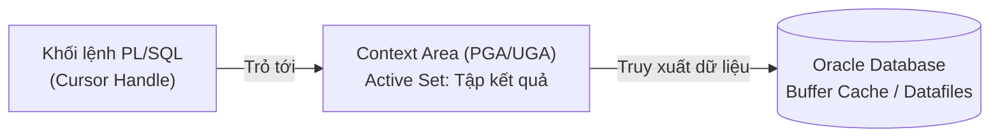
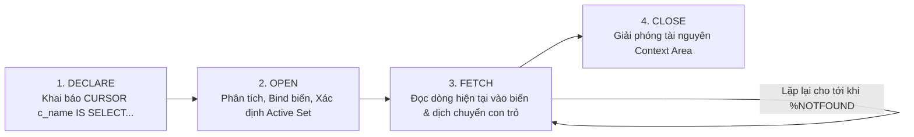

# Chương 22: Cursor trong PL/SQL (Implicit, Explicit, FOR UPDATE & REF CURSOR) - OCP PL/SQL (1Z0-149)

> **Tài liệu tham chiếu:** *OCA/OCP Oracle Database 12c/19c/21c Program with PL/SQL Exam Guide (Exam 1Z0-149)* & *Oracle Database PL/SQL Language Reference*.  
> **Mục tiêu khảo thí:** Phân biệt Implicit và Explicit Cursor; Sử dụng thành thạo các thuộc tính con trỏ (`%FOUND`, `%NOTFOUND`, `%ROWCOUNT`, `%ISOPEN`); Quản lý vòng đời Explicit Cursor (`DECLARE`, `OPEN`, `FETCH`, `CLOSE`); Tối ưu với `Cursor FOR Loop`; Xây dựng Parameterized Cursor; Khóa và cập nhật dòng với `FOR UPDATE` & `WHERE CURRENT OF`; Lập trình động với `REF CURSOR` (`SYS_REFCURSOR`) trả kết quả cho ứng dụng Client.

---

## 📑 Mục Lục Chi Tiết

1. [Tổng Quan Về Cursor & Context Area Trong Bộ Nhớ Oracle](#1-tổng-quan-về-cursor--context-area-trong-bộ-nhớ-oracle)
2. [Con Trỏ Ngầm Định (Implicit Cursor) & Thuộc Tính `SQL%`](#2-con-trỏ-ngầm-định-implicit-cursor--thuộc-tính-sql)
3. [Con Trỏ Tường Minh (Explicit Cursor): Vòng Đời 4 Bước](#3-con-trỏ-tường-minh-explicit-cursor-vòng-đời-4-bước)
4. [Các Thuộc Tính Của Explicit Cursor & Ma Trận Trạng Thái](#4-các-thuộc-tính-của-explicit-cursor--ma-trận-trạng-thái)
5. [Vòng Lặp Con Trỏ Tự Động (`Cursor FOR Loop`)](#5-vòng-lặp-con-trỏ-tự-động-cursor-for-loop)
6. [Con Trỏ Có Tham Số (Parameterized Cursor)](#6-con-trỏ-có-tham-số-parameterized-cursor)
7. [Con Trỏ Khóa Bản Ghi (`FOR UPDATE`) & `WHERE CURRENT OF`](#7-con-trỏ-khóa-bản-ghi-for-update--where-current-of)
8. [Biến Con Trỏ (`REF CURSOR` & `SYS_REFCURSOR`)](#8-biến-con-trỏ-ref-cursor--sys_refcursor)
9. [Bài Tập Thực Hành Tự Luyện (Kèm Lời Giải Chi Tiết)](#9-bài-tập-thực-hành-tự-luyện-kèm-lời-giải-chi-tiết)
10. [Tổng Hợp Bẫy Thi OCP Cốt Lõi Cần Nhớ (Exam Essentials)](#10-tổng-hợp-bẫy-thi-ocp-cốt-lõi-cần-nhớ-exam-essentials)

---

## 1. Tổng Quan Về Cursor & Context Area Trong Bộ Nhớ Oracle

Khi một câu lệnh SQL (`SELECT`, `INSERT`, `UPDATE`, `DELETE`, `MERGE`) được thực thi bên trong khối PL/SQL, Oracle Database cấp phát một vùng nhớ riêng trong **PGA (Program Global Area)** hoặc **Shared SQL Area (UGA)** được gọi là **Context Area** (Vùng ngữ cảnh).

* **Context Area** lưu trữ:
  1. Câu lệnh SQL đã được phân tích cú pháp (parsed statement) và kế hoạch thực thi (execution plan).
  2. Địa chỉ các biến liên kết (Bind Variables) đầu vào.
  3. Số lượng dòng đã được xử lý bởi câu lệnh SQL.
  4. Tập hợp các dòng đang hoạt động (**Active Set**) được trả về bởi câu truy vấn `SELECT`.

* **Cursor (Con trỏ)** chính là một **con trỏ bộ nhớ (pointer/handle)** trỏ tới vùng **Context Area** này, cho phép chương trình PL/SQL đặt tên, kiểm soát và duyệt qua từng dòng dữ liệu (row-by-row processing) trong Active Set.



### Phân loại Cursor trong PL/SQL
Oracle PL/SQL chia Cursor thành 2 nhóm chính (và mở rộng thêm biến con trỏ):

| Tiêu chí so sánh | Implicit Cursor (Con trỏ ngầm định) | Explicit Cursor (Con trỏ tường minh) | `REF CURSOR` (Biến con trỏ) |
| :--- | :--- | :--- | :--- |
| **Ai quản lý?** | PL/SQL Engine tự động tạo, mở, nạp và đóng. | Lập trình viên tự khai báo và điều khiển (`OPEN`/`FETCH`/`CLOSE`). | Lập trình viên khai báo biến con trỏ trỏ động tới câu SQL lúc Runtime. |
| **Áp dụng cho** | Mọi lệnh DML (`INSERT`, `UPDATE`, `DELETE`, `MERGE`) và `SELECT ... INTO` (trả về đúng 1 dòng). | Câu lệnh `SELECT` trả về **nhiều dòng** (0, 1 hoặc N dòng). | Câu lệnh `SELECT` động hoặc tĩnh cần truyền qua lại giữa các tầng (PL/SQL ↔ Java/.NET). |
| **Tên định danh** | Luôn dùng từ khóa cố định `SQL`. | Tên do người dùng đặt (ví dụ: `c_emp`). | Tên biến kiểu `REF CURSOR` / `SYS_REFCURSOR`. |
| **Lưu trữ trong Package Spec** | Không áp dụng. | Được phép khai báo toàn cục trong Package. | **Không** được khai báo biến `REF CURSOR` ở cấp Package (Session state). |

---

## 2. Con Trỏ Ngầm Định (Implicit Cursor) & Thuộc Tính `SQL%`

Mỗi khi bạn chạy một lệnh DML (`INSERT`, `UPDATE`, `DELETE`, `MERGE`) hoặc một lệnh `SELECT ... INTO` mà không khai báo con trỏ tường minh, Oracle tự động mở một **Implicit Cursor** có tên là **`SQL`**.

### 2.1. Bốn thuộc tính của Implicit Cursor (`SQL%`)
Bạn có thể kiểm tra kết quả của câu lệnh SQL **vừa mới thực thi gần nhất** thông qua 4 thuộc tính sau:

| Thuộc tính | Kiểu trả về | Ý nghĩa chi tiết | Giá trị trước khi chạy bất kỳ lệnh SQL nào trong Session |
| :--- | :---: | :--- | :---: |
| **`SQL%FOUND`** | `BOOLEAN` | Trả về `TRUE` nếu lệnh DML hoặc `SELECT INTO` gần nhất tác động/lấy được **ít nhất 1 dòng** ($\ge 1$ dòng). Ngược lại trả về `FALSE`. | `NULL` |
| **`SQL%NOTFOUND`** | `BOOLEAN` | Ngược lại với `SQL%FOUND`: Trả về `TRUE` nếu lệnh DML gần nhất **không tác động dòng nào** ($0$ dòng). | `NULL` |
| **`SQL%ROWCOUNT`** | `PLS_INTEGER` | Trả về **số lượng dòng** bị tác động bởi lệnh DML gần nhất hoặc được trả về bởi `SELECT INTO`. | `NULL` |
| **`SQL%ISOPEN`** | `BOOLEAN` | Luôn luôn trả về **`FALSE`** vì Oracle tự động đóng Implicit Cursor ngay sau khi câu lệnh SQL hoàn tất thực thi. | `FALSE` |

> [!IMPORTANT]
> **Quy tắc vàng trong kỳ thi OCP 1Z0-149:**
> 1. **`SQL%ISOPEN` luôn bằng `FALSE`** ở mọi vị trí trong code PL/SQL của bạn.
> 2. Các thuộc tính `SQL%` luôn phản ánh trạng thái của **câu lệnh SQL thực thi gần nhất** (kể cả câu lệnh đó nằm trong một thủ tục con vừa được gọi). Do đó, nếu cần lưu lại số dòng bị ảnh hưởng trước khi chạy lệnh khác, hãy gán ngay `v_cnt := SQL%ROWCOUNT;` vào biến cục bộ!
> 3. Các thuộc tính con trỏ (`SQL%FOUND`, `SQL%ROWCOUNT`, ...) là cấu trúc của **PL/SQL Procedural Engine**, do đó **KHÔNG ĐƯỢC PHÉP sử dụng trực tiếp bên trong câu lệnh SQL** (ví dụ: `SELECT SQL%ROWCOUNT FROM dual;` hoặc `UPDATE ... WHERE x = SQL%ROWCOUNT` sẽ báo lỗi biên dịch `PLS-00201`).

### 2.2. Ví dụ thực tế với Implicit Cursor trong DML

```sql
SET SERVEROUTPUT ON;
DECLARE
    v_rows_updated PLS_INTEGER;
BEGIN
    -- Cập nhật lương cho nhân viên phòng 20
    UPDATE employees
    SET salary = salary * 1.05
    WHERE department_id = 20;

    -- Lưu ngay giá trị SQL%ROWCOUNT vào biến trước khi chạy lệnh khác
    v_rows_updated := SQL%ROWCOUNT;

    IF SQL%FOUND THEN
        DBMS_OUTPUT.PUT_LINE('Đã tăng lương thành công cho ' || v_rows_updated || ' nhân viên.');
    ELSIF SQL%NOTFOUND THEN
        DBMS_OUTPUT.PUT_LINE('Không có nhân viên nào thuộc phòng 20!');
    END IF;

    IF NOT SQL%ISOPEN THEN
        DBMS_OUTPUT.PUT_LINE('Trạng thái SQL%ISOPEN luôn là FALSE.');
    END IF;
    
    ROLLBACK;
END;
/
```
**Kết quả đầu ra (Output):**
```text
Đã tăng lương thành công cho 2 nhân viên.
Trạng thái SQL%ISOPEN luôn là FALSE.
```

> [!WARNING]
> **Bẫy thi với `SELECT ... INTO` và `SQL%NOTFOUND`:**
> Nếu bạn viết:
> ```sql
> SELECT salary INTO v_sal FROM employees WHERE employee_id = 99999;
> IF SQL%NOTFOUND THEN
>     DBMS_OUTPUT.PUT_LINE('Không tìm thấy!');
> END IF;
> ```
> Khối `IF SQL%NOTFOUND` sẽ **KHÔNG BAO GIỜ chạy tới được**! Lý do: Khi `SELECT ... INTO` trả về 0 dòng, PL/SQL lập tức ném ra ngoại lệ **`NO_DATA_FOUND`** (`ORA-01403`) và nhảy thẳng xuống khối `EXCEPTION`, bỏ qua toàn bộ các câu lệnh phía sau. (Tương tự, nếu `SELECT ... INTO` trả về $\ge 2$ dòng, nó ném **`TOO_MANY_ROWS`** `ORA-01422`, và tại khối `EXCEPTION` lúc đó `SQL%ROWCOUNT` có giá trị bằng `1`).

---

## 3. Con Trỏ Tường Minh (Explicit Cursor): Vòng Đời 4 Bước

Khi câu truy vấn `SELECT` có thể trả về **nhiều hơn 1 dòng** (hoặc khi bạn muốn chủ động kiểm soát trường hợp trả về 0 dòng mà không bị ném ngoại lệ `NO_DATA_FOUND`), bạn sử dụng **Explicit Cursor**.

### 3.1. Sơ đồ vòng đời 4 bước của Explicit Cursor



1. **Bước 1 — `DECLARE` (Khai báo trong phần Declaration):**
   * Cú pháp: `CURSOR cursor_name IS select_statement;`
   * Lưu ý: Câu lệnh `SELECT` trong khai báo Cursor **không có mệnh đề `INTO`**. Lúc này chưa có bất kỳ truy vấn nào được gửi tới Database.
2. **Bước 2 — `OPEN` (Mở con trỏ trong phần Executable):**
   * Cú pháp: `OPEN cursor_name;`
   * Khi gọi `OPEN`: Oracle cấp phát bộ nhớ Context Area, đọc giá trị hiện tại của các biến truyền vào câu truy vấn, thực thi câu lệnh `SELECT`, và xác định tập kết quả (**Active Set**). Con trỏ được đặt ngay trước dòng đầu tiên.
   * **Đảm bảo tính nhất quán đọc (Read Consistency - SCN):** Tập kết quả Active Set được chốt tại thời điểm (**SCN - System Change Number**) câu lệnh `OPEN` được thực thi! Mọi thay đổi (`INSERT`/`UPDATE`/`DELETE` + `COMMIT`) xảy ra trên bảng sau thời điểm `OPEN` sẽ **không** làm thay đổi tập kết quả mà Cursor đang duyệt.
3. **Bước 3 — `FETCH` (Nạp từng dòng dữ liệu):**
   * Cú pháp: `FETCH cursor_name INTO variable_list | record_variable;`
   * Mỗi lệnh `FETCH` lấy đúng **1 dòng hiện tại** gán vào biến đích, sau đó đẩy vị trí con trỏ xuống dòng kế tiếp.
   * Nếu đã hết dòng để đọc mà vẫn gọi `FETCH`: Oracle **KHÔNG báo lỗi**, mà chỉ bật cờ `cursor_name%NOTFOUND := TRUE` và **giữ nguyên giá trị cũ của biến đích** từ lần `FETCH` thành công trước đó!
4. **Bước 4 — `CLOSE` (Đóng con trỏ):**
   * Cú pháp: `CLOSE cursor_name;`
   * Giải phóng vùng nhớ Context Area. Số lượng con trỏ mở đồng thời tối đa của một Session bị giới hạn bởi tham số khởi tạo DB **`OPEN_CURSORS`** (nếu vượt quá sẽ bị lỗi `ORA-01000: maximum open cursors exceeded`).

### 3.2. Ví dụ chuẩn mực: Duyệt Explicit Cursor với `LOOP` và `%ROWTYPE`

```sql
SET SERVEROUTPUT ON;
DECLARE
    -- 1. DECLARE: Khai báo con trỏ
    CURSOR c_emp IS
        SELECT employee_id, first_name, salary
        FROM employees
        WHERE department_id = 30
        ORDER BY employee_id;

    -- Khai báo biến Record khớp hoàn toàn với cấu trúc cột của Cursor
    v_emp_rec c_emp%ROWTYPE;
BEGIN
    -- 2. OPEN: Mở con trỏ
    OPEN c_emp;

    LOOP
        -- 3. FETCH: Đọc từng dòng vào biến Record
        FETCH c_emp INTO v_emp_rec;

        -- KIỂM TRA ĐIỀU KIỆN THOÁT NGAY SAU LỆNH FETCH!
        EXIT WHEN c_emp%NOTFOUND;

        DBMS_OUTPUT.PUT_LINE(
            'Row #' || c_emp%ROWCOUNT || ': ID=' || v_emp_rec.employee_id ||
            ', Name=' || v_emp_rec.first_name || ', Sal=' || v_emp_rec.salary
        );
    END LOOP;

    DBMS_OUTPUT.PUT_LINE('Tổng số dòng đã duyệt: ' || c_emp%ROWCOUNT);

    -- 4. CLOSE: Đóng con trỏ
    CLOSE c_emp;
END;
/
```
**Kết quả đầu ra:**
```text
Row #1: ID=114, Name=Den, Sal=11000
Row #2: ID=115, Name=Alexander, Sal=3100
Row #3: ID=116, Name=Shelli, Sal=2900
Row #4: ID=117, Name=Sigal, Sal=2800
Row #5: ID=118, Name=Guy, Sal=2600
Row #6: ID=119, Name=Karen, Sal=2500
Tổng số dòng đã duyệt: 6
```

> [!WARNING]
> **BẪY THI KINH ĐIỂN #1 — Đặt `EXIT WHEN c_emp%NOTFOUND` sai vị trí (sau lệnh xử lý/in ấn):**
> Giả sử bạn viết:
> ```sql
> LOOP
>     FETCH c_emp INTO v_emp_rec;
>     DBMS_OUTPUT.PUT_LINE(v_emp_rec.first_name); -- Đặt TRƯỚC EXIT WHEN!
>     EXIT WHEN c_emp%NOTFOUND;
> END LOOP;
> ```
> **Chuyện gì xảy ra?**
> * Khi `FETCH` xong dòng cuối cùng (dòng thứ 6 - `Karen`), `c_emp%NOTFOUND` vẫn là `FALSE`. Chương trình in ra `Karen` và tiếp tục vòng lặp thứ 7.
> * Ở vòng lặp thứ 7, `FETCH` không còn dòng nào để đọc nên bật `c_emp%NOTFOUND := TRUE`. Tuy nhiên, **biến `v_emp_rec` KHÔNG bị xóa về `NULL` mà vẫn giữ nguyên dữ liệu của dòng thứ 6 (`Karen`)**!
> * Kết quả: **Dòng cuối cùng (`Karen`) bị xử lý / in ra 2 lần!** (Và nếu tập kết quả ban đầu có 0 dòng, chương trình sẽ in ra 1 dòng trống `NULL`).

> [!WARNING]
> **BẪY THI KINH ĐIỂN #2 — Dùng `WHILE c_emp%FOUND LOOP` mà quên `FETCH` mồi trước vòng lặp:**
> ```sql
> OPEN c_emp;
> -- Ngay sau khi OPEN (chưa FETCH lần nào), c_emp%FOUND có giá trị là NULL!
> WHILE c_emp%FOUND LOOP
>     FETCH c_emp INTO v_emp_rec;
>     DBMS_OUTPUT.PUT_LINE(v_emp_rec.first_name);
> END LOOP;
> ```
> **Kết quả:** Vòng lặp `WHILE` **không chạy bất kỳ lần nào** (0 lần)! Vì ngay sau lệnh `OPEN`, chưa có lệnh `FETCH` nào diễn ra nên `c_emp%FOUND` trả về **`NULL`** (không phải `TRUE`). Muốn dùng `WHILE c_emp%FOUND LOOP`, bắt buộc phải có 1 lệnh `FETCH` mồi trước `WHILE` và 1 lệnh `FETCH` ở cuối thân vòng lặp `WHILE`.

> [!TIP]
> **Quy tắc đặt bí danh cột (Column Alias) trong Cursor khi dùng `%ROWTYPE`:**
> Nếu trong câu lệnh `SELECT` của Cursor có các **cột biểu thức tính toán hoặc hàm** (ví dụ: `SELECT employee_id, salary * 12 FROM employees`), bạn **BẮT BUỘC phải đặt Column Alias** (ví dụ: `SELECT employee_id, salary * 12 AS annual_sal FROM employees`) nếu muốn khai báo biến `v_rec c_emp%ROWTYPE;`. Nếu không đặt Alias, trình biên dịch PL/SQL sẽ báo lỗi vì không thể tạo tên trường hợp lệ trong Record cho biểu thức `salary * 12`.

---

## 4. Các Thuộc Tính Của Explicit Cursor & Ma Trận Trạng Thái

Mỗi Explicit Cursor `cur_name` có 4 thuộc tính trạng thái:
1. **`cur_name%ISOPEN`** (`BOOLEAN`): Trả về `TRUE` nếu con trỏ đang mở, `FALSE` nếu chưa mở hoặc đã đóng.
2. **`cur_name%FOUND`** (`BOOLEAN`): Trả về `TRUE` nếu lần `FETCH` gần nhất lấy được dòng dữ liệu; `FALSE` nếu lần `FETCH` gần nhất không lấy được dòng nào; `NULL` nếu đã mở nhưng chưa `FETCH` lần nào.
3. **`cur_name%NOTFOUND`** (`BOOLEAN`): Ngược lại với `%FOUND` (`FALSE` khi `FETCH` có dòng, `TRUE` khi `FETCH` chạm đáy, `NULL` khi vừa `OPEN` chưa `FETCH`).
4. **`cur_name%ROWCOUNT`** (`PLS_INTEGER`): Số lượng dòng **đã được `FETCH` ra tính đến thời điểm hiện tại** (không phải tổng số dòng của câu `SELECT`!). Ngay khi vừa `OPEN`, giá trị của nó bằng **`0`**.

### Bảng Ma Trận Trạng Thái Con Trỏ (Cực kỳ quan trọng trong đề thi OCP)

| Thời điểm kiểm tra | `%ISOPEN` | `%FOUND` | `%NOTFOUND` | `%ROWCOUNT` |
| :--- | :---: | :---: | :---: | :---: |
| **1. Trước khi `OPEN`** | `FALSE` | ❌ **`ORA-01001`** (`INVALID_CURSOR`) | ❌ **`ORA-01001`** (`INVALID_CURSOR`) | ❌ **`ORA-01001`** (`INVALID_CURSOR`) |
| **2. Ngay sau khi `OPEN` (Chưa `FETCH`)** | `TRUE` | **`NULL`** | **`NULL`** | **`0`** |
| **3. Sau khi `FETCH` dòng thứ 1 thành công** | `TRUE` | `TRUE` | `FALSE` | `1` |
| **4. Sau khi `FETCH` dòng thứ $N$ thành công** | `TRUE` | `TRUE` | `FALSE` | $N$ |
| **5. Sau khi `FETCH` vượt quá dòng cuối (Hết dữ liệu)** | `TRUE` | `FALSE` | `TRUE` | $N$ *(Giữ nguyên số dòng đã fetch)* |
| **6. Ngay sau khi `CLOSE`** | `FALSE` | ❌ **`ORA-01001`** (`INVALID_CURSOR`) | ❌ **`ORA-01001`** (`INVALID_CURSOR`) | ❌ **`ORA-01001`** (`INVALID_CURSOR`) |

### Hai Ngoại Lệ Con Trỏ Bắt Buộc Phải Nhớ
1. **`INVALID_CURSOR` (`ORA-01001: invalid cursor`):**
   Xảy ra khi bạn thực hiện một thao tác trên con trỏ **chưa được `OPEN`** hoặc **đã bị `CLOSE`**:
   * Gọi `FETCH` hoặc `CLOSE` trên một con trỏ đang đóng.
   * Truy cập các thuộc tính `%FOUND`, `%NOTFOUND`, hoặc `%ROWCOUNT` khi con trỏ đang đóng (trước `OPEN` hoặc sau `CLOSE`).
   * *Lưu ý:* Duy nhất thuộc tính **`%ISOPEN`** có thể kiểm tra an toàn ở mọi lúc mà không bao giờ gây lỗi `ORA-01001`!
2. **`CURSOR_ALREADY_OPEN` (`ORA-06511: PL/SQL: cursor already open`):**
   Xảy ra khi bạn gọi lệnh `OPEN cur_name;` trên một con trỏ **đang ở trạng thái mở** (chưa `CLOSE`), hoặc cố tình gọi `OPEN` con trỏ bên trong thân vòng lặp `Cursor FOR Loop` đang chạy chính con trỏ đó.

---

## 5. Vòng Lặp Con Trỏ Tự Động (`Cursor FOR Loop`)

Trong thực tế và kỳ thi OCP, thay vì viết thủ công 4 bước `OPEN` -> `FETCH` -> `EXIT WHEN %NOTFOUND` -> `CLOSE`, bạn nên sử dụng **`Cursor FOR Loop`**.

### 5.1. Cơ chế tự động hóa của `Cursor FOR Loop`
Khi bạn viết:
```sql
FOR rec_var IN cursor_name LOOP
    -- Xử lý rec_var
END LOOP;
```
PL/SQL Engine tự động thực hiện 4 việc:
1. **Ngầm định khai báo** biến `rec_var` có kiểu `cursor_name%ROWTYPE` với phạm vi cục bộ chỉ tồn tại bên trong vòng lặp `FOR`.
2. **Tự động `OPEN`** con trỏ khi bắt đầu vào vòng lặp.
3. **Tự động `FETCH`** các dòng dữ liệu vào `rec_var` và tự động thoát khi hết dữ liệu (`%NOTFOUND`).
   > [!TIP]
   > **Tối ưu hiệu năng ngầm định (Array Fetch 100 dòng):** Với biến thể `Cursor FOR Loop` từ Oracle 10g trở đi (khi mức tối ưu hóa trình biên dịch `PLSQL_OPTIMIZE_LEVEL >= 2` - mặc định), PL/SQL Optimizer tự động biên dịch lại vòng lặp `Cursor FOR Loop` thành lệnh `BULK COLLECT` ngầm định lấy **100 dòng mỗi lần chuyển ngữ cảnh (Context Switch)**! Trong khi đó, vòng lặp `OPEN - FETCH - LOOP` viết tay chỉ lấy đúng **1 dòng** mỗi lần gọi.
4. **Tự động `CLOSE`** con trỏ ngay khi kết thúc vòng lặp — kể cả khi thoát sớm bằng lệnh `EXIT`, `RETURN`, `GOTO`, hoặc khi **bị văng Exception** giữa chừng!

### 5.2. Hai cách viết `Cursor FOR Loop`

#### Cách 1: Duyệt qua Explicit Cursor đã khai báo sẵn
```sql
DECLARE
    CURSOR c_dept IS
        SELECT department_id, department_name FROM departments WHERE location_id = 1700;
BEGIN
    -- Không cần khai báo r_dept, không cần OPEN, FETCH, CLOSE
    FOR r_dept IN c_dept LOOP
        DBMS_OUTPUT.PUT_LINE(
            'Row #' || c_dept%ROWCOUNT || ': ' || r_dept.department_id || ' - ' || r_dept.department_name
        );
    END LOOP;
    -- Tại đây c_dept đã tự động đóng (c_dept%ISOPEN = FALSE)
END;
/
```

#### Cách 2: Inline Subquery trong `Cursor FOR Loop` (Không cần khai báo Cursor ở `DECLARE`)
```sql
BEGIN
    FOR r_emp IN (
        SELECT employee_id, first_name, salary * 12 AS annual_sal
        FROM employees
        WHERE department_id = 10
    ) LOOP
        DBMS_OUTPUT.PUT_LINE(r_emp.first_name || ' hưởng lương năm: ' || r_emp.annual_sal);
    END LOOP;
END;
/
```

> [!WARNING]
> **3 Bẫy thi với `Cursor FOR Loop`:**
> 1. **Truy cập biến chỉ mục `r_dept` bên ngoài vòng lặp `FOR`:** Biến `r_dept` chỉ tồn tại bên trong vòng lặp. Truy cập `r_dept.department_name` sau dòng `END LOOP;` sẽ gây **lỗi biên dịch `PLS-00201: identifier 'R_DEPT' must be declared`**.
> 2. **Truy cập thuộc tính con trỏ trong Inline Subquery FOR Loop:** Nếu bạn dùng câu truy vấn trực tiếp `FOR r_emp IN (SELECT ...) LOOP`, con trỏ này không có tên nên bạn **không thể kiểm tra `%ROWCOUNT`** (Và tuyệt đối không được nhầm dùng `SQL%ROWCOUNT`, vì `SQL%` chỉ dành cho Implicit Cursor, không phản ánh số dòng của `FOR r_emp IN (SELECT ...)`!).
> 3. **Kiểm tra `c_dept%ROWCOUNT` sau `END LOOP;`:** Ngay khi thoát khỏi `FOR r_dept IN c_dept LOOP`, con trỏ `c_dept` đã bị đóng tự động. Nếu sau `END LOOP;` bạn gọi `DBMS_OUTPUT.PUT_LINE(c_dept%ROWCOUNT);`, chương trình sẽ ném lỗi Runtime **`ORA-01001: invalid cursor`**!

---

## 6. Con Trỏ Có Tham Số (Parameterized Cursor)

Bạn có thể định nghĩa Explicit Cursor nhận tham số đầu vào để tái sử dụng cùng một câu truy vấn cho nhiều giá trị lọc khác nhau.

### 6.1. Cú pháp và Quy tắc Khai báo

```sql
CURSOR cursor_name (
    param_1 [IN] datatype [{:= | DEFAULT} default_value],
    param_2 [IN] datatype [{:= | DEFAULT} default_value]
) IS
    select_statement;
```

> [!IMPORTANT]
> **4 Quy tắc bắt buộc của Parameterized Cursor trong đề thi OCP:**
> 1. **Không được chỉ định kích thước/độ dài cho kiểu dữ liệu của tham số:**
>    * Đúng: `CURSOR c_emp (p_dept_id NUMBER, p_job VARCHAR2) IS ...`
>    * Sai (Lỗi biên dịch `PLS-00103`): `CURSOR c_emp (p_dept_id NUMBER(4), p_job VARCHAR2(10)) IS ...`
> 2. **Chế độ tham số chỉ được phép là `IN` (mặc định):**
>    * Con trỏ không thể trả dữ liệu ra qua tham số. Do đó, sử dụng `OUT` hoặc `IN OUT` trong khai báo tham số Cursor sẽ gây **lỗi biên dịch**.
> 3. **Hỗ trợ giá trị mặc định (`DEFAULT` hoặc `:=`):**
>    * Nếu tất cả các tham số của Cursor đều có giá trị mặc định, bạn có thể gọi `OPEN c_emp;` hoặc `OPEN c_emp();` mà không cần truyền đối số.
>    * Hỗ trợ truyền đối số theo vị trí (Positional) và theo tên (`Named Notation =>`).
> 4. **Phạm vi tên tham số:** Tham số của Cursor chỉ có phạm vi bên trong câu lệnh `SELECT` của Cursor đó. Nếu tên tham số trùng với tên cột của bảng (ví dụ tham số tên là `department_id` viết `WHERE department_id = department_id`), tên cột sẽ được ưu tiên hoặc gây nhầm lẫn logic (luôn đúng `1=1`). Do đó luôn đặt tiền tố `p_` cho tham số Cursor!

### 6.2. Ví dụ Parameterized Cursor kết hợp `Cursor FOR Loop`

```sql
SET SERVEROUTPUT ON;
DECLARE
    CURSOR c_emp_by_dept (
        p_dept_id NUMBER DEFAULT 60,
        p_min_sal NUMBER := 5000
    ) IS
        SELECT employee_id, first_name, salary
        FROM employees
        WHERE department_id = p_dept_id
          AND salary >= p_min_sal;
BEGIN
    DBMS_OUTPUT.PUT_LINE('--- Lần 1: Dùng giá trị mặc định (Phòng 60, Lương >= 5000) ---');
    FOR r IN c_emp_by_dept LOOP
        DBMS_OUTPUT.PUT_LINE(r.first_name || ': ' || r.salary);
    END LOOP;

    DBMS_OUTPUT.PUT_LINE('--- Lần 2: Truyền tham số theo tên (Phòng 90, Lương >= 15000) ---');
    FOR r IN c_emp_by_dept(p_min_sal => 15000, p_dept_id => 90) LOOP
        DBMS_OUTPUT.PUT_LINE(r.first_name || ': ' || r.salary);
    END LOOP;
END;
/
```

---

## 7. Con Trỏ Khóa Bản Ghi (`FOR UPDATE`) & `WHERE CURRENT OF`

Mặc định, câu lệnh `SELECT` trong Oracle không đặt bất kỳ khóa (lock) nào lên các dòng dữ liệu được đọc. Nếu bạn duyệt qua một Cursor với mục đích **cập nhật (`UPDATE`) hoặc xóa (`DELETE`) chính những dòng vừa đọc**, bạn cần ngăn chặn các Session khác sửa đổi các dòng đó trong lúc bạn đang xử lý.

### 7.1. Mệnh đề `FOR UPDATE` trong khai báo Cursor

```sql
CURSOR cursor_name IS
    SELECT ...
    FROM ...
    FOR UPDATE [OF schema.table.column_name] [NOWAIT | WAIT n | SKIP LOCKED];
```

* **Khi nào các dòng bị khóa?**
  Các dòng thỏa mãn câu truy vấn sẽ bị khóa độc quyền cấp dòng (**Row-level Exclusive Lock - TX Lock**) **ngay tại thời điểm thực thi lệnh `OPEN cursor_name`** (chứ không phải đợi tới lúc `FETCH` từng dòng!).
* **Các tùy chọn xử lý tranh chấp khóa (Lock Contention):**
  * **Mặc định (Không ghi gì sau `FOR UPDATE`):** Nếu có bất kỳ dòng nào đang bị Session khác khóa, Session hiện tại sẽ **treo và chờ vô thời hạn** cho đến khi Session kia `COMMIT` hoặc `ROLLBACK`.
  * **`FOR UPDATE NOWAIT`:** Nếu dòng đang bị khóa bởi Session khác, lập tức trả về lỗi **`ORA-00054: resource busy and acquire with NOWAIT specified`** mà không chờ.
  * **`FOR UPDATE WAIT n`:** Chờ tối đa `n` giây. Nếu sau `n` giây vẫn chưa lấy được khóa, trả về lỗi **`ORA-30006: resource busy; acquire with WAIT timeout expired`**.
  * **`FOR UPDATE SKIP LOCKED`:** Bỏ qua các dòng đang bị khóa bởi Session khác, chỉ khóa và trả về các dòng đang rảnh.
* **Ý nghĩa của `FOR UPDATE OF column_name` khi truy vấn JOIN nhiều bảng:**
  * Nếu câu `SELECT` trong Cursor nối (`JOIN`) từ 2 bảng trở lên (ví dụ `employees e JOIN departments d`) và bạn chỉ ghi `FOR UPDATE` chung chung: Oracle sẽ **khóa các dòng trên TẤT CẢ các bảng** tham gia trong mệnh đề `FROM`!
  * Nếu bạn ghi `FOR UPDATE OF e.salary` (chỉ định một cột bất kỳ thuộc bảng `employees`): Oracle sẽ **chỉ khóa các dòng trên bảng `employees`**, còn bảng `departments` không bị khóa. (Lưu ý: tên cột sau `OF` chỉ dùng để định danh **bảng nào** cần khóa, bản thân khóa trong Oracle luôn là khóa nguyên dòng - Row-level lock, không có khóa cấp cột!).

### 7.2. Mệnh đề `WHERE CURRENT OF cursor_name`

Khi Cursor đã được khai báo với `FOR UPDATE`, bạn có thể dùng mệnh đề `WHERE CURRENT OF cursor_name` trong lệnh `UPDATE` hoặc `DELETE` để tác động trực tiếp lên **dòng vừa được `FETCH` gần nhất** thông qua địa chỉ vật lý `ROWID` nội bộ mà không cần tra cứu lại qua khóa chính `WHERE employee_id = ...`.

```sql
SET SERVEROUTPUT ON;
DECLARE
    CURSOR c_sal IS
        SELECT e.employee_id, e.salary, d.department_name
        FROM employees e
        JOIN departments d ON e.department_id = d.department_id
        WHERE e.department_id = 30
        FOR UPDATE OF e.salary NOWAIT; -- Chỉ khóa các dòng trên bảng employees
BEGIN
    FOR r_sal IN c_sal LOOP
        IF r_sal.salary < 3000 THEN
            -- Cập nhật chính xác dòng vừa được FETCH thông qua ROWID nội bộ
            UPDATE employees
            SET salary = salary * 1.10
            WHERE CURRENT OF c_sal;
        END IF;
    END LOOP;
    
    -- Chỉ COMMIT sau khi đã thoát hoàn toàn khỏi vòng lặp Cursor!
    COMMIT;
END;
/
```

> [!WARNING]
> **BẪY THI SỐ 1 VỀ `FOR UPDATE` — Lỗi `ORA-01002: fetch out of sequence`:**
> * Mọi khóa dòng (`FOR UPDATE`) sẽ bị **giải phóng ngay lập tức** khi giao dịch kết thúc bằng lệnh **`COMMIT`** hoặc **`ROLLBACK`**.
> * Do đó, nếu bạn thực hiện **`COMMIT` hoặc `ROLLBACK` ngay bên trong vòng lặp** đang duyệt một Cursor có mệnh đề `FOR UPDATE`, các khóa và vị trí `ROWID` của con trỏ sẽ bị vô hiệu hóa. Ở lần lặp kế tiếp, khi lệnh `FETCH` được gọi, Oracle sẽ lập tức ném lỗi Runtime:
>   **`ORA-01002: fetch out of sequence`**!
> * **Giải pháp:** Luôn đặt `COMMIT` **sau khi đã thoát khỏi vòng lặp** Cursor. Nếu bắt buộc phải `COMMIT` theo từng lô trong vòng lặp, tuyệt đối **không dùng `FOR UPDATE`**, mà hãy lấy cột `ROWID` (hoặc khóa chính `PK`) trong câu `SELECT` và cập nhật bằng `WHERE rowid = r.rid`.

---

## 8. Biến Con Trỏ (`REF CURSOR` & `SYS_REFCURSOR`)

### 8.1. Tại sao cần `REF CURSOR`?
Một **Explicit Cursor tĩnh** (`CURSOR c_emp IS SELECT ...`) bị gắn cứng (hard-coded) với duy nhất một câu lệnh `SELECT` tại thời điểm biên dịch và không thể truyền như một tham số đầu ra trả về cho ứng dụng Client.

**`REF CURSOR` (Cursor Variable - Biến con trỏ)** là một con trỏ thực thụ (pointer) trỏ tới vùng nhớ Context Area ở phía Server:
1. Một biến `REF CURSOR` có thể được mở (`OPEN ... FOR`) cho **nhiều câu lệnh `SELECT` khác nhau** (thậm chí cả chuỗi SQL động) tại thời điểm chạy (Runtime).
2. Biến `REF CURSOR` có thể được truyền làm tham số `IN OUT` hoặc `OUT` của Procedure/Function để **trả tập kết quả (ResultSet) từ Database về cho ứng dụng Backend (Java JDBC, .NET, Python)**.

### 8.2. Phân biệt Strong `REF CURSOR` và Weak `REF CURSOR`

| Đặc điểm | Strong `REF CURSOR` (Có kiểu trả về - Restrictive) | Weak `REF CURSOR` (Không kiểu trả về - Non-restrictive) |
| :--- | :--- | :--- |
| **Cú pháp khai báo kiểu** | `TYPE t_ref IS REF CURSOR RETURN record_or_rowtype;` | `TYPE t_ref IS REF CURSOR;` *(Không có mệnh đề `RETURN`)* hoặc dùng sẵn **`SYS_REFCURSOR`**. |
| **Kiểm tra kiểu lúc Compile** | **Có:** Câu lệnh `SELECT` trong `OPEN ... FOR` bắt buộc phải có danh sách cột khớp hoàn toàn với kiểu `RETURN` ngay lúc biên dịch. | **Không:** Có thể mở cho bất kỳ câu truy vấn `SELECT` nào với số lượng và kiểu cột tùy ý. |
| **Hỗ trợ Dynamic SQL (`OPEN ... FOR 'string'`)** | ❌ **KHÔNG HỖ TRỢ** (Gây lỗi biên dịch `PLS-00455: cursor '...' cannot be used in dynamic SQL OPEN statement`). | ✅ **HỖ TRỢ HOÀN TOÀN** chuỗi truy vấn động kèm `USING bind_vars`. |
| **Khả năng gặp lỗi Runtime** | Thấp (đã kiểm tra kiểu lúc biên dịch). | Có thể ném ngoại lệ **`ROWTYPE_MISMATCH` (`ORA-06504`)** lúc `FETCH` nếu biến đích không tương thích với các cột của câu `SELECT`. |

> [!TIP]
> **Kiểu dựng sẵn `SYS_REFCURSOR`:**
> Trong gói chuẩn `STANDARD`, Oracle đã định nghĩa sẵn:
> `TYPE SYS_REFCURSOR IS REF CURSOR;`
> Do đó, bạn không cần tự khai báo `TYPE ... IS REF CURSOR;` nữa mà có thể khai báo trực tiếp biến hoặc tham số kiểu **`SYS_REFCURSOR`**.

### 8.3. Ví dụ: Strong vs Weak `REF CURSOR` và Mở Lại Con Trỏ

```sql
SET SERVEROUTPUT ON;
DECLARE
    -- 1. Khai báo kiểu Strong REF CURSOR (Bắt buộc trả về cấu trúc bảng departments)
    TYPE t_strong_dept_rc IS REF CURSOR RETURN departments%ROWTYPE;
    v_strong_rc t_strong_dept_rc;
    v_dept_rec  departments%ROWTYPE;

    -- 2. Khai báo biến Weak REF CURSOR bằng kiểu dựng sẵn SYS_REFCURSOR
    v_weak_rc   SYS_REFCURSOR;
    v_name      VARCHAR2(100);
    v_sal       NUMBER;
BEGIN
    -- Sử dụng Strong REF CURSOR với câu SELECT tĩnh
    OPEN v_strong_rc FOR
        SELECT * FROM departments WHERE department_id = 10;
    FETCH v_strong_rc INTO v_dept_rec;
    DBMS_OUTPUT.PUT_LINE('Strong RC Dept: ' || v_dept_rec.department_name);
    CLOSE v_strong_rc;

    -- Sử dụng Weak REF CURSOR (SYS_REFCURSOR) với câu SELECT thứ nhất
    OPEN v_weak_rc FOR
        SELECT department_name FROM departments WHERE department_id = 20;
    FETCH v_weak_rc INTO v_name;
    DBMS_OUTPUT.PUT_LINE('Weak RC (Query 1 - Dept): ' || v_name);

    -- ĐẶC QUYỀN CỦA REF CURSOR: Có thể OPEN lại ngay cho câu SELECT khác
    -- (kể cả Dynamic SQL với USING) mà KHÔNG CẦN CLOSE trước (không bị lỗi ORA-06511)!
    OPEN v_weak_rc FOR
        'SELECT first_name, salary FROM employees WHERE employee_id = :id'
        USING 100;
    FETCH v_weak_rc INTO v_name, v_sal;
    DBMS_OUTPUT.PUT_LINE('Weak RC (Query 2 - Emp): ' || v_name || ' - ' || v_sal);

    CLOSE v_weak_rc;
END;
/
```

### 8.4. Ứng dụng thực tế: Trả `SYS_REFCURSOR` về cho Java / .NET Backend

```sql
CREATE OR REPLACE PROCEDURE sp_get_employees_by_dept (
    p_dept_id IN  employees.department_id%TYPE,
    p_emp_rc  OUT SYS_REFCURSOR
) IS
BEGIN
    -- Mở con trỏ trỏ tới vùng kết quả
    OPEN p_emp_rc FOR
        SELECT employee_id, first_name, last_name, salary
        FROM employees
        WHERE department_id = p_dept_id
        ORDER BY employee_id;

    -- ⚠️ TUYỆT ĐỐI KHÔNG GỌI "CLOSE p_emp_rc;" Ở ĐÂY!
    -- Nếu đóng tại đây, ứng dụng Java/.NET khi đọc ResultSet sẽ bị lỗi ORA-01001 (Invalid Cursor)
    -- hoặc "Cursor is closed"! Client (JDBC ResultSet.close()) sẽ chịu trách nhiệm đóng con trỏ này.
END sp_get_employees_by_dept;
/
```

> [!IMPORTANT]
> **Các hạn chế và quy tắc đặc biệt của `REF CURSOR` trong đề thi OCP:**
> 1. **Mở lại `REF CURSOR` đang mở:** Khác với Explicit Cursor tĩnh (gọi `OPEN` khi chưa `CLOSE` sẽ bị lỗi `ORA-06511: cursor already open`), nếu bạn gọi `OPEN v_rc FOR ...` trên một biến `REF CURSOR` đang mở, Oracle sẽ **tự động đóng truy vấn cũ và mở truy vấn mới** mà không báo lỗi!
> 2. **Chia sẻ vùng nhớ con trỏ (Pointer Aliasing):** Nếu gán `v_rc2 := v_rc1;`, cả hai biến con trỏ **cùng trỏ vào duy nhất một Context Area**. Nếu bạn `OPEN`, `FETCH` hoặc `CLOSE` trên `v_rc1`, trạng thái của `v_rc2` cũng thay đổi y hệt (`v_rc2%ISOPEN`, `v_rc2%ROWCOUNT` phản ánh tức thì)!
> 3. **Không dùng được trong `Cursor FOR Loop`:** Bạn **KHÔNG THỂ** viết `FOR r IN v_ref_cursor LOOP`. Biến `REF CURSOR` bắt buộc phải duyệt bằng `LOOP ... FETCH v_ref_cursor INTO ... EXIT WHEN v_ref_cursor%NOTFOUND; END LOOP;`.
> 4. **Cấm khai báo biến `REF CURSOR` ở cấp Package:** Bạn có thể khai báo kiểu `TYPE t_rc IS REF CURSOR;` trong Package Specification, nhưng **không được phép khai báo biến `v_rc SYS_REFCURSOR;`** nằm ở phần toàn cục của Package Spec hoặc Package Body (lỗi `PLS-00994: Cursor Variables cannot be declared as part of a package`).
> 5. **Cấm so sánh biến `REF CURSOR`:** Không thể dùng toán tử `=`, `<>`, `<`, `>` để so sánh 2 biến `REF CURSOR` (chỉ có thể kiểm tra `IS NULL` hoặc `IS NOT NULL`).
> 6. **Cấm dùng `FOR UPDATE` với `WHERE CURRENT OF` trên `REF CURSOR`.**

---

## 9. Bài Tập Thực Hành Tự Luyện (Kèm Lời Giải Chi Tiết)

### Bài tập 1: Bẫy vòng lặp Explicit Cursor và `%ROWCOUNT`
Hãy dự đoán kết quả in ra màn hình của khối lệnh sau (giả sử bảng `departments` có đúng **3 phòng ban** thỏa điều kiện `location_id = 1800` là `'Marketing'`, `'Sales'`, `'IT'`):
```sql
DECLARE
    CURSOR c_dept IS
        SELECT department_name FROM departments WHERE location_id = 1800 ORDER BY 1;
    v_name departments.department_name%TYPE;
BEGIN
    OPEN c_dept;
    DBMS_OUTPUT.PUT_LINE('Start Rowcount: ' || c_dept%ROWCOUNT);
    LOOP
        FETCH c_dept INTO v_name;
        DBMS_OUTPUT.PUT_LINE('Fetched: ' || v_name || ' | Count: ' || c_dept%ROWCOUNT);
        EXIT WHEN c_dept%NOTFOUND;
    END LOOP;
    CLOSE c_dept;
END;
/
```

<details>
<summary><b>👉 Xem Lời Giải Chi Tiết Bài Tập 1</b></summary>

1. Ngay sau `OPEN c_dept;`, chưa có dòng nào được `FETCH` nên `c_dept%ROWCOUNT` bằng **`0`**. In ra: `Start Rowcount: 0`.
2. Vòng lặp 1: `FETCH` dòng 1 (`IT`) -> In ra: `Fetched: IT | Count: 1`. `%NOTFOUND` là `FALSE`.
3. Vòng lặp 2: `FETCH` dòng 2 (`Marketing`) -> In ra: `Fetched: Marketing | Count: 2`. `%NOTFOUND` là `FALSE`.
4. Vòng lặp 3: `FETCH` dòng 3 (`Sales`) -> In ra: `Fetched: Sales | Count: 3`. `%NOTFOUND` là `FALSE`.
5. Vòng lặp 4: `FETCH` lần thứ 4 không còn dòng nào -> `%NOTFOUND` chuyển thành `TRUE`, nhưng biến `v_name` **vẫn giữ giá trị `'Sales'`** và `%ROWCOUNT` **vẫn giữ giá trị `3`**. Do lệnh `DBMS_OUTPUT.PUT_LINE` nằm **trước** `EXIT WHEN c_dept%NOTFOUND`, nó sẽ in thêm 1 dòng bị lặp: `Fetched: Sales | Count: 3` rồi mới thoát!
</details>

---

### Bài tập 2: Viết thủ tục cập nhật lương dùng `FOR UPDATE` và trả về `SYS_REFCURSOR`
Hãy viết một khối PL/SQL hoặc thủ tục thực hiện:
1. Duyệt qua tất cả nhân viên thuộc phòng ban `p_dept_id` bằng con trỏ có tham số và khóa các dòng này (nếu đang bị người khác khóa thì chờ tối đa 5 giây).
2. Tăng `10%` lương cho những nhân viên có lương dưới `5000` bằng mệnh đề `WHERE CURRENT OF`.
3. Mở một `SYS_REFCURSOR` trả về danh sách nhân viên của phòng ban đó sau khi cập nhật.

<details>
<summary><b>👉 Xem Lời Giải Chi Tiết Bài Tập 2</b></summary>

```sql
CREATE OR REPLACE PROCEDURE sp_upgrade_and_list_emp (
    p_dept_id IN  employees.department_id%TYPE,
    p_out_rc  OUT SYS_REFCURSOR
) IS
    -- 1. Khai báo Parameterized Cursor kết hợp FOR UPDATE WAIT 5
    CURSOR c_emp_lock (cp_dept_id NUMBER) IS
        SELECT employee_id, salary
        FROM employees
        WHERE department_id = cp_dept_id
        FOR UPDATE OF salary WAIT 5;
BEGIN
    -- 2. Duyệt bằng Cursor FOR Loop và cập nhật với WHERE CURRENT OF
    FOR r_emp IN c_emp_lock(p_dept_id) LOOP
        IF r_emp.salary < 5000 THEN
            UPDATE employees
            SET salary = salary * 1.10
            WHERE CURRENT OF c_emp_lock;
        END IF;
    END LOOP;

    -- 3. Mở SYS_REFCURSOR trả kết quả về cho Client (Không gọi CLOSE p_out_rc!)
    OPEN p_out_rc FOR
        SELECT employee_id, first_name, salary
        FROM employees
        WHERE department_id = p_dept_id
        ORDER BY employee_id;
END sp_upgrade_and_list_emp;
/
```
</details>

---

## 10. Tổng Hợp Bẫy Thi OCP Cốt Lõi Cần Nhớ (Exam Essentials)

| # | Chủ đề / Tình huống bẫy trong đề thi OCP 1Z0-149 | Kết quả / Quy tắc chuẩn xác |
| :---: | :--- | :--- |
| **1** | Kiểm tra `SQL%ISOPEN` sau câu lệnh `UPDATE` / `SELECT INTO` | Luôn luôn trả về **`FALSE`** (Oracle tự đóng Implicit Cursor ngay lập tức). |
| **2** | Dùng `IF SQL%NOTFOUND` ngay sau lệnh `SELECT ... INTO` để bắt trường hợp 0 dòng | **Bẫy:** Không bao giờ chạy vào `IF` vì `SELECT INTO` 0 dòng sẽ ném ngoại lệ `NO_DATA_FOUND` ngay lập tức. |
| **3** | Giá trị của `cur%FOUND`, `cur%NOTFOUND`, `cur%ROWCOUNT` ngay sau lệnh `OPEN cur;` (chưa `FETCH`) | `%FOUND` = **`NULL`**, `%NOTFOUND` = **`NULL`**, `%ROWCOUNT` = **`0`**. |
| **4** | Viết `OPEN cur; WHILE cur%FOUND LOOP FETCH ...` (không có `FETCH` trước `WHILE`) | Vòng lặp `WHILE` **chạy 0 lần** vì `cur%FOUND` đang là `NULL`. |
| **5** | Đặt lệnh xử lý trước `EXIT WHEN cur%NOTFOUND` trong `LOOP ... END LOOP` | Dòng dữ liệu cuối cùng bị xử lý **lặp lại 2 lần** (vì `FETCH` thất bại không xóa biến đích về `NULL`). |
| **6** | Kiểm tra `cur%ROWCOUNT` hoặc `cur%FOUND` trước khi `OPEN` hoặc sau khi `CLOSE` | Ném ngoại lệ Runtime **`INVALID_CURSOR` (`ORA-01001`)**. (Chỉ có `cur%ISOPEN` là không báo lỗi). |
| **7** | Gọi `OPEN` lần 2 trên một Explicit Cursor đang mở | Ném ngoại lệ Runtime **`CURSOR_ALREADY_OPEN` (`ORA-06511`)**. |
| **8** | Gọi `OPEN` lần 2 trên một biến `REF CURSOR` (`SYS_REFCURSOR`) đang mở | **Hợp lệ hoàn toàn!** Oracle tự động đóng tập kết quả cũ và mở tập kết quả mới. |
| **9** | Khai báo độ dài kiểu dữ liệu hoặc chế độ `OUT` trong Parameterized Cursor: `CURSOR c(p NUMBER(5))` | **Lỗi biên dịch `PLS-00103`**. Tham số Cursor chỉ nhận kiểu không độ dài (`NUMBER`, `VARCHAR2`) và chỉ ở chế độ `IN`. |
| **10** | Thực hiện `COMMIT` hoặc `ROLLBACK` bên trong vòng lặp của Cursor có `FOR UPDATE` | Ném lỗi Runtime **`ORA-01002: fetch out of sequence`** ở lần `FETCH` tiếp theo. |
| **11** | Dùng Strong `REF CURSOR` (`RETURN type`) cho câu lệnh Dynamic SQL `OPEN rc FOR 'SELECT ...'` | **Lỗi biên dịch `PLS-00455`**. Dynamic SQL bắt buộc phải dùng **Weak `REF CURSOR`** (`SYS_REFCURSOR`). |
| **12** | Duyệt biến `REF CURSOR` bằng `FOR r IN v_ref_cursor LOOP` | **Lỗi biên dịch**. `REF CURSOR` không dùng được trong `Cursor FOR Loop`, phải dùng `FETCH` tường minh. |
| **13** | Gọi `CLOSE p_out_refcursor;` trong Procedure trước khi trả tham số `OUT` về cho Java/.NET | **Lỗi Runtime ở phía Client** (`ORA-01001: invalid cursor`) vì con trỏ đã bị đóng trước khi Client kịp đọc. |
