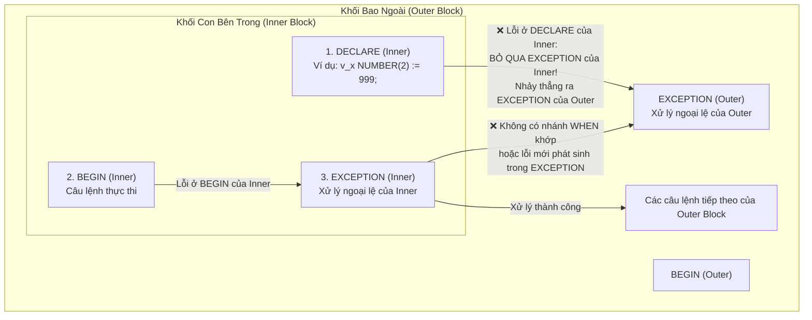

# Chương 24: Exception Handling (Xử Lý Ngoại Lệ Chuyên Sâu Trong PL/SQL) - OCP PL/SQL (1Z0-149)

> **Tài liệu tham chiếu:** *OCA/OCP Oracle Database 12c/19c/21c Program with PL/SQL Exam Guide (Exam 1Z0-149)* & *Oracle Database PL/SQL Language Reference*.  
> **Mục tiêu khảo thí:** Hiểu kiến trúc và luồng xử lý ngoại lệ trong PL/SQL; Phân biệt và vận dụng 3 loại Exception (Predefined, Non-Predefined với `PRAGMA EXCEPTION_INIT`, User-Defined); Sử dụng thành thạo `RAISE`, Re-raise (`RAISE;`), và `RAISE_APPLICATION_ERROR`; Truy vết lỗi với `SQLCODE`, `SQLERRM`, `DBMS_UTILITY.FORMAT_ERROR_BACKTRACE`; Nắm vững quy tắc lan truyền ngoại lệ (Exception Propagation) ở phần `DECLARE` / `EXCEPTION` và tác động của Exception lên Transaction.

---

## 📑 Mục Lục Chi Tiết

1. [Tổng Quan Kiến Trúc Xử Lý Ngoại Lệ (Exception Handling) Trong PL/SQL](#1-tổng-quan-kiến-trúc-xử-lý-ngoại-lệ-exception-handling-trong-plsql)
2. [Phân Loại Ba Nhóm Ngoại Lệ Trong PL/SQL](#2-phân-loại-ba-nhóm-ngoại-lệ-trong-plsql)
3. [Nhóm 1: Predefined Oracle Exceptions (Ngoại Lệ Định Nghĩa Sẵn)](#3-nhóm-1-predefined-oracle-exceptions-ngoại-lệ-định-nghĩa-sẵn)
4. [Nhóm 2: Non-Predefined Exceptions & `PRAGMA EXCEPTION_INIT`](#4-nhóm-2-non-predefined-exceptions--pragma-exception_init)
5. [Nhóm 3: User-Defined Exceptions, Lệnh `RAISE` & Re-raise (`RAISE;`)](#5-nhóm-3-user-defined-exceptions-lệnh-raise--re-raise-raise)
6. [Thủ Tục `RAISE_APPLICATION_ERROR` (-20000 Đến -20999)](#6-thủ-tục-raise_application_error--20000-đến--20999)
7. [Các Hàm Truy Vết Lỗi: `SQLCODE`, `SQLERRM` & `DBMS_UTILITY`](#7-các-hàm-truy-vết-lỗi-sqlcode-sqlerrm--dbms_utility)
8. [Quy Tắc Lan Truyền Ngoại Lệ (Exception Propagation) & Transaction](#8-quy-tắc-lan-truyền-ngoại-lệ-exception-propagation--transaction)
9. [Bài Tập Thực Hành Tự Luyện (Kèm Lời Giải Chi Tiết)](#9-bài-tập-thực-hành-tự-luyện-kèm-lời-giải-chi-tiết)
10. [Tổng Hợp Bẫy Thi OCP Cốt Lõi Cần Nhớ (Exam Essentials)](#10-tổng-hợp-bẫy-thi-ocp-cốt-lõi-cần-nhớ-exam-essentials)

---

## 1. Tổng Quan Kiến Trúc Xử Lý Ngoại Lệ (Exception Handling) Trong PL/SQL

Trong PL/SQL, một lỗi xảy ra trong quá trình thực thi chương trình (**Runtime Error**) được gọi là một **Exception (Ngoại lệ)**.
* **Lưu ý đầu tiên:** Khối `EXCEPTION` chỉ bắt và xử lý được các lỗi xảy ra lúc **Runtime**! Các lỗi cú pháp (Compile-time Syntax Errors như thiếu dấu `;`, sai tên cột) sẽ ngăn không cho khối lệnh được biên dịch nên khối `EXCEPTION` không bao giờ có thể bắt được lỗi biên dịch.

### 1.1. Cú pháp khối `EXCEPTION` và Quy tắc khớp nhánh `WHEN`

```sql
BEGIN
    -- Các câu lệnh thực thi (Executable section)
EXCEPTION
    WHEN exception_1 [OR exception_2 ...] THEN
        -- Xử lý cho exception_1 hoặc exception_2
    WHEN exception_3 THEN
        -- Xử lý cho exception_3
    WHEN OTHERS THEN
        -- Bắt tất cả các ngoại lệ còn lại (BẮT BUỘC phải đặt ở cuối cùng!)
END;
```

> [!IMPORTANT]
> **5 Quy tắc cú pháp bắt buộc của khối `EXCEPTION` trong kỳ thi OCP:**
> 1. **Khi một Exception phát sinh ở dòng lệnh thứ $k$ trong phần `BEGIN`:** Luồng điều khiển lập tức nhảy thẳng xuống phần `EXCEPTION` của khối hiện tại và **KHÔNG BAO GIỜ quay ngược trở lại dòng thứ $k+1$ của phần `BEGIN` đó nữa**! (Nếu muốn sau khi bắt lỗi mà chương trình vẫn chạy tiếp dòng $k+1$, bạn bắt buộc phải bọc dòng thứ $k$ trong một khối con `BEGIN ... EXCEPTION ... END;` lồng bên trong!).
> 2. **Kết hợp nhiều ngoại lệ trong một nhánh `WHEN`:** Phải dùng từ khóa **`OR`** (ví dụ: `WHEN NO_DATA_FOUND OR TOO_MANY_ROWS THEN`), **tuyệt đối KHÔNG dùng dấu phẩy `,`** (viết `WHEN NO_DATA_FOUND, TOO_MANY_ROWS THEN` sẽ báo **lỗi biên dịch `PLS-00103`**!).
> 3. **Vị trí của `WHEN OTHERS THEN`:** Mệnh đề `WHEN OTHERS` đóng vai trò bắt mọi ngoại lệ chưa được liệt kê trước đó, nên nó **BẮT BUỘC phải là nhánh `WHEN` cuối cùng** trong khối `EXCEPTION` và **không được kết hợp với ngoại lệ khác bằng `OR`** (viết `WHEN NO_DATA_FOUND OR OTHERS THEN` là **lỗi biên dịch**!).
> 4. **Không được trùng lặp ngoại lệ:** Cùng một ngoại lệ không được phép xuất hiện ở hai nhánh `WHEN` khác nhau trong cùng một khối `EXCEPTION` (lỗi biên dịch `PLS-00483: exception '...' may appear in at most one exception handler`).

---

## 2. Phân Loại Ba Nhóm Ngoại Lệ Trong PL/SQL

Oracle chia tất cả các ngoại lệ trong PL/SQL thành **3 nhóm chính**:

| Tiêu chí | 1. Predefined Oracle Exception (Ngoại lệ định nghĩa sẵn) | 2. Non-Predefined Oracle Exception (Ngoại lệ Oracle chưa có tên) | 3. User-Defined Exception (Ngoại lệ do người dùng định nghĩa) |
| :--- | :--- | :--- | :--- |
| **Nguồn gốc lỗi** | Lỗi chuẩn của Oracle Server có tần suất gặp cao (khoảng hơn 20 lỗi). | Hàng ngàn mã lỗi `ORA-xxxxx` của Oracle Server nhưng chưa được đặt tên sẵn. | Quy tắc nghiệp vụ riêng của ứng dụng (ví dụ: Lương âm, Ngày giao hàng < Ngày đặt). |
| **Tên Exception** | Đã được định nghĩa sẵn trong package `STANDARD` (ví dụ: `NO_DATA_FOUND`, `ZERO_DIVIDE`). | Lập trình viên tự khai báo tên biến kiểu `EXCEPTION`. | Lập trình viên tự khai báo tên biến kiểu `EXCEPTION`. |
| **Mã lỗi (`SQLCODE`)** | Mã lỗi âm `ORA-xxxxx` cố định (riêng `NO_DATA_FOUND` có `SQLCODE = +100`!). | Mã lỗi âm `ORA-xxxxx` được gắn qua `PRAGMA EXCEPTION_INIT`. | Mặc định luôn có **`SQLCODE = +1`** và message là `'User-Defined Exception'` (trừ khi gắn `PRAGMA EXCEPTION_INIT`). |
| **Cách khai báo ở `DECLARE`** | **Không cần khai báo** (gọi thẳng tên trong `WHEN`). | Khai báo `e_name EXCEPTION;` **+** `PRAGMA EXCEPTION_INIT(e_name, -ora_code);`. | Khai báo `e_name EXCEPTION;`. |
| **Cách kích hoạt (Raise)** | Oracle Server **tự động ném (Implicitly raised)** (hoặc dùng `RAISE` tường minh cũng được). | Oracle Server **tự động ném (Implicitly raised)** khi gặp lỗi `ORA-xxxxx` tương ứng. | Lập trình viên **BẮT BUỘC phải tự ném tường minh** bằng lệnh **`RAISE e_name;`**. |

---

## 3. Nhóm 1: Predefined Oracle Exceptions (Ngoại Lệ Định Nghĩa Sẵn)

Gói `SYS.STANDARD` của Oracle đã gắn sẵn tên định danh PL/SQL cho hơn 20 mã lỗi `ORA-xxxxx` phổ biến nhất. Bạn **không cần khai báo** chúng trong phần `DECLARE` mà dùng trực tiếp sau `WHEN`.

### Bảng Tổng Hợp Các Predefined Exceptions Bắt Buộc Thuộc Lòng Cho Kỳ Thi OCP 1Z0-149

| Tên Ngoại Lệ (`STANDARD`) | Mã Lỗi `ORA-` | Giá trị `SQLCODE` | Tình Huống Kích Hoạt & Bẫy Thi Cần Nhớ |
| :--- | :---: | :---: | :--- |
| **`NO_DATA_FOUND`** | `ORA-01403` | **`+100`** *(Dương 100!)* | 1. Lệnh `SELECT ... INTO` trả về **0 dòng**.<br/>2. Truy cập một phần tử chưa tồn tại trong **Associative Array (`INDEX BY`)**.<br/>3. Đọc quá cuối file với `UTL_FILE.GET_LINE`.<br/>*(Lưu ý: `UPDATE`/`DELETE` 0 dòng hoặc `FETCH` con trỏ 0 dòng **KHÔNG** ném `NO_DATA_FOUND`!)* |
| **`TOO_MANY_ROWS`** | `ORA-01422` | `-1422` | Lệnh `SELECT ... INTO` (không có `BULK COLLECT`) trả về **từ 2 dòng trở lên**. |
| **`DUP_VAL_ON_INDEX`** | `ORA-00001` | `-1` | Cố tình `INSERT` hoặc `UPDATE` gây trùng giá trị trên cột có **Unique Index** hoặc **Primary Key**. |
| **`ZERO_DIVIDE`** | `ORA-01476` | `-1476` | Chia một số bất kỳ cho `0` (ví dụ `10 / 0`). |
| **`VALUE_ERROR`** | `ORA-06502` | `-6502` | Lỗi chuyển đổi kiểu, tràn độ dài chuỗi hoặc tràn số trong **câu lệnh PL/SQL** (ví dụ: gán `'ABC'` vào biến `NUMBER`, hoặc gán chuỗi 10 ký tự vào biến `VARCHAR2(5)`). |
| **`INVALID_NUMBER`** | `ORA-01722` | `-1722` | Chuyển đổi chuỗi sang số thất bại **bên trong một câu lệnh SQL** (ví dụ: `SELECT TO_NUMBER('ABC') INTO v_n FROM dual;`). |
| **`INVALID_CURSOR`** | `ORA-01001` | `-1001` | Thao tác bất hợp lệ trên Cursor (ví dụ: `FETCH`, `CLOSE`, hoặc kiểm tra `%FOUND`/`%ROWCOUNT` trên Cursor chưa `OPEN` hoặc đã `CLOSE`). |
| **`CURSOR_ALREADY_OPEN`** | `ORA-06511` | `-6511` | Gọi lệnh `OPEN` trên một Explicit Cursor tĩnh đang ở trạng thái mở. |
| **`CASE_NOT_FOUND`** | `ORA-06592` | `-6592` | Trong **câu lệnh `CASE` (CASE statement)** của PL/SQL, không có nhánh `WHEN` nào thỏa mãn và **không có mệnh đề `ELSE`**. *(Lưu ý: Biểu thức `CASE` - CASE expression không ném lỗi này mà trả về `NULL`!).* |
| **`ACCESS_INTO_NULL`** | `ORA-06530` | `-6530` | Cố gắng gán giá trị cho thuộc tính của một đối tượng **Object Type** chưa được khởi tạo (`NULL` object). |
| **`COLLECTION_IS_NULL`** | `ORA-06531` | `-6531` | Gọi phương thức (trừ `EXISTS`) hoặc gán phần tử cho một **Nested Table / VARRAY** đang là `NULL` (chưa khởi tạo bằng Constructor). |
| **`SUBSCRIPT_BEYOND_COUNT`** | `ORA-06533` | `-6533` | Truy cập chỉ số vượt quá số lượng phần tử hiện có (`COUNT`) của **Nested Table / VARRAY** (chưa `EXTEND`). |
| **`SUBSCRIPT_OUTSIDE_LIMIT`** | `ORA-06532` | `-6532` | Truy cập chỉ số âm, bằng `0`, hoặc vượt quá kích thước tối đa (`LIMIT`) của một **VARRAY**. |
| **`ROWTYPE_MISMATCH`** | `ORA-06504` | `-6504` | Kiểu bản ghi trong lệnh `FETCH` của Weak `REF CURSOR` không khớp với câu lệnh `SELECT` trong `OPEN ... FOR`. |
| **`PROGRAM_ERROR`** | `ORA-06501` | `-6501` | Lỗi nội bộ của PL/SQL Engine. |
| **`STORAGE_ERROR`** | `ORA-06500` | `-6500` | PL/SQL hết bộ nhớ RAM (Out of memory) hoặc bộ nhớ bị hỏng. |
| **`LOGIN_DENIED`** | `ORA-01017` | `-1017` | Đăng nhập vào Oracle với Username hoặc Password không hợp lệ. |
| **`NOT_LOGGED_ON`** | `ORA-01012` | `-1012` | Chương trình gọi lệnh Database khi chưa kết nối vào Oracle. |
| **`TIMEOUT_ON_RESOURCE`** | `ORA-00051` | `-51` | Hết thời gian chờ (Timeout) khi đợi một tài nguyên hệ thống của Oracle. |

> [!WARNING]
> **3 CẶP BẪY PHÂN BIỆT TRONG ĐỀ THI OCP 1Z0-149:**
> 1. **Phân biệt `VALUE_ERROR` (`ORA-06502`) và `INVALID_NUMBER` (`ORA-01722`):**
>    * Nếu phép gán/ép kiểu lỗi xảy ra trong **lệnh PL/SQL thuần túy**: `v_num := 'ABC';` hoặc `v_num := TO_NUMBER('ABC');` $\rightarrow$ Ném **`VALUE_ERROR`** (`ORA-06502`)!
>    * Nếu phép ép kiểu lỗi xảy ra **bên trong câu lệnh SQL**: `SELECT TO_NUMBER('ABC') INTO v_num FROM dual;` hoặc `UPDATE emp SET sal = 'ABC';` $\rightarrow$ SQL Engine báo lỗi nên ném **`INVALID_NUMBER`** (`ORA-01722`)!
> 2. **Bẫy `NO_DATA_FOUND` được gọi từ bên trong một câu lệnh SQL (`SELECT fn_get_name(999) FROM dual;`):**
>    * Nếu bạn gọi một PL/SQL Function bên trong câu lệnh `SELECT`, và bên trong Function đó phát sinh ngoại lệ `NO_DATA_FOUND` (`ORA-01403`) không được bắt: Khi trả về cho **SQL Engine**, SQL Engine coi `NO_DATA_FOUND` chỉ là dấu hiệu *"Hết dữ liệu đọc"* chứ không phải lỗi, nên câu lệnh `SELECT` **KHÔNG báo lỗi mà âm thầm trả về giá trị `NULL`**!
> 3. **Các lỗi cực kỳ phổ biến nhưng KHÔNG PHẢI là Predefined Exception (Chưa có tên sẵn trong `STANDARD`):**
>    * `ORA-01400: cannot insert NULL into (...)`
>    * `ORA-02291: integrity constraint (...) violated - parent key not found`
>    * `ORA-02292: integrity constraint (...) violated - child record found`
>    * `ORA-00054: resource busy and acquire with NOWAIT specified`
>    *(Muốn bắt đích danh các lỗi này mà không dùng `WHEN OTHERS`, bạn bắt buộc phải dùng `PRAGMA EXCEPTION_INIT`!).*

---

## 4. Nhóm 2: Non-Predefined Exceptions & `PRAGMA EXCEPTION_INIT`

Để bắt đích danh một lỗi chuẩn của Oracle Server (như `ORA-02292` — xóa dòng cha khi vẫn còn dòng con tham chiếu khóa ngoại, hoặc `ORA-01400` — chèn `NULL` vào cột `NOT NULL`) mà Oracle chưa đặt tên sẵn trong gói `STANDARD`, bạn thực hiện **3 bước**:

1. **Bước 1 (`DECLARE`):** Khai báo một tên ngoại lệ tự chọn: `e_child_exists EXCEPTION;`.
2. **Bước 2 (`DECLARE`):** Dùng chỉ thị trình biên dịch **`PRAGMA EXCEPTION_INIT(exception_name, error_number);`** trong cùng vùng khai báo để liên kết tên ngoại lệ với mã lỗi âm của Oracle.
3. **Bước 3 (`EXCEPTION`):** Bắt ngoại lệ bằng `WHEN e_child_exists THEN` (khi lỗi `ORA-02292` xảy ra, Oracle sẽ **tự động ném** `e_child_exists` mà không cần gọi lệnh `RAISE`!).

```sql
SET SERVEROUTPUT ON;
DECLARE
    -- Bước 1: Khai báo tên ngoại lệ
    e_fk_child_exists EXCEPTION;

    -- Bước 2: Gắn tên ngoại lệ với mã lỗi Oracle ORA-02292 (Lưu ý dấu trừ: -2292)
    PRAGMA EXCEPTION_INIT(e_fk_child_exists, -2292);
BEGIN
    -- Cố tình xóa phòng ban 90 đang có nhân viên làm việc -> Gây lỗi ORA-02292
    DELETE FROM departments WHERE department_id = 90;
EXCEPTION
    -- Bước 3: Bắt đích danh ngoại lệ mà không cần dùng WHEN OTHERS
    WHEN e_fk_child_exists THEN
        DBMS_OUTPUT.PUT_LINE('Không thể xóa phòng ban vì vẫn còn nhân viên trực thuộc!');
        DBMS_OUTPUT.PUT_LINE('Mã lỗi SQLCODE: ' || SQLCODE);
        DBMS_OUTPUT.PUT_LINE('Chi tiết SQLERRM: ' || SQLERRM);
END;
/
```
**Kết quả đầu ra:**
```text
Không thể xóa phòng ban vì vẫn còn nhân viên trực thuộc!
Mã lỗi SQLCODE: -2292
Chi tiết SQLERRM: ORA-02292: integrity constraint (HR.EMP_DEPT_FK) violated - child record found
```

> [!IMPORTANT]
> **Quy tắc tham số `error_number` trong `PRAGMA EXCEPTION_INIT(ex_name, error_number)`:**
> * `error_number` phải là một số nguyên đại diện cho mã lỗi Oracle hợp lệ:
>   * Số nguyên dương **`100`** (ứng với `ORA-01403: no data found`).
>   * Hoặc một **số nguyên âm** từ `-1` trở xuống (trừ `-1403`, nếu truyền `-1403` bạn phải viết `100` hoặc `-1403` tùy phiên bản, chuẩn nhất cho `NO_DATA_FOUND` là `100`), tối thiểu đến khoảng `-10000000` (không được truyền `0` hoặc số dương khác `100` -> lỗi biên dịch `PLS-00701: illegal ORACLE error number for PRAGMA EXCEPTION_INIT`).
> * Bạn hoàn toàn có thể gắn `PRAGMA EXCEPTION_INIT` cho cả các mã lỗi do người dùng định nghĩa trong dải **`-20000` đến `-20999`** để bắt lỗi được ném ra từ `RAISE_APPLICATION_ERROR`!

---

## 5. Nhóm 3: User-Defined Exceptions, Lệnh `RAISE` & Re-raise (`RAISE;`)

### 5.1. Khai báo và Ném Ngoại lệ Nghiệp vụ (`User-Defined Exception`)
Khi có một vi phạm logic nghiệp vụ (ví dụ: số tiền rút vượt quá số dư tài khoản — đối với Oracle đây không phải là lỗi hệ thống nên Oracle không tự biết để ném lỗi), bạn phải tự khai báo biến kiểu `EXCEPTION` và dùng lệnh **`RAISE exception_name;`**:

```sql
SET SERVEROUTPUT ON;
DECLARE
    -- 1. Khai báo User-Defined Exception trong phần DECLARE
    e_invalid_salary EXCEPTION;
    v_sal            NUMBER := -500;
BEGIN
    IF v_sal < 0 THEN
        -- 2. Chủ động kích hoạt ngoại lệ bằng lệnh RAISE
        RAISE e_invalid_salary;
    END IF;
EXCEPTION
    -- 3. Bắt và xử lý ngoại lệ
    WHEN e_invalid_salary THEN
        DBMS_OUTPUT.PUT_LINE('Lỗi nghiệp vụ: Lương không được phép là số âm!');
        DBMS_OUTPUT.PUT_LINE('SQLCODE = ' || SQLCODE || ' | SQLERRM = ' || SQLERRM);
END;
/
```
**Kết quả đầu ra:**
```text
Lỗi nghiệp vụ: Lương không được phép là số âm!
SQLCODE = 1 | SQLERRM = User-Defined Exception
```

> [!TIP]
> **Lưu ý về `SQLCODE` của User-Defined Exception:**
> Nếu một User-Defined Exception **không** được gắn với `PRAGMA EXCEPTION_INIT`, thì khi bị ném ra, hàm **`SQLCODE` luôn trả về giá trị dương `+1`** (chứ không phải số âm!) và hàm **`SQLERRM` luôn trả về chuỗi `'User-Defined Exception'`**.
> Ngoài ra, bạn cũng có thể dùng lệnh `RAISE` để chủ động ném một **Predefined Exception** của Oracle (ví dụ: `RAISE NO_DATA_FOUND;` hoặc `RAISE VALUE_ERROR;`).

### 5.2. Lệnh `RAISE;` không đối số (Re-raising the Current Exception)
Khi đang ở **bên trong phần `EXCEPTION`**, nếu bạn muốn ghi log lỗi cục bộ trước, sau đó **ném tiếp chính ngoại lệ hiện tại ra khối bao ngoài (hoặc ra ứng dụng gọi)**, bạn chỉ cần viết câu lệnh **`RAISE;`** đứng một mình (không cần ghi tên ngoại lệ):

```sql
BEGIN
    BEGIN
        UPDATE employees SET salary = salary / 0 WHERE employee_id = 100;
    EXCEPTION
        WHEN OTHERS THEN
            DBMS_OUTPUT.PUT_LINE('Khối trong: Đã ghi log lỗi ' || SQLCODE || ', chuyển tiếp ra ngoài...');
            RAISE; -- Ném lại chính xác ngoại lệ ZERO_DIVIDE đang xử lý ra khối ngoài!
    END;
EXCEPTION
    WHEN ZERO_DIVIDE THEN
        DBMS_OUTPUT.PUT_LINE('Khối ngoài: Đã bắt được lỗi ZERO_DIVIDE được re-raise từ khối trong!');
END;
/
```

> [!WARNING]
> **BẪY THI CÚ PHÁP VỚI `RAISE;` KHÔNG ĐỐI SỐ:**
> Câu lệnh `RAISE;` (không kèm tên ngoại lệ) **CHỈ ĐƯỢC PHÉP đặt bên trong phần `EXCEPTION`** (Exception Handler)!
> Nếu bạn viết `RAISE;` đứng một mình ở phần thực thi `BEGIN` (ngoài khối `EXCEPTION`), trình biên dịch sẽ lập tức báo lỗi **`PLS-00367: a RAISE statement with no exception name must be inside an exception handler`**!

---

## 6. Thủ Tục `RAISE_APPLICATION_ERROR` (-20000 Đến -20999)

Với User-Defined Exception thông thường (`e_invalid_sal EXCEPTION`), nếu bạn không bắt nó trong PL/SQL mà để nó văng ra ngoài ứng dụng Client (Java, .NET), Client chỉ nhận được thông báo chung chung vô nghĩa: `ORA-06510: PL/SQL: unhandled user-defined exception`.

Để trả về cả **Mã lỗi riêng (`ORA-20xxx`)** lẫn **Thông báo lỗi chi tiết do bạn tự viết** trực tiếp về cho ứng dụng Client (giống hệt cách Oracle trả lỗi chuẩn), bạn sử dụng thủ tục dựng sẵn trong gói `DBMS_STANDARD`:

### 6.1. Cú pháp và Tham số của `RAISE_APPLICATION_ERROR`

```sql
RAISE_APPLICATION_ERROR (
    error_number IN BINARY_INTEGER,
    message      IN VARCHAR2,
    keep_errors  IN BOOLEAN DEFAULT FALSE
);
```

1. **`error_number`:** **BẮT BUỘC phải là một số nguyên âm nằm trong dải từ `-20000` đến `-20999`** (gồm 1000 mã lỗi dành riêng cho lập trình viên).
   * Nếu truyền một số nằm ngoài dải `-20999 .. -20000` (ví dụ: `-19999`, `-21000`, hoặc số dương `20001`), tại thời điểm Runtime sẽ bị ném lỗi:
     **`ORA-21000: error number argument to raise_application_error of ... is out of range`**!
2. **`message`:** Chuỗi văn bản mô tả lỗi (tối đa **2048 bytes**).
3. **`keep_errors` (`BOOLEAN`, mặc định là `FALSE`):**
   * **`FALSE` (Mặc định):** Thông báo lỗi mới sẽ **thay thế (ghi đè)** toàn bộ ngăn xếp lỗi trước đó.
   * **`TRUE`:** Khi gọi `RAISE_APPLICATION_ERROR` bên trong khối `EXCEPTION`, lỗi mới sẽ được **nối thêm lên đầu ngăn xếp lỗi hiện có (Error Stack)**, giúp giữ lại nguyên vẹn thông tin lỗi gốc ban đầu!

### 6.2. Ví dụ kết hợp `RAISE_APPLICATION_ERROR` và `PRAGMA EXCEPTION_INIT`

Bạn có thể dùng `RAISE_APPLICATION_ERROR` ở cả phần `BEGIN` lẫn phần `EXCEPTION`, và có thể bắt đích danh mã lỗi `-20xxx` đó bằng `PRAGMA EXCEPTION_INIT`:

```sql
SET SERVEROUTPUT ON;
DECLARE
    e_sal_too_high EXCEPTION;
    PRAGMA EXCEPTION_INIT(e_sal_too_high, -20105);
BEGIN
    -- Ném lỗi ứng dụng với mã -20105 ngay trong phần BEGIN
    RAISE_APPLICATION_ERROR(-20105, 'Mức lương vượt quá trần quy định của công ty!');
EXCEPTION
    WHEN e_sal_too_high THEN
        DBMS_OUTPUT.PUT_LINE('Mã lỗi bắt được: ' || SQLCODE);
        DBMS_OUTPUT.PUT_LINE('Thông điệp: ' || SQLERRM);
END;
/
```
**Kết quả đầu ra:**
```text
Mã lỗi bắt được: -20105
Thông điệp: ORA-20105: Mức lương vượt quá trần quy định của công ty!
```

---

## 7. Các Hàm Truy Vết Lỗi: `SQLCODE`, `SQLERRM` & `DBMS_UTILITY`

Khi bắt lỗi bằng `WHEN OTHERS THEN`, bạn cần xác định chính xác lỗi gì vừa xảy ra và xảy ra ở dòng code số mấy.

### 7.1. Hàm `SQLCODE` và `SQLERRM`

| Hàm / Giá trị | Ý nghĩa và Giá trị trả về |
| :--- | :--- |
| **`SQLCODE`** (Gọi bên ngoài khối `EXCEPTION`, khi không có lỗi) | Trả về **`0`**. |
| **`SQLCODE`** (Với lỗi Oracle chuẩn `ORA-xxxxx`) | Trả về **số nguyên âm** tương ứng với mã lỗi (ví dụ `ORA-01422` $\rightarrow$ `-1422`), **NGOẠI TRỪ `NO_DATA_FOUND` (`ORA-01403`) trả về số dương `+100`**! |
| **`SQLCODE`** (Với User-Defined Exception không gắn Pragma) | Trả về **số nguyên dương `+1`**. |
| **`SQLERRM`** (Gọi không tham số trong khối `EXCEPTION`) | Trả về chuỗi thông báo lỗi đầy đủ kèm mã `ORA-xxxxx` của ngoại lệ hiện tại (tối đa 512 bytes). |
| **`SQLERRM(error_number)`** (Truyền một mã số lỗi) | Trả về thông điệp chuẩn của mã lỗi đó (ví dụ: `SQLERRM(-1422)` trả về `'ORA-01422: exact fetch returns more than requested number of rows'`; `SQLERRM(100)` trả về `'ORA-01403: no data found'`; `SQLERRM(0)` trả về `'ORA-0000: normal, successful completion'`). |

> [!WARNING]
> **BẪY THI KINH ĐIỂN: Không được gọi trực tiếp `SQLCODE` và `SQLERRM` trong câu lệnh SQL!**
> Giống như các thuộc tính con trỏ `SQL%ROWCOUNT`, hai hàm **`SQLCODE`** và **`SQLERRM`** là các hàm nội bộ của **PL/SQL Procedural Engine**, SQL Engine không nhận diện được chúng!
> Nếu trong khối `EXCEPTION`, bạn viết:
> ```sql
> -- ❌ LỖI BIÊN DỊCH ORA-00904 / PLS-00231:
> INSERT INTO error_log (err_code, err_msg) VALUES (SQLCODE, SQLERRM);
> ```
> Trình biên dịch sẽ **báo lỗi ngay lập tức**!
> **Cách viết ĐÚNG:** Bạn bắt buộc phải gán `SQLCODE` và `SQLERRM` vào 2 biến cục bộ của PL/SQL trước, sau đó mới truyền 2 biến đó vào câu lệnh `INSERT`:
> ```sql
> v_code := SQLCODE;
> v_msg  := SUBSTR(SQLERRM, 1, 200);
> INSERT INTO error_log (err_code, err_msg) VALUES (v_code, v_msg); -- ✅ Hợp lệ 100%!
> ```

### 7.2. Bộ 3 hàm chuẩn của `DBMS_UTILITY` (Khuyến nghị thay thế `SQLERRM`)

Hàm `SQLERRM` bị giới hạn cắt chuỗi ở 512 bytes và không cho biết lỗi phát sinh từ dòng code nào. Trong kỳ thi OCP 1Z0-149, Oracle nhấn mạnh 3 hàm trong gói `DBMS_UTILITY`:

1. **`DBMS_UTILITY.FORMAT_ERROR_STACK`:** Trả về toàn bộ ngăn xếp thông báo lỗi (lên tới 2000 bytes, không bị cắt ngắn như `SQLERRM`).
2. **`DBMS_UTILITY.FORMAT_ERROR_BACKTRACE`:** Trả về chuỗi truy vết **chính xác tên Subprogram và SỐ DÒNG (line number)** nơi ngoại lệ được ném ra đầu tiên (ngay cả khi ngoại lệ đã đi qua nhiều tầng gọi hàm!).
3. **`DBMS_UTILITY.FORMAT_CALL_STACK`:** Trả về ngăn xếp các lời gọi chương trình (Call Stack) dẫn tới vị trí hiện tại.

---

## 8. Quy Tắc Lan Truyền Ngoại Lệ (Exception Propagation) & Transaction

Khi có các khối PL/SQL lồng nhau (hoặc Subprogram A gọi Subprogram B), việc ngoại lệ lan truyền đi đâu phụ thuộc tuyệt đối vào **VỊ TRÍ nơi ngoại lệ phát sinh**:



### 8.1. Ba Quy Tắc Vàng Về Lan Truyền Ngoại Lệ (Exception Propagation) — Bẫy Thi Số 1!

#### Quy tắc 1: Ngoại lệ phát sinh trong phần Thực thi (`BEGIN`) của khối con
* PL/SQL tìm nhánh `WHEN` phù hợp trong phần `EXCEPTION` của **chính khối con đó**.
* Nếu bắt được và xử lý xong (không `RAISE` lại): Khối con kết thúc êm đẹp, luồng điều khiển quay ra thực thi **câu lệnh kế tiếp ngay sau `END;` của khối con** trong khối bao ngoài!
* Nếu phần `EXCEPTION` của khối con không có nhánh `WHEN` nào khớp: Ngoại lệ **lan truyền (propagate) ra phần `EXCEPTION` của khối bao ngoài**.

#### Quy tắc 2 (BẪY THI CỰC LỚN): Ngoại lệ phát sinh trong phần Khai báo (`DECLARE`) của khối con
Giả sử bạn khai báo khởi tạo biến bị lỗi ngay ở phần `DECLARE`:
```sql
BEGIN -- Khối ngoài (Outer Block)
    DECLARE -- Khối trong (Inner Block)
        v_num NUMBER(2) := 12345; -- ❌ Lỗi VALUE_ERROR phát sinh ngay tại DECLARE!
    BEGIN
        DBMS_OUTPUT.PUT_LINE(v_num);
    EXCEPTION
        WHEN OTHERS THEN -- ⚠️ KHÔNG BAO GIỜ BẮT ĐƯỢC LỖI Ở DECLARE CỦA CHÍNH NÓ!
            DBMS_OUTPUT.PUT_LINE('Inner Exception Handler');
    END;
EXCEPTION
    WHEN OTHERS THEN -- ✅ Bắt được lỗi ở đây (Outer Exception Handler)!
        DBMS_OUTPUT.PUT_LINE('Outer Exception Handler');
END;
/
```
* **Kết quả in ra:** **`Outer Exception Handler`**!
* **Nguyên lý:** Phần `EXCEPTION` của một khối **CHỈ bắt được ngoại lệ phát sinh trong phần `BEGIN` của khối đó**. Nếu ngoại lệ xảy ra ngay trong phần `DECLARE` (khi khởi tạo biến/hằng số), khối đó chưa kịp đi vào `BEGIN` nên phần `EXCEPTION` của chính nó bị **bỏ qua hoàn toàn**, ngoại lệ lập tức văng thẳng ra phần `EXCEPTION` của **khối bao ngoài (Enclosing Block)**!

#### Quy tắc 3 (BẪY THI CỰC LỚN): Ngoại lệ phát sinh bên trong chính phần `EXCEPTION`
Giả sử trong phần `EXCEPTION` có 2 nhánh `WHEN ZERO_DIVIDE` và `WHEN OTHERS`:
```sql
BEGIN -- Khối ngoài
    BEGIN -- Khối trong
        IF 1 / 0 = 1 THEN NULL; END IF; -- Ném lỗi ZERO_DIVIDE
    EXCEPTION
        WHEN ZERO_DIVIDE THEN
            -- Trong lúc xử lý ZERO_DIVIDE lại vô tình gây ra lỗi VALUE_ERROR mới:
            DECLARE v_s VARCHAR2(1) := 'ABC'; BEGIN NULL; END;
        WHEN OTHERS THEN
            -- ⚠️ Nhánh WHEN OTHERS cùng cấp NÀY SẼ KHÔNG BẮT ĐƯỢC lỗi phát sinh từ nhánh trên!
            DBMS_OUTPUT.PUT_LINE('Inner WHEN OTHERS');
    END;
EXCEPTION
    WHEN VALUE_ERROR THEN
        DBMS_OUTPUT.PUT_LINE('Outer caught VALUE_ERROR!');
END;
/
```
* **Kết quả in ra:** **`Outer caught VALUE_ERROR!`**!
* **Nguyên lý:** Một khi đã nhảy vào một nhánh `WHEN` trong phần `EXCEPTION`, nếu bên trong nhánh `WHEN` đó lại phát sinh một ngoại lệ mới (hoặc gọi `RAISE`), PL/SQL **KHÔNG BAO GIỜ tìm sang nhánh `WHEN OTHERS` nằm bên dưới trong cùng khối `EXCEPTION` đó**, mà lập tức đẩy ngoại lệ mới văng thẳng ra phần `EXCEPTION` của **khối bao ngoài**!

---

### 8.2. Tác Động Của Exception Lên Giao Dịch (Transaction & DML Rollback)

Đây là câu hỏi lý thuyết rất hay gây nhầm lẫn trong đề thi OCP:

1. **Khi một Exception được BẮT và XỬ LÝ (Handled Exception) trong PL/SQL:**
   * Việc một ngoại lệ xảy ra và được bắt bởi nhánh `WHEN ... THEN` **KHÔNG TỰ ĐỘNG `ROLLBACK`** các câu lệnh DML (`INSERT`, `UPDATE`, `DELETE`) đã thực thi thành công trước dòng bị lỗi trong cùng khối PL/SQL!
   * Các thay đổi DML trước dòng lỗi **vẫn được giữ nguyên trong Transaction hiện tại**, chờ lập trình viên quyết định gọi `COMMIT` hay `ROLLBACK`.
2. **Khi một Exception KHÔNG ĐƯỢC BẮT và văng thoát khỏi khối PL/SQL ngoài cùng về lại Host / SQL Engine (Unhandled Exception):**
   * Oracle thực hiện cơ chế **Statement-level Atomicity (Tính nguyên tử cấp câu lệnh)**: Toàn bộ khối PL/SQL ngoài cùng được tính là **một câu lệnh đơn lẻ** gửi từ Client.
   * Do đó, nếu khối PL/SQL ngoài cùng kết thúc thất bại bởi một **Unhandled Exception**, Oracle Server sẽ **tự động `ROLLBACK` tất cả các thay đổi DML chưa được `COMMIT` được thực hiện bên trong lần gọi khối PL/SQL đó** (nhưng các câu lệnh DML của các câu lệnh trước đó đã chạy xong trong cùng Session trước khi gọi khối PL/SQL này thì vẫn được giữ nguyên)!

---

## 9. Bài Tập Thực Hành Tự Luyện (Kèm Lời Giải Chi Tiết)

### Bài tập 1: Phân tích luồng chạy với Nested Blocks, `DECLARE` Exception và Transaction
Cho bảng `test_tab(id NUMBER)` đang trống (0 dòng). Hãy xác định bảng `test_tab` có bao nhiêu dòng và màn hình in ra chữ gì sau khi chạy khối lệnh sau:
```sql
DECLARE
    v_cnt NUMBER;
BEGIN
    INSERT INTO test_tab VALUES (1);

    DECLARE
        v_str VARCHAR2(2) := 'HELLO'; -- Dài 5 ký tự gán vào VARCHAR2(2)
    BEGIN
        INSERT INTO test_tab VALUES (2);
    EXCEPTION
        WHEN VALUE_ERROR THEN
            INSERT INTO test_tab VALUES (3);
            DBMS_OUTPUT.PUT_LINE('Handled in Inner Block');
    END;

    INSERT INTO test_tab VALUES (4);
EXCEPTION
    WHEN VALUE_ERROR THEN
        INSERT INTO test_tab VALUES (5);
        DBMS_OUTPUT.PUT_LINE('Handled in Outer Block');
END;
/
SELECT COUNT(*) FROM test_tab;
```

<details>
<summary><b>👉 Xem Lời Giải Chi Tiết Bài Tập 1</b></summary>

1. Đầu tiên, ở khối ngoài, lệnh `INSERT INTO test_tab VALUES (1);` chạy thành công (bảng có dòng `1`).
2. Tiếp theo bước vào khối con: Ngay tại phần `DECLARE` của khối con, phép khởi tạo `v_str VARCHAR2(2) := 'HELLO';` gây ra ngoại lệ **`VALUE_ERROR`** (`ORA-06502`).
3. Theo **Quy tắc 2 của Exception Propagation**: Ngoại lệ xảy ra ở phần `DECLARE` của khối con sẽ **bỏ qua hoàn toàn phần `BEGIN` và phần `EXCEPTION` của chính khối con đó** (các lệnh `INSERT 2` và `INSERT 3` không chạy), đồng thời văng thẳng ra phần `EXCEPTION` của khối bao ngoài (nên lệnh `INSERT 4` cũng bị bỏ qua)!
4. Phần `EXCEPTION` của khối ngoài bắt được `VALUE_ERROR`:
   * Thực thi `INSERT INTO test_tab VALUES (5);` (bảng có thêm dòng `5`).
   * In ra màn hình: **`Handled in Outer Block`**.
5. Vì ngoại lệ đã được xử lý êm đẹp ở khối ngoài, dòng `1` đã chèn trước đó **không bị rollback**. Tổng cộng bảng `test_tab` có **2 dòng** (giá trị `1` và `5`).
</details>

---

### Bài tập 2: Viết khối xử lý ngoại lệ toàn diện với `PRAGMA EXCEPTION_INIT` và `RAISE_APPLICATION_ERROR`
Hãy viết một thủ tục `sp_insert_dept(p_id NUMBER, p_name VARCHAR2)` thực hiện thêm mới phòng ban vào bảng `departments`:
1. Bắt lỗi chèn giá trị `NULL` vào cột `NOT NULL` (`ORA-01400`) bằng `PRAGMA EXCEPTION_INIT` và ném ra lỗi ứng dụng `-20001` với thông báo `'Tên phòng ban không được để trống!'`.
2. Bắt lỗi trùng khóa chính (`DUP_VAL_ON_INDEX`) và ném ra lỗi ứng dụng `-20002` với thông báo `'Mã phòng ban đã tồn tại!'` kèm giữ lại ngăn xếp lỗi gốc (`keep_errors => TRUE`).

<details>
<summary><b>👉 Xem Lời Giải Chi Tiết Bài Tập 2</b></summary>

```sql
CREATE OR REPLACE PROCEDURE sp_insert_dept (
    p_id   IN departments.department_id%TYPE,
    p_name IN departments.department_name%TYPE
) IS
    e_cannot_insert_null EXCEPTION;
    PRAGMA EXCEPTION_INIT(e_cannot_insert_null, -1400);
BEGIN
    INSERT INTO departments (department_id, department_name, location_id)
    VALUES (p_id, p_name, 1700);
EXCEPTION
    WHEN e_cannot_insert_null THEN
        RAISE_APPLICATION_ERROR(-20001, 'Tên phòng ban không được để trống!', TRUE);
    WHEN DUP_VAL_ON_INDEX THEN
        RAISE_APPLICATION_ERROR(-20002, 'Mã phòng ban ' || p_id || ' đã tồn tại!', TRUE);
END sp_insert_dept;
/
```
</details>

---

## 10. Tổng Hợp Bẫy Thi OCP Cốt Lõi Cần Nhớ (Exam Essentials)

| # | Chủ đề / Tình huống bẫy trong đề thi OCP 1Z0-149 | Kết quả / Quy tắc chuẩn xác |
| :---: | :--- | :--- |
| **1** | Viết `WHEN NO_DATA_FOUND, TOO_MANY_ROWS THEN` (dùng dấu phẩy `,`) | **Lỗi biên dịch `PLS-00103`**. Phải dùng từ khóa **`OR`** (`WHEN ex1 OR ex2 THEN`). |
| **2** | Đặt `WHEN OTHERS THEN` ở trước các nhánh `WHEN` khác hoặc viết `WHEN ex1 OR OTHERS` | **Lỗi biên dịch**. `WHEN OTHERS` bắt buộc phải đứng cuối cùng và đứng độc lập một mình. |
| **3** | Giá trị của `SQLCODE` đối với `NO_DATA_FOUND` vs User-Defined Exception | `NO_DATA_FOUND` có `SQLCODE = +100` (số dương!); User-Defined Exception có `SQLCODE = +1`. Các lỗi `ORA-` khác đều là số âm. |
| **4** | Phân biệt `v_num := TO_NUMBER('ABC');` vs `SELECT TO_NUMBER('ABC') INTO v_num FROM dual;` | Trong lệnh PL/SQL ném **`VALUE_ERROR` (`ORA-06502`)**; trong câu lệnh SQL ném **`INVALID_NUMBER` (`ORA-01722`)**. |
| **5** | Viết `INSERT INTO err_log VALUES (SQLCODE, SQLERRM);` trực tiếp trong khối `EXCEPTION` | **Lỗi biên dịch**. Không được gọi trực tiếp `SQLCODE`/`SQLERRM` trong câu lệnh SQL; phải gán ra biến PL/SQL trước. |
| **6** | Viết lệnh `RAISE;` (không kèm tên ngoại lệ) ở trong phần `BEGIN` | **Lỗi biên dịch `PLS-00367`**. Lệnh `RAISE;` không đối số chỉ được phép đặt bên trong phần `EXCEPTION`. |
| **7** | Dải mã lỗi hợp lệ của `RAISE_APPLICATION_ERROR(num, msg, keep)` | Từ **`-20000` đến `-20999`**. Truyền số ngoài dải này sẽ bị lỗi Runtime `ORA-21000`. |
| **8** | Ngoại lệ phát sinh trong phần `DECLARE` (khởi tạo biến) của một khối | **Bỏ qua hoàn toàn phần `EXCEPTION` của chính khối đó**, lan truyền thẳng ra phần `EXCEPTION` của khối bao ngoài! |
| **9** | Ngoại lệ phát sinh bên trong một nhánh `WHEN` của phần `EXCEPTION` | **Không nhảy xuống nhánh `WHEN OTHERS` cùng khối**, mà lan truyền thẳng ra phần `EXCEPTION` của khối bao ngoài! |
| **10** | Trong khối `BEGIN`, chạy `INSERT` dòng 1 thành công, dòng 2 bị lỗi nhưng đã được bắt trong `EXCEPTION` | Dòng 1 **KHÔNG bị tự động rollback** (vẫn nằm trong giao dịch hiện tại). Chỉ khi Unhandled Exception văng ra khỏi khối ngoài cùng thì mới bị tự động rollback. |
| **11** | Hàm PL/SQL được gọi từ câu lệnh `SELECT` bị văng lỗi `NO_DATA_FOUND` không bắt | Câu lệnh `SELECT` **không báo lỗi** mà nhận giá trị trả về là **`NULL`**. |
| **12** | Hàm nào giúp lấy đúng **số dòng (Line Number)** nơi ngoại lệ được ném ra đầu tiên? | **`DBMS_UTILITY.FORMAT_ERROR_BACKTRACE`**. |
