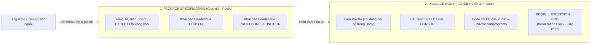
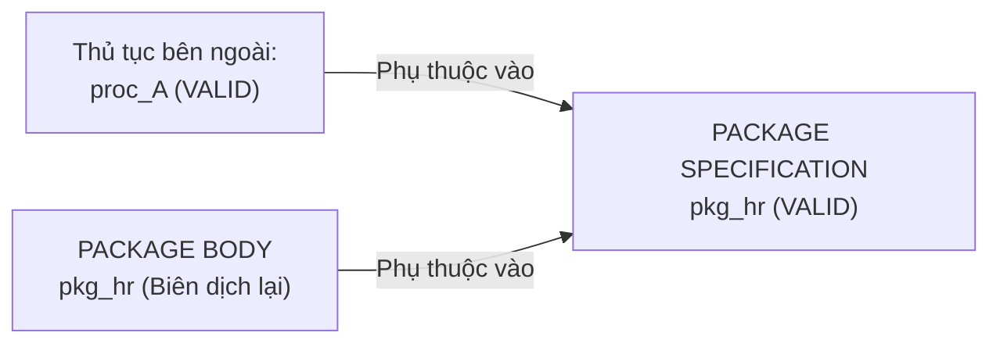
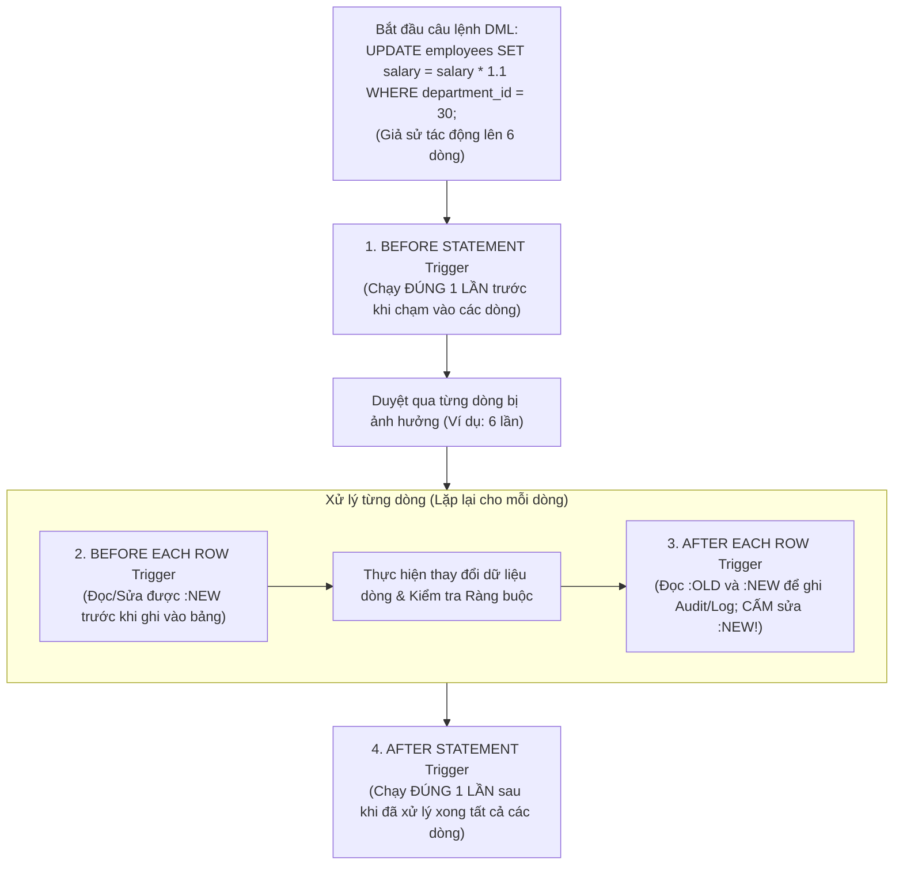
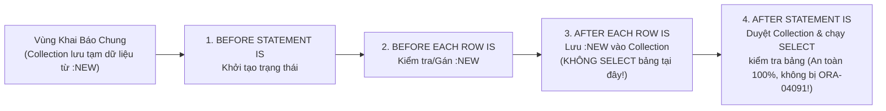

# Chương 25: Package và Trigger (Kiến Trúc Package, Overloading, DML Trigger & Compound Trigger) - OCP PL/SQL (1Z0-149)

> **Tài liệu tham chiếu:** *OCA/OCP Oracle Database 12c/19c/21c Program with PL/SQL Exam Guide (Exam 1Z0-149)* & *Oracle Database PL/SQL Language Reference*.  
> **Mục tiêu khảo thí:** Thiết kế `PACKAGE SPECIFICATION` và `PACKAGE BODY` (cùng Bodiless Package); Nắm vững quy tắc Nạp chồng hàm (`Overloading`); Quản lý trạng thái biến toàn cục Package theo Session, Khối khởi tạo (Initialization Block), lỗi `ORA-04068` và `PRAGMA SERIALLY_REUSABLE`; Hiểu cơ chế quản lý phụ thuộc (Dependency Management); Xây dựng DML Trigger (`BEFORE`/`AFTER`, Statement/Row-level), sử dụng `:OLD`, `:NEW`, `WHEN`, vị từ điều kiện (`INSERTING`/`UPDATING`/`DELETING`), và `INSTEAD OF` Trigger; Xử lý triệt để lỗi `ORA-04091: table is mutating` bằng `COMPOUND TRIGGER`.

---

## 📑 Mục Lục Chi Tiết

1. [Kiến Trúc PL/SQL Package: Specification, Body & Bodiless Package](#1-kiến-trúc-plsql-package-specification-body--bodiless-package)
2. [Lợi Ích Quản Lý Phụ Thuộc (Dependency Management) Của Package](#2-lợi-ích-quản-lý-phụ-thuộc-dependency-management-của-package)
3. [Nạp Chồng Chương Trình Con Trong Package (`Subprogram Overloading`)](#3-nạp-chồng-chương-trình-con-trong-package-subprogram-overloading)
4. [Khối Khởi Tạo Package, Trạng Thái Session (`ORA-04068`) & `SERIALLY_REUSABLE`](#4-khối-khởi-tạo-package-trạng-thái-session-ora-04068--serially_reusable)
5. [Tổng Quan Về Database Trigger & Phân Loại DML Trigger](#5-tổng-quan-về-database-trigger--phân-loại-dml-trigger)
6. [Giả Bản Ghi `:OLD` / `:NEW`, Mệnh Đề `WHEN` & Vị Từ `INSERTING` / `UPDATING` / `DELETING`](#6-giả-bản-ghi-old--new-mệnh-đề-when--vị-từ-inserting--updating--deleting)
7. [`INSTEAD OF` Trigger Trên Complex View](#7-instead-of-trigger-trên-complex-view)
8. [Lỗi Kinh Điển `ORA-04091: Table is Mutating` & Giải Pháp `COMPOUND TRIGGER`](#8-lỗi-kinh-điển-ora-04091-table-is-mutating--giải-pháp-compound-trigger)
9. [Bài Tập Thực Hành Tự Luyện (Kèm Lời Giải Chi Tiết)](#9-bài-tập-thực-hành-tự-luyện-kèm-lời-giải-chi-tiết)
10. [Tổng Hợp Bẫy Thi OCP Cốt Lõi Cần Nhớ (Exam Essentials)](#10-tổng-hợp-bẫy-thi-ocp-cốt-lõi-cần-nhớ-exam-essentials)

---

## 1. Kiến Trúc PL/SQL Package: Specification, Body & Bodiless Package

**Package (Gói)** là một đối tượng Schema gom nhóm các thành phần PL/SQL có liên quan về mặt logic (biến, hằng số, kiểu dữ liệu `TYPE`, con trỏ `CURSOR`, ngoại lệ `EXCEPTION`, và các chương trình con `PROCEDURE` / `FUNCTION`) vào một đơn vị lưu trữ duy nhất.

Một Package chuẩn bao gồm **2 phần tách biệt** được lưu trữ như hai đối tượng riêng trong Data Dictionary (`USER_OBJECTS` với `OBJECT_TYPE` là `'PACKAGE'` và `'PACKAGE BODY'`):



### 1.1. Quy tắc của `PACKAGE SPECIFICATION` và `PACKAGE BODY`

| Thành phần | `PACKAGE SPECIFICATION` (Đặc tả gói) | `PACKAGE BODY` (Thân gói) |
| :--- | :--- | :--- |
| **Phạm vi truy cập** | **Public (Công khai):** Mọi đối tượng được khai báo ở đây đều có thể truy cập từ bên ngoài bằng cú pháp `pkg_name.element_name`. | **Private (Nội bộ):** Những biến/thủ tục chỉ khai báo trong Body mà không có trong Spec thì chỉ gọi được ở bên trong chính Package Body đó. |
| **Thời điểm tạo** | **Bắt buộc phải tạo TRƯỚC** `PACKAGE BODY`. | Tạo sau `PACKAGE SPECIFICATION`. (Nếu biên dịch Body khi chưa có Spec sẽ báo lỗi `PLS-00201` / `PLS-00304`). |
| **Khi nào `PACKAGE BODY` là BẮT BUỘC?** | Khi trong `PACKAGE SPECIFICATION` có khai báo ít nhất một **`PROCEDURE`**, **`FUNCTION`**, hoặc một **`CURSOR` chỉ có Header** (không có câu lệnh `SELECT`). | Nếu Spec chỉ chứa biến, hằng số, `TYPE`, `EXCEPTION` (hoặc `CURSOR` đã viết đầy đủ cả câu lệnh `SELECT`), thì **KHÔNG CẦN tạo `PACKAGE BODY`**! |
| **Quy tắc khớp chữ ký** | Khai báo phần Header của Subprogram. | Phần Header của Public Subprogram trong Body phải **khớp chính xác 100%** với Spec (tên, thứ tự tham số, tên tham số, chế độ `IN`/`OUT`, kiểu dữ liệu). |

### 1.2. Bodiless Package (Package không có phần Body)
Một Package chỉ có `PACKAGE SPECIFICATION` mà không cần `PACKAGE BODY` được gọi là **Bodiless Package**.
* **Ứng dụng thực tế cực kỳ phổ biến:**
  1. Định nghĩa tập trung các **hằng số cấu hình toàn hệ thống** (ví dụ: tỷ giá, mức thuế VAT, mã trạng thái, hệ số quy đổi đơn vị).
  2. Định nghĩa các **kiểu dữ liệu dùng chung** (`TYPE ... IS RECORD`, `TYPE ... IS TABLE OF ...`, `REF CURSOR`) và các **ngoại lệ chuẩn** gắn `PRAGMA EXCEPTION_INIT` để toàn bộ các Procedure trong dự án tái sử dụng.

```sql
-- Ví dụ Bodiless Package chuẩn mực (Không cần tạo PACKAGE BODY):
CREATE OR REPLACE PACKAGE pkg_app_constants IS
    c_vat_rate       CONSTANT NUMBER       := 0.10;
    c_max_retry      CONSTANT PLS_INTEGER  := 3;
    c_company_name   CONSTANT VARCHAR2(50) := 'VNPT IT';

    e_fk_violation   EXCEPTION;
    PRAGMA EXCEPTION_INIT(e_fk_violation, -2292);
END pkg_app_constants;
/
```

> [!WARNING]
> **BẪY THI VỀ TỪ KHÓA `AUTHID` TRONG PACKAGE:**
> Mệnh đề quyền thực thi `AUTHID DEFINER` hoặc `AUTHID CURRENT_USER` **CHỈ ĐƯỢC PHÉP khai báo trong `PACKAGE SPECIFICATION`** (ngay trước `IS`/`AS`)!
> **Tuyệt đối KHÔNG ĐƯỢC** viết `AUTHID` trong `CREATE OR REPLACE PACKAGE BODY` hoặc trong từng Procedure/Function con bên trong Package (sẽ gây lỗi biên dịch `PLS-00103`!). Toàn bộ các chương trình con trong Package đều thừa hưởng chung chế độ `AUTHID` của `PACKAGE SPECIFICATION`.

---

## 2. Lợi Ích Quản Lý Phụ Thuộc (Dependency Management) Của Package

Trong Oracle, khi đối tượng **A** (ví dụ: Thủ tục `proc_A`) gọi tới đối tượng **B** (ví dụ: Thủ tục độc lập `proc_B`), thì `proc_A` là **Dependent Object** (Đối tượng phụ thuộc) và `proc_B` là **Referenced Object** (Đối tượng được tham chiếu).
* Nếu `proc_B` là một **Standalone Procedure**: Mỗi khi bạn sửa code bên trong `proc_B` và biên dịch lại (`CREATE OR REPLACE PROCEDURE proc_B`), trạng thái của `proc_A` sẽ bị đánh dấu thành **`INVALID`**!
* Ngược lại, nếu bạn đặt `proc_B` vào bên trong một **Package (`pkg_hr.proc_B`)**:
  1. Thủ tục `proc_A` bên ngoài **chỉ phụ thuộc vào `PACKAGE SPECIFICATION` (`pkg_hr`)**, hoàn toàn **KHÔNG phụ thuộc vào `PACKAGE BODY` (`pkg_hr`)**!
  2. Do đó, khi bạn sửa đổi logic code bên trong và biên dịch lại **`CREATE OR REPLACE PACKAGE BODY pkg_hr`** (mà giữ nguyên `PACKAGE SPECIFICATION`), thủ tục `proc_A` và toàn bộ các đối tượng gọi tới `pkg_hr` **VẪN GIỮ NGUYÊN TRẠNG THÁI `VALID`**! Không xảy ra hiệu ứng dây chuyền làm `INVALID` toàn hệ thống (Cascading Invalidation)!



---

## 3. Nạp Chồng Chương Trình Con Trong Package (`Subprogram Overloading`)

**Overloading (Nạp chồng)** là tính năng cho phép bạn định nghĩa **từ 2 chương trình con (`PROCEDURE` hoặc `FUNCTION`) trở lên có CÙNG TÊN** bên trong cùng một Package (hoặc cùng một khối Local Subprograms), miễn là danh sách tham số hình thức của chúng có sự khác biệt đủ để trình biên dịch phân biệt.

### 3.1. Điều kiện để Overloading HỢP LỆ
Các chương trình con trùng tên phải **khác nhau về ít nhất 1 trong 3 yếu tố** của tham số hình thức:
1. **Số lượng tham số** khác nhau (ví dụ: 1 tham số vs 2 tham số).
2. **Thứ tự các kiểu dữ liệu** của tham số khác nhau (ví dụ: `(NUMBER, VARCHAR2)` vs `(VARCHAR2, NUMBER)`).
3. **Họ kiểu dữ liệu (Datatype Family)** của tham số ở cùng vị trí phải khác nhau (ví dụ: `NUMBER` vs `DATE`).

### 3.2. Năm Trường Hợp KHÔNG THỂ Nạp Chồng (Bẫy Thi OCP Cực Nặng!)

Bạn **KHÔNG THỂ** nạp chồng hai chương trình con cùng tên nếu danh sách tham số của chúng **chỉ khác nhau** về một trong các yếu tố sau:

| # | Trường hợp KHÔNG THỂ Overloading | Ví dụ Minh Họa (Gây lỗi khi biên dịch hoặc khi gọi) |
| :---: | :--- | :--- |
| **1** | **Chỉ khác nhau về Tên tham số (Parameter Names)** | `PROCEDURE p(p_emp_id NUMBER);`<br/>`PROCEDURE p(p_dept_id NUMBER);` |
| **2** | **Chỉ khác nhau về Chế độ tham số (`IN`, `OUT`, `IN OUT`)** | `PROCEDURE p(x IN NUMBER);`<br/>`PROCEDURE p(x OUT NUMBER);` |
| **3** | **Chỉ khác nhau về Kiểu dữ liệu nhưng thuộc CÙNG MỘT HỌ (Same Datatype Family)** | * Cố nạp chồng `VARCHAR2` với `CHAR`, `STRING`, hoặc `LONG`.<br/>* Cố nạp chồng `NUMBER` với `INTEGER`, `DECIMAL`, `FLOAT`, `REAL` (vì `INTEGER` chỉ là `SUBTYPE` của `NUMBER`!).<br/>* Cố nạp chồng `PLS_INTEGER` với `BINARY_INTEGER`. |
| **4** | **Hai `FUNCTION` chỉ khác nhau về Kiểu trả về (`RETURN datatype`)** | `FUNCTION f(x NUMBER) RETURN NUMBER;`<br/>`FUNCTION f(x NUMBER) RETURN VARCHAR2;` |
| **5** | **Một cái là `PROCEDURE` và một cái là `FUNCTION` có cùng tên và cùng danh sách tham số?** | *(Chú ý: Một `PROCEDURE p(x NUMBER)` và một `FUNCTION p(x NUMBER) RETURN NUMBER` thực chất **ĐƯỢC PHÉP** cùng tồn tại vì ngữ cảnh gọi khác nhau — một cái gọi độc lập, một cái gọi trong biểu thức! Nhưng hai `FUNCTION` chỉ khác kiểu `RETURN` thì **BỊ CẤM**!).* |

> [!WARNING]
> **BẪY THI ĐẶC BIỆT VỀ THỜI ĐIỂM BÁO LỖI `PLS-00307: too many declarations of '...' match this call`:**
> Khi bạn viết 2 thủ tục nạp chồng có tham số cùng họ kiểu dữ liệu (ví dụ: `PROCEDURE p(x VARCHAR2)` và `PROCEDURE p(x CHAR)`) trong Package:
> * Khi chạy lệnh `CREATE PACKAGE` và `CREATE PACKAGE BODY`: Trình biên dịch PL/SQL **VẪN BIÊN DỊCH THÀNH CÔNG MÀ KHÔNG BÁO LỖI**!
> * Chỉ đến khi bạn **GỌI THỰC THI** thủ tục đó (`pkg.p('Hello');`), trình biên dịch mới không biết nên chọn bản `VARCHAR2` hay bản `CHAR` và lập tức báo lỗi **`PLS-00307: too many declarations of 'P' match this call`**!
> * Tương tự, nếu `PROCEDURE p(a NUMBER)` và `PROCEDURE p(a NUMBER, b NUMBER DEFAULT 10)` cùng tồn tại, khi gọi `pkg.p(5);` (1 đối số) cũng sẽ bị lỗi mơ hồ **`PLS-00307`**!

---

## 4. Khối Khởi Tạo Package, Trạng Thái Session (`ORA-04068`) & `SERIALLY_REUSABLE`

### 4.1. Khối Khởi Tạo Package (Package Initialization Block)
Ở phần cuối cùng của **`PACKAGE BODY`**, trước từ khóa `END package_name;`, bạn có thể viết một khối `BEGIN ... [EXCEPTION ...] END`:

```sql
CREATE OR REPLACE PACKAGE pkg_session_ctx IS
    g_tax_rate   NUMBER;
    g_login_time DATE;
    FUNCTION fn_calc_tax(p_amount NUMBER) RETURN NUMBER;
END pkg_session_ctx;
/

CREATE OR REPLACE PACKAGE BODY pkg_session_ctx IS
    FUNCTION fn_calc_tax(p_amount NUMBER) RETURN NUMBER IS
    BEGIN
        RETURN p_amount * g_tax_rate;
    END fn_calc_tax;

-- KHỐI KHỞI TẠO PACKAGE (PACKAGE INITIALIZATION BLOCK)
BEGIN
    g_login_time := SYSDATE;
    g_tax_rate   := 0.08;
    DBMS_OUTPUT.PUT_LINE('>>> Khối khởi tạo pkg_session_ctx vừa chạy! <<<');
END pkg_session_ctx;
/
```

> [!IMPORTANT]
> **Quy tắc chạy của Khối Khởi Tạo Package (Initialization Block):**
> * Khối `BEGIN ... END` ở cuối `PACKAGE BODY` được thực thi **ĐÚNG MỘT LẦN DUY NHẤT cho mỗi Session**, ngay tại **lần đầu tiên Session đó chạm tới bất kỳ thành phần nào của Package** (gọi hàm, đọc/ghi biến toàn cục).
> * Trong tất cả các lần gọi tiếp theo trong cùng Session đó, khối khởi tạo này **KHÔNG chạy lại nữa** (trừ khi Package bị biên dịch lại hoặc trạng thái gói bị reset bằng `DBMS_SESSION.RESET_PACKAGE`).

### 4.2. Trạng Thái Biến Toàn Cục Của Package (Package State) & Lỗi `ORA-04068`

* **Mỗi Session có một bản sao bộ nhớ riêng trong UGA/PGA:**
  Các biến toàn cục, hằng số, và con trỏ khai báo ở cấp Package (cả trong Spec và trong Body) duy trì giá trị của chúng **xuyên suốt toàn bộ thời gian sống của Session (Session-persistent)**, bất kể các Transaction có `COMMIT` hay `ROLLBACK`.
  **Lưu ý:** Biến toàn cục của Package là **riêng tư cho từng Session** — Session A thay đổi `pkg.g_count := 100` thì Session B hoàn toàn **không nhìn thấy** giá trị `100` đó (Session B có vùng nhớ `pkg.g_count` riêng)!

* **Lỗi kinh điển `ORA-04068: existing state of packages has been discarded`:**
  Giả sử Package `pkg_a` có chứa ít nhất một biến hoặc hằng số toàn cục (gọi là **Stateful Package**):
  1. **Session 1** gọi `pkg_a` $\rightarrow$ Oracle khởi tạo vùng nhớ Package State cho Session 1 trong UGA.
  2. Trong lúc Session 1 vẫn đang kết nối, **Session 2** sửa code và chạy lệnh biên dịch lại `CREATE OR REPLACE PACKAGE BODY pkg_a;`.
  3. Ngay sau đó, **Session 1** gọi lại `pkg_a`: Vì vùng nhớ trạng thái cũ của Session 1 không còn khớp với bản biên dịch mới, Oracle lập tức ném lỗi Runtime ở lần gọi đầu tiên của Session 1:
     **`ORA-04068: existing state of packages has been discarded`** (kèm theo `ORA-04061` / `ORA-06508`)!
  4. Nếu Session 1 gọi lại `pkg_a` lần thứ hai ngay sau lỗi đó, Package sẽ được khởi tạo lại (chạy lại Initialization Block) và chạy thành công.

### 4.3. Chỉ Thị `PRAGMA SERIALLY_REUSABLE`
Để tiết kiệm bộ nhớ RAM trên các hệ thống có hàng chục ngàn người dùng đồng thời và tránh lỗi giữ trạng thái lâu dài, bạn có thể đặt **`PRAGMA SERIALLY_REUSABLE;`**:

| Đặc điểm kỹ thuật | Package Thông Thường (Mặc định) | Package có `PRAGMA SERIALLY_REUSABLE;` |
| :--- | :--- | :--- |
| **Vị trí khai báo Pragma** | Không có. | Nếu Package có cả Spec và Body, **BẮT BUỘC phải đặt `PRAGMA SERIALLY_REUSABLE;` ở CẢ HAI NƠI** (`PACKAGE SPECIFICATION` **và** `PACKAGE BODY`)! (Chỉ đặt 1 nơi sẽ lỗi biên dịch `PLS-00709`). |
| **Vùng nhớ lưu trữ biến** | Lưu trong **UGA (PGA)** riêng của từng Session. | Lưu trong một vùng nhớ dùng chung trong **SGA (Shared Pool)**. |
| **Thời gian sống của biến Package & Khối khởi tạo** | Tồn tại suốt **cả Session** (Khối khởi tạo chỉ chạy 1 lần trong cả Session). | Chỉ tồn tại trong **MỘT LẦN GỌI SERVER (Single Call / Unit of work)**! Ngay khi cuộc gọi kết thúc trả về Client, trạng thái biến bị giải phóng trả lại SGA. Lần gọi tiếp theo sẽ **chạy lại Khối khởi tạo từ đầu**! |
| **Gọi từ SQL hoặc Trigger** | ✅ Được phép gọi hàm từ câu lệnh SQL hoặc từ DML Trigger. | ❌ **BỊ CẤM** gọi từ câu lệnh SQL (`SELECT pkg.fn() FROM dual`) và **BỊ CẤM** gọi từ bên trong **Trigger**! (Lỗi `ORA-06534: Cannot access Serially Reusable package`). |

---

## 5. Tổng Quan Về Database Trigger & Phân Loại DML Trigger

**Trigger** là một khối chương trình PL/SQL được lưu trữ trong Database và được Oracle **tự động kích hoạt (fire)** khi một sự kiện xác định xảy ra (không bao giờ có thể gọi Trigger trực tiếp bằng câu lệnh như Procedure, và Trigger không nhận tham số).

### 5.1. Bốn Thời Điểm & Cấp Độ Của DML Trigger Trên Bảng (Table)

Một câu lệnh DML (`INSERT`, `UPDATE`, `DELETE`) trên bảng có thể kích hoạt tối đa **4 loại thời điểm/cấp độ Trigger** theo đúng thứ tự thực thi sau:



### 5.2. Bảng Phân Biệt Statement-Level Trigger vs Row-Level Trigger

| Tiêu chí | Statement-Level Trigger (Mức câu lệnh — **Mặc định**) | Row-Level Trigger (Mức dòng — Có **`FOR EACH ROW`**) |
| :--- | :--- | :--- |
| **Từ khóa nhận diện** | Không có mệnh đề `FOR EACH ROW`. | Có mệnh đề **`FOR EACH ROW`**. |
| **Số lần kích hoạt khi câu lệnh `UPDATE` sửa `0` dòng** | Chạy **1 lần**! (Statement-level Trigger luôn chạy 1 lần ngay cả khi câu lệnh DML tác động 0 dòng!). | Chạy **0 lần**! (Vì không có dòng nào bị tác động). |
| **Số lần kích hoạt khi câu lệnh `UPDATE` sửa `100` dòng** | Chạy **1 lần**. | Chạy **100 lần** (mỗi dòng 1 lần). |
| **Truy cập giả bản ghi `:OLD` và `:NEW`** | ❌ **BỊ CẤM** (Lỗi biên dịch). | ✅ **Được phép** đọc dữ liệu cũ (`:OLD.col`) và dữ liệu mới (`:NEW.col`). |
| **Sử dụng mệnh đề điều kiện `WHEN (...)`** | ❌ **BỊ CẤM** (Mệnh đề `WHEN` chỉ dành cho Row-level Trigger!). | ✅ **Được phép** lọc dòng cần kích hoạt Trigger. |

> [!WARNING]
> **QUY TẮC GIAO DỊCH (TRANSACTION) TRONG TRIGGER:**
> Bên trong một Trigger (hoặc bất kỳ Procedure nào được gọi từ Trigger), bạn **TUYỆT ĐỐI KHÔNG ĐƯỢC PHÉP thực hiện lệnh điều khiển giao dịch (`COMMIT`, `ROLLBACK`, `SAVEPOINT`)** hay lệnh DDL!
> Nếu vi phạm, khi Trigger kích hoạt lúc Runtime sẽ lập tức ném lỗi:
> **`ORA-04092: cannot COMMIT in a trigger`** (hoặc `ORA-04092: cannot ROLLBACK in a trigger`)!
> *(Ngoại lệ duy nhất: Nếu Trigger hoặc Procedure mà nó gọi được khai báo là `PRAGMA AUTONOMOUS_TRANSACTION`, lúc đó bắt buộc phải có `COMMIT`/`ROLLBACK` của riêng giao dịch độc lập đó).*

---

## 6. Giả Bản Ghi `:OLD` / `:NEW`, Mệnh Đề `WHEN` & Vị Từ `INSERTING` / `UPDATING` / `DELETING`

### 6.1. Giá trị của `:OLD` và `:NEW` theo từng loại câu lệnh DML

Trong một **Row-Level Trigger (`FOR EACH ROW`)**, bạn truy cập giá trị cột của dòng đang xử lý thông qua `:OLD.column_name` và `:NEW.column_name`:

| Sự kiện DML kích hoạt | Giá trị của `:OLD.col` | Giá trị của `:NEW.col` |
| :--- | :--- | :--- |
| **`INSERT`** | **`NULL`** *(Vì dòng mới chưa từng tồn tại trước đó)* | Giá trị sắp/vừa được chèn vào bảng. |
| **`UPDATE`** | Giá trị gốc của cột **trước khi** cập nhật. | Giá trị mới của cột **sau khi** cập nhật. |
| **`DELETE`** | Giá trị của cột **trước khi** dòng bị xóa. | **`NULL`** *(Vì sau khi xóa dòng không còn tồn tại)* |

> [!WARNING]
> **2 BẪY THI SỐ 1 VỀ `:NEW`, `:OLD` VÀ MỆNH ĐỀ `WHEN` TRONG TRIGGER:**
> 1. **Cấm sửa đổi `:NEW` trong `AFTER EACH ROW` Trigger (`ORA-04084`):**
>    * Bạn **CHỈ ĐƯỢC PHÉP gán giá trị mới cho `:NEW.col` (`:NEW.salary := 5000;`) trong `BEFORE EACH ROW` Trigger** (trước khi dòng dữ liệu được ghi xuống bảng)!
>    * Nếu bạn cố tình gán `:NEW.col := ...` trong một **`AFTER EACH ROW` Trigger**, trình biên dịch sẽ lập tức báo lỗi:
>      **`ORA-04084: cannot change NEW values for this trigger type`**!
>    * Còn giả bản ghi **`:OLD`** thì luôn luôn chỉ đọc (Read-only) ở cả `BEFORE` lẫn `AFTER` (không bao giờ được gán `:OLD.col := ...`).
> 2. **Cấm viết dấu hai chấm `:` trước `NEW` và `OLD` trong mệnh đề `WHEN (...)`:**
>    * Ở phần điều kiện lọc dòng `WHEN (condition)` nằm trên phần Header của Trigger: Bạn **PHẢI viết `NEW.col` và `OLD.col` KHÔNG CÓ dấu hai chấm `:`**! (Nếu viết `WHEN (:NEW.salary > 0)` sẽ bị lỗi biên dịch `ORA-04076: invalid NEW or OLD specification`).
>    * Ngược lại, ở bên trong khối lệnh PL/SQL (`DECLARE ... BEGIN ... END`), bạn **BẮT BUỘC PHẢI có dấu hai chấm `:`** (`:NEW.salary`, `:OLD.salary`)!

### 6.2. Các Vị Từ Điều Kiện (`Conditional Predicates`): `INSERTING`, `UPDATING`, `DELETING`

Khi bạn gộp nhiều sự kiện DML vào chung một Trigger (`BEFORE INSERT OR UPDATE OR DELETE ON employees`), bạn sử dụng các vị từ kiểu `BOOLEAN` dựng sẵn sau để phân nhánh logic:
* **`INSERTING`:** Trả về `TRUE` nếu câu lệnh kích hoạt là `INSERT`.
* **`DELETING`:** Trả về `TRUE` nếu câu lệnh kích hoạt là `DELETE`.
* **`UPDATING`:** Trả về `TRUE` nếu câu lệnh kích hoạt là `UPDATE` (bất kỳ cột nào).
* **`UPDATING('COLUMN_NAME')`:** Trả về `TRUE` nếu câu lệnh `UPDATE` có liệt kê cột `COLUMN_NAME` trong mệnh đề `SET`. *(Lưu ý: Tên cột truyền vào `UPDATING('SALARY')` không phân biệt chữ hoa/thường).*

### 6.3. Ví dụ chuẩn mực kết hợp `FOR EACH ROW`, `REFERENCING`, `WHEN` và Vị từ điều kiện

```sql
CREATE OR REPLACE TRIGGER trg_emp_audit_and_validate
BEFORE INSERT OR UPDATE OF salary, commission_pct OR DELETE
ON employees
REFERENCING OLD AS old_emp NEW AS new_emp
FOR EACH ROW
-- ⚠️ Chú ý: Trong mệnh đề WHEN tuyệt đối KHÔNG có dấu hai chấm (:) trước new_emp / old_emp!
WHEN (new_emp.department_id = 80 OR old_emp.department_id = 80)
BEGIN
    -- Trong thân BEGIN ... END bắt buộc PHẢI có dấu hai chấm (:) trước :new_emp / :old_emp!
    IF INSERTING THEN
        :new_emp.commission_pct := NVL(:new_emp.commission_pct, 0.10);
    ELSIF UPDATING('SALARY') THEN
        IF :new_emp.salary < :old_emp.salary THEN
            RAISE_APPLICATION_ERROR(-20010, 'Không được giảm lương của nhân viên phòng Sales (80)!');
        END IF;
    ELSIF DELETING THEN
        RAISE_APPLICATION_ERROR(-20011, 'Không được phép xóa nhân viên phòng Sales (80)!');
    END IF;
END trg_emp_audit_and_validate;
/
```

---

## 7. `INSTEAD OF` Trigger Trên Complex View

Một **Complex View** (Khung nhìn phức hợp — có chứa `JOIN` nhiều bảng, `GROUP BY`, `DISTINCT`, hàm tổng hợp...) thường không cho phép thực hiện trực tiếp các câu lệnh `INSERT`, `UPDATE`, `DELETE`.
Giải pháp là tạo một **`INSTEAD OF` Trigger** trên View đó: Thay vì chạy câu lệnh DML trực tiếp lên View (vốn sẽ báo lỗi), Oracle sẽ **chạy đoạn code PL/SQL trong `INSTEAD OF` Trigger** để bạn tự bóc tách `:NEW` / `:OLD` và cập nhật xuống từng bảng vật lý bên dưới!

```sql
CREATE OR REPLACE VIEW vw_emp_dept AS
SELECT e.employee_id, e.last_name, e.email, e.hire_date, e.job_id,
       d.department_id, d.department_name
FROM employees e
JOIN departments d ON e.department_id = d.department_id;
/

CREATE OR REPLACE TRIGGER trg_instead_vw_emp_dept
INSTEAD OF INSERT ON vw_emp_dept
FOR EACH ROW
DECLARE
    v_cnt NUMBER;
BEGIN
    -- 1. Kiểm tra nếu phòng ban chưa tồn tại trong bảng DEPARTMENTS thì thêm mới
    SELECT COUNT(*) INTO v_cnt FROM departments WHERE department_id = :NEW.department_id;
    IF v_cnt = 0 THEN
        INSERT INTO departments (department_id, department_name)
        VALUES (:NEW.department_id, :NEW.department_name);
    END IF;

    -- 2. Thêm nhân viên mới vào bảng EMPLOYEES
    INSERT INTO employees (employee_id, last_name, email, hire_date, job_id, department_id)
    VALUES (:NEW.employee_id, :NEW.last_name, :NEW.email, :NEW.hire_date, :NEW.job_id, :NEW.department_id);
END trg_instead_vw_emp_dept;
/
```

> [!IMPORTANT]
> **4 Quy tắc bắt buộc của `INSTEAD OF` Trigger trong đề thi OCP:**
> 1. **`INSTEAD OF` Trigger CHỈ ĐƯỢC TẠO TRÊN `VIEW`** (hoặc Nested Table column của View)! Tuyệt đối **KHÔNG THỂ tạo `INSTEAD OF` Trigger trên Bảng (`TABLE`)** — cố tình tạo trên Table sẽ báo lỗi **`ORA-25002: cannot create INSTEAD OF triggers on tables`**!
> 2. **`INSTEAD OF` Trigger LUÔN LUÔN là Row-Level Trigger (`FOR EACH ROW`)!** Ngay cả khi bạn **không viết** mệnh đề `FOR EACH ROW` khi tạo `INSTEAD OF` Trigger, Oracle vẫn tự động biến nó thành Row-level Trigger!
> 3. **Không có `BEFORE` hay `AFTER`:** Chỉ viết `INSTEAD OF INSERT [OR UPDATE OR DELETE] ON view_name`.
> 4. **Không hỗ trợ mệnh đề điều kiện `WHEN (...)`** trên `INSTEAD OF` Trigger.

---

## 8. Lỗi Kinh Điển `ORA-04091: Table is Mutating` & Giải Pháp `COMPOUND TRIGGER`

### 8.1. Bản chất của lỗi `ORA-04091: table is mutating, trigger/function may not see it`

Một **Mutating Table (Bảng đang biến đổi)** là bảng hiện đang bị sửa đổi bởi một câu lệnh DML (`INSERT`, `UPDATE`, `DELETE`, `MERGE`), hoặc bảng bị ảnh hưởng bởi `DELETE CASCADE`.

> [!WARNING]
> **QUY TẮC GÂY LỖI MUTATING TABLE (`ORA-04091`):**
> Một **Row-Level Trigger (`BEFORE EACH ROW` hoặc `AFTER EACH ROW`)** kích hoạt trên bảng **`T`** **KHÔNG ĐƯỢC PHÉP thực thi câu lệnh `SELECT` (đọc) hoặc DML (`INSERT`/`UPDATE`/`DELETE`) tác động lên chính bảng `T` đó**!
> **Tại sao?** Vì khi đang ở giữa vòng lặp xử lý từng dòng (`FOR EACH ROW`), bảng `T` mới chỉ cập nhật được một nửa số dòng (đang ở trạng thái không nhất quán). Nếu cho phép câu lệnh `SELECT` bên trong Row-level Trigger đọc bảng `T`, nó sẽ nhìn thấy dữ liệu dở dang! Do đó Oracle chặn lại bằng lỗi **`ORA-04091: table ... is mutating, trigger/function may not see it`**.
>
> * **Ngoại lệ đặc biệt duy nhất không bị lỗi `ORA-04091`:** Nếu câu lệnh là **`INSERT INTO T VALUES (...)` đơn dòng (Single-row `INSERT ... VALUES`)**, thì một Row-level Trigger trên bảng `T` vẫn được phép `SELECT` bảng `T` mà không bị lỗi `ORA-04091`! Nhưng nếu là `INSERT INTO T SELECT ...` (Multi-row insert), `UPDATE`, hoặc `DELETE` thì lập tức bị **`ORA-04091`** ngay!
> * **Statement-Level Trigger (`BEFORE STATEMENT` và `AFTER STATEMENT`) KHÔNG BAO GIỜ bị lỗi `ORA-04091`** vì tại thời điểm chúng chạy, bảng `T` chưa biến đổi hoặc đã biến đổi xong hoàn toàn tất cả các dòng!

### 8.2. Giải Pháp Hiện Đại & Triệt Để Nhất: `COMPOUND TRIGGER` (Từ Oracle 11g+)

Làm thế nào để kiểm tra một quy tắc nghiệp vụ vừa cần biết thông tin của **từng dòng đang sửa (`:NEW`)** (chỉ có ở Row-level), vừa cần **truy vấn `SELECT` tổng hợp trên chính bảng đó** (chỉ làm được ở Statement-level mà không bị `ORA-04091`)?

Từ Oracle 11g+, câu trả lời chuẩn mực nhất là sử dụng **`COMPOUND TRIGGER`** — một Trigger duy nhất kết hợp cả **4 thời điểm thực thi (Timing Points)** và có **vùng khai báo biến chung (Shared State)** tồn tại xuyên suốt câu lệnh DML (và tự động hủy khi câu lệnh DML kết thúc):



### 8.3. Ví dụ thực tế: Giải quyết bài toán `ORA-04091` bằng `COMPOUND TRIGGER`

**Bài toán:** Đảm bảo rằng khi cập nhật hoặc thêm nhân viên, không có nhân viên nào có mức lương vượt quá `2` lần mức lương trung bình hiện tại của phòng ban đó. (Nếu viết `SELECT AVG(salary) FROM employees` trong `BEFORE EACH ROW` sẽ bị lỗi `ORA-04091` ngay khi `UPDATE` nhiều dòng!).

```sql
CREATE OR REPLACE TRIGGER trg_check_max_avg_sal
FOR INSERT OR UPDATE OF salary ON employees
COMPOUND TRIGGER

    -- 1. Vùng khai báo chung (Tồn tại trong suốt câu lệnh DML, tự xóa khi xong lệnh)
    TYPE t_dept_list IS TABLE OF employees.department_id%TYPE INDEX BY PLS_INTEGER;
    v_depts t_dept_list;

    -- Thời điểm 1 (Tùy chọn): Chạy 1 lần trước câu lệnh DML
    BEFORE STATEMENT IS
    BEGIN
        v_depts.DELETE;
    END BEFORE STATEMENT;

    -- Thời điểm 2 (Tùy chọn): Chạy cho từng dòng trước khi ghi
    BEFORE EACH ROW IS
    BEGIN
        IF :NEW.salary < 0 THEN
            RAISE_APPLICATION_ERROR(-20020, 'Lương không được âm!');
        END IF;
    END BEFORE EACH ROW;

    -- Thời điểm 3: Chạy cho từng dòng sau khi ghi -> Chỉ gom mã phòng ban vào Collection!
    AFTER EACH ROW IS
    BEGIN
        IF :NEW.department_id IS NOT NULL THEN
            v_depts(:NEW.department_id) := :NEW.department_id;
        END IF;
    END AFTER EACH ROW;

    -- Thời điểm 4: Chạy 1 lần sau khi TẤT CẢ các dòng đã cập nhật xong!
    -- Tại đây bảng EMPLOYEES không còn mutating nữa -> Tha hồ SELECT kiểm tra!
    AFTER STATEMENT IS
        v_avg_sal NUMBER;
        v_max_sal NUMBER;
        v_dept_id employees.department_id%TYPE;
    BEGIN
        v_dept_id := v_depts.FIRST;
        WHILE v_dept_id IS NOT NULL LOOP
            SELECT AVG(salary), MAX(salary)
            INTO v_avg_sal, v_max_sal
            FROM employees
            WHERE department_id = v_dept_id;

            IF v_max_sal > v_avg_sal * 2 THEN
                RAISE_APPLICATION_ERROR(
                    -20021,
                    'Vi phạm tại phòng ' || v_dept_id || ': Lương cao nhất (' || v_max_sal ||
                    ') vượt quá 2 lần lương trung bình (' || ROUND(v_avg_sal) || ')!'
                );
            END IF;

            v_dept_id := v_depts.NEXT(v_dept_id);
        END LOOP;
    END AFTER STATEMENT;

END trg_check_max_avg_sal;
/
```

---

## 9. Bài Tập Thực Hành Tự Luyện (Kèm Lời Giải Chi Tiết)

### Bài tập 1: Phân tích trạng thái biến Package và Khối khởi tạo
Hãy xác định chính xác những dòng nào sẽ được in ra màn hình khi chạy tuần tự 2 khối lệnh vô danh dưới đây trong **cùng một Session**:
```sql
CREATE OR REPLACE PACKAGE pkg_counter IS
    g_cnt NUMBER := 10;
    PROCEDURE sp_inc(p_step NUMBER);
END pkg_counter;
/

CREATE OR REPLACE PACKAGE BODY pkg_counter IS
    PROCEDURE sp_inc(p_step NUMBER) IS
    BEGIN
        g_cnt := g_cnt + p_step;
        DBMS_OUTPUT.PUT_LINE('Current g_cnt = ' || g_cnt);
    END sp_inc;
BEGIN
    g_cnt := g_cnt * 2;
    DBMS_OUTPUT.PUT_LINE('Package Initialized! g_cnt = ' || g_cnt);
END pkg_counter;
/

-- Lần gọi 1 trong Session:
BEGIN
    pkg_counter.sp_inc(5);
END;
/

-- Lần gọi 2 trong cùng Session:
BEGIN
    ROLLBACK;
    pkg_counter.sp_inc(10);
END;
/
```

<details>
<summary><b>👉 Xem Lời Giải Chi Tiết Bài Tập 1</b></summary>

1. **Ở Lần gọi 1 (`pkg_counter.sp_inc(5);`):**
   * Đây là lần đầu tiên Session chạm tới `pkg_counter`.
   * Bước 1: Biến `g_cnt` được cấp phát và khởi tạo theo khai báo ở Spec: `g_cnt := 10`.
   * Bước 2: **Khối khởi tạo (Initialization Block)** ở cuối `PACKAGE BODY` tự động chạy 1 lần: `g_cnt := 10 * 2 = 20`, và in ra:
     **`Package Initialized! g_cnt = 20`**.
   * Bước 3: Thân thủ tục `sp_inc(5)` thực thi: `g_cnt := 20 + 5 = 25`, và in ra:
     **`Current g_cnt = 25`**.
2. **Ở Lần gọi 2 (`ROLLBACK; pkg_counter.sp_inc(10);`):**
   * Lệnh `ROLLBACK;` chỉ hoàn tác dữ liệu bảng Database, **không ảnh hưởng đến biến PL/SQL hay trạng thái Package State** (`g_cnt` vẫn bằng `25`).
   * Vì Package đã được khởi tạo trong Session này rồi, Khối khởi tạo **không chạy lại nữa**.
   * Thân thủ tục `sp_inc(10)` thực thi: `g_cnt := 25 + 10 = 35`, và in ra:
     **`Current g_cnt = 35`**.
</details>

---

### Bài tập 2: Tìm tất cả các lỗi biên dịch và lỗi Runtime trong đoạn code Trigger sau
Hãy tìm **3 lỗi sai** trong đoạn code tạo Trigger dưới đây và sửa lại cho đúng:
```sql
CREATE OR REPLACE TRIGGER trg_fix_me
AFTER INSERT OR UPDATE ON employees
FOR EACH ROW
WHEN (:NEW.salary > 0)
BEGIN
    IF INSERTING THEN
        :NEW.hire_date := SYSDATE;
    END IF;
    COMMIT;
END;
/
```

<details>
<summary><b>👉 Xem Lời Giải Chi Tiết Bài Tập 2</b></summary>

Đoạn code trên mắc **3 lỗi kinh điển trong đề thi OCP**:
1. **Lỗi 1 (Tại mệnh đề `WHEN (:NEW.salary > 0)`):** Trong mệnh đề `WHEN` của Trigger, **không được viết dấu hai chấm `:`** trước `NEW` hoặc `OLD` (gây lỗi `ORA-04076`). Phải sửa thành: `WHEN (NEW.salary > 0)`.
2. **Lỗi 2 (Gán `:NEW.hire_date := SYSDATE;` trong `AFTER` Trigger):** Không được phép thay đổi giá trị của `:NEW` trong một `AFTER EACH ROW` Trigger (gây lỗi `ORA-04084`). Phải đổi thời điểm Trigger từ `AFTER` thành **`BEFORE INSERT OR UPDATE`**.
3. **Lỗi 3 (Lệnh `COMMIT;` trong Trigger):** Không được phép đặt lệnh `COMMIT` (hoặc `ROLLBACK`, `SAVEPOINT`) trong Trigger (gây lỗi Runtime `ORA-04092`). Phải xóa bỏ dòng `COMMIT;`.
</details>

---

## 10. Tổng Hợp Bẫy Thi OCP Cốt Lõi Cần Nhớ (Exam Essentials)

| # | Chủ đề / Tình huống bẫy trong đề thi OCP 1Z0-149 | Kết quả / Quy tắc chuẩn xác |
| :---: | :--- | :--- |
| **1** | Khi nào một Package KHÔNG cần tạo `PACKAGE BODY` (Bodiless Package)? | Khi `PACKAGE SPECIFICATION` không chứa `PROCEDURE`, `FUNCTION`, hoặc `CURSOR` chưa có câu lệnh `SELECT`. |
| **2** | Biên dịch lại `PACKAGE BODY` (không sửa `PACKAGE SPECIFICATION`) | Các đối tượng bên ngoài gọi tới Package **KHÔNG bị chuyển sang `INVALID`**. |
| **3** | Khai báo hai hàm cùng tên trong Package chỉ khác nhau kiểu trả về `RETURN` hoặc chế độ `IN`/`OUT` | **Không thể Overloading!** Sẽ báo lỗi biên dịch hoặc lỗi `PLS-00307` khi gọi. |
| **4** | Khai báo hai thủ tục nạp chồng `p(x VARCHAR2)` và `p(x CHAR)` (hoặc `NUMBER` và `INTEGER`) | **Biên dịch Package thành công**, nhưng khi gọi `p('A')` sẽ báo lỗi **`PLS-00307: too many declarations match this call`**. |
| **5** | Khối `BEGIN ... END` ở cuối `PACKAGE BODY` chạy mấy lần? | Chạy **1 lần duy nhất trong mỗi Session** tại lần đầu tiên Session đó tham chiếu tới Package. |
| **6** | Đặt `PRAGMA SERIALLY_REUSABLE;` chỉ ở `PACKAGE SPECIFICATION` mà quên đặt ở `PACKAGE BODY` | **Lỗi biên dịch `PLS-00709`**. Nếu có Body, bắt buộc phải đặt Pragma này ở **cả Spec và Body**. |
| **7** | Câu lệnh `DELETE FROM emp WHERE 1 = 2;` (xóa 0 dòng) kích hoạt Statement-level vs Row-level Trigger mấy lần? | **Statement-level Trigger chạy 1 lần**; **Row-level Trigger (`FOR EACH ROW`) chạy 0 lần**. |
| **8** | Gán `:NEW.col := val;` bên trong một `AFTER EACH ROW` Trigger | **Lỗi biên dịch `ORA-04084`**. Chỉ được sửa `:NEW` trong **`BEFORE EACH ROW`** Trigger. |
| **9** | Viết `WHEN (:NEW.sal > 1000)` ở Header của Trigger | **Lỗi biên dịch `ORA-04076`**. Trong mệnh đề `WHEN`, cấm dùng dấu `:` (`WHEN (NEW.sal > 1000)`). |
| **10** | Tạo `INSTEAD OF` Trigger trên một Bảng (`TABLE`) | **Lỗi `ORA-25002`**. `INSTEAD OF` Trigger **chỉ được tạo trên `VIEW`** và luôn là Row-level Trigger. |
| **11** | Trong `AFTER EACH ROW` Trigger trên bảng `EMP` lại chạy `SELECT COUNT(*) FROM emp;` khi đang `UPDATE` | **Lỗi Runtime `ORA-04091: table is mutating`**. Giải quyết triệt để bằng **`COMPOUND TRIGGER`** (chuyển câu `SELECT` xuống phần `AFTER STATEMENT`). |
| **12** | Đặt lệnh `COMMIT` hoặc `ROLLBACK` bên trong Trigger | **Lỗi Runtime `ORA-04092: cannot COMMIT in a trigger`** (trừ khi dùng `PRAGMA AUTONOMOUS_TRANSACTION`). |
