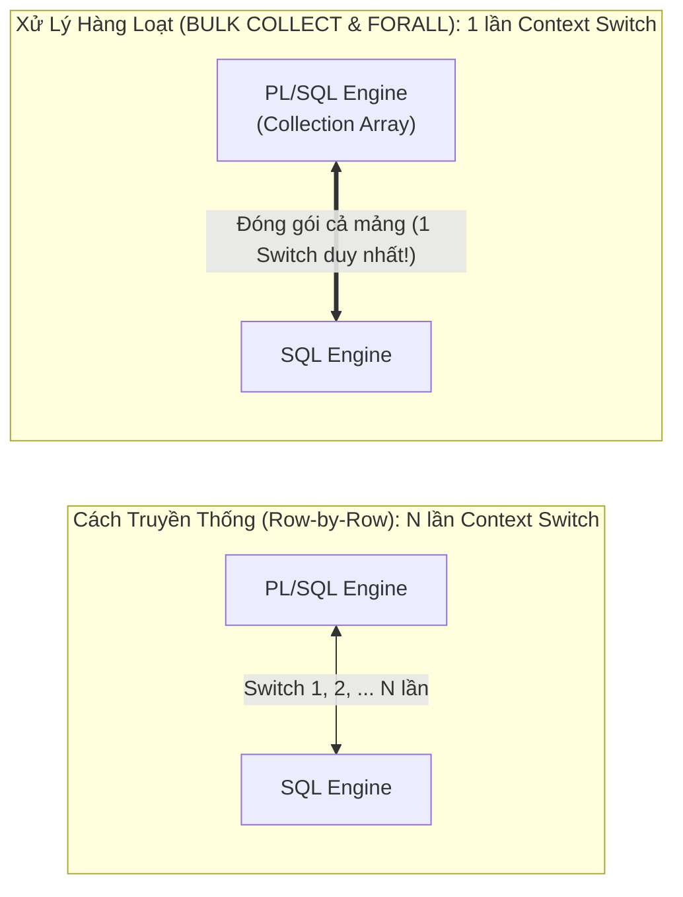

# Chương 26: PL/SQL Nâng Cao & Tối Ưu Hiệu Năng (Collections, BULK COLLECT, FORALL, Dynamic SQL & Autonomous Transaction) - OCP PL/SQL (1Z0-149)

> **Tài liệu tham chiếu:** *OCA/OCP Oracle Database 12c/19c/21c Program with PL/SQL Exam Guide (Exam 1Z0-149)* & *Oracle Database PL/SQL Language Reference*.  
> **Mục tiêu khảo thí:** Làm chủ 3 loại Collections (`Associative Array`, `Nested Table`, `VARRAY`) và 10 phương thức Collection; Tối ưu hóa hiệu năng giảm Context Switching với `BULK COLLECT` (`LIMIT`) và `FORALL` (`INDICES OF`, `VALUES OF`, `SAVE EXCEPTIONS`, `SQL%BULK_EXCEPTIONS`); Lập trình SQL động với `EXECUTE IMMEDIATE` (`INTO`, `USING`, `RETURNING INTO`), `DBMS_SQL`, và phòng chống SQL Injection bằng Bind Variables / `DBMS_ASSERT`; Quản lý giao dịch độc lập với `PRAGMA AUTONOMOUS_TRANSACTION` (`ORA-06519`).

---

## 📑 Mục Lục Chi Tiết

1. [Tổng Quan Ba Loại Collections Trong PL/SQL: Associative Array, Nested Table & VARRAY](#1-tổng-quan-ba-loại-collections-trong-plsql-associative-array-nested-table--varray)
2. [Mười Phương Thức Điều Khiển Collection (Collection Methods)](#2-mười-phương-thức-điều-khiển-collection-collection-methods)
3. [Bản Chất Context Switching & Đọc Hàng Loạt Với `BULK COLLECT`](#3-bản-chất-context-switching--đọc-hàng-loạt-với-bulk-collect)
4. [Ghi Dữ Liệu Hàng Loạt Với `FORALL` (`INDICES OF`, `VALUES OF`)](#4-ghi-dữ-liệu-hàng-loạt-với-forall-indices-of-values-of)
5. [Xử Lý Lỗi Hàng Loạt Với `SAVE EXCEPTIONS` & `SQL%BULK_EXCEPTIONS` (`ORA-24381`)](#5-xử-lý-lỗi-hàng-loạt-với-save-exceptions--sqlbulk_exceptions-ora-24381)
6. [Native Dynamic SQL (`EXECUTE IMMEDIATE`) & Gói `DBMS_SQL`](#6-native-dynamic-sql-execute-immediate--gói-dbms_sql)
7. [Bảo Mật Chống SQL Injection Với Bind Variables & `DBMS_ASSERT`](#7-bảo-mật-chống-sql-injection-với-bind-variables--dbms_assert)
8. [Giao Dịch Độc Lập: `PRAGMA AUTONOMOUS_TRANSACTION` (`ORA-06519`)](#8-giao-dịch-độc-lập-pragma-autonomous_transaction-ora-06519)
9. [Bài Tập Thực Hành Tự Luyện (Kèm Lời Giải Chi Tiết)](#9-bài-tập-thực-hành-tự-luyện-kèm-lời-giải-chi-tiết)
10. [Tổng Hợp Bẫy Thi OCP Cốt Lõi Cần Nhớ (Exam Essentials)](#10-tổng-hợp-bẫy-thi-ocp-cốt-lõi-cần-nhớ-exam-essentials)

---

## 1. Tổng Quan Ba Loại Collections Trong PL/SQL: Associative Array, Nested Table & VARRAY

**Collection (Tập hợp)** là một cấu trúc dữ liệu một chiều gồm các phần tử có **cùng kiểu dữ liệu (Homogeneous)**, được truy xuất thông qua một chỉ mục (Index / Subscript).

### 1.1. Bảng So Sánh Toàn Diện 3 Loại Collections (Trọng Tâm Đề Thi OCP 1Z0-149)

| Tiêu chí so sánh | 1. Associative Array (`INDEX BY` Table) | 2. Nested Table (Bảng lồng) | 3. `VARRAY` (Variable-Size Array) |
| :--- | :--- | :--- | :--- |
| **Cú pháp khai báo** | `TYPE t_name IS TABLE OF element_type INDEX BY {PLS_INTEGER \| BINARY_INTEGER \| VARCHAR2(n)};` | `TYPE t_name IS TABLE OF element_type [NOT NULL];` *(Không có `INDEX BY`!)* | `TYPE t_name IS {VARRAY \| VARYING ARRAY}(max_size) OF element_type [NOT NULL];` |
| **Phạm vi khai báo** | **Chỉ trong PL/SQL** (Block, Subprogram, Package). **Không thể** tạo ở cấp Schema bằng `CREATE TYPE`! | Khai báo được cả trong **PL/SQL** lẫn cấp **Schema (`CREATE TYPE ... IS TABLE OF ...`)** để làm cột của bảng DB. | Khai báo được cả trong **PL/SQL** lẫn cấp **Schema (`CREATE TYPE ... IS VARRAY(n) OF ...`)** để làm cột của bảng DB. |
| **Kiểu dữ liệu chỉ mục (Index / Key)** | Số nguyên (**âm, `0`, hoặc dương** `PLS_INTEGER`) **HOẶC chuỗi ký tự `VARCHAR2(n)`**! | Chỉ nhận số nguyên dương từ **`1` đến $2^{31}-1$** (`1 .. 2147483647`). | Chỉ nhận số nguyên dương từ **`1` đến `max_size` (`LIMIT`)**. |
| **Giới hạn số phần tử tối đa (`LIMIT`)** | **Không giới hạn** (Unbounded). Hàm `.LIMIT` luôn trả về **`NULL`**. | **Không giới hạn** (Unbounded). Hàm `.LIMIT` luôn trả về **`NULL`**. | **Có giới hạn cứng (`max_size`)** ngay lúc khai báo. Hàm `.LIMIT` trả về **`max_size`**. |
| **Mật độ phần tử (Dense vs Sparse)** | **Thưa (Sparse) ngay từ đầu:** Có thể gán nhảy cóc chỉ số bất kỳ (`v(-10)`, `v(500)`, `v('VN')`). | Ban đầu là **Đặc (Dense)** (liên tục từ `1..N`), nhưng sẽ trở thành **Thưa (Sparse)** nếu dùng `.DELETE(n)` xóa phần tử ở giữa! | **LUÔN LUÔN ĐẶC (Always Dense):** Các phần tử luôn liên tục từ `1..COUNT`. **Không bao giờ** có khoảng trống ở giữa! |
| **Trạng thái khi mới khai báo biến (Chưa gán gì)** | Tự động là một tập hợp **Rỗng (Empty, KHÔNG PHẢI `NULL`)**! Sẵn sàng gán ngay `v(1) := 'A';` mà không cần khởi tạo hay `EXTEND`! | Mặc định là **`NULL` (Atomically NULL)**! Bắt buộc phải khởi tạo bằng **Constructor `v := t_name();`** (hoặc `BULK COLLECT`) và phải gọi **`.EXTEND`** trước khi gán phần tử mới! *(Lưu ý: Từ 18c hỗ trợ Qualified Expression cho cả Associative Array).* | Mặc định là **`NULL` (Atomically NULL)**! Bắt buộc phải khởi tạo bằng **Constructor `v := t_name();`** và gọi **`.EXTEND`** trước khi gán! |
| **Thứ tự bảo toàn khi lưu vào cột Database** | Không lưu được vào cột Database. | Lưu ở bảng phụ riêng; **KHÔNG đảm bảo giữ nguyên thứ tự** chỉ số khi đọc ra. | Lưu inline trong bảng chính; **ĐẢM BẢO giữ nguyên thứ tự** các phần tử (`1..N`). |

### 1.2. Ví dụ Minh Họa Khởi Tạo và Sử Dụng Cả 3 Loại Collections

```sql
SET SERVEROUTPUT ON;
DECLARE
    -- 1. Associative Array (Chỉ mục kiểu chuỗi VARCHAR2)
    TYPE t_capitals_aa IS TABLE OF VARCHAR2(50) INDEX BY VARCHAR2(30);
    v_capitals t_capitals_aa; -- Không cần Constructor, không cần EXTEND!

    -- 2. Nested Table (Không có INDEX BY, không giới hạn kích thước)
    TYPE t_scores_nt IS TABLE OF NUMBER;
    v_scores t_scores_nt := t_scores_nt(85, 90, 95); -- Khởi tạo 3 phần tử bằng Constructor

    -- 3. VARRAY (Giới hạn tối đa 5 phần tử)
    TYPE t_tags_va IS VARRAY(5) OF VARCHAR2(20);
    v_tags t_tags_va := t_tags_va(); -- Khởi tạo VARRAY rỗng (COUNT = 0, LIMIT = 5)
BEGIN
    -- Thao tác trên Associative Array (Gán trực tiếp khóa bất kỳ)
    v_capitals('Vietnam') := 'Hanoi';
    v_capitals('Japan')   := 'Tokyo';
    DBMS_OUTPUT.PUT_LINE('AA Count = ' || v_capitals.COUNT || ', First Key = ' || v_capitals.FIRST);

    -- Thao tác trên Nested Table (Xóa phần tử số 2 ở giữa -> tạo mảng thưa!)
    v_scores.DELETE(2);
    DBMS_OUTPUT.PUT_LINE('NT Count = ' || v_scores.COUNT || ', Next of 1 = ' || v_scores.NEXT(1));

    -- Thao tác trên VARRAY (Phải EXTEND trước khi gán vào ô mới)
    v_tags.EXTEND(2);
    v_tags(1) := 'SQL';
    v_tags(2) := 'PL/SQL';
    DBMS_OUTPUT.PUT_LINE('VA Count = ' || v_tags.COUNT || ', Limit = ' || v_tags.LIMIT);
END;
/
```
**Kết quả đầu ra:**
```text
AA Count = 2, First Key = Japan
NT Count = 2, Next of 1 = 3
VA Count = 2, Limit = 5
```

> [!TIP]
> **Thứ tự sắp xếp khóa trong Associative Array:**
> Trong ví dụ trên, dù ta gán `'Vietnam'` trước và `'Japan'` sau, nhưng `v_capitals.FIRST` lại trả về **`'Japan'`**! Tại sao? Vì Associative Array luôn tự động sắp xếp các khóa theo thứ tự tăng dần của giá trị khóa (số từ âm sang dương, chuỗi theo bảng mã `NLS_SORT` / ASCII).

---

## 2. Mười Phương Thức Điều Khiển Collection (Collection Methods)

Các phương thức Collection được gọi theo cú pháp: `collection_name.METHOD_NAME[(parameters)]`.
*(Lưu ý: Các phương thức Collection là hàm/thủ tục của **PL/SQL Engine**, **không thể gọi trực tiếp bên trong câu lệnh SQL**!).*

### Bảng Ma Trận 10 Phương Thức Collection & Các Bẫy Thi OCP

| Phương thức | Loại | Ý nghĩa & Hành vi chi tiết | Áp dụng cho loại nào? / Bẫy thi cần nhớ |
| :--- | :---: | :--- | :--- |
| **`EXISTS(n)`** | Function (`BOOLEAN`) | Trả về `TRUE` nếu phần tử tại chỉ số `n` tồn tại; ngược lại trả về `FALSE`. | Áp dụng cho **cả 3 loại**. **ĐẶC BIỆT:** `EXISTS(n)` là phương thức **DUY NHẤT KHÔNG NÉM NGOẠI LỆ `COLLECTION_IS_NULL`** khi gọi trên một Nested Table / VARRAY chưa khởi tạo (`NULL`), mà chỉ trả về **`FALSE`**! |
| **`COUNT`** | Function (`PLS_INTEGER`) | Trả về tổng số phần tử **hiện đang tồn tại** trong Collection (không tính các phần tử đã bị `.DELETE(n)`). | Áp dụng cho **cả 3 loại**. Nếu vừa khởi tạo rỗng `t_nt()`, `COUNT` bằng `0`. |
| **`LIMIT`** | Function (`PLS_INTEGER`) | Trả về số lượng phần tử tối đa được phép chứa. | Với **`VARRAY`**: trả về `max_size`.<br/>Với **`Nested Table` và `Associative Array`**: luôn trả về **`NULL`**! |
| **`FIRST` / `LAST`** | Function (Kiểu index) | Trả về chỉ số (index/key) đầu tiên (nhỏ nhất) và cuối cùng (lớn nhất). Trả về `NULL` nếu Collection rỗng. | Áp dụng cho **cả 3 loại**. Với **`VARRAY`** không rỗng: `FIRST` luôn là `1`, và `LAST` luôn bằng **`COUNT`**! Với Nested Table đã xóa phần tử ở giữa, `LAST` có thể lớn hơn `COUNT`. |
| **`PRIOR(n)` / `NEXT(n)`** | Function (Kiểu index) | Trả về chỉ số đứng liền trước / liền sau chỉ số `n` đang tồn tại (bỏ qua các ô đã bị xóa!). Trả về `NULL` nếu không còn. | Áp dụng cho **cả 3 loại**. **Chuẩn duyệt mảng thưa (Sparse Collection):** Phải dùng `v_idx := col.FIRST; WHILE v_idx IS NOT NULL LOOP ... v_idx := col.NEXT(v_idx); END LOOP;` (Nếu dùng `FOR i IN col.FIRST .. col.LAST` trên mảng thưa sẽ bị lỗi `NO_DATA_FOUND`!). |
| **`EXTEND` / `EXTEND(n)` / `EXTEND(n, i)`** | Procedure | Mở rộng thêm `1` phần tử `NULL` (hoặc `n` phần tử `NULL`, hoặc `n` bản sao của phần tử thứ `i`) vào cuối Collection. | Chỉ dùng cho **`Nested Table` và `VARRAY`**! **CẤM dùng `EXTEND` cho `Associative Array`** (`PLS-00306`)! |
| **`TRIM` / `TRIM(n)`** | Procedure | Cắt bỏ `1` phần tử (hoặc `n` phần tử) ở **cuối** Collection (kể cả vị trí đó đã bị `.DELETE` trước đó!). | Chỉ dùng cho **`Nested Table` và `VARRAY`**! **CẤM dùng `TRIM` cho `Associative Array`**! Nếu `n > COUNT`, ném lỗi `SUBSCRIPT_BEYOND_COUNT`. |
| **`DELETE`** (Không tham số) | Procedure | Xóa sạch **tất cả** các phần tử trong Collection (`COUNT` về `0`, nhưng Collection vẫn đã khởi tạo, không biến thành `NULL`). | Áp dụng cho **cả 3 loại** (kể cả **`VARRAY`** cũng gọi được `.DELETE` không tham số để xóa sạch toàn bộ!). |
| **`DELETE(n)` / `DELETE(m, n)`** | Procedure | Xóa phần tử tại vị trí `n` (hoặc từ `m` đến `n`), tạo ra khoảng trống (Sparse) tại vị trí đó. | Chỉ dùng cho **`Associative Array` và `Nested Table`**! **CẤM dùng `DELETE(n)` có tham số trên `VARRAY`** (vì VARRAY bắt buộc phải luôn đặc - Dense)! |

> [!WARNING]
> **BẪY THI KINH ĐIỂN: Kết hợp `.DELETE(n)` và `.TRIM` trên cùng một Nested Table!**
> Giả sử bạn có một Nested Table gồm 4 phần tử: `v_nt := t_nt(10, 20, 30, 40);` (các vị trí `1, 2, 3, 4`).
> 1. Bạn gọi `v_nt.DELETE(4);` (xóa phần tử cuối cùng): Lúc này `v_nt.COUNT` giảm còn `3`, nhưng **ô giữ chỗ (placeholder) thứ 4 vẫn còn nằm ở cuối mảng**!
> 2. Ngay sau đó bạn gọi `v_nt.TRIM(1);`: Phương thức `TRIM(1)` sẽ cắt bỏ đúng **ô giữ chỗ trống số 4** đó, chứ **KHÔNG cắt mất phần tử số 3 (`30`)**! Do đó sau lệnh `TRIM(1)`, phần tử số 3 (`30`) vẫn còn nguyên vẹn!
> *Lời khuyên:* Không bao giờ dùng lẫn lộn cả `.DELETE(n)` và `.TRIM` trên cùng một Nested Table.

---

## 3. Bản Chất Context Switching & Đọc Hàng Loạt Với `BULK COLLECT`

### 3.1. Tại sao vòng lặp Cursor truyền thống lại chậm khi xử lý hàng trăm ngàn dòng?
Trong kiến trúc Oracle Server, **PL/SQL Engine** (xử lý logic thủ tục `IF`, `LOOP`, biến) và **SQL Engine** (xử lý câu lệnh `SELECT`, `INSERT`, `UPDATE`, `DELETE`) là hai bộ máy tách biệt.
* Khi bạn chạy một vòng lặp 100.000 lần, mỗi lần gọi `FETCH` 1 dòng rồi chạy `UPDATE` 1 dòng: Sẽ xảy ra **200.000 lần chuyển ngữ cảnh (Context Switches)** qua lại giữa PL/SQL Engine và SQL Engine!
* Để loại bỏ nút cổ chai Context Switching này, Oracle cung cấp cặp công cụ **Bulk Binding**:
  1. **`BULK COLLECT`:** Đọc một lúc cả một tập hợp nhiều dòng từ SQL Engine nạp thẳng vào PL/SQL Collection chỉ trong **1 lần Context Switch**.
  2. **`FORALL`:** Đóng gói toàn bộ các phần tử trong PL/SQL Collection gửi xuống SQL Engine để thực thi DML (`INSERT`/`UPDATE`/`DELETE`) chỉ trong **1 lần Context Switch**.



### 3.2. Ba cách sử dụng `BULK COLLECT`
Bạn có thể dùng `BULK COLLECT` với cả 3 loại Collections (`Associative Array`, `Nested Table`, `VARRAY`):
1. **`SELECT ... BULK COLLECT INTO collection_list FROM ...`** (Nạp trực tiếp từ câu lệnh `SELECT`).
2. **`FETCH cursor_name BULK COLLECT INTO collection_list [LIMIT max_rows];`** (Nạp theo từng lô từ Explicit Cursor hoặc `REF CURSOR`).
3. **`EXECUTE IMMEDIATE ... BULK COLLECT INTO`** hoặc **`RETURNING ... BULK COLLECT INTO`** (Nhận kết quả trả về từ lệnh DML tác động nhiều dòng).

> [!IMPORTANT]
> **5 ĐẶC ĐIỂM VÀNG CỦA `BULK COLLECT` TRONG ĐỀ THI OCP 1Z0-149:**
> 1. **KHÔNG BAO GIỜ ném ngoại lệ `NO_DATA_FOUND` hoặc `TOO_MANY_ROWS`!**
>    * Khác với `SELECT ... INTO` thông thường (0 dòng ném `NO_DATA_FOUND`, $\ge 2$ dòng ném `TOO_MANY_ROWS`), câu lệnh **`SELECT ... BULK COLLECT INTO v_arr` khi trả về 0 dòng sẽ KHÔNG NÉM `NO_DATA_FOUND`**! Nó chỉ đơn giản trả về một Collection rỗng có **`v_arr.COUNT = 0`**!
> 2. **Tự động khởi tạo (Auto-initialize) và tự động `EXTEND`:**
>    * Khi nạp vào một `Nested Table` hoặc `VARRAY` bằng `BULK COLLECT INTO`, bạn **KHÔNG CẦN khởi tạo bằng Constructor trước** và **KHÔNG CẦN gọi `.EXTEND`**! PL/SQL tự động xóa sạch dữ liệu cũ của Collection, tự động khởi tạo và nạp các phần tử liên tiếp bắt đầu từ chỉ số **`1`** (`1 .. N`).
>    * *(Lưu ý duy nhất với `VARRAY`: Nếu số dòng trả về của câu `SELECT` vượt quá `LIMIT` của `VARRAY`, sẽ bị lỗi `ORA-22165` — do đó luôn dùng `Associative Array` hoặc `Nested Table` cho `BULK COLLECT`).*

### 3.3. Mẫu chuẩn `FETCH ... BULK COLLECT INTO ... LIMIT n` & Bẫy `%NOTFOUND`

Nếu bảng có 10 triệu dòng mà bạn dùng `SELECT ... BULK COLLECT INTO v_arr`, toàn bộ 10 triệu dòng sẽ tràn vào bộ nhớ PGA làm cạn kiệt RAM (`ORA-04030`). Giải pháp chuẩn là dùng Explicit Cursor kết hợp mệnh đề **`LIMIT n`** (thường `n` từ `100` đến `1000`):

```sql
SET SERVEROUTPUT ON;
DECLARE
    CURSOR c_emp IS SELECT employee_id, first_name, salary FROM employees;
    TYPE t_emp_list IS TABLE OF c_emp%ROWTYPE; -- Nested Table (hoặc Associative Array)
    v_emps t_emp_list;
BEGIN
    OPEN c_emp;
    LOOP
        -- Mỗi lần FETCH lấy tối đa 50 dòng vào v_emps
        FETCH c_emp BULK COLLECT INTO v_emps LIMIT 50;

        -- ✅ CHUẨN MỰC: Luôn kiểm tra thoát vòng lặp bằng "EXIT WHEN v_emps.COUNT = 0;"
        EXIT WHEN v_emps.COUNT = 0;

        DBMS_OUTPUT.PUT_LINE('Đã lấy được lô gồm: ' || v_emps.COUNT || ' dòng.');
        FOR i IN 1 .. v_emps.COUNT LOOP
            -- Xử lý từng phần tử v_emps(i) trong RAM
            NULL;
        END LOOP;
    END LOOP;
    CLOSE c_emp;
END;
/
```

> [!WARNING]
> **BẪY THI KINH ĐIỂN SỐ 1 VỀ `BULK COLLECT LIMIT`: Đặt `EXIT WHEN c_emp%NOTFOUND;` ngay sau `FETCH ... BULK COLLECT INTO ... LIMIT n`!**
> Giả sử bảng `employees` có **107 dòng**, bạn đặt `LIMIT 50` và viết:
> ```sql
> LOOP
>     FETCH c_emp BULK COLLECT INTO v_emps LIMIT 50;
>     EXIT WHEN c_emp%NOTFOUND; -- ❌ BẪY CHẾT NGƯỜI! BỎ SÓT MẤT 7 DÒNG CUỐI!
>     -- Xử lý v_emps...
> END LOOP;
> ```
> **Chuyện gì xảy ra?**
> * Lần lặp 1: Lấy 50 dòng (dòng 1..50). Vì vẫn còn dòng trong con trỏ nên `c_emp%NOTFOUND` là `FALSE` $\rightarrow$ Xử lý 50 dòng đầu.
> * Lần lặp 2: Lấy 50 dòng (dòng 51..100). `c_emp%NOTFOUND` vẫn là `FALSE` $\rightarrow$ Xử lý 50 dòng tiếp theo.
> * Lần lặp 3: Chỉ còn **7 dòng cuối** (dòng 101..107). Lệnh `FETCH ... LIMIT 50` nạp 7 dòng này vào `v_emps` (`v_emps.COUNT = 7`), nhưng vì không đủ 50 dòng (đã chạm đáy con trỏ!) nên Oracle lập tức bật cờ **`c_emp%NOTFOUND := TRUE` NGAY TẠI LẦN FETCH THỨ 3 NÀY**!
> * Do bạn đặt `EXIT WHEN c_emp%NOTFOUND;` ngay sau `FETCH`, vòng lặp **THOÁT NGAY LẬP TỨC và BỎ SÓT HOÀN TOÀN 7 DÒNG CUỐI CÙNG** đang nằm trong `v_emps`!
> * **Quy tắc sống còn:** Với `FETCH ... BULK COLLECT INTO v_arr LIMIT n`, **luôn đặt `EXIT WHEN v_arr.COUNT = 0;` ngay sau `FETCH`** (hoặc nếu dùng `EXIT WHEN c_emp%NOTFOUND;` thì bắt buộc phải đặt ở **cuối cùng của vòng lặp**, sau khi đã xử lý xong `v_arr`)!

---

## 4. Ghi Dữ Liệu Hàng Loạt Với `FORALL` (`INDICES OF`, `VALUES OF`)

### 4.1. Bản chất và Quy tắc Cú pháp của `FORALL`

> [!IMPORTANT]
> **`FORALL` KHÔNG PHẢI LÀ MỘT VÒNG LẶP (`LOOP`)!**
> * Cú pháp của `FORALL` **không có từ khóa `LOOP`** và **không có `END LOOP;`**!
> * Theo sau `FORALL` **BẮT BUỘC chỉ được có DUY NHẤT MỘT câu lệnh DML** (`INSERT`, `UPDATE`, `DELETE`, `MERGE`) hoặc một câu lệnh `EXECUTE IMMEDIATE`! Nếu bạn viết 2 câu lệnh bên dưới `FORALL`, trình biên dịch sẽ báo lỗi ngay lập tức.

### 4.2. Ba dạng mệnh đề biên (Bounds Clause) của `FORALL`

| Dạng cú pháp `FORALL` | Khi nào sử dụng? | Điều kiện & Bẫy thi nếu gặp mảng thưa (Sparse Collection) |
| :--- | :--- | :--- |
| **1. `FORALL i IN lower_bound .. upper_bound`**<br/>*(Ví dụ: `FORALL i IN 1 .. v_arr.COUNT`)* | Khi Collection là **mảng đặc (Dense Collection)** — mọi phần tử từ `lower_bound` đến `upper_bound` đều tồn tại liên tục. | ❌ Nếu trong khoảng `lower..upper` có **bất kỳ phần tử nào đã bị `.DELETE(k)` (mảng thưa)**, lệnh `FORALL i IN 1..v_arr.LAST` sẽ lập tức thất bại và ném lỗi: **`ORA-22160: element at index [k] does not exist`**! |
| **2. `FORALL i IN INDICES OF collection_name [BETWEEN low AND high]`** | Khi Collection là **mảng thưa (Sparse Collection)** — có các phần tử ở giữa đã bị `.DELETE(k)`. | ✅ Tự động **nhảy qua (bỏ qua) các vị trí đã bị xóa**, chỉ lấy các chỉ số `i` hiện đang thực sự tồn tại trong `collection_name`! Không bao giờ bị lỗi `ORA-22160`! |
| **3. `FORALL i IN VALUES OF index_collection`** | Khi bạn có một Collection phụ (`index_collection` kiểu `PLS_INTEGER` hoặc `BINARY_INTEGER`) chứa danh sách các chỉ số được chọn lọc cần xử lý. | ✅ `FORALL` sẽ lấy **giá trị của từng phần tử** trong `index_collection` làm chỉ số truy xuất vào Collection dữ liệu chính! |

### 4.3. Ví dụ Thực Tế: `FORALL` với `INDICES OF` và Thuộc tính `SQL%BULK_ROWCOUNT`

Khi chạy `FORALL`, ngoài `SQL%ROWCOUNT` (trả về **tổng số dòng** bị tác động bởi toàn bộ lệnh `FORALL`), Oracle còn cung cấp một thuộc tính dạng mảng kết hợp đặc biệt là **`SQL%BULK_ROWCOUNT(i)`** cho biết **số lượng dòng bị tác động bởi riêng phần tử thứ `i`**!

```sql
SET SERVEROUTPUT ON;
DECLARE
    TYPE t_dept_list IS TABLE OF NUMBER;
    v_depts t_dept_list := t_dept_list(10, 20, 30, 40);
BEGIN
    -- Xóa phần tử thứ 2 (phòng 20) -> v_depts trở thành mảng thưa (chỉ còn vị trí 1, 3, 4)!
    v_depts.DELETE(2);

    -- Dùng INDICES OF để tự động bỏ qua vị trí số 2 đã bị xóa:
    FORALL i IN INDICES OF v_depts
        UPDATE employees
        SET salary = salary * 1.05
        WHERE department_id = v_depts(i);

    DBMS_OUTPUT.PUT_LINE('Tổng số nhân viên được tăng lương (SQL%ROWCOUNT): ' || SQL%ROWCOUNT);

    -- Kiểm tra số dòng cập nhật của từng phòng ban bằng SQL%BULK_ROWCOUNT(i)
    FOR i IN v_depts.FIRST .. v_depts.LAST LOOP
        IF v_depts.EXISTS(i) THEN
            DBMS_OUTPUT.PUT_LINE(
                'Phần tử thứ ' || i || ' (Phòng ' || v_depts(i) || ') cập nhật: ' ||
                SQL%BULK_ROWCOUNT(i) || ' dòng.'
            );
        END IF;
    END LOOP;

    ROLLBACK;
END;
/
```
**Kết quả đầu ra:**
```text
Tổng số nhân viên được tăng lương (SQL%ROWCOUNT): 8
Phần tử thứ 1 (Phòng 10) cập nhật: 1 dòng.
Phần tử thứ 3 (Phòng 30) cập nhật: 6 dòng.
Phần tử thứ 4 (Phòng 40) cập nhật: 1 dòng.
```

---

## 5. Xử Lý Lỗi Hàng Loạt Với `SAVE EXCEPTIONS` & `SQL%BULK_EXCEPTIONS` (`ORA-24381`)

### 5.1. Vấn đề khi một phần tử trong `FORALL` gặp lỗi
Giả sử bạn dùng `FORALL` để `INSERT` 1.000 dòng, nhưng dòng thứ 500 bị lỗi trùng khóa chính hoặc tràn độ dài cột:
* **Nếu KHÔNG dùng `SAVE EXCEPTIONS`:** Ngay tại dòng thứ 500 bị lỗi, toàn bộ câu lệnh `FORALL` sẽ **dừng lại ngay lập tức**. Dòng thứ 500 bị Rollback, 500 dòng phía sau (501..1000) không được chạy, còn 499 dòng đầu tiên (1..499) nếu ngoại lệ được bắt thì vẫn giữ lại, nếu không bắt thì bị Rollback hết.
* **Khi thêm mệnh đề `SAVE EXCEPTIONS` vào `FORALL`:**
  1. Nếu bất kỳ dòng nào gặp lỗi DML, SQL Engine **KHÔNG dừng lại**, mà lưu thông tin lỗi đó vào bộ sưu tập **`SQL%BULK_EXCEPTIONS`** và **tiếp tục thực thi tất cả các dòng còn lại** cho đến hết mảng!
  2. Sau khi đã chạy xong toàn bộ các dòng hợp lệ, PL/SQL Engine sẽ tự động ném ra một ngoại lệ tổng hợp duy nhất có mã lỗi là:
     **`ORA-24381: error(s) in array DML`**!

### 5.2. Cấu trúc của `SQL%BULK_EXCEPTIONS`
Trong khối `EXCEPTION`, bạn gắn `PRAGMA EXCEPTION_INIT(e_bulk_errors, -24381);` (hoặc dùng `WHEN OTHERS`) và duyệt qua `SQL%BULK_EXCEPTIONS`:
* **`SQL%BULK_EXCEPTIONS.COUNT`:** Tổng số lỗi đã xảy ra trong lệnh `FORALL`.
* **`SQL%BULK_EXCEPTIONS(i).ERROR_INDEX`:** Thứ tự lần lặp (iteration index) trong `FORALL` nơi xảy ra lỗi thứ `i`.
* **`SQL%BULK_EXCEPTIONS(i).ERROR_CODE`:** Mã lỗi Oracle của lỗi thứ `i`.

> [!WARNING]
> **BẪY THI CỰC ĐỘC VỀ `SQL%BULK_EXCEPTIONS(i).ERROR_CODE`:**
> Trường `.ERROR_CODE` trong `SQL%BULK_EXCEPTIONS` lưu mã lỗi dưới dạng **SỐ NGUYÊN DƯƠNG (Positive Number — KHÔNG CÓ DẤU TRỪ `-`)**! (Ví dụ: lỗi `ORA-01400` sẽ được lưu là `1400` chứ không phải `-1400`!).
> Do đó, khi muốn truyền mã lỗi này vào hàm `SQLERRM(...)` để lấy nội dung thông báo lỗi, bạn **BẮT BUỘC phải nhân với `-1` (thêm dấu trừ `-`)**:
> **`SQLERRM(-SQL%BULK_EXCEPTIONS(i).ERROR_CODE)`**!
> Nếu quên dấu trừ (`SQLERRM(SQL%BULK_EXCEPTIONS(i).ERROR_CODE)`), hàm `SQLERRM` nhận số dương sẽ trả về thông báo lỗi sai (`non-ORACLE exception`)!

### 5.3. Ví dụ Chuẩn Mực Với `FORALL ... SAVE EXCEPTIONS`

```sql
SET SERVEROUTPUT ON;
DECLARE
    TYPE t_name_list IS TABLE OF VARCHAR2(50);
    -- Phần tử thứ 2 là NULL (sẽ lỗi ORA-01400 karena department_name là NOT NULL)
    v_names t_name_list := t_name_list('Dept A', NULL, 'Dept C');

    e_forall_err EXCEPTION;
    PRAGMA EXCEPTION_INIT(e_forall_err, -24381); -- Mã lỗi chuẩn của SAVE EXCEPTIONS
BEGIN
    FORALL i IN 1 .. v_names.COUNT SAVE EXCEPTIONS
        INSERT INTO departments (department_id, department_name, location_id)
        VALUES (900 + i, v_names(i), 1700);
EXCEPTION
    WHEN e_forall_err THEN
        DBMS_OUTPUT.PUT_LINE('Số lượng dòng bị lỗi: ' || SQL%BULK_EXCEPTIONS.COUNT);
        DBMS_OUTPUT.PUT_LINE('Số lượng dòng vẫn chèn thành công: ' || SQL%ROWCOUNT);

        FOR idx IN 1 .. SQL%BULK_EXCEPTIONS.COUNT LOOP
            DBMS_OUTPUT.PUT_LINE(
                'Lỗi #' || idx ||
                ' tại vị trí mảng thứ ' || SQL%BULK_EXCEPTIONS(idx).ERROR_INDEX ||
                ' - Chi tiết: ' || SQLERRM(-SQL%BULK_EXCEPTIONS(idx).ERROR_CODE) -- Chú ý dấu trừ (-)!
            );
        END LOOP;
        ROLLBACK;
END;
/
```
**Kết quả đầu ra:**
```text
Số lượng dòng bị lỗi: 1
Số lượng dòng vẫn chèn thành công: 2
Lỗi #1 tại vị trí mảng thứ 2 - Chi tiết: ORA-01400: cannot insert NULL into ("HR"."DEPARTMENTS"."DEPARTMENT_NAME")
```

---

## 6. Native Dynamic SQL (`EXECUTE IMMEDIATE`) & Gói `DBMS_SQL`

### 6.1. Khi nào BẮT BUỘC phải sử dụng Dynamic SQL?
PL/SQL biên dịch tĩnh (Static SQL) chỉ hỗ trợ trực tiếp các lệnh **DML (`SELECT`, `INSERT`, `UPDATE`, `DELETE`, `MERGE`)** và **TCL (`COMMIT`, `ROLLBACK`, `SAVEPOINT`)** khi tên bảng và tên cột đã cố định lúc biên dịch. Bạn **BẮT BUỘC phải dùng Dynamic SQL** trong 3 trường hợp:
1. Thực thi các câu lệnh **DDL (`CREATE`, `ALTER`, `DROP`, `TRUNCATE`)** hoặc **DCL (`GRANT`, `REVOKE`)** hoặc **`ALTER SESSION`** bên trong PL/SQL! (Viết trực tiếp `TRUNCATE TABLE temp_tab;` trong PL/SQL sẽ bị lỗi biên dịch!).
2. Khi **tên bảng, tên cột, mệnh đề `WHERE`, hoặc `ORDER BY`** được truyền động lúc Runtime.
3. Khi gọi một khối PL/SQL hoặc Subprogram mà tên của nó chỉ được xác định lúc Runtime.

### 6.2. Cú pháp và Thứ tự Mệnh đề của `EXECUTE IMMEDIATE`

```sql
EXECUTE IMMEDIATE dynamic_string
    [INTO {variable1, variable2 ... | record_var} | BULK COLLECT INTO collection_var]
    [USING [IN | OUT | IN OUT] bind_arg1, [IN | OUT | IN OUT] bind_arg2 ...]
    [{RETURNING | RETURN} INTO bind_out1, bind_out2 ...];
```

> [!IMPORTANT]
> **6 QUY TẮC & BẪY THI SỐ 1 VỀ `EXECUTE IMMEDIATE` TRONG ĐỀ THI OCP:**
> 1. **Thứ tự mệnh đề bắt buộc (`INTO` $\rightarrow$ `USING` $\rightarrow$ `RETURNING INTO`):**
>    Nếu câu lệnh là `SELECT` động có cả biến đích nhận kết quả (`INTO`) và biến liên kết đầu vào (`USING`), mệnh đề **`INTO` (hoặc `BULK COLLECT INTO`) BẮT BUỘC phải đứng TRƯỚC mệnh đề `USING`**!
>    * ✅ Đúng: `EXECUTE IMMEDIATE v_sql INTO v_name USING v_emp_id;`
>    * ❌ Sai (Lỗi biên dịch): `EXECUTE IMMEDIATE v_sql USING v_emp_id INTO v_name;`
> 2. **Quy tắc dấu chấm phẩy `;` ở cuối chuỗi `dynamic_string`:**
>    * Nếu chuỗi là câu lệnh **SQL (`SELECT`, `INSERT`, `UPDATE`, `DELETE`, `CREATE`, `TRUNCATE`)**: **TUYỆT ĐỐI KHÔNG ĐƯỢC có dấu chấm phẩy `;`** ở cuối chuỗi! (Có dấu `;` sẽ bị lỗi Runtime `ORA-00911: invalid character`).
>    * Nếu chuỗi là một **khối lệnh PL/SQL (`BEGIN ...; END;` hoặc `DECLARE ... BEGIN ...; END;`)**: **BẮT BUỘC PHẢI có dấu chấm phẩy `;`** sau `END;`!
> 3. **Không thể dùng Bind Variable (`:1`) cho Tên Bảng, Tên Cột hoặc Từ khóa SQL:**
>    * Bạn **KHÔNG THỂ** viết: `EXECUTE IMMEDIATE 'SELECT * FROM :tab_name' USING 'EMPLOYEES';` (Lỗi `ORA-00903: invalid table name`).
>    * Tên đối tượng Schema (tên bảng, tên cột) bắt buộc phải **nối chuỗi** (kèm kiểm tra bằng `DBMS_ASSERT`), còn giá trị dữ liệu lọc thì truyền qua **`USING`**.
> 4. **Bẫy truyền `NULL` trực tiếp vào mệnh đề `USING` (`USING NULL`):**
>    * ❌ Nếu bạn viết trực tiếp từ khóa `NULL` trong `USING`: `EXECUTE IMMEDIATE 'UPDATE emp SET comm = :1' USING NULL;` $\rightarrow$ **Lỗi biên dịch `PLS-00457: expressions have to be of SQL types`** (vì literal `NULL` không có kiểu dữ liệu!).
>    * ✅ **Cách khắc phục:** Phải khai báo một biến có kiểu dữ liệu rõ ràng mang giá trị `NULL` (ví dụ `v_null NUMBER := NULL;`) rồi truyền biến đó vào `USING v_null;`!
> 5. **Sự khác biệt khi lặp tên Placeholder (`:a ... :a`) trong câu SQL vs khối PL/SQL động:**
>    * Trong một **câu lệnh SQL động** (`'UPDATE emp SET sal = :x, bonus = :x'`): Các biến liên kết được đối chiếu **theo VỊ TRÍ (By Position)**! Dù bạn đặt cùng tên `:x` ở 2 chỗ, bạn vẫn **phải truyền 2 đối số** trong `USING v_val, v_val;`!
>    * Ngược lại, nếu chuỗi động là một **khối PL/SQL động (`'BEGIN proc(:x, :x); END;'`)**: Các biến liên kết được đối chiếu **theo TÊN (By Name)**! Nếu `:x` xuất hiện 2 lần trong khối `BEGIN ... END;`, bạn **chỉ truyền ĐÚNG 1 đối số** trong `USING v_val;`!

### 6.3. Khi nào phải dùng gói `DBMS_SQL` thay vì `EXECUTE IMMEDIATE`?

Trong 95% trường hợp, Native Dynamic SQL (`EXECUTE IMMEDIATE` và `OPEN ref_cursor FOR`) nhanh hơn và gọn hơn `DBMS_SQL`. Tuy nhiên, bạn **BẮT BUỘC phải dùng `DBMS_SQL`** trong trường hợp:
* **Phương pháp 4 của Dynamic SQL (Dynamic SQL Method 4):** Khi tại thời điểm viết code (Compile-time), bạn **KHÔNG BIẾT TRƯỚC số lượng cột trả về của câu lệnh `SELECT` hoặc KHÔNG BIẾT TRƯỚC số lượng biến liên kết (Bind Variables)** cần truyền vào! (Với `EXECUTE IMMEDIATE`, số lượng biến trong `INTO` và `USING` bắt buộc phải cố định lúc viết code).
* Ngoài ra, từ Oracle 11g+, `DBMS_SQL` cho phép chuyển đổi qua lại giữa `DBMS_SQL` cursor ID (kiểu `INTEGER`) và `SYS_REFCURSOR` bằng hai hàm:
  * **`DBMS_SQL.TO_REFCURSOR(cursor_id)`**: Chuyển từ `DBMS_SQL` cursor sang `SYS_REFCURSOR`.
  * **`DBMS_SQL.TO_CURSOR_NUMBER(ref_cursor)`**: Chuyển từ `SYS_REFCURSOR` sang `DBMS_SQL` cursor ID.

---

## 7. Bảo Mật Chống SQL Injection Với Bind Variables & `DBMS_ASSERT`

**SQL Injection** xảy ra khi đầu vào của người dùng được nối chuỗi trực tiếp (`||`) vào câu lệnh SQL động, cho phép kẻ tấn công chèn thêm điều kiện `' OR '1'='1` hoặc câu lệnh phá hoại.

### Hai Lá Chắn Chống SQL Injection Trong Đề Thi OCP 1Z0-149

1. **Lá chắn 1 — Sử dụng Bind Variables (`USING`):**
   Luôn truyền mọi giá trị dữ liệu đầu vào thông qua biến liên kết (`:1`, `:2` với mệnh đề `USING`). Oracle coi giá trị trong `USING` thuần túy là dữ liệu văn bản/số chứ không bao giờ biên dịch nó như một phần cấu trúc lệnh SQL!
2. **Lá chắn 2 — Sử dụng gói `DBMS_ASSERT` (Khi bắt buộc phải nối chuỗi Tên Bảng / Tên Cột / Tên Schema):**
   Vì không thể dùng Bind Variable cho tên bảng/tên cột, bạn phải kiểm chứng chuỗi định danh đó bằng các hàm trong gói **`DBMS_ASSERT`** trước khi nối chuỗi:

| Hàm trong gói `DBMS_ASSERT` | Chức năng kiểm tra & Giá trị trả về (hoặc Lỗi ném ra) |
| :--- | :--- |
| **`DBMS_ASSERT.SIMPLE_SQL_NAME(str)`** | Kiểm tra `str` có phải là một tên định danh SQL đơn giản hợp lệ không (không chứa khoảng trắng, dấu chấm phẩy, hay toán tử SQL Injection). Nếu sai ném `ORA-44003: invalid SQL name`. |
| **`DBMS_ASSERT.SQL_OBJECT_NAME(str)`** | Kiểm tra `str` có phải là **tên của một đối tượng thực sự đang tồn tại trong Database** (Table, View, Procedure...) hay không! Nếu không tồn tại ném `ORA-44002: invalid object name`. |
| **`DBMS_ASSERT.SCHEMA_NAME(str)`** | Kiểm tra `str` có phải là tên một **Schema (User) đang tồn tại** trong Database hay không (Phân biệt hoa/thường!). Nếu sai ném `ORA-44001: invalid schema name`. |
| **`DBMS_ASSERT.ENQUOTE_NAME(str [, capitalize])`** | Bọc tên định danh trong cặp dấu ngoặc kép `"..."` (mặc định tự động viết hoa `capitalize => TRUE`) và kiểm tra tính hợp lệ của dấu ngoặc kép bên trong. |
| **`DBMS_ASSERT.ENQUOTE_LITERAL(str)`** | Bọc một hằng chuỗi trong cặp dấu nháy đơn `'...'` và kiểm tra không cho phép dấu nháy đơn đơn lẻ chưa được nhân đôi (`''`) thoát ra ngoài. |
| **`DBMS_ASSERT.NOOP(str)`** | Trả về nguyên trạng chuỗi `str` mà không thực hiện kiểm tra nào (chỉ dùng để đánh dấu với công cụ kiểm tra bảo mật rằng lập trình viên đã tự kiểm tra chuỗi này). |

```sql
-- Ví dụ kết hợp cả DBMS_ASSERT (cho tên bảng) và Bind Variable USING (cho giá trị lọc):
CREATE OR REPLACE PROCEDURE sp_safe_delete (
    p_table_name IN VARCHAR2,
    p_record_id  IN NUMBER
) IS
    v_valid_table VARCHAR2(128);
    v_sql         VARCHAR2(500);
BEGIN
    -- 1. Kiểm tra tên bảng thực sự tồn tại trong DB bằng DBMS_ASSERT.SQL_OBJECT_NAME
    v_valid_table := DBMS_ASSERT.SQL_OBJECT_NAME(p_table_name);

    -- 2. Dùng Bind Variable (:id) với USING cho giá trị dữ liệu
    v_sql := 'DELETE FROM ' || v_valid_table || ' WHERE id = :id';
    EXECUTE IMMEDIATE v_sql USING p_record_id;
END sp_safe_delete;
/
```

---

## 8. Giao Dịch Độc Lập: `PRAGMA AUTONOMOUS_TRANSACTION` (`ORA-06519`)

### 8.1. Cơ chế hoạt động của Autonomous Transaction
Mặc định, khi Thủ tục **A** (Giao dịch chính - Main Transaction) gọi Thủ tục **B**, cả **A** và **B** cùng chia sẻ chung **một ngữ cảnh giao dịch duy nhất**: nếu **B** gọi `COMMIT` hoặc `ROLLBACK`, toàn bộ các thay đổi chưa lưu của **A** cũng bị `COMMIT` hoặc `ROLLBACK` theo!

Khi bạn đặt chỉ thị trình biên dịch **`PRAGMA AUTONOMOUS_TRANSACTION;`** trong phần khai báo của Thủ tục **B**:
1. Ngay khi **A** gọi **B**: Giao dịch chính **A** tạm thời bị **Tạm dừng (Suspended)**.
2. **B** bắt đầu một **Giao dịch hoàn toàn độc lập (Autonomous Transaction)**:
   * Các lệnh `COMMIT` hoặc `ROLLBACK` bên trong **B** **CHỈ có tác dụng đối với các thay đổi DML của riêng B**, hoàn toàn **KHÔNG ảnh hưởng** gì tới giao dịch chính **A**!
   * Ngay cả khi sau đó giao dịch chính **A** gặp lỗi và thực hiện **`ROLLBACK`**, những dữ liệu mà **B** đã **`COMMIT`** (ví dụ: bản ghi Audit Log hoặc Error Log) **vẫn được lưu giữ an toàn vĩnh viễn trong Database**!
3. Khi **B** kết thúc, giao dịch chính **A** được **Khôi phục (Resumed)** và chạy tiếp bình thường.

```mermaid
sequenceDiagram
    participant Main as Giao Dịch Chính (Main Transaction)
    participant Auto as Thủ Tục Ghi Log (PRAGMA AUTONOMOUS_TRANSACTION)
    participant DB as Oracle Database

    Main->>DB: 1. INSERT INTO orders ... (Chưa Commit)
    Main->>Auto: 2. Gọi sp_write_error_log('Lỗi thanh toán')
    Note over Main: Giao dịch chính TẠM DỪNG (Suspended)
    Auto->>DB: 3. INSERT INTO error_logs ...
    Auto->>DB: 4. COMMIT; (Chỉ lưu bảng error_logs!)
    Auto-->>Main: 5. Kết thúc thủ tục ghi log
    Note over Main: Giao dịch chính TIẾP TỤC (Resumed)
    Main->>DB: 6. ROLLBACK; (Chỉ hủy bảng orders, bảng error_logs vẫn còn nguyên!)
```

### 8.2. Các Đơn Vị Chương Trình Được Phép Dùng `PRAGMA AUTONOMOUS_TRANSACTION`
Bạn có thể khai báo `PRAGMA AUTONOMOUS_TRANSACTION;` trong:
1. Khối vô danh **Anonymous Block ở cấp cao nhất (Top-level Anonymous Block)** *(Lưu ý: Khối vô danh lồng bên trong - Nested Anonymous Block **KHÔNG ĐƯỢC PHÉP** có `PRAGMA AUTONOMOUS_TRANSACTION`!)*.
2. **Standalone hoặc Package `PROCEDURE` / `FUNCTION`** *(Lưu ý: Không thể khai báo cho toàn bộ Package mà phải khai báo riêng trong từng Procedure/Function của Package!)*.
3. Phương thức (`Method`) của một SQL **Object Type**.
4. **Database Trigger** (Cho phép chạy `COMMIT`/`ROLLBACK` hoặc lệnh DDL như `EXECUTE IMMEDIATE 'CREATE...'` bên trong Trigger!).

> [!WARNING]
> **2 BẪY THI SỐ 1 VỀ `PRAGMA AUTONOMOUS_TRANSACTION`:**
> 1. **Lỗi `ORA-06519: active autonomous transaction detected and rolled back`:**
>    Một khối hoặc chương trình con có `PRAGMA AUTONOMOUS_TRANSACTION` (nếu đã thực hiện bất kỳ lệnh DML nào) **BẮT BUỘC PHẢI kết thúc giao dịch độc lập của nó bằng lệnh `COMMIT;` hoặc `ROLLBACK;` trước khi thoát ra ngoài**!
>    Nếu chương trình con đó kết thúc (`RETURN` hoặc chạm `END;`) mà **quên gọi `COMMIT` hoặc `ROLLBACK`**, Oracle sẽ lập tức tự động rollback giao dịch con đó và ném ra ngoại lệ Runtime:
>    **`ORA-06519: active autonomous transaction detected and rolled back`**!
> 2. **Bẫy tự khóa lẫn nhau (Self-Deadlock `ORA-00060`) và Không nhìn thấy dữ liệu chưa Commit:**
>    Vì Giao dịch chính (**Main**) và Giao dịch độc lập (**Autonomous**) là **2 giao dịch tách biệt hoàn toàn**:
>    * Giao dịch độc lập **KHÔNG THỂ nhìn thấy** các dòng vừa được `INSERT`/`UPDATE` nhưng chưa `COMMIT` của Giao dịch chính!
>    * Nếu Giao dịch chính đang khóa một dòng (`UPDATE emp SET sal = 1000 WHERE id = 1;` chưa `COMMIT`), rồi gọi một thủ tục `AUTONOMOUS_TRANSACTION` cũng cố gắng `UPDATE emp SET sal = 2000 WHERE id = 1;`: Giao dịch độc lập sẽ chờ Giao dịch chính nhả khóa, trong khi Giao dịch chính lại đang tạm dừng chờ Giao dịch độc lập chạy xong $\rightarrow$ Gây ra **Deadlock (`ORA-00060: deadlock detected while waiting for resource`)**!

---

## 9. Bài Tập Thực Hành Tự Luyện (Kèm Lời Giải Chi Tiết)

### Bài tập 1: Phân tích `Nested Table` với `DELETE`, `COUNT`, `FIRST`, `LAST` và `NEXT`
Hãy xác định kết quả in ra màn hình của khối lệnh sau:
```sql
DECLARE
    TYPE t_num_nt IS TABLE OF NUMBER;
    v_nt t_num_nt := t_num_nt(10, 20, 30, 40, 50);
BEGIN
    v_nt.DELETE(2, 4); -- Xóa các phần tử từ vị trí 2 đến 4
    v_nt.DELETE(5);    -- Xóa tiếp phần tử vị trí 5

    DBMS_OUTPUT.PUT_LINE(
        'COUNT=' || v_nt.COUNT ||
        ', FIRST=' || v_nt.FIRST ||
        ', LAST=' || v_nt.LAST ||
        ', NEXT(1)=' || NVL(TO_CHAR(v_nt.NEXT(1)), 'NULL')
    );

    v_nt.EXTEND(1);
    DBMS_OUTPUT.PUT_LINE('After EXTEND(1): LAST=' || v_nt.LAST || ', COUNT=' || v_nt.COUNT);
END;
/
```

<details>
<summary><b>👉 Xem Lời Giải Chi Tiết Bài Tập 1</b></summary>

1. Ban đầu `v_nt` có 5 phần tử tại các vị trí `1, 2, 3, 4, 5`.
2. Sau khi gọi `v_nt.DELETE(2, 4);` và `v_nt.DELETE(5);`:
   * Chỉ còn duy nhất phần tử tại vị trí số `1` (giá trị `10`) là đang tồn tại!
   * Do đó: `v_nt.COUNT = 1`, `v_nt.FIRST = 1`, `v_nt.LAST = 1`, và không còn phần tử nào sau `1` nên `v_nt.NEXT(1) = NULL`.
   * Dòng 1 in ra: **`COUNT=1, FIRST=1, LAST=1, NEXT(1)=NULL`**.
3. **Bẫy cực hay ở lệnh `v_nt.EXTEND(1);`:**
   * Phương thức `.DELETE(n)` xóa phần tử nhưng **vẫn giữ lại các vị trí đánh số đã cấp phát (`1..5`)**!
   * Khi gọi `v_nt.EXTEND(1);`, nó mở rộng thêm 1 ô mới vào sau vị trí thứ 5 (tức tạo ra vị trí thứ **`6`** mang giá trị `NULL`)!
   * Do đó sau `EXTEND(1)`, chỉ số cuối cùng `v_nt.LAST` nhảy lên **`6`** (gồm phần tử số `1` và phần tử số `6`), và `v_nt.COUNT` bằng **`2`**!
   * Dòng 2 in ra: **`After EXTEND(1): LAST=6, COUNT=2`**.
</details>

---

### Bài tập 2: Viết thủ tục Ghi Log Lỗi Độc Lập (`PRAGMA AUTONOMOUS_TRANSACTION`)
Hãy viết một thủ tục `sp_log_error(p_proc_name VARCHAR2, p_err_code NUMBER, p_err_msg VARCHAR2)` sử dụng giao dịch độc lập để lưu thông tin lỗi vào bảng `app_error_logs(log_time, proc_name, err_code, err_msg)` sao cho không làm ảnh hưởng đến giao dịch chính của người gọi.

<details>
<summary><b>👉 Xem Lời Giải Chi Tiết Bài Tập 2</b></summary>

```sql
CREATE OR REPLACE PROCEDURE sp_log_error (
    p_proc_name IN VARCHAR2,
    p_err_code  IN NUMBER,
    p_err_msg   IN VARCHAR2
) IS
    -- Khai báo chỉ thị giao dịch độc lập
    PRAGMA AUTONOMOUS_TRANSACTION;
BEGIN
    INSERT INTO app_error_logs (log_time, proc_name, err_code, err_msg)
    VALUES (SYSTIMESTAMP, p_proc_name, p_err_code, SUBSTR(p_err_msg, 1, 2000));

    -- BẮT BUỘC phải có COMMIT (hoặc ROLLBACK) trước khi kết thúc thủ tục để tránh lỗi ORA-06519!
    COMMIT;
EXCEPTION
    WHEN OTHERS THEN
        ROLLBACK;
        RAISE;
END sp_log_error;
/
```
</details>

---

## 10. Tổng Hợp Bẫy Thi OCP Cốt Lõi Cần Nhớ (Exam Essentials)

| # | Chủ đề / Tình huống bẫy trong đề thi OCP 1Z0-149 | Kết quả / Quy tắc chuẩn xác |
| :---: | :--- | :--- |
| **1** | Loại Collection nào có thể dùng chỉ mục kiểu chuỗi `VARCHAR2` hoặc số nguyên âm, và không cần Constructor? | Duy nhất **`Associative Array` (`INDEX BY`)** (và chỉ tồn tại trong PL/SQL, không thể `CREATE TYPE` ở cấp Schema). |
| **2** | Gọi phương thức nào trên một `Nested Table` / `VARRAY` đang là `NULL` (chưa khởi tạo) mà **KHÔNG bị lỗi `COLLECTION_IS_NULL`**? | Duy nhất phương thức **`.EXISTS(n)`** (trả về `FALSE`). Mọi phương thức khác đều ném `COLLECTION_IS_NULL` (`ORA-06531`). |
| **3** | Gọi `.LIMIT` trên `Nested Table` hoặc `Associative Array`; gọi `.DELETE(n)` có tham số trên `VARRAY` | `.LIMIT` trên NT/AA trả về **`NULL`**. Gọi `.DELETE(n)` trên `VARRAY` báo **lỗi biên dịch `PLS-00306`** (VARRAY chỉ hỗ trợ `.DELETE` không tham số). |
| **4** | Câu lệnh `SELECT ... BULK COLLECT INTO v_arr` trả về 0 dòng | **KHÔNG ném `NO_DATA_FOUND`!** Trả về tập hợp rỗng với **`v_arr.COUNT = 0`**. |
| **5** | Đặt `EXIT WHEN cur%NOTFOUND;` ngay sau dòng `FETCH cur BULK COLLECT INTO v_arr LIMIT 100;` | **Bỏ sót toàn bộ lô dữ liệu cuối cùng** nếu số dòng còn lại nhỏ hơn `100`! Phải dùng **`EXIT WHEN v_arr.COUNT = 0;`**. |
| **6** | Chạy `FORALL i IN 1 .. v_arr.LAST` trên một mảng có phần tử ở giữa đã bị `.DELETE(k)` | Ném lỗi Runtime **`ORA-22160: element at index [k] does not exist`**. Phải đổi sang dùng **`FORALL i IN INDICES OF v_arr`**. |
| **7** | Trong `FORALL ... SAVE EXCEPTIONS`, mã lỗi tổng hợp ném ra là gì và cách lấy message từ `SQL%BULK_EXCEPTIONS(i).ERROR_CODE`? | Ném lỗi **`ORA-24381`**. Vì `.ERROR_CODE` lưu **số dương**, bắt buộc phải thêm dấu trừ: **`SQLERRM(-SQL%BULK_EXCEPTIONS(i).ERROR_CODE)`**. |
| **8** | Thứ tự mệnh đề khi dùng `EXECUTE IMMEDIATE` cho câu lệnh `SELECT` có biến liên kết | **`INTO` phải đứng TRƯỚC `USING`**: `EXECUTE IMMEDIATE v_sql INTO v_res USING v_in;`. |
| **9** | Viết `EXECUTE IMMEDIATE 'UPDATE emp SET comm = :1' USING NULL;` | **Lỗi biên dịch `PLS-00457`**. Không được truyền trực tiếp từ khóa `NULL` vào `USING`, phải truyền qua một biến có kiểu dữ liệu. |
| **10** | Lặp lại tên `:a` 2 lần trong chuỗi SQL động vs khối PL/SQL động với `EXECUTE IMMEDIATE` | Trong câu **SQL động**: phải truyền **2 biến** trong `USING` (theo vị trí); trong khối **PL/SQL động (`BEGIN...END;`)**: chỉ truyền **1 biến** trong `USING` (theo tên). |
| **11** | Hàm nào của `DBMS_ASSERT` kiểm tra tên đối tượng có thực sự tồn tại trong Database hay không? | **`DBMS_ASSERT.SQL_OBJECT_NAME`**. |
| **12** | Thủ tục có `PRAGMA AUTONOMOUS_TRANSACTION;` thực hiện `INSERT` rồi kết thúc mà quên `COMMIT` hoặc `ROLLBACK` | Ném lỗi Runtime **`ORA-06519: active autonomous transaction detected and rolled back`**. |
